<p align="center">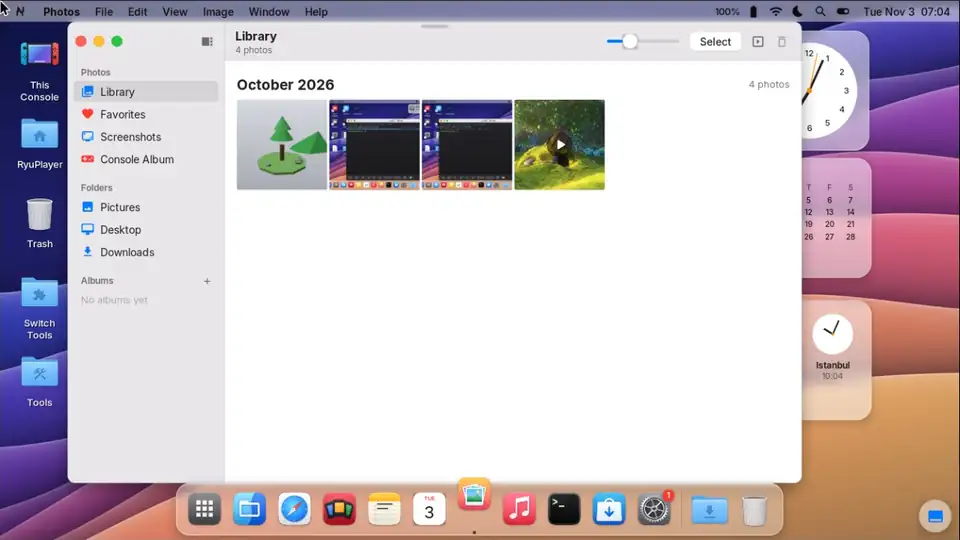</p>

<h1 align="center">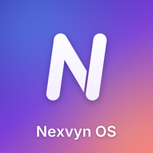 Nexvyn OS</h1>

<p align="center"><b>English</b> · <a href="README.tr.md">Türkçe</a></p>

<p align="center">A desktop shell for Switch homebrew with Atmosphère, with its own apps, an App Market and an
SDK for apps and games. One <code>.nro</code> file, opened from the Homebrew Menu. No reboot, no partitioning.</p>

<p align="center">
<a href="https://github.com/sonerx7/Nexvyn-OS-NX/releases/latest"></a>
<a href="LICENSE"></a>
<a href="SDK/README.md"></a>
<a href="#accessibility-and-languages"></a>
</p>

<p align="center">
<a href="https://github.com/sonerx7/Nexvyn-OS-NX/releases/latest"><b>Download NexvynOS.nro</b></a> ·
<a href="#whats-new-in-130">What's new</a> ·
<a href="#requirements">Requirements</a> ·
<a href="#installation">Installation</a> ·
<a href="#documentation">Documentation</a> ·
<a href="SDK/README.md">SDK</a> ·
<a href="Store/README.md">App Market</a> ·
<a href="CHANGELOG.md">Release notes</a>
</p>

## Overview

Nexvyn OS runs on top of the console's own system with Atmosphère. It gives the console a windowed desktop, more than
70 built-in apps (browser, video, music, office, files, terminal and more), tools for Atmosphère users, a code studio,
a game engine and a 3D modeler, and an App Market where every item is reviewed before it is published.

- **Desktop:** overlapping, resizable windows, snapping, virtual desktops, Window Overview, Launcher, Quick Search,
  Control Center, notifications and widgets, in a Dock layout or a taskbar layout.
- **Apps:** Browser, YousTube, Live TV, Radio, Music, Photos, Video Player, Writer, Spreadsheet, Presenter, Files,
  Terminal, Weather, Maps, Calendar, Notes, AI Chat and more.
- **Make apps and games on the console:** Nexvyn OS Studio for six languages, the Game Engine with Quick Game, and
  the 3D Modeler. A PC is optional.
- **SDK 1.9:** physically based 3D rendering (NexGFX), 3D model files with animation, feeds, media players and
  network functions for social apps, in Lua, JavaScript, Python and C.
- **Switch Tools:** mods, cheats, overlays, clock profiles, system modules, save backups and Turkish patches.
- **Accessibility:** 8 languages, a Screen Reader, touch, controller, USB keyboard and mouse, handheld and TV layouts.

<p align="center">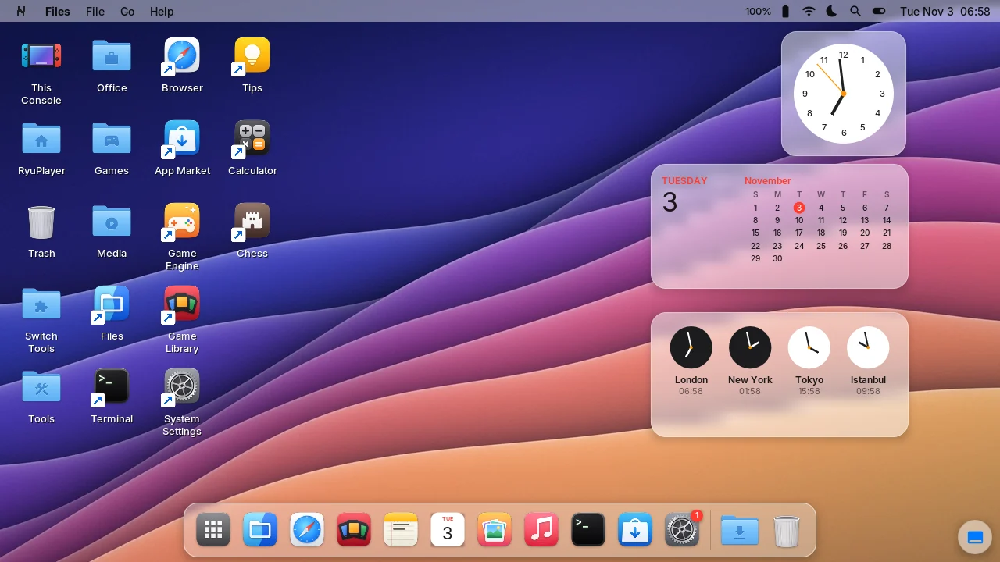</p>

## What's new in 1.2.2

<p align="center">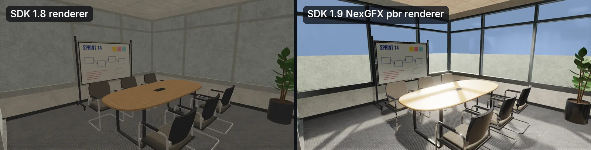</p>

- **NexGFX pbr renderer (SDK 1.9).** A new, versioned graphics core for 3D apps and games: metallic-roughness
  materials with normal, occlusion and emissive maps, real-time point, spot and directional lights, sun and spot
  shadows, HDR with ACES or filmic tone mapping, bloom, MSAA, cube map reflections, thin glass with refraction,
  clearcoat and GPU instancing. Apps opt in with `g3d.renderer("pbr")`; apps that do not ask for it render exactly as
  before.
- **Social and media SDK (SDK 1.9).** `net.request` with JSON, form, multipart and file bodies, upload progress,
  cookies, retries and an offline cache; a WebSocket client; sign-in through the console's browser; web pictures with
  a disk cache; embedded video and audio players; virtualized feeds and grids with pull-to-refresh; a swipe pager; rich
  text with links, mentions and hashtags.
- **Runtime library (SDK 1.9).** `net.request` in Lua; `TextEncoder`, `TextDecoder`, `URL`, `URLSearchParams` and
  `structuredClone` in JavaScript; more string methods, `urllib.parse`, `html` and `uuid` in Python.
- **Deep reset.** **System Settings > Developer > Deep reset** returns the SD card to the state of a fresh install:
  everything Nexvyn OS wrote, inside and outside its folder, is removed after a PIN and a 3-second hold. Games, saves,
  the Album, Atmosphère and other homebrew are not touched. An interrupted reset finishes at the next start.
- **System version 22.5.0 required.** Nexvyn OS is built and tested for system versions 22.5.0 to 23.0.x. It still
  starts on other versions and shows a one-time notice; the full browser is used only inside the tested range.
- **Sound and game-feel kits.** Ready-made Lua and JavaScript kits for layered sound effects and music, and for motion,
  impact, light, titles, panels, transitions and cameras, with guides and demo apps.
- **Store icon tool.** Renders a game's own model and builds its key-art icon in every size; the style is the maker's
  choice, with a clean default.
- **App Market pictures.** Five screenshots per item, taken with the interface in English.

The full list is in the [release notes](CHANGELOG.md).

## SDK 1.9: modern 3D and social apps

| | |
|:---:|:---:|
| 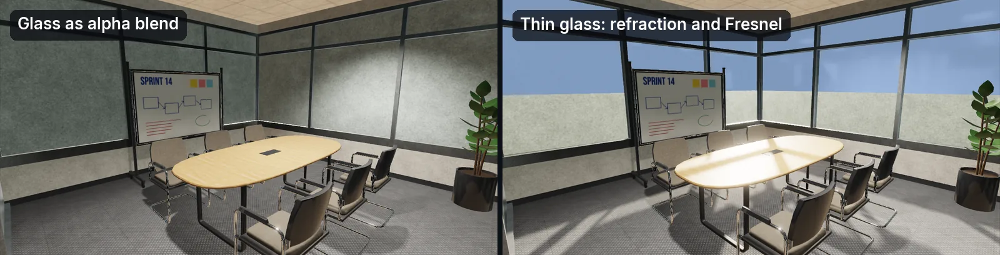 | 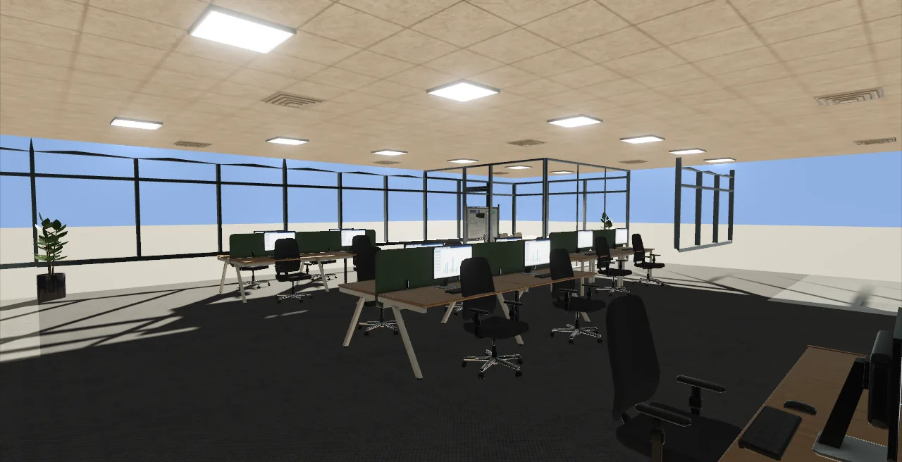 |
| **Glass:** alpha blend compared with thin-glass transmission | **Interiors:** glass partitions, area lights, clearcoat floor |
| 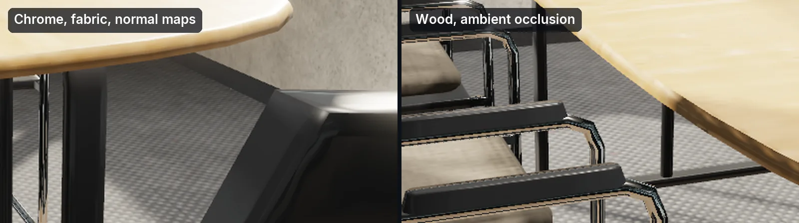 | 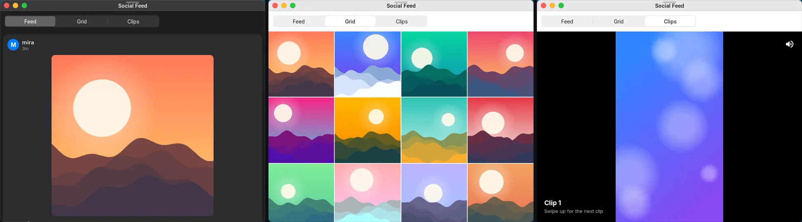 |
| **Materials:** metal, fabric and wood from glTF and FBX maps | **Social Feed sample:** feed, grid and clip pager |

The 3D scenes above are rendered by Nexvyn OS from an interior asset kit exported as `.glb` and `.fbx`; the material
maps come from the files as they are.

```lua
function app.load()
  g3d.renderer("pbr")                                   -- "basic" when the console offers no OpenGL ES 3
  g3d.shadows({quality = "medium", distance = 25})
  g3d.postfx({exposure = 1.0, tonemap = "aces", bloom = 0.06})
  g3d.environment({sky = "#9DB8E8", ground = "#4A4038"})
  g3d.loadModel("bundle:/models/room.glb", function(m) room = m end)   -- PBR maps come from the file
  lamp = g3d.addLight({type = "point", x = 1, y = 2, z = 0, color = "#FF9A3C", intensity = 6, range = 8})
end
```

- **The same API in Lua, JavaScript, Python and C.** Squirrel and Java apps keep working; they are frozen at SDK 1.8.
- **Compatible.** Apps made for SDK 1.0 to 1.8 run unchanged; nothing is removed and new behaviour applies only to
  apps that target the new SDK ([SDK versions](SDK/Guides/SDK_VERSIONS.en.md)).
- **Recipes and samples.** A [PBR game recipe](SDK/Guides/PBR_GAME_RECIPE.en.md) and a
  [social app recipe](SDK/Guides/SOCIAL_APP_RECIPE.en.md), complete in Lua and JavaScript with Python and C versions, the [PBR, Lights and Shadows](SDK/Samples/lua/pbr3d/) and [Social Feed](SDK/Samples/lua/social-feed/)
  samples, and [Ember Field](SDK/Samples/lua/ember-field/), a small 3D game with an animated model.
- **AI-assisted development.** Context packs and task prompts in [SDK/AI](SDK/AI/README.md), and a
  [workflow guide](SDK/Guides/AI_WORKFLOW.en.md) from generated models and textures to console-ready files.

## The desktop

Windows can be dragged, resized from any edge, snapped to half or a quarter of the screen, maximized, made full screen
or kept on top, and they reopen where you left them. Virtual desktops switch with a 3D cube. A crashing app is closed
on its own and does not take the system with it.

<p align="center">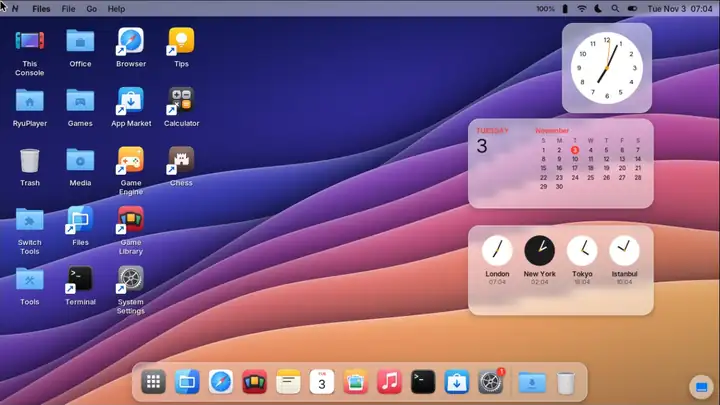</p>

| | |
|:---:|:---:|
| 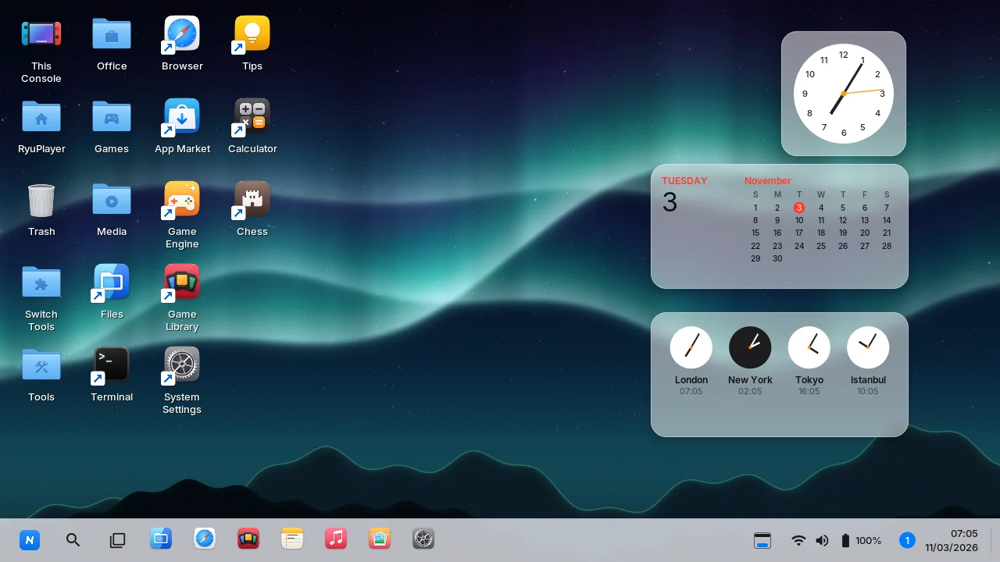 | 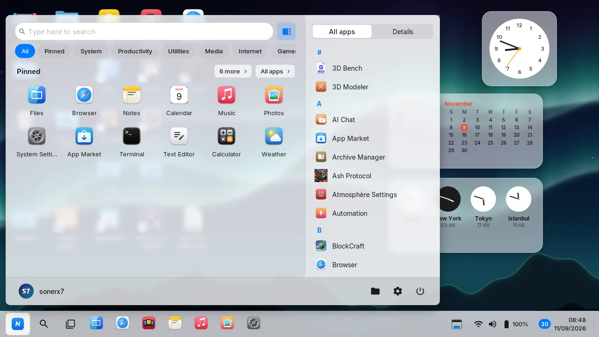 |
| **Taskbar layout:** taskbar, widgets, desktop icons | **Start menu:** pinned apps, all apps, search |
| 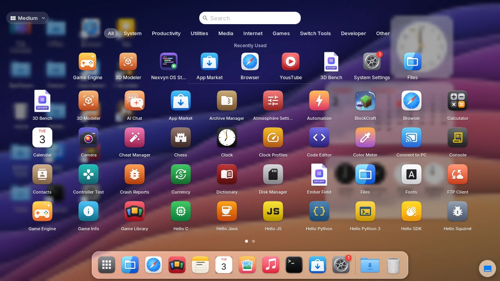 | 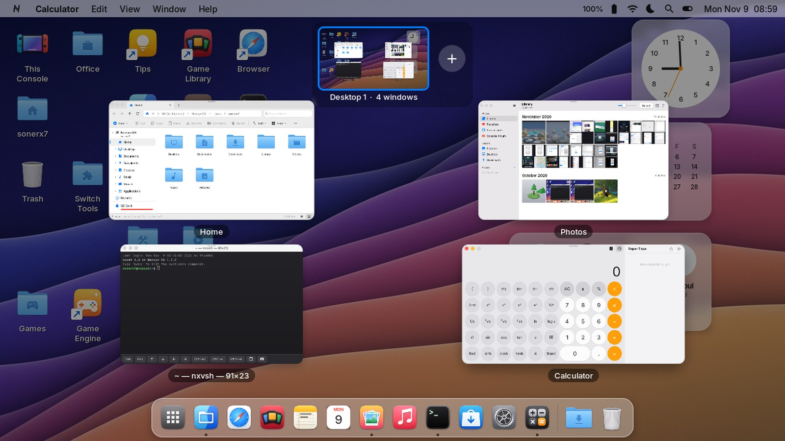 |
| **Launcher:** recently used, then every app by category | **Window Overview:** every window and desktop at a glance |
| 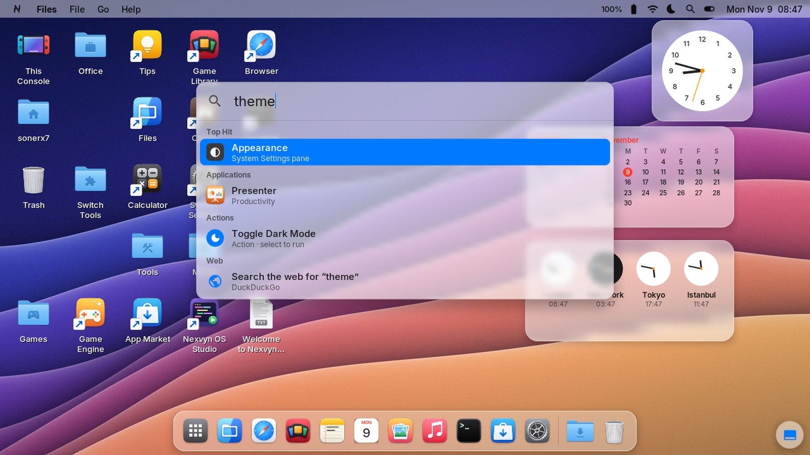 | 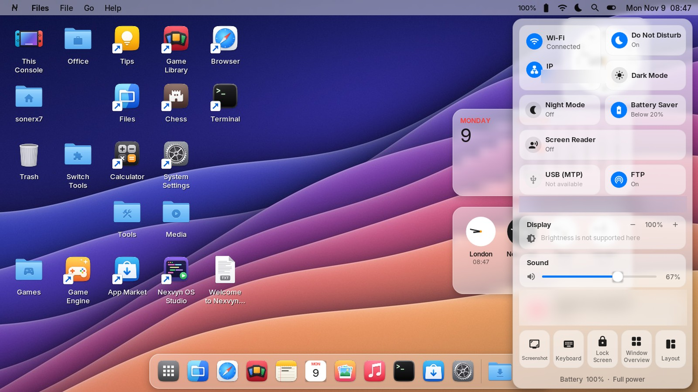 |
| **Quick Search:** apps, files, settings, actions, a calculator and the web | **Control Center:** Wi-Fi, Do Not Disturb, Dark Mode, volume, Now Playing |

- **Dock layout:** a menu bar with the app's menus, battery, Wi-Fi, clock and search, and a Dock with magnification,
  running-app dots, pinning and auto-hide.
- **Taskbar layout:** a centred or left-aligned taskbar, a Start menu, live window thumbnails, and minimize, maximize
  and close buttons on every window.
- **Desktop:** icons, folders, shortcuts, rubber-band selection, keyboard navigation and widgets (clock, calendar,
  weather, battery, system, notes, reminders, world clock, radio).
- **Shortcuts:** Ctrl+Space for Quick Search, F3 for Window Overview, F4 for the Launcher, Alt+Tab to switch apps,
  Ctrl+Left/Right for desktops. With a controller, + opens the apps, ZR opens search, L and R switch windows.
- **Welcome Tour:** after setup, a guided tour on your own desktop; replay it from **Help > Take the Tour**.

## Make apps and games on the console

| | |
|:---:|:---:|
| 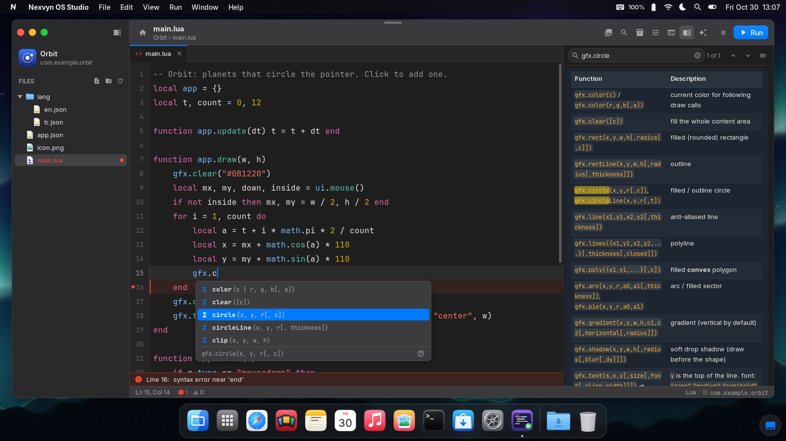 | 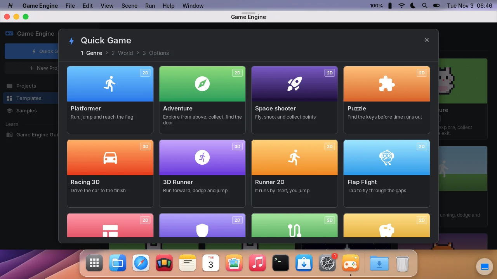 |
| **Nexvyn OS Studio:** autocomplete for the whole SDK, run beside the code | **Quick Game:** pick a genre and a world, then play |
| 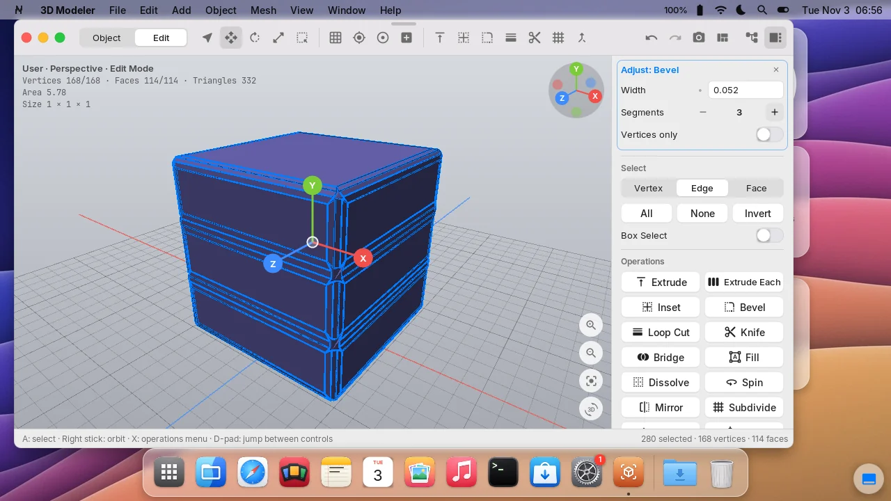 | 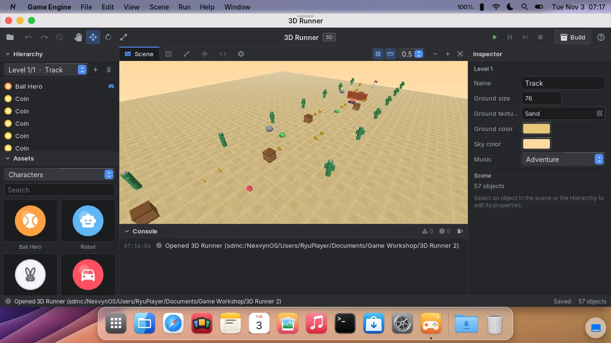 |
| **3D Modeler:** edit tools, modifier stack, UV unwrapping, `.glb` export | **Game Engine:** 2D and 3D games with picture cards or code |

- **Nexvyn OS Studio:** Lua 5.4, JavaScript, Python (light runtime or CPython 3.12), Squirrel, C (compiled on the
  console) and Java 8. Autocomplete, the SDK reference on F1, a live console, clickable errors, 20 templates, online
  samples, an **Ask AI** panel, `.nxvapp` export and a **Publish** wizard.
- **Game Engine:** Quick Game builds a playable game in three steps (17 genres, 7 worlds); Easy mode uses picture
  cards, Advanced mode adds an inspector, layers, event blocks, pixel and tile editors and the generated Lua code.
- **3D Modeler:** primitives, vertex, edge and face editing (bevel, loop cut, knife, bridge, spin, mirror), a modifier
  stack, UV unwrapping, per-face materials, a quad view, OBJ and STL import and export, and `.glb` export.

## Internet, media and productivity

| | |
|:---:|:---:|
| 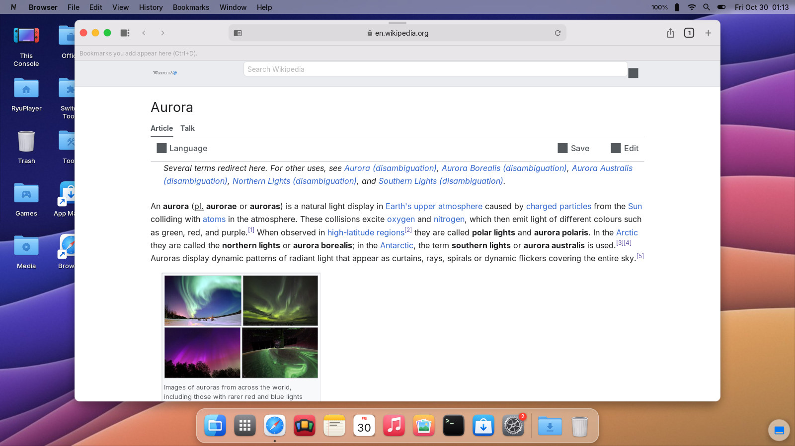 | 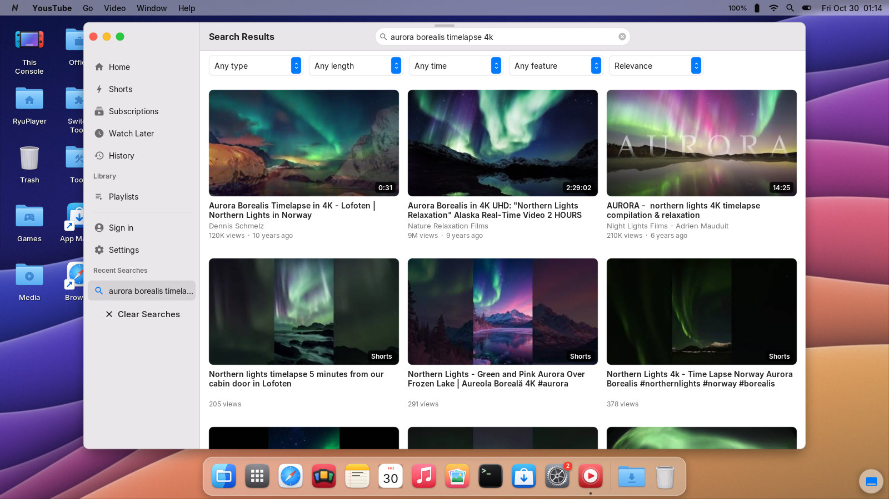 |
| **Browser** with its own HTML, CSS and JavaScript engine | **YousTube:** search and watch videos |
| 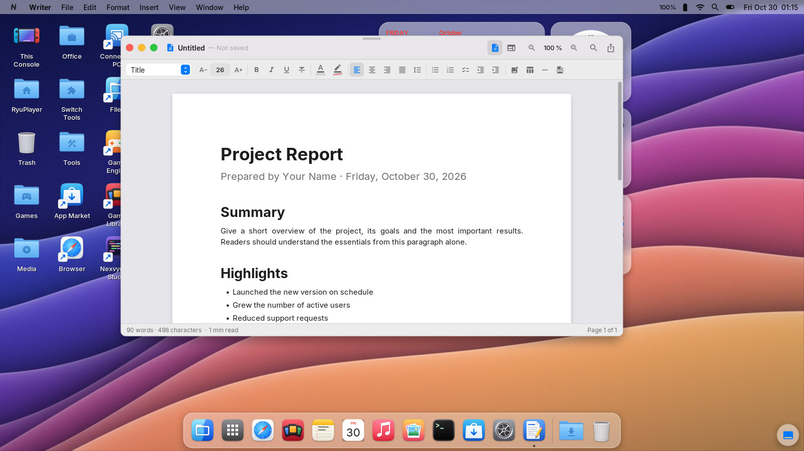 | 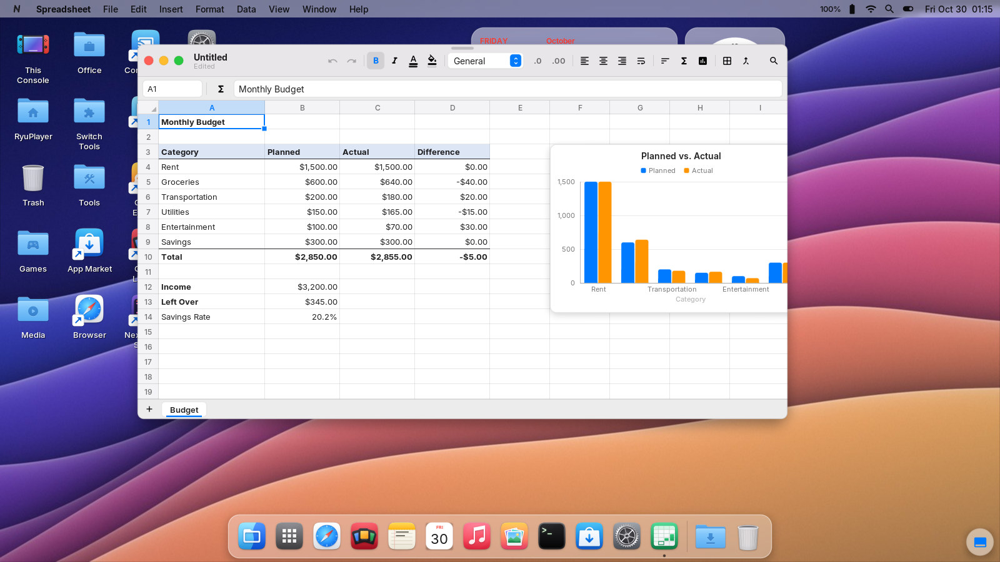 |
| **Writer:** templates, styles and formatting | **Spreadsheet:** formulas, charts and CSV |

- **Browser:** tabs, bookmarks, history, reader mode, downloads and an encrypted password store.
- **Media:** YousTube, Live TV (M3U playlists), Radio, Music, Photos and a Video Player for MP4, MKV, WebM and HTTPS
  and HLS streams.
- **Productivity:** Writer, Spreadsheet, Presenter, Files (USB drives, archives, Trash), Terminal, Code Editor, Notes,
  Calendar, Reminders, Contacts, Calculator, Clock, Automation and AI Chat with your own API key.
- **Connect to PC:** a wireless FTP server and USB file transfer (MTP), plus an FTP client.
- **Game Library:** your installed games with covers, play time and Album captures, launched in title mode.

## App Market

<p align="center">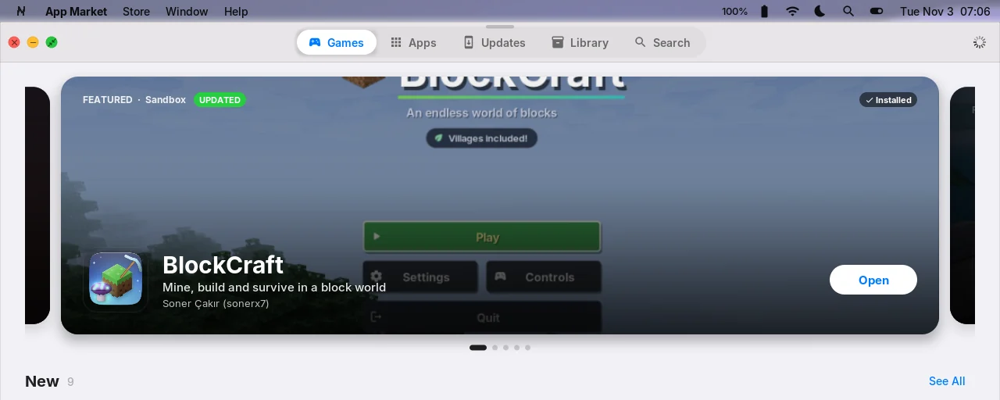</p>

Apps, games, themes and font packs. Every page lists the permissions before you install. Packages are checked with
SHA-256 and signed, and updates come in one tap. **Every item is reviewed by the maintainer before it is published.**
Browse everything in [Store/](Store/README.md); to publish your own, read [Contributing](CONTRIBUTING.md).

## Switch Tools

A folder of tools for Atmosphère users: **Mod Manager** and **Mod Finder**, **Cheat Manager**, **Overlays**, **Clock
Profiles**, **System Modules**, **Save Backup**, **Game Info**, **Patch Manager**, **Crash Reports**, **Atmosphère
Settings** and **Homebrew**. **Turkish Patches** installs translation patches and keeps the original files so you can
switch back. Changes made by mods take effect the next time the game starts.

## Accessibility and languages

| | |
|:---:|:---:|
| 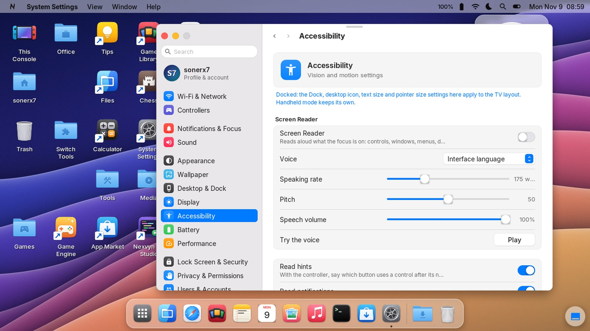 | 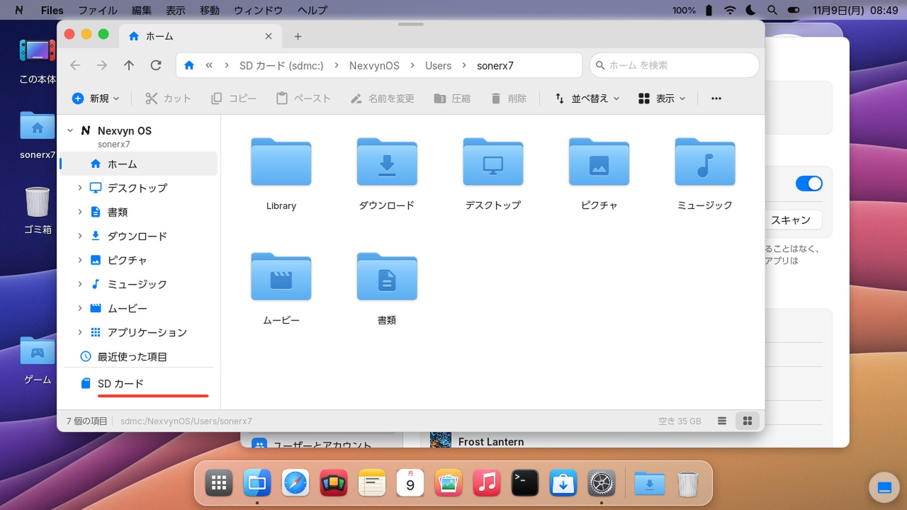 |
| **Screen Reader** and accessibility settings | The whole system in **Japanese** |

- **8 languages:** English, Türkçe, Deutsch, Français, Español, 日本語, 中文 and 한국어, with Hangul and romaji input.
- A **Screen Reader** with its own voice, rate, pitch and hints; zoom, inverted colours, text and pointer size, reduced
  motion and transparency, large window buttons.
- An on-screen keyboard (docked, floating or split) with word suggestions, or the console's own keyboard.
- **Input:** touch (tap, hold, two-finger scroll, pinch, edge swipes), controller (the left stick moves the pointer,
  hold L+R to take the controller back from a game), USB keyboard and mouse. Handheld and TV (1080p) layouts.

## Privacy and security

- Apps ask **once** for what they need (network, files and so on); review it in **System Settings > Privacy &
  Permissions**. Native C, Java and module code asks before it runs for the first time.
- **App Guard** scans every package before it is installed and shows *No issues found*, *Review* or *Dangerous* with
  the reasons. Store apps cannot read the system's settings, other apps' data or the Browser's passwords.
  [More](SDK/Guides/APP_GUARD.en.md)
- Passwords in the Browser and API keys in AI Chat are stored encrypted on the console.
- Anonymous usage statistics are announced at the first start, never include your files, passwords or keys, and can
  be turned off in **System Settings > About > Privacy**.
- To report a vulnerability, follow the [security policy](SECURITY.md); please do not open a public issue for it.

---

## Requirements

- A console that boots with **Atmosphère**. Recommended: Atmosphère **1.12.1** or newer.
- **System version 22.5.0 or later (required).** Tested up to **23.0.x**. On other versions Nexvyn OS still starts and
  nothing is blocked, but problems may occur; it shows a one-time notice. The full browser is used only on the tested
  versions (Browser settings can allow it anyway).
- About **70 MB** free on the SD card for the `.nro` file, plus space for your own files and apps.
- No SD card partition and no extra setup.
- **Recommended launch: title mode.** Hold **R** while starting a game, then open Nexvyn OS from the Homebrew Menu.
  This gives the full memory (about 3.2 GB). Started from the Album (applet mode) it gets a few hundred MB: large apps,
  the full browser and launching games are limited, and Nexvyn OS tells you so.

<p align="center">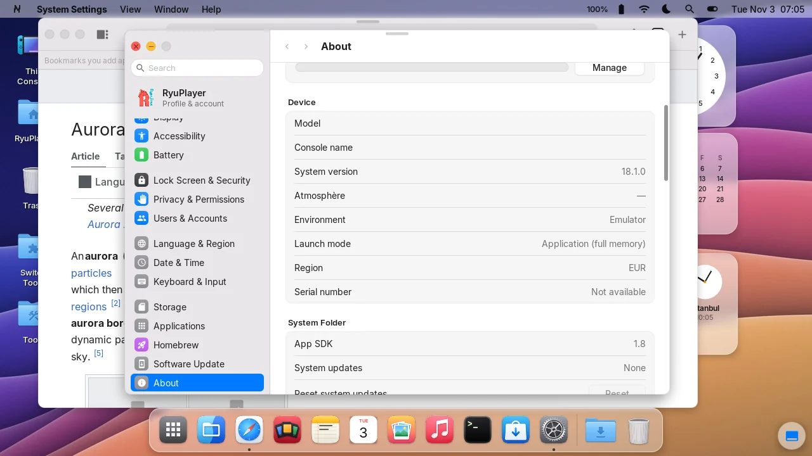 About: system version, Atmosphère, environment, launch mode and the App SDK version"></p>

**System Settings > About** shows your system version, the required system version, the Atmosphère version, the
launch mode and the App SDK version.

## Installation

1. Download `NexvynOS.nro` from the [latest release](https://github.com/sonerx7/Nexvyn-OS-NX/releases/latest).
2. Copy it to `sdmc:/switch/NexvynOS.nro` (the `switch` folder at the root of the SD card, where the Homebrew Menu
   looks). Do not put it in the root of the SD card.
3. Start it from the Homebrew Menu, in title mode (see above). To give it its own icon on the HOME menu, see
   [the forwarder guide](SDK/Guides/FORWARDER.en.md).
4. The setup assistant asks for your language, keyboard, layout and look. On the first start Nexvyn OS creates
   `sdmc:/NexvynOS/`; your settings, users, files and apps live there.

**Updates:** **System Settings > Software Update** downloads the new release from this repository, keeps a backup of
the old one and installs it. Your apps, files and settings stay.

**Removing it:** **System Settings > Developer > Deep reset** removes everything Nexvyn OS wrote on the SD card. Then
delete `sdmc:/switch/NexvynOS.nro`. Games, saves and Atmosphère are never touched.

The [user guide](SDK/Guides/USER_GUIDE.en.md) explains everything in detail.

## Online and offline

Nexvyn OS works without a network. These parts need an internet connection: the Browser and the full browser, the App
Market and system updates, AI Chat, Weather, News, Currency, Maps, Dictionary, Radio, Live TV and video streams, Mod
Finder and Turkish patch downloads, and the optional anonymous statistics. PC Connect and the FTP server and client use
only your local network. Everything else (files, notes, calendar, music and video players, games, the Game Engine, the
3D Modeler, Studio) works offline.

## Known issues

- **Full browser on untested system versions.** On some consoles with system versions it was not tested on, opening the
  full browser stopped the console with an Atmosphère fatal error. Nexvyn OS keeps the full browser off outside the
  tested 22.5.0 - 23.0.x and opens the page in its built-in browser instead. If you allow it and the console stops,
  please [report it](https://github.com/sonerx7/Nexvyn-OS-NX/issues/new?template=bug-report.yml) with your system and
  Atmosphère versions and the report in `sdmc:/atmosphere/fatal_errors/`.
- **Short freezes or a slow desktop after games.** Please attach `sdmc:/NexvynOS/System/Logs/system.log` (and
  `system.prev.log` if you restarted since) to a bug report. Lines starting with `stall` name the part that took the
  time. A slow or failing SD card is a common cause.
- **Large 3D scenes.** Very large `.glb` / `.fbx` files take seconds to load and use a lot of memory, and the pbr
  renderer costs GPU time. Use `g3d.loadModel`, keep textures at 1024 px or less and measure on the console
  ([SDK reference](SDK/Reference/SDK.en.md), section 8b).

## Documentation

| For | Start with |
|---|---|
| Users | [User guide](SDK/Guides/USER_GUIDE.en.md) · [Forwarder](SDK/Guides/FORWARDER.en.md) · [Browser](SDK/Guides/BROWSER.en.md) · [Release notes](CHANGELOG.md) |
| App and game makers | [SDK start page](SDK/README.md) · [SDK reference](SDK/Reference/SDK.en.md) · [PBR game recipe](SDK/Guides/PBR_GAME_RECIPE.en.md) · [Social app recipe](SDK/Guides/SOCIAL_APP_RECIPE.en.md) · [Make a game](SDK/Guides/MAKE_A_GAME.en.md) · [Make a social app](SDK/Guides/MAKE_A_SOCIAL_APP.en.md) · [SDK versions](SDK/Guides/SDK_VERSIONS.en.md) · [All guides](SDK/Guides/README.md) |
| Developers using AI tools | [SDK/AI](SDK/AI/README.md) · [AI-assisted workflow](SDK/Guides/AI_WORKFLOW.en.md) |
| Publishing | [Contributing](CONTRIBUTING.md) · [Publishing guide](SDK/Publishing/PUBLISHING.en.md) · [Review checklist](SDK/Publishing/REVIEW.en.md) |
| Security | [Security policy](SECURITY.md) · [App Guard](SDK/Guides/APP_GUARD.en.md) · [Compatibility](SDK/Guides/COMPATIBILITY.en.md) |

## Repository layout

```
Store/            what the App Market installs
├── Apps/<category>/<slug>/      apps (and the store pages of the apps that ship with Nexvyn OS)
├── Games/<genre>/<slug>/        games
├── Themes/<slug>/               themes (.nxvtheme)
├── Fonts/<slug>/                font packs (.nxvfont)
└── catalog.json, packages.json  what the console reads; README.md lists everything
SDK/              everything for developers, in English and Turkish
├── Reference/                   the SDK reference, the Java SDK, the C header
├── Languages/<language>/        a quick start, a template and the game kits
├── Guides/                      guides and recipes
├── Samples/<language>/<slug>/   working samples (samples.json: Studio's Samples)
├── AI/                          context packs and task prompts for AI assistants
├── Publishing/                  how to publish, the review checklist
├── Fonts/                       the system fonts
└── Tools/                       nxv command line, icon tool, texture tool
Tools/            repository maintenance: build_store.py, CI
.github/          issue forms, pull request template, CODEOWNERS and the README images
```

This repository holds the App Market, the SDK and the releases. The source code of Nexvyn OS itself is not part of it.

## FAQ

**Does it replace the console's system?**
No. Nexvyn OS is a homebrew app that runs on top of the console's system with Atmosphère. Close it and you are back
in the Homebrew Menu.

**Which system version do I need?**
22.5.0 or later; it is tested up to 23.0.x. **System Settings > About** shows yours.

**Why title mode?**
Started from the Album (applet mode), homebrew gets only a small part of the memory. Some features (large apps, the
full browser, launching games) need the full memory of title mode.

**Can I make a game without writing code?**
Yes. Open the Game Engine, press **Quick Game**, pick a genre and a world and press **Play now**.

**Can I use my own 3D models?**
Yes. Export `.glb` or `.fbx` from your 3D tool, from an AI model generator after clean-up, or from the built-in 3D
Modeler, and load it with `g3d.loadModel`. With the pbr renderer the model's PBR maps are used as they are. See the
[AI-assisted workflow](SDK/Guides/AI_WORKFLOW.en.md) and [Make a game](SDK/Guides/MAKE_A_GAME.en.md).

**Can I write apps with an AI assistant?**
Yes. Give it the context pack and a task prompt from [SDK/AI](SDK/AI/README.md); Studio's **Ask AI** panel uses the
provider and key you set up in AI Chat.

**Where are my files?**
In `sdmc:/NexvynOS/Users/<your name>/` (Desktop, Documents, Downloads, Pictures, Music, Movies).

**Can I watch subscription video services in the browser?**
No. Services that protect their videos with DRM do not play in the built-in browser or the full browser.

**Is it safe to use mods and cheats?**
The Switch Tools only write to the SD card. Playing online with modified games or cheats can get an account banned,
so use them offline.

**Were the screenshots taken on a console?**
The screenshots and videos were captured in an emulator with the interface in English. Features that need real
hardware, such as USB drives, MTP and the camera, work only on a console.

## Contributing

App, game, theme and font submissions come as pull requests and are reviewed before they are published; bug reports
and translations come as issues. See [Contributing](CONTRIBUTING.md).

## License and credits

Nexvyn OS is **GPL-3.0-or-later** ([LICENSE](LICENSE)); third-party components and their licenses are listed in
[THIRD_PARTY_NOTICES.md](THIRD_PARTY_NOTICES.md). Items in the store come under the same license unless they state
otherwise (font packs carry their own license, mostly the SIL Open Font License). YamaNX is based on YamaNX by SertAy.
Content shown in the Browser, YousTube, Live TV and Radio belongs to its owners.

Developed by **Soner Çakır** · [github.com/sonerx7](https://github.com/sonerx7). Designed and directed by its author and
built with the help of AI coding tools.
