<p align="center">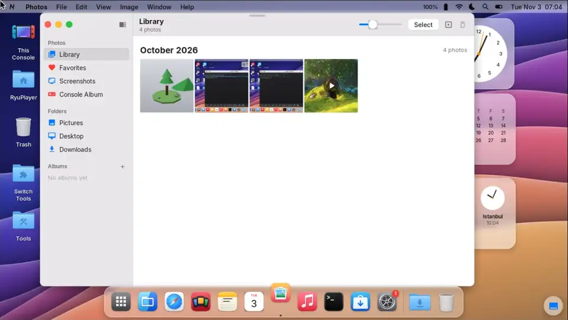</p>

<h1 align="center">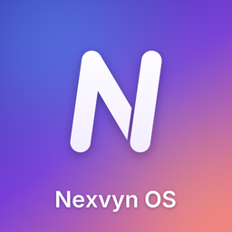 Nexvyn OS</h1>

<p align="center"><a href="README.md">English</a> · <b>Türkçe</b></p>

<p align="center">Atmosphère kurulu Switch homebrew ortamı için kendi uygulamaları, bir Uygulama Mağazası ve uygulama ile oyunlar
için bir SDK'sı olan bir masaüstü kabuğu. Homebrew Menüsü'nden açılan tek bir <code>.nro</code> dosyası. Yeniden
başlatma yok, bölümlendirme yok.</p>

<p align="center">
<a href="https://github.com/sonerx7/Nexvyn-OS-NX/releases/latest"></a>
<a href="LICENSE"></a>
<a href="SDK/README.tr.md"></a>
<a href="#erişilebilirlik-ve-diller"></a>
</p>

<p align="center">
<a href="https://github.com/sonerx7/Nexvyn-OS-NX/releases/latest"><b>NexvynOS.nro'yu indir</b></a> ·
<a href="#122-sürümündeki-yenilikler">Yenilikler</a> ·
<a href="#gereksinimler">Gereksinimler</a> ·
<a href="#kurulum">Kurulum</a> ·
<a href="#belgeler">Belgeler</a> ·
<a href="SDK/README.tr.md">SDK</a> ·
<a href="Store/README.tr.md">Uygulama Mağazası</a> ·
<a href="CHANGELOG.md">Sürüm notları</a>
</p>

## Genel bakış

Nexvyn OS, konsolun kendi sisteminin üstünde Atmosphère ile çalışır. Konsola pencereli bir masaüstü, 70'ten fazla
yerleşik uygulama (tarayıcı, video, müzik, ofis, dosyalar, terminal ve daha fazlası), Atmosphère kullanıcıları için
araçlar, bir kod stüdyosu, bir oyun motoru, bir 3B modelleme aracı ve her öğesi yayından önce incelenen bir Uygulama
Mağazası getirir.

- **Masaüstü:** üst üste binen, boyutlandırılabilen pencereler, yaslama, sanal masaüstleri, Pencere Görünümü,
  Başlatıcı, Hızlı Arama, Denetim Merkezi, bildirimler ve araç takımları; Dock düzeni ya da görev çubuğu düzeni.
- **Uygulamalar:** Tarayıcı, YousTube, Canlı TV, Radyo, Müzik, Fotoğraflar, Video Oynatıcı, Kelime İşlemci, Hesap Tablosu,
  Sunu, Dosyalar, Terminal, Hava Durumu, Haritalar, Takvim, Notlar, AI Sohbet ve daha fazlası.
- **Konsolda uygulama ve oyun yapın:** altı dil için Nexvyn OS Studio, Hızlı Oyun'lu Oyun Motoru ve 3D Modelleme.
  PC gerekmez.
- **SDK 1.9:** fiziksel tabanlı 3B görüntü (NexGFX), animasyonlu 3B model dosyaları, sosyal uygulamalar için akış,
  medya oynatıcı ve ağ fonksiyonları; Lua, JavaScript, Python ve C'de.
- **SDK 1.10 - 1.12:** Nexvyn OS içinde pencerede ya da tam ekranda çalışan native C / C++ uygulamalar (şablonlu
  Native SDK 1.1 kiti ve `nxv-native` komut satırı); kalıcı klasörler ve kayıt yedekleri (`ui.chooseFolder`,
  `fs.saveBackup`): Lua, JavaScript, Python ve C'de.
- **Switch Araçları:** modlar, hileler, overlay'ler, saat profilleri, sistem modülleri, kayıt yedekleri ve Türkçe
  yamalar.
- **Erişilebilirlik:** 8 dil, Ekran Okuyucu, dokunmatik, kumanda, USB klavye ve fare, el modu ve TV düzenleri.

<p align="center"></p>

## 1.2.2 sürümündeki yenilikler

<p align="center">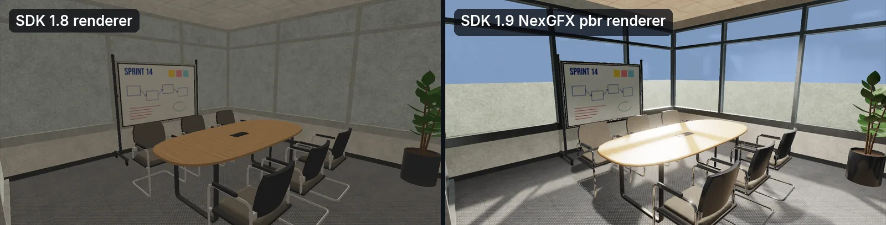</p>

- **Native uygulamalar hızlı çalışır.** Konsolda ölçüldü: 3B sahne demosu 10'dan 59 fps'e, OpenGL showcase 10-16'dan
  60 fps'e çıktı, bir GBA emülatörü tam hızda çalışıyor, bir karenin uygulamadan sisteme devri 15-24 ms'den 0.1 ms'ye,
  bir sahnenin yüklenmesi yaklaşık 30 sn'den 0.6 sn'ye indi. Daha önce derlenmiş uygulamalar yeniden derlemeden
  hızlanır.
- **Ayarlar > Performans.** Konsolun resmi en yüksek saatleri varsayılan olarak kullanılır, yükleme sırasında kısa bir
  CPU hızlandırma verilir; isteyenler için isteğe bağlı hız aşırtma da var (varsayılan kapalı, uyarı ve açık onay
  ister). Canlı panel çekirdek başına CPU'yu, GPU'yu, saatleri ve sıcaklığı gösterir.
- **Portlar.** Doom (ücretsiz Freedoom verisiyle), bir GBA emülatörü ve bir Quake motoru kendi Nexvyn pencerelerinde ya
  da tam ekranda, App Market'ten ayrı uygulamalar olarak çalışır. Oyun verisi, BIOS ve firmware pakete asla
  konmaz. Yeni **Nexvyn Bench** uygulaması ekranı zorlar ve kare süresini gösterir.
- **Port kiti ve Native SDK 1.1 kiti.** Uygulama yapımcıları `port` şablonunu ve kit başvurusunu alır; başvuruda artık
  kare ritmi, ses ve ayarlar notları var (`SDK/Guides/NATIVE_KIT.tr.md`).
- **Arka planda kurulum, ses ve girdi.** Paket kurulumu yavaş SD kartları artık dondurmuyor, native oyunların ses
  efektlerindeki cızırtı giderildi, native pencerelerde Joy-Con ve dokunmatik girdi düzeltildi.
- **NexGFX pbr renderer (SDK 1.9).** 3B uygulama ve oyunlar için yeni, sürümlü bir grafik çekirdeği: normal,
  occlusion ve emissive haritalı metallic-roughness materyaller, gerçek zamanlı nokta, spot ve yönlü ışıklar, güneş ve
  spot gölgeleri, ACES ya da filmic ton eşlemeli HDR, bloom, MSAA, cube map yansımaları, kırılmalı ince cam, clearcoat
  ve GPU instancing. Uygulamalar `g3d.renderer("pbr")` ile açar; açmayan uygulamalar eskisiyle birebir aynı çizilir.
- **Sosyal ve medya SDK'sı (SDK 1.9).** JSON, form, multipart ve dosya gövdeli, yükleme ilerlemeli, çerezli, yeniden
  denemeli ve çevrimdışı önbellekli `net.request`; WebSocket istemcisi; konsolun tarayıcısıyla oturum açma; disk
  önbellekli web resimleri; gömülü video ve ses oynatıcılar; çek-yenileli sanal akış ve ızgaralar; kaydırmalı
  sayfalayıcı; bağlantı, bahsetme ve etiketli zengin metin.
- **Runtime kütüphanesi (SDK 1.9).** Lua'da `net.request`; JavaScript'te `TextEncoder`, `TextDecoder`, `URL`,
  `URLSearchParams` ve `structuredClone`; Python'da daha fazla metin metodu, `urllib.parse`, `html` ve `uuid`.
- **Köklü sıfırlama.** **Sistem Ayarları > Geliştirici > Köklü sıfırla**, SD kartı ilk kurulumdaki hâline döndürür:
  Nexvyn OS'un klasörünün içinde ve dışında yazdığı her şey PIN ve 3 saniye basılı tutmadan sonra silinir. Oyunlara,
  kayıtlara, Albüm'e, Atmosphère'e ve diğer homebrew'lara dokunulmaz. Yarıda kalan sıfırlama sonraki açılışta biter.
- **Gerekli sistem sürümü 22.5.0.** Nexvyn OS 22.5.0 ile 23.0.x arası sistem sürümleri için yapılıp test edilir.
  Başka sürümlerde de açılır ve bir kez bildirim gösterir; tam tarayıcı yalnızca test edilen aralıkta kullanılır.
- **Ses ve oyun hissi kitleri.** Katmanlı ses efektleri ve müzik ile hareket, darbe, ışık, başlık, panel, geçiş ve
  kameralar için hazır Lua ve JavaScript kitleri; rehberleri ve demo uygulamalarıyla.
- **Mağaza ikonu aracı.** Oyunun kendi modelini çizip her boyutta key-art ikonunu üretir; stil yapımcının seçimidir,
  varsayılanı clean'dir.
- **Uygulama Mağazası görselleri.** Her öğe için İngilizce arayüzle çekilmiş beş ekran görüntüsü.

### Native uygulamalar ve portlar

| | |
|:---:|:---:|
| 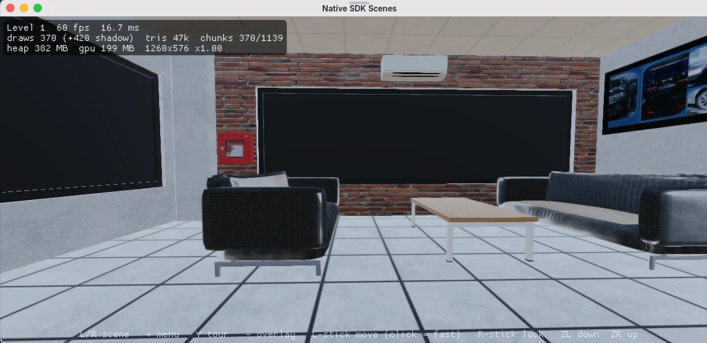 | 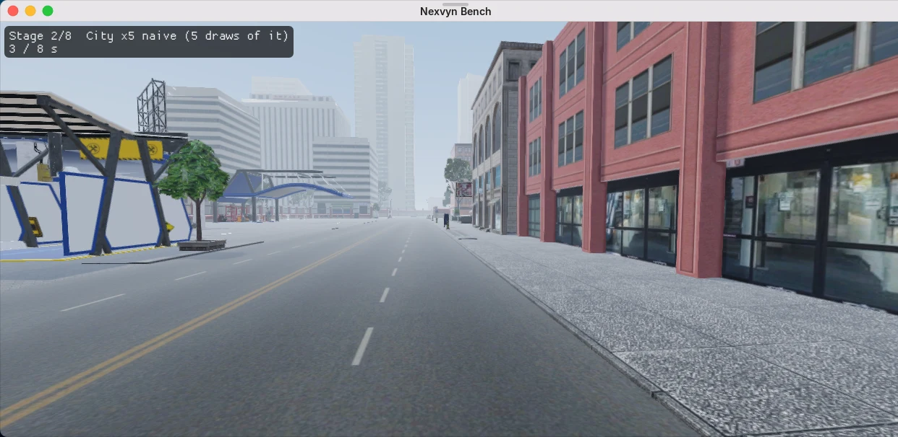 |
| 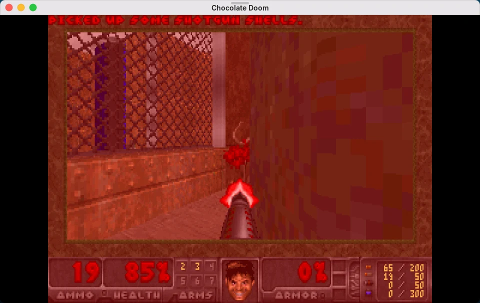 |  |

Tam liste [sürüm notlarında](CHANGELOG.md).

## SDK 1.9: modern 3B ve sosyal uygulamalar

| | |
|:---:|:---:|
| 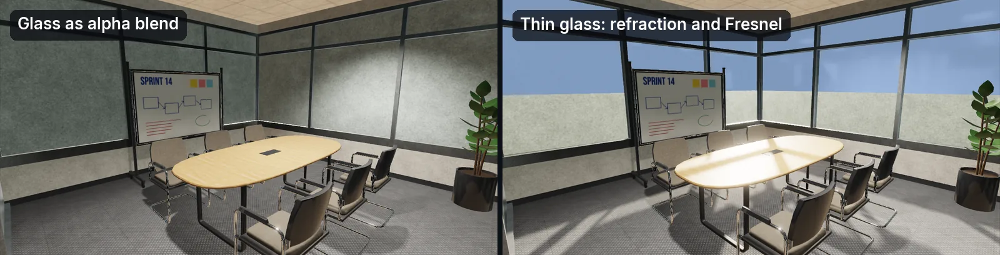 | 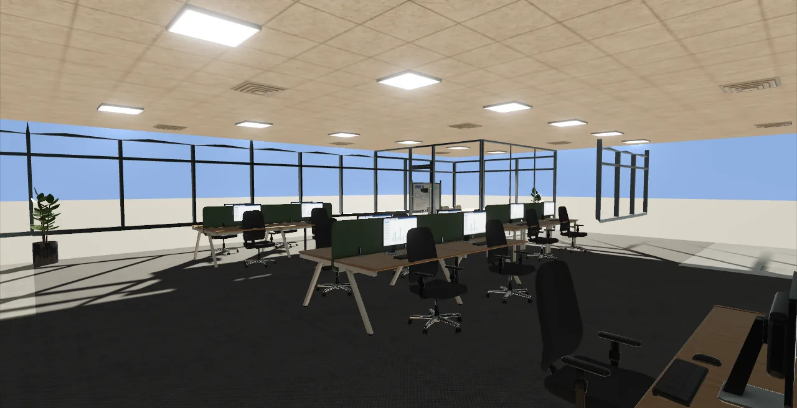 |
| **Cam:** alfa karışımı ile ince cam geçirgenliği | **İç mekânlar:** cam bölmeler, alan ışıkları, clearcoat zemin |
|  | 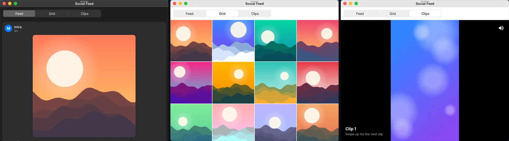 |
| **Materyaller:** glTF ve FBX haritalarından metal, kumaş ve ahşap | **Sosyal Akış örneği:** akış, ızgara ve klip sayfalayıcı |

Yukarıdaki 3B sahneleri Nexvyn OS, `.glb` ve `.fbx` olarak dışa aktarılmış bir iç mekân varlık kitinden çizer;
materyal haritaları dosyalardan olduğu gibi gelir.

```lua
function app.load()
  g3d.renderer("pbr")                                   -- "basic" when the console offers no OpenGL ES 3
  g3d.shadows({quality = "medium", distance = 25})
  g3d.postfx({exposure = 1.0, tonemap = "aces", bloom = 0.06})
  g3d.environment({sky = "#9DB8E8", ground = "#4A4038"})
  g3d.loadModel("bundle:/models/room.glb", function(m) room = m end)   -- PBR maps come from the file
  lamp = g3d.addLight({type = "point", x = 1, y = 2, z = 0, color = "#FF9A3C", intensity = 6, range = 8})
end
```

- **Lua, JavaScript, Python ve C'de aynı API.** Squirrel ve Java uygulamaları çalışmaya devam eder; SDK 1.8'de
  donduruldular.
- **Uyumlu.** SDK 1.0-1.8 için yapılmış uygulamalar değişmeden çalışır; hiçbir şey kaldırılmaz, yeni davranış
  yalnızca yeni SDK'yı hedefleyen uygulamalara uygulanır ([SDK sürümleri](SDK/Guides/SDK_VERSIONS.tr.md)).
- **Tarifler ve örnekler.** Lua ve JavaScript'te eksiksiz, Python ve C sürümleri de olan bir
  [PBR oyun tarifi](SDK/Guides/PBR_GAME_RECIPE.tr.md) ve bir [sosyal uygulama tarifi](SDK/Guides/SOCIAL_APP_RECIPE.tr.md), [PBR, Işıklar ve Gölgeler](SDK/Samples/lua/pbr3d/) ve
  [Sosyal Akış](SDK/Samples/lua/social-feed/) örnekleri ve animasyonlu modelli küçük bir 3B oyun olan
  [Ember Field](SDK/Samples/lua/ember-field/).
- **AI destekli geliştirme.** [SDK/AI](SDK/AI/README.tr.md) içinde context pack'ler ve görev prompt'ları, üretilmiş
  model ve dokulardan konsola hazır dosyalara giden bir [çalışma rehberi](SDK/Guides/AI_WORKFLOW.tr.md).

## Masaüstü

Pencereler sürüklenir, her kenarından boyutlandırılır, ekranın yarısına ya da çeyreğine yaslanır, büyütülür, tam ekran
yapılır ya da üstte tutulur ve bıraktığınız yerde yeniden açılır. Sanal masaüstleri 3B bir küple geçer. Çöken bir
uygulama kendiliğinden kapanır ve sistemi düşürmez.

<p align="center">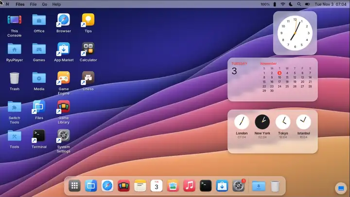</p>

| | |
|:---:|:---:|
|  | 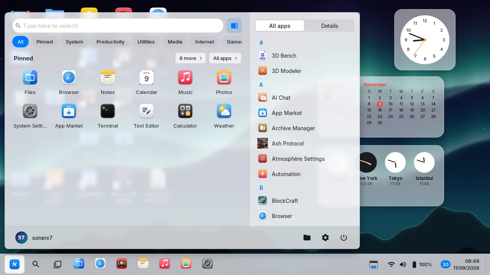 |
| **Görev çubuğu düzeni:** görev çubuğu, araç takımları, masaüstü simgeleri | **Başlat menüsü:** sabitlenmiş uygulamalar, tüm uygulamalar, arama |
| 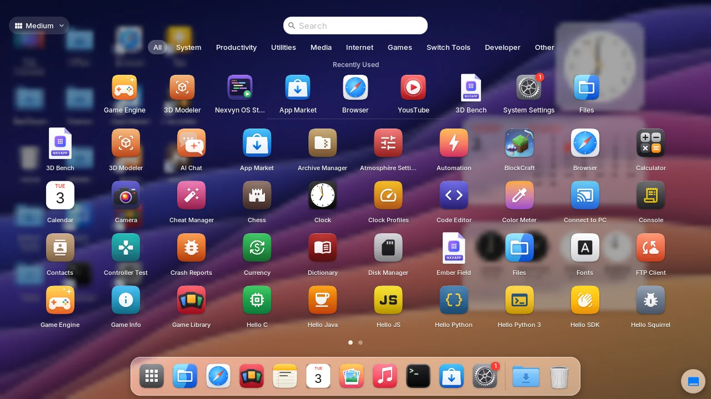 | 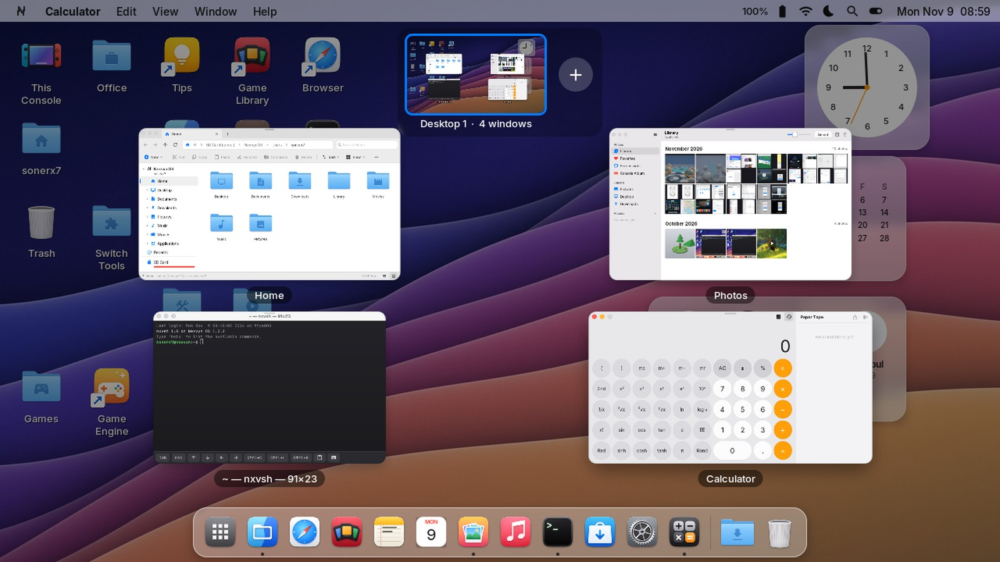 |
| **Başlatıcı:** son kullanılanlar, sonra kategoriye göre her uygulama | **Pencere Görünümü:** her pencere ve masaüstü bir bakışta |
| 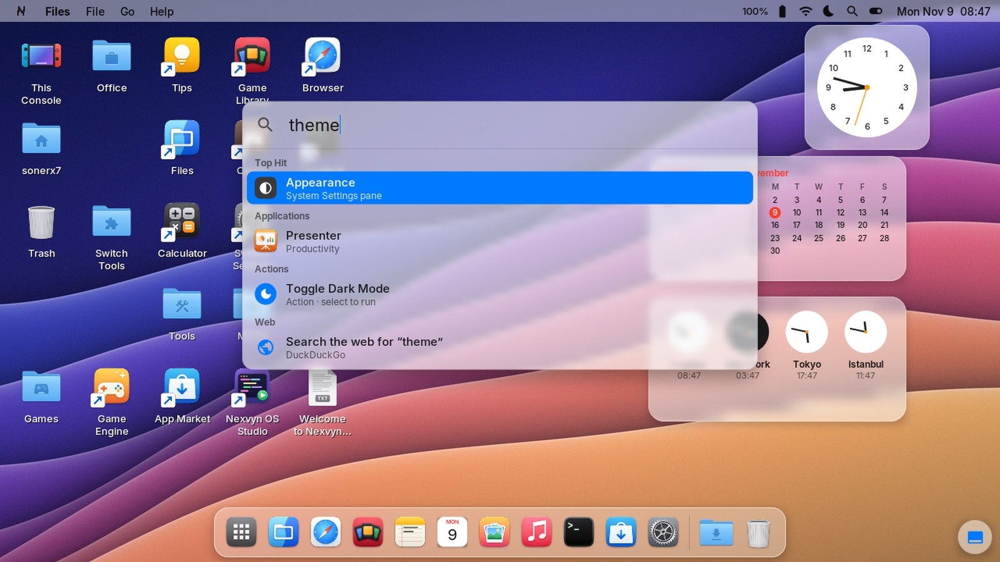 | 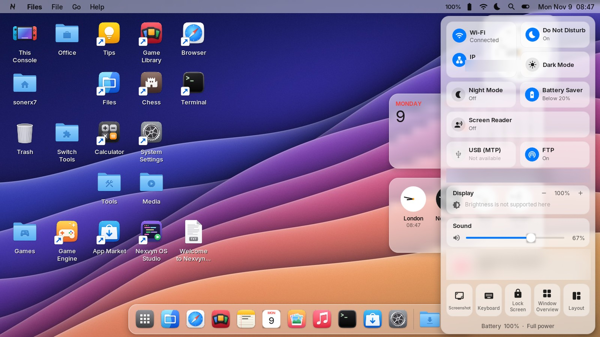 |
| **Hızlı Arama:** uygulamalar, dosyalar, ayarlar, eylemler, hesap makinesi ve web | **Denetim Merkezi:** Wi-Fi, Rahatsız Etmeyin, Karanlık Mod, ses, Şimdi Çalıyor |

- **Dock düzeni:** uygulamanın menüleri, pil, Wi-Fi, saat ve aramalı bir menü çubuğu; büyütmeli, çalışan uygulama
  noktalı, sabitlemeli ve otomatik gizlenen bir Dock.
- **Görev çubuğu düzeni:** ortalı ya da sola yaslı görev çubuğu, Başlat menüsü, canlı pencere önizlemeleri ve her
  pencerede küçült, büyüt ve kapat düğmeleri.
- **Masaüstü:** simgeler, klasörler, kısayollar, sürükleyerek seçme, klavyeyle gezinme ve araç takımları (saat, takvim,
  hava durumu, pil, sistem, notlar, anımsatıcılar, dünya saati, radyo).
- **Kısayollar:** Hızlı Arama için Ctrl+Space, Pencere Görünümü için F3, Başlatıcı için F4, uygulama değiştirmek
  için Alt+Tab, masaüstleri için Ctrl+Sol/Sağ. Kumandada + uygulamaları, ZR aramayı açar, L ve R pencere değiştirir.
- **Tanıtım Turu:** kurulumdan sonra kendi masaüstünüzde rehberli bir tur; **Yardım > Tanıtım Turu** ile yeniden
  izleyin.

## Konsolda uygulama ve oyun yapın

| | |
|:---:|:---:|
| 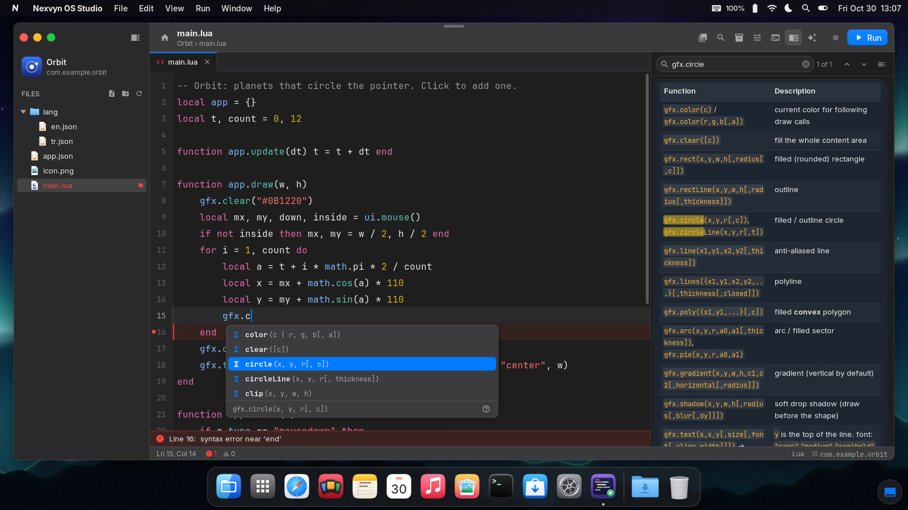 | 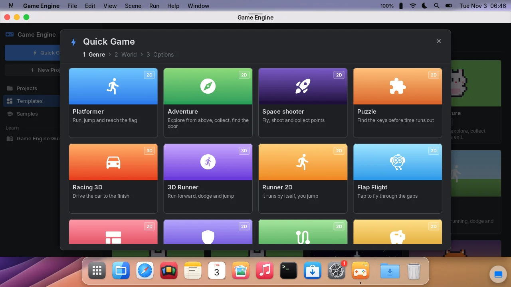 |
| **Nexvyn OS Studio:** bütün SDK için otomatik tamamlama, kodun yanında çalıştırma | **Hızlı Oyun:** bir tür ve bir dünya seçin, oynayın |
| 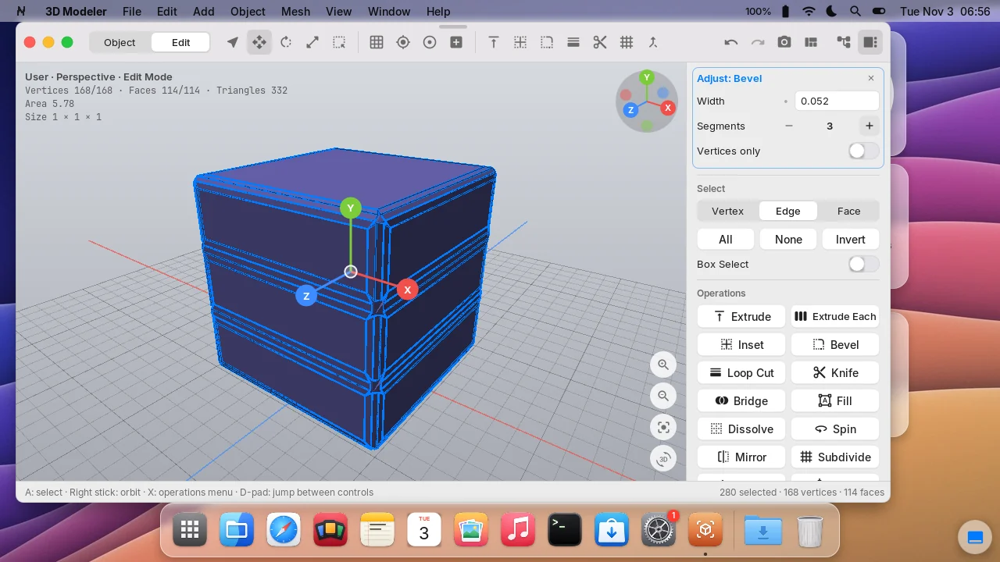 | 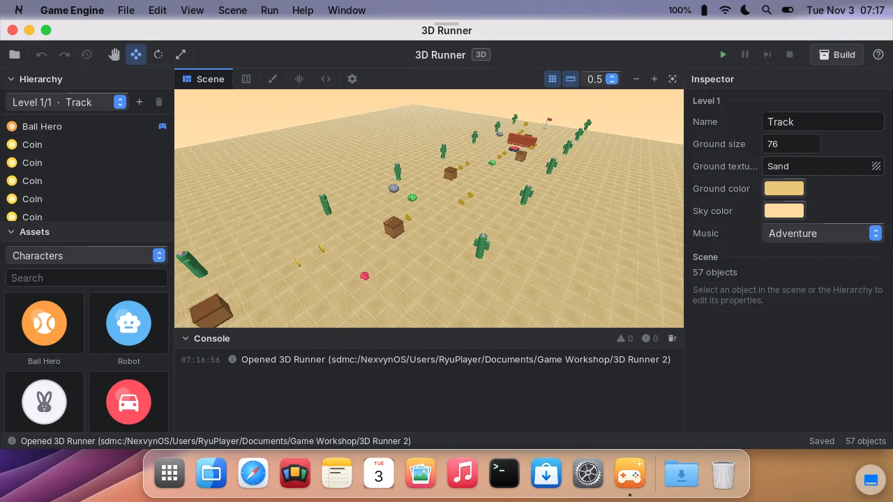 |
| **3D Modelleme:** düzenleme araçları, modifier yığını, UV açma, `.glb` dışa aktarma | **Oyun Motoru:** resimli kartlarla ya da kodla 2B ve 3B oyunlar |

- **Nexvyn OS Studio:** Lua 5.4, JavaScript, Python (hafif runtime ya da CPython 3.12), Squirrel, C (konsolda
  derlenir) ve Java 8. Otomatik tamamlama, F1'de SDK başvurusu, canlı konsol, tıklanabilir hatalar, 20 şablon, çevrimiçi
  örnekler, **Yapay zekâya sor** paneli, `.nxvapp` dışa aktarma ve **Yayımla** sihirbazı.
- **Oyun Motoru:** Hızlı Oyun üç adımda oynanabilir bir oyun kurar (17 tür, 7 dünya); Kolay mod resimli kartlar
  kullanır, Gelişmiş mod denetçi, katmanlar, olay blokları, piksel ve döşeme düzenleyicileri ve üretilen Lua kodunu
  ekler.
- **3D Modelleme:** temel şekiller, köşe, kenar ve yüz düzenleme (pah, loop cut, bıçak, köprü, döndürme, ayna),
  modifier yığını, UV açma, yüz başına materyal, dörtlü görünüm, OBJ ve STL içe/dışa aktarma ve `.glb` dışa aktarma.

## İnternet, medya ve verimlilik

| | |
|:---:|:---:|
| 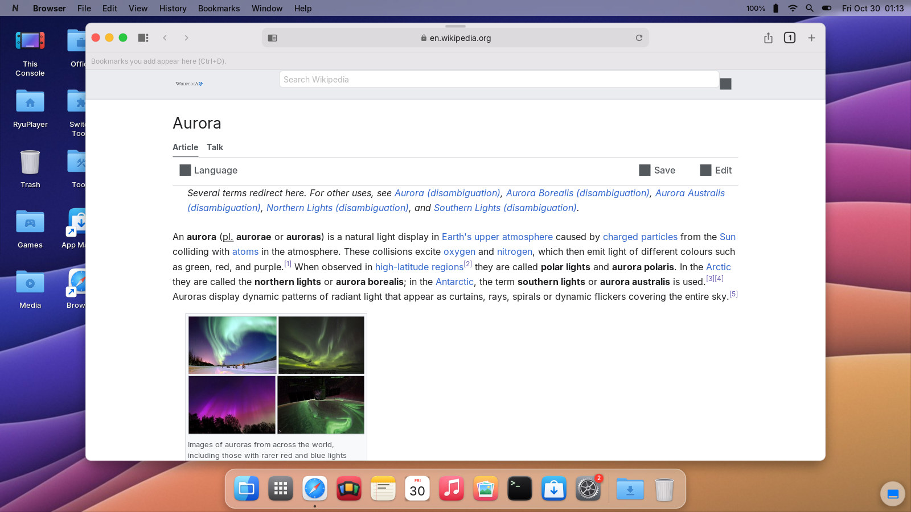 | 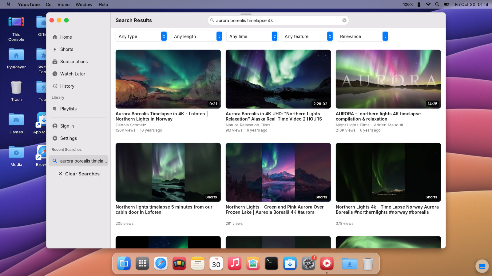 |
| Kendi HTML, CSS ve JavaScript motoruyla **Tarayıcı** | **YousTube:** video arayın ve izleyin |
| 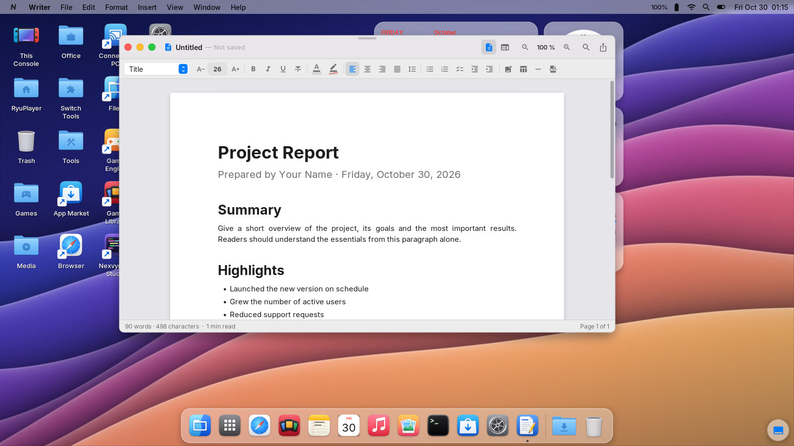 | 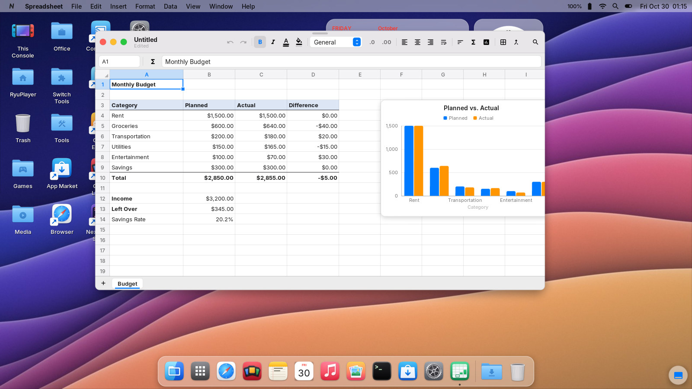 |
| **Kelime İşlemci:** şablonlar, stiller ve biçimlendirme | **Hesap Tablosu:** formüller, grafikler ve CSV |

- **Tarayıcı:** sekmeler, yer imleri, geçmiş, okuma modu, indirmeler ve şifreli parola deposu.
- **Medya:** YousTube, Canlı TV (M3U listeleri), Radyo, Müzik, Fotoğraflar ve MP4, MKV, WebM ile HTTPS ve HLS
  yayınları için Video Oynatıcı.
- **Verimlilik:** Kelime İşlemci, Hesap Tablosu, Sunu, Dosyalar (USB sürücüler, arşivler, Çöp Kutusu), Terminal, Kod
  Düzenleyici, Notlar, Takvim, Anımsatıcılar, Kişiler, Hesap Makinesi, Saat, Otomasyon ve kendi API anahtarınızla AI
  Sohbet.
- **PC Bağlantısı:** kablosuz FTP sunucusu ve USB dosya aktarımı (MTP), ayrıca bir FTP istemcisi.
- **Oyun Kitaplığı:** kapakları, oynama süresi ve Albüm görüntüleriyle kurulu oyunlarınız, başlık modunda açılır.

## Uygulama Mağazası

<p align="center">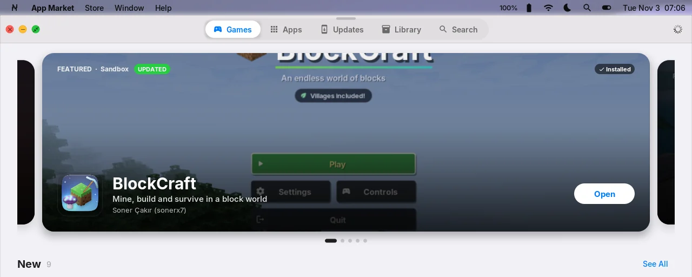</p>

Uygulamalar, oyunlar, temalar ve yazı tipi paketleri. Her sayfa kurmadan önce izinleri listeler. Paketler SHA-256 ile
denetlenir ve imzalıdır, güncellemeler tek dokunuşla gelir. **Her öğe yayımlanmadan önce bakımcı tarafından
incelenir.** Hepsine [Store/](Store/README.tr.md) içinden göz atın; kendinizinkini yayımlamak için
[Katkı](CONTRIBUTING.tr.md) sayfasını okuyun.

## Switch Araçları

Atmosphère kullanıcıları için bir araç klasörü: **Mod Yöneticisi** ve **Mod Bulucu**, **Hile Yöneticisi**,
**Overlay'ler**, **Saat Profilleri**, **Sistem Modülleri**, **Kayıt Yedeği**, **Oyun Bilgisi**, **Yama Yöneticisi**,
**Çökme Raporları**, **Atmosphère Ayarları** ve **Homebrew**. **Türkçe Yamalar** çeviri yamalarını kurar ve geri
dönebilmeniz için özgün dosyaları saklar. Modların değişiklikleri oyun bir sonraki açılışında geçerli olur.

## Erişilebilirlik ve diller

| | |
|:---:|:---:|
| 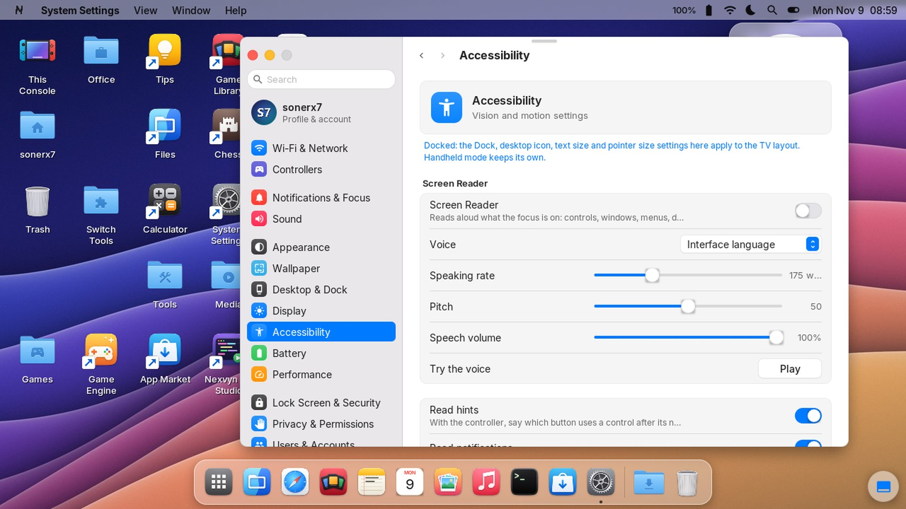 | 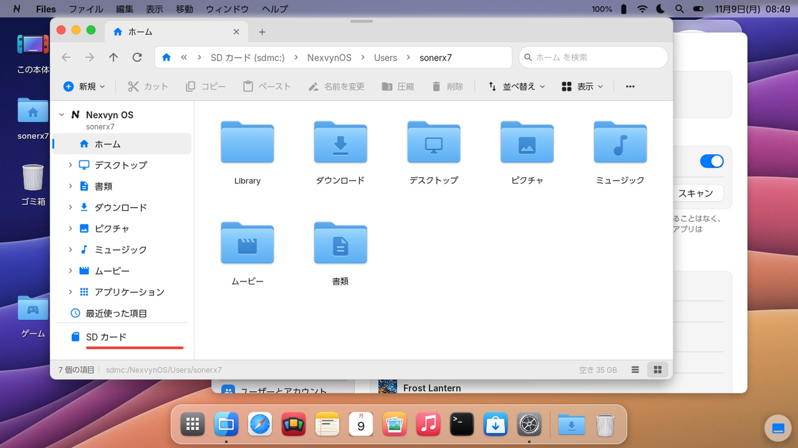 |
| **Ekran Okuyucu** ve erişilebilirlik ayarları | Bütün sistem **Japonca** |

- **8 dil:** English, Türkçe, Deutsch, Français, Español, 日本語, 中文 ve 한국어; Hangul ve romaji girişiyle.
- Kendi sesi, hızı, perdesi ve ipuçlarıyla bir **Ekran Okuyucu**; yakınlaştırma, renkleri ters çevirme, yazı ve
  imleç boyutu, azaltılmış hareket ve saydamlık, büyük pencere düğmeleri.
- Kelime önerili ekran klavyesi (sabit, yüzen ya da bölünmüş) ya da konsolun kendi klavyesi.
- **Girdi:** dokunmatik (dokunma, basılı tutma, iki parmakla kaydırma, kıstırma, kenar kaydırmaları), kumanda (sol
  çubuk imleci taşır, kumandayı oyundan geri almak için L+R'yi basılı tutun), USB klavye ve fare. El modu ve TV
  (1080p) düzenleri.

## Gizlilik ve güvenlik

- Uygulamalar ihtiyaç duyduklarını (ağ, dosyalar vb.) **bir kez** sorar; **Sistem Ayarları > Gizlilik ve İzinler**
  içinden gözden geçirin. Native C, Java ve modül kodu ilk çalışmadan önce sorar.
- **App Guard** her paketi kurulmadan önce tarar ve nedenleriyle *Sorun bulunamadı*, *İncele* ya da *Tehlikeli*
  gösterir. Mağaza uygulamaları sistem ayarlarını, diğer uygulamaların verilerini ya da Tarayıcı'nın parolalarını
  okuyamaz. [Ayrıntılar](SDK/Guides/APP_GUARD.tr.md)
- Tarayıcı'daki parolalar ve AI Sohbet'teki API anahtarları konsolda şifreli saklanır.
- Anonim kullanım istatistikleri ilk açılışta duyurulur, dosyalarınızı, parolalarınızı ya da anahtarlarınızı asla
  içermez ve **Sistem Ayarları > Hakkında > Gizlilik** içinden kapatılabilir.
- Bir güvenlik açığı bildirmek için [güvenlik politikasını](SECURITY.tr.md) izleyin; lütfen bunun için herkese açık
  bir konu açmayın.

---

## Gereksinimler

- **Atmosphère** ile açılan bir konsol. Önerilen: Atmosphère **1.12.1** ya da daha yenisi.
- **Sistem sürümü 22.5.0 ya da daha yenisi (gerekli).** **23.0.x**'e kadar test edildi. Başka sürümlerde de Nexvyn OS
  açılır ve hiçbir şey engellenmez ama sorunlar olabilir; bir kez bildirim gösterir. Tam tarayıcı yalnızca test edilen
  sürümlerde kullanılır (Tarayıcı ayarlarından yine de izin verilebilir).
- SD kartta `.nro` dosyası için yaklaşık **70 MB** boş alan, ayrıca kendi dosya ve uygulamalarınız için yer.
- SD kart bölümü ya da ek kurulum gerekmez.
- **Önerilen açılış: başlık modu.** Bir oyunu başlatırken **R**'yi basılı tutun, sonra Nexvyn OS'u Homebrew
  Menüsü'nden açın. Böylece belleğin tamamını (yaklaşık 3.2 GB) alır. Albüm'den (applet modu) açılırsa birkaç yüz MB
  alır: büyük uygulamalar, tam tarayıcı ve oyun başlatma kısıtlıdır ve Nexvyn OS bunu söyler.

<p align="center">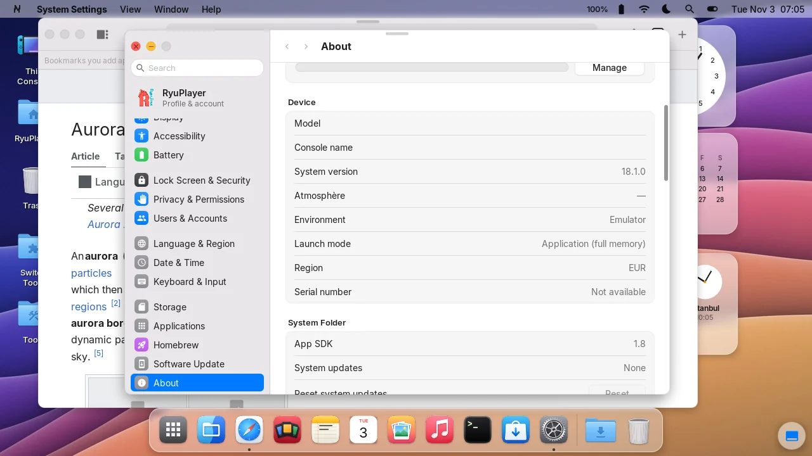 Hakkında: sistem sürümü, Atmosphère, ortam, açılış modu ve App SDK sürümü"></p>

**Sistem Ayarları > Hakkında** sistem sürümünüzü, gerekli sistem sürümünü, Atmosphère sürümünü, açılış modunu ve App
SDK sürümünü gösterir.

## Kurulum

1. `NexvynOS.nro`'yu [son sürümden](https://github.com/sonerx7/Nexvyn-OS-NX/releases/latest) indirin.
2. `sdmc:/switch/NexvynOS.nro` konumuna kopyalayın (SD kartın kökündeki, Homebrew Menüsü'nün baktığı `switch`
   klasörü). SD kartın köküne koymayın.
3. Homebrew Menüsü'nden, başlık modunda açın (yukarıya bakın). HOME menüsünde kendi simgesi olsun isterseniz
   [forwarder rehberine](SDK/Guides/FORWARDER.tr.md) bakın.
4. Kurulum yardımcısı dilinizi, klavyenizi, düzeninizi ve görünümü sorar. İlk açılışta Nexvyn OS
   `sdmc:/NexvynOS/` klasörünü oluşturur; ayarlarınız, kullanıcılarınız, dosyalarınız ve uygulamalarınız oradadır.

**Güncellemeler:** **Sistem Ayarları > Yazılım Güncelleme** yeni sürümü bu depodan indirir, eskisinin yedeğini tutar ve
kurar. Uygulamalarınız, dosyalarınız ve ayarlarınız kalır.

**Kaldırma:** **Sistem Ayarları > Geliştirici > Köklü sıfırla** Nexvyn OS'un SD karta yazdığı her şeyi siler. Sonra
`sdmc:/switch/NexvynOS.nro`'yu silin. Oyunlara, kayıtlara ve Atmosphère'e asla dokunulmaz.

Her şey [kullanım rehberinde](SDK/Guides/USER_GUIDE.tr.md) ayrıntılı anlatılır.

## Çevrimiçi ve çevrimdışı

Nexvyn OS ağ olmadan çalışır. Şu bölümler internet bağlantısı ister: Tarayıcı ve tam tarayıcı, Uygulama Mağazası ve
sistem güncellemeleri, AI Sohbet, Hava Durumu, Haberler, Döviz, Haritalar, Sözlük, Radyo, Canlı TV ve video
yayınları, Mod Bulucu ve Türkçe yama indirmeleri ve isteğe bağlı anonim istatistikler. PC Bağlantısı ile FTP sunucusu
ve istemcisi yalnızca yerel ağınızı kullanır. Geri kalan her şey (dosyalar, notlar, takvim, müzik ve video
oynatıcılar, oyunlar, Oyun Motoru, 3D Modelleme, Studio) çevrimdışı çalışır.

## Bilinen sorunlar

- **Test edilmemiş sistem sürümlerinde tam tarayıcı.** Test edilmemiş sistem sürümlü bazı konsollarda tam tarayıcıyı
  açmak konsolu bir Atmosphère fatal hatasıyla durdurdu. Nexvyn OS test edilen 22.5.0 - 23.0.x dışında tam tarayıcıyı
  kapalı tutar ve sayfayı dahili tarayıcıda açar. İzin verirseniz ve konsol durursa lütfen sistem ve Atmosphère
  sürümlerinizle ve `sdmc:/atmosphere/fatal_errors/` içindeki raporla
  [bildirin](https://github.com/sonerx7/Nexvyn-OS-NX/issues/new?template=bug-report.yml).
- **Kısa donmalar ya da oyunlardan sonra yavaşlayan masaüstü.** Lütfen bir hata bildirimine
  `sdmc:/NexvynOS/System/Logs/system.log` dosyasını (yeniden başlattıysanız `system.prev.log`'u da) ekleyin. `stall`
  ile başlayan satırlar zamanın nereye gittiğini söyler. Yavaş ya da arızalı bir SD kart sık görülen bir nedendir.
- **Büyük 3B sahneler.** Çok büyük `.glb` / `.fbx` dosyaları saniyeler içinde yüklenir ve çok bellek kullanır; pbr
  renderer GPU zamanı harcar. `g3d.loadModel` kullanın, dokuları 1024 px ya da altında tutun ve konsolda ölçün
  ([SDK başvurusu](SDK/Reference/SDK.tr.md), bölüm 8b).

## Belgeler

| Kimin için | Başlangıç |
|---|---|
| Kullanıcılar | [Kullanım rehberi](SDK/Guides/USER_GUIDE.tr.md) · [Forwarder](SDK/Guides/FORWARDER.tr.md) · [Tarayıcı](SDK/Guides/BROWSER.tr.md) · [Sürüm notları](CHANGELOG.md) |
| Uygulama ve oyun yapımcıları | [SDK başlangıç sayfası](SDK/README.tr.md) · [SDK başvurusu](SDK/Reference/SDK.tr.md) · [PBR oyun tarifi](SDK/Guides/PBR_GAME_RECIPE.tr.md) · [Sosyal uygulama tarifi](SDK/Guides/SOCIAL_APP_RECIPE.tr.md) · [Oyun yap](SDK/Guides/MAKE_A_GAME.tr.md) · [Sosyal uygulama yap](SDK/Guides/MAKE_A_SOCIAL_APP.tr.md) · [SDK sürümleri](SDK/Guides/SDK_VERSIONS.tr.md) · [Bütün rehberler](SDK/Guides/README.tr.md) |
| AI araçlarıyla geliştirenler | [SDK/AI](SDK/AI/README.tr.md) · [AI destekli çalışma](SDK/Guides/AI_WORKFLOW.tr.md) |
| Yayımlama | [Katkı](CONTRIBUTING.tr.md) · [Yayımlama rehberi](SDK/Publishing/PUBLISHING.tr.md) · [İnceleme listesi](SDK/Publishing/REVIEW.tr.md) |
| Güvenlik | [Güvenlik politikası](SECURITY.tr.md) · [App Guard](SDK/Guides/APP_GUARD.tr.md) · [Uyumluluk](SDK/Guides/COMPATIBILITY.tr.md) |

## Depo düzeni

```
Store/            Uygulama Mağazası'nın kurduğu her şey
├── Apps/<kategori>/<kısa-ad>/   uygulamalar (ve Nexvyn OS ile gelen uygulamaların mağaza sayfaları)
├── Games/<tür>/<kısa-ad>/       oyunlar
├── Themes/<kısa-ad>/            temalar (.nxvtheme)
├── Fonts/<kısa-ad>/             yazı tipi paketleri (.nxvfont)
└── catalog.json, packages.json  konsolun okuduğu; README.md hepsini listeler
SDK/              geliştiriciler için her şey, İngilizce ve Türkçe
├── Reference/                   SDK başvurusu, Java SDK'sı, C başlığı
├── Languages/<dil>/             hızlı başlangıç, şablon ve oyun kitleri (C: native-kit/ içinde Native SDK kiti)
├── Guides/                      rehberler ve tarifler
├── Samples/<dil>/<kısa-ad>/     çalışan örnekler (samples.json: Studio'nun Örnekler'i)
├── AI/                          AI asistanları için context pack'ler ve görev prompt'ları
├── Publishing/                  nasıl yayımlanır, inceleme listesi
├── Fonts/                       sistem yazı tipleri
└── Tools/                       nxv komut satırı, ikon aracı, doku aracı
Tools/            depo bakımı: build_store.py, CI
.github/          konu formları, pull request şablonu, CODEOWNERS ve README görselleri
```

Bu depo Uygulama Mağazası'nı, SDK'yı ve sürümleri barındırır. Nexvyn OS'un kendi kaynak kodu bu depoda değildir.

## SSS

**Konsolun sisteminin yerine mi geçer?**
Hayır. Nexvyn OS, konsolun sisteminin üstünde Atmosphère ile çalışan bir homebrew uygulamasıdır. Kapatınca Homebrew
Menüsü'ne dönersiniz.

**Hangi sistem sürümü gerekli?**
22.5.0 ya da daha yenisi; 23.0.x'e kadar test edildi. **Sistem Ayarları > Hakkında** sizinkini gösterir.

**Neden başlık modu?**
Albüm'den (applet modu) açılan homebrew belleğin küçük bir kısmını alır. Bazı özellikler (büyük uygulamalar, tam
tarayıcı, oyun başlatma) başlık modunun belleğinin tamamını ister.

**Kod yazmadan oyun yapabilir miyim?**
Evet. Oyun Motoru'nu açın, **Hızlı Oyun**'a basın, bir tür ve bir dünya seçip **Hemen oyna**'ya basın.

**Kendi 3B modellerimi kullanabilir miyim?**
Evet. 3B aracınızdan, temizledikten sonra bir AI model üreticisinden ya da yerleşik 3D Modelleme'den `.glb` veya
`.fbx` dışa aktarın ve `g3d.loadModel` ile yükleyin. pbr renderer'da modelin PBR haritaları olduğu gibi kullanılır.
[AI destekli çalışma](SDK/Guides/AI_WORKFLOW.tr.md) ve [Oyun yap](SDK/Guides/MAKE_A_GAME.tr.md) rehberlerine bakın.

**AI asistanıyla uygulama yazabilir miyim?**
Evet. Ona [SDK/AI](SDK/AI/README.tr.md) içinden context pack'i ve bir görev prompt'unu verin; Studio'nun
**Yapay zekâya sor** paneli AI Sohbet'te ayarladığınız sağlayıcıyı ve anahtarı kullanır.

**Dosyalarım nerede?**
`sdmc:/NexvynOS/Users/<adınız>/` içinde (Masaüstü, Belgeler, İndirilenler, Resimler, Müzik, Filmler).

**Abonelikli video servislerini tarayıcıda izleyebilir miyim?**
Hayır. Videolarını DRM ile koruyan servisler dahili tarayıcıda da tam tarayıcıda da oynamaz.

**Mod ve hile kullanmak güvenli mi?**
Switch Araçları yalnızca SD karta yazar. Değiştirilmiş oyunlarla ya da hilelerle çevrimiçi oynamak hesabın
yasaklanmasına yol açabilir; çevrimdışı kullanın.

**Ekran görüntüleri konsolda mı çekildi?**
Ekran görüntüleri ve videolar bir emülatörde, İngilizce arayüzle çekildi. USB sürücüler, MTP ve kamera gibi gerçek
donanım isteyen özellikler yalnızca konsolda çalışır.

## Katkı

Uygulama, oyun, tema ve yazı tipi gönderimleri pull request olarak gelir ve yayından önce incelenir; hata bildirimleri
ve çeviriler konu olarak gelir. [Katkı](CONTRIBUTING.tr.md) sayfasına bakın.

## Lisans ve emeği geçenler

Nexvyn OS **GPL-3.0-or-later** lisanslıdır ([LICENSE](LICENSE)); üçüncü taraf bileşenler ve lisansları
[THIRD_PARTY_NOTICES.md](THIRD_PARTY_NOTICES.md) içindedir. Mağazadaki öğeler aksi belirtilmedikçe aynı lisansla
gelir (yazı tipi paketleri kendi lisanslarını taşır, çoğunlukla SIL Open Font License). YamaNX, SertAy'ın YamaNX'ine
dayanır. Tarayıcı, YousTube,
Canlı TV ve Radyo'da gösterilen içerik sahiplerine aittir.

Geliştiren **Soner Çakır** · [github.com/sonerx7](https://github.com/sonerx7). Yazarı tarafından tasarlanıp
yönetildi ve AI kodlama araçlarının yardımıyla yapıldı.
