<p align="center"></p>

<h1 align="center">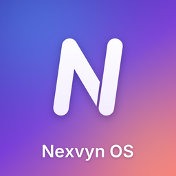 Nexvyn OS</h1>

<p align="center"><a href="README.md">English</a> · <b>Türkçe</b></p>

<p align="center"><b>Nintendo Switch için eksiksiz bir masaüstü işletim sistemi kabuğu.</b><br>
Gerçek pencereler, iki masaüstü düzeni, web tarayıcısı, video, Canlı TV, ofis uygulamaları, oyun motoru, 3D modelleme,
kod stüdyosu ve Uygulama Mağazası; hepsi Homebrew menüsünden açılan tek bir <code>.nro</code> içinde. Yeniden başlatma
yok, SD kart bölümleme yok.</p>

<p align="center">
<a href="https://github.com/sonerx7/Nexvyn-OS-NX/releases/latest"></a>
<a href="LICENSE"></a>
<a href="SDK/README.tr.md"></a>
<a href="#erişilebilirlik-ve-diller"></a>
</p>

<p align="center">
<a href="https://github.com/sonerx7/Nexvyn-OS-NX/releases/latest"><b>⬇ NexvynOS.nro'yu indir</b></a> ·
<a href=".github/assets/nexvyn-os-demo.mp4"><b>▶ 1 dakikalık tanıtım videosunu izle</b></a> ·
<a href="SDK/Guides/USER_GUIDE.tr.md">Kullanım rehberi</a> ·
<a href="Store/README.tr.md">Uygulama Mağazası</a> ·
<a href="SDK/README.tr.md">SDK</a> ·
<a href="CHANGELOG.md">Sürüm notları</a> ·
<a href="ROADMAP.tr.md">Yol haritası</a>
</p>

<p align="center"><a href=".github/assets/nexvyn-os-demo.mp4">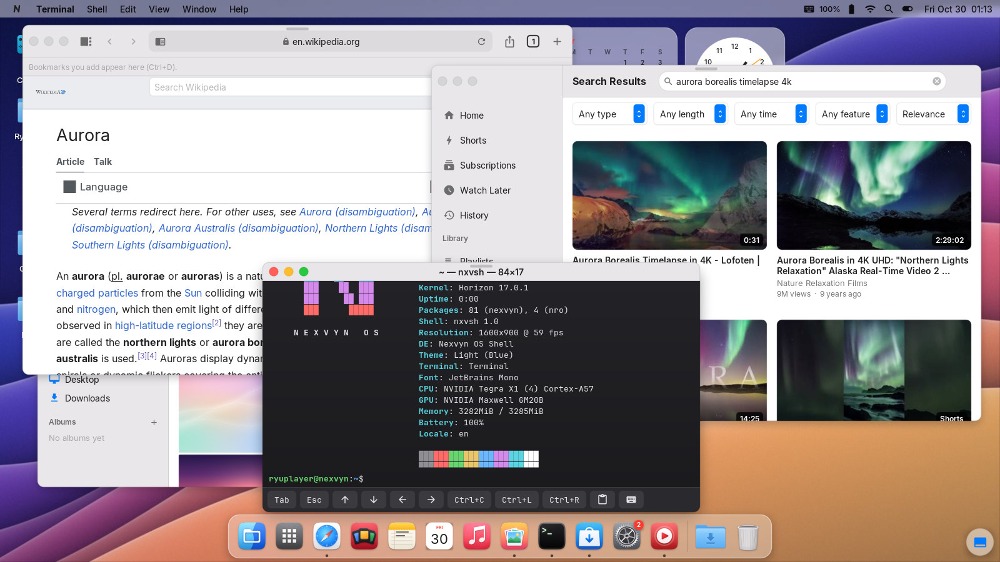</a></p>

> Ekran görüntüleri ve video İngilizce arayüzle çekildi; Nexvyn OS'un tamamı Türkçe de kullanılabilir.

## Bir bakışta

- **Gerçek bir masaüstü.** Üst üste binen, boyutlandırılabilen pencereler, kenara yaslama, sanal masaüstleri, Pencere
  Görünümü, Başlatıcı (Launcher), Hızlı Arama, Denetim Merkezi, Bildirim Merkezi, masaüstü widget'ları ve her yerde
  sağ tık menüleri.
- **İki düzen.** **Dock düzeni** (üstte menü çubuğu, altta Dock) ya da **görev çubuğu düzeni** (Başlat menülü görev
  çubuğu, menüler her pencerenin içinde). İstediğiniz an geçebilirsiniz.
- **70'i aşkın yerleşik uygulama.** Tarayıcı, YousTube, Canlı TV, Radyo, Müzik, Fotoğraflar, Video Oynatıcı, Kelime
  İşlemci, Hesap Tablosu, Sunum, Dosyalar, Terminal, Hava Durumu, Haritalar, Takvim, Notlar ve çok daha fazlası.
- **Konsolda üretin.** Altı dilde uygulama yazmak için Nexvyn OS Studio, 2D ve 3D oyunlar için Oyun Motoru ve tam bir
  3D Modelleme uygulaması; yanında SDK, örnekler ve rehberler.
- **Uygulama Mağazası (App Market).** Uygulamalar, oyunlar, temalar ve yazı tipi paketleri; her biri yayımlanmadan önce
  incelenir.
- **Switch Araçları.** Modlar, hileler, overlay'ler, saat profilleri, sistem modülleri, kayıt yedekleri ve Türkçe yamalar.
- **Herkes için.** 8 dil, Ekran Okuyucu, dokunmatik, kumanda, USB klavye ve fare, el ve TV düzenleri.

---

## Masaüstü

Nexvyn OS, kaplama giydirilmiş bir başlatıcı değildir. Pencereler gerçektir: sürükleyin, her kenarından boyutlandırın,
ekranın yarısına ya da çeyreğine yaslayın, büyütün, tam ekrana alın ya da birini her zaman üstte tutun. Her pencere
bıraktığınız yerde yeniden açılır. Sanal masaüstleri 3D küp geçişiyle değişir; çöken bir uygulama sistemi kendisiyle
birlikte götürmez.

| | |
|:---:|:---:|
| 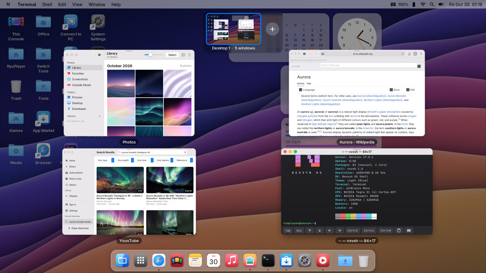 | 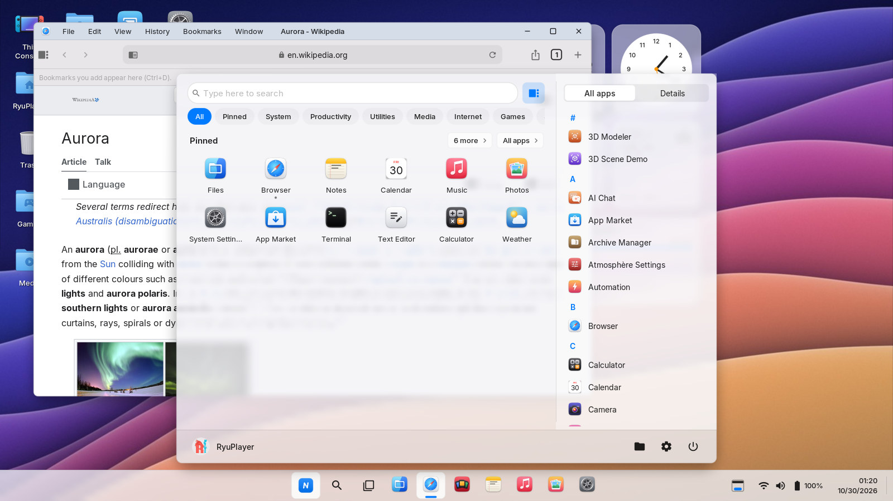 |
| **Pencere Görünümü:** tüm pencereler ve masaüstleri tek bakışta | Başlat menüsüyle **görev çubuğu düzeni:** sabitlenenler, tüm uygulamalar, arama |
| 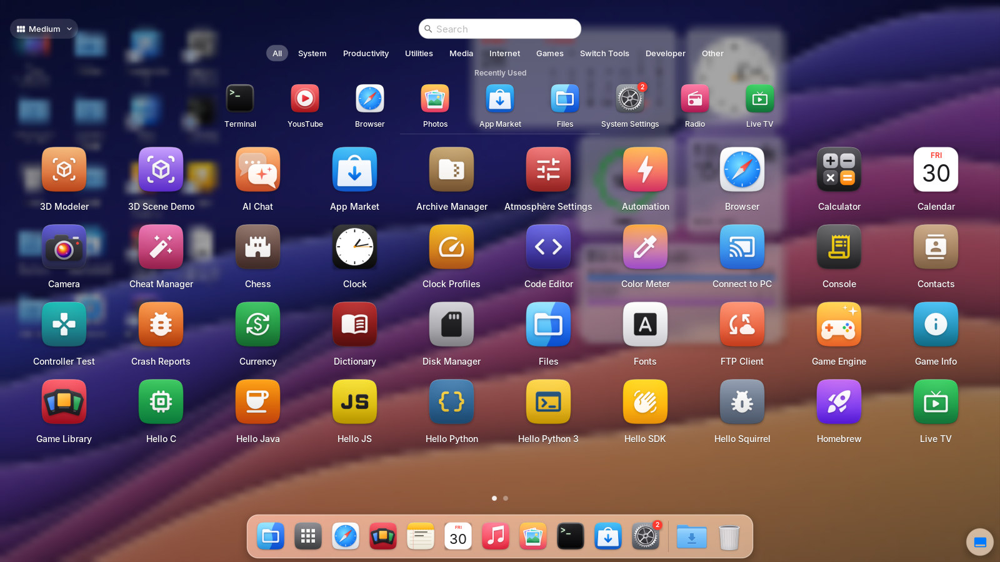 | 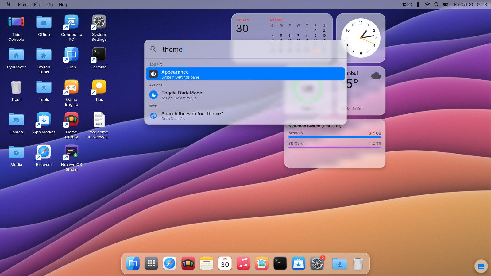 |
| **Başlatıcı:** tüm uygulamalar, kategorilere göre | **Hızlı Arama:** uygulamalar, dosyalar, ayarlar, eylemler, hesap makinesi ve web |
| 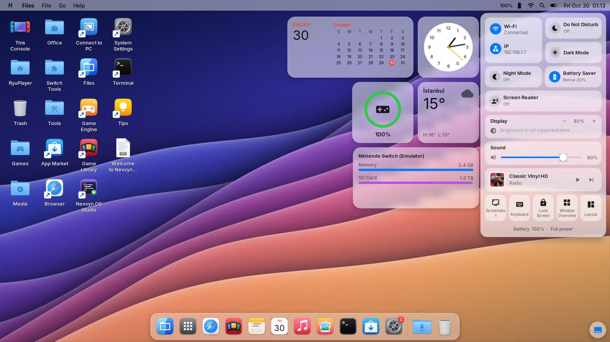 | 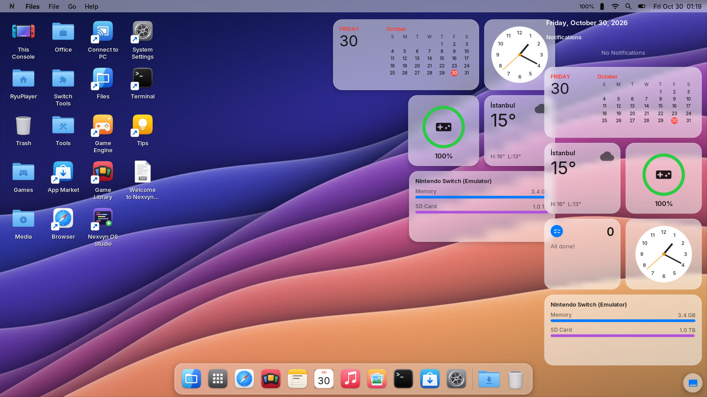 |
| **Denetim Merkezi:** Wi-Fi, Rahatsız Etme, Karanlık Mod, ses, Şimdi Çalıyor | widget'larıyla **Bildirim Merkezi** |
| 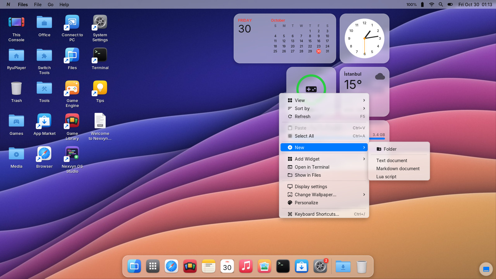 | 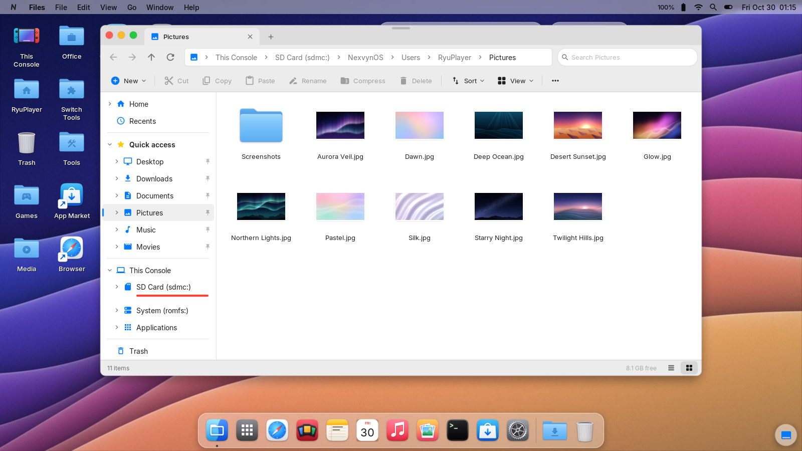 |
| Masaüstünde, simgelerde, dosyalarda ve Dock'ta **sağ tık menüleri** | **Dosyalar:** kenar çubuğu, sekmeler, liste ve ızgara görünümü, Çöp Sepeti, USB bellekler |

- **Dock düzeni:** uygulamanın menüleri, pil, Wi-Fi, saat ve arama ile bir menü çubuğu; büyütme efekti, çalışan uygulama
  noktası, sabitleme ve otomatik gizlemeyle bir Dock.
- **Görev çubuğu düzeni:** ortaya ya da sola hizalanan görev çubuğu; sabitlenen uygulamalar, kategorilere göre tüm
  uygulamalar ve önerilerle Başlat menüsü; canlı pencere küçük resimleri; her pencerede küçült, büyüt ve kapat düğmeleri.
- **Masaüstü:** simgeler, kendi simgesi olan klasörler, kısayollar, lastik bant seçimi, klavyeyle gezinme ve widget'lar
  (saat, takvim, hava durumu, pil, sistem, notlar, anımsatıcılar, dünya saati, radyo).
- **Kısayollar:** Hızlı Arama için Ctrl+Boşluk, Pencere Görünümü için F3, Başlatıcı için F4, uygulamalar arasında
  Alt+Tab, masaüstleri arasında Ctrl+Sol/Sağ. Kumandada + uygulamaları, ZR aramayı açar; L ve R pencere değiştirir.

### Tanıtım Turu

Kurulumdan hemen sonra canlı bir tur sistemi **gerçek masaüstünüzde** gösterir: yerine oturan pencereler, iki masaüstü
düzeni, Quick Search, Studio'da 20 saniyede yazılıp çalıştırılan bir uygulama, üç dokunuşla yapılan bir oyun. Her adımda
*Göster* ve *Ben deneyeyim* vardır. İstediğiniz zaman **Yardım > Tanıtım Turu** ile tekrar izleyebilirsiniz.

<p align="center">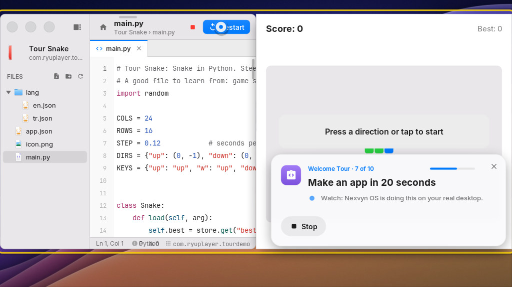</p>

## Nexvyn OS Studio — uygulamaları konsolda geliştirin

Doğrudan Switch üzerinde çalışan eksiksiz bir kod stüdyosu. Uygulamanızı yazın, **Çalıştır**'a basın; uygulama kodun
hemen yanında kendi penceresinde açılır, çıktısı anında konsola akar. Bir satırı değiştirin, **Yeniden Başlat**'a basın;
değişiklik hemen görünür. Bilgisayar yok, derleme adımı yok.

| | |
|:---:|:---:|
| 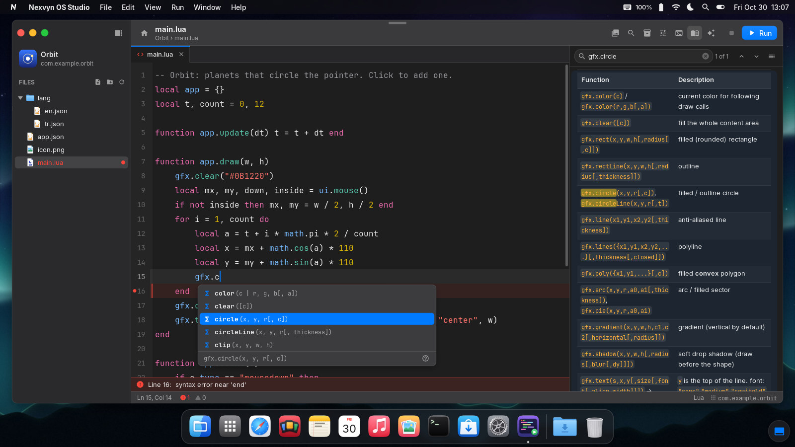 | 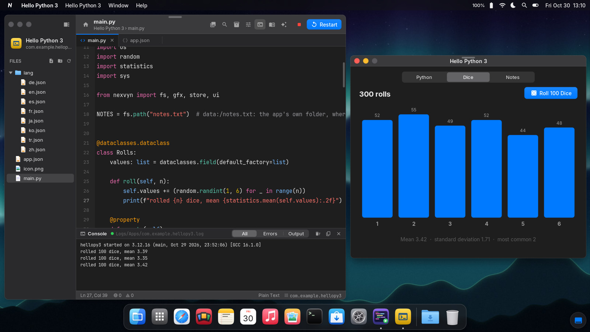 |
| **Tüm SDK için otomatik tamamlama**, başvuru o fonksiyonda açık | **Gerçek CPython 3.12:** dataclasses, statistics ve konsolda `print()` |
| 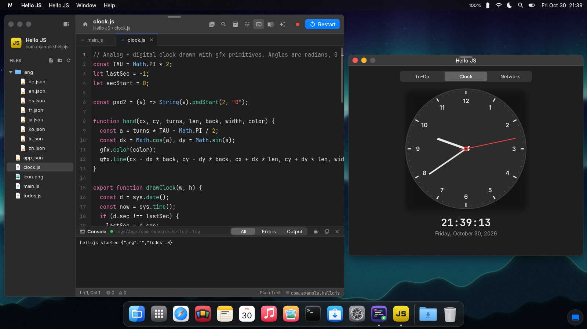 | 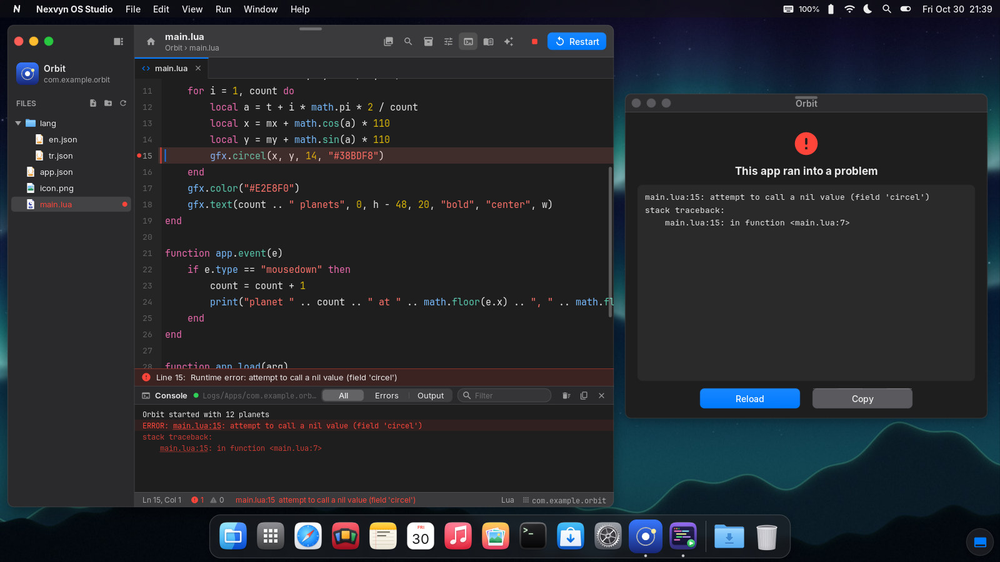 |
| **JavaScript:** Çalıştır'a basın, uygulama kodun yanında açılır | **Satır numaralı hatalar:** satıra gitmek için tıklayın ya da F8'e basın |
| 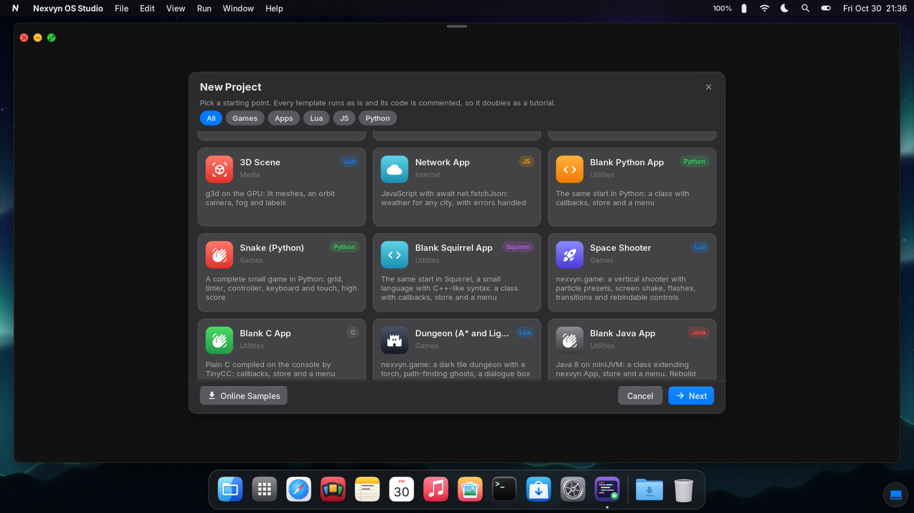 | 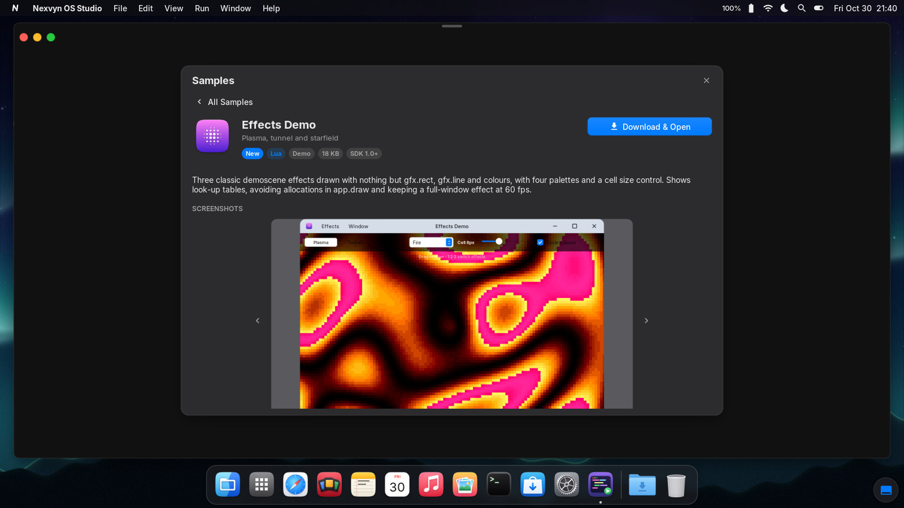 |
| Altı dilde **18 şablon**, hepsi olduğu gibi çalışır | **Örnekler:** hazır bir projeyi tek dokunuşla indirip açın |

- **Altı dil:** **Lua 5.4**, **JavaScript**, **Python** (hafif çalışma ortamı ya da standart kütüphanesiyle gerçek
  **CPython 3.12**), **Squirrel**, konsolda TinyCC ile derlenen **C** ve miniJVM üzerinde **Java 8**.
- **Tüm SDK için otomatik tamamlama:** `gfx.` yazın, her fonksiyon parametreleriyle listelenir; F1, SDK başvurusunu
  tam o fonksiyonda açar. Söz dizimi hataları siz yazarken işaretlenir.
- **Canlı konsolla çalıştırma:** F5 ya da Ctrl+R uygulamayı kendi penceresinde başlatır; `print()` ve `sys.log()`
  çıktısı anında konsolda görünür. **Yeniden Başlat** değişikliklerinizi alır, isterseniz **Kaydedince Yeniden Başlat**
  bunu sizin yerinize yapar.
- **Tıklanabilir hatalar:** bir çalışma zamanı hatası dosyası ve satırıyla konsolda, düzenleyicide ve uygulamanın
  penceresinde görünür. Tıklayın ya da F8'e basın, doğrudan o satıra gidin.
- **Şablonlar ve örnekler:** 18 şablondan biriyle başlayın (boş uygulamalar, platform oyunu, nişancı, bulmaca, 3D sahne,
  ağ, yapılacaklar listesi…) ya da çevrimiçi katalogdan bir örnek indirip proje olarak açın.
- **Kodun etrafındaki her şey:** projede bul ve değiştir, Hızlı Aç, sprite, tilemap ve sahne düzenleyicileri, anlık
  görüntüler ve AI Chat'te ayarladığınız sağlayıcı ve anahtarı kullanan bir **AI'ya sor** paneli.
- **Uygulama Mağazası'nda yayımlayın:** **Dışa Aktar** hemen paylaşabileceğiniz bir `.nxvapp` üretir; **Yayınla**
  sihirbazı projenizi pull request ile bu depoya eklemeniz için sizi adım adım yönlendirir. Uygulama Mağazası'nda
  görünmeden önce bakımcı tarafından incelenir.

## İnternet ve medya

| | |
|:---:|:---:|
| 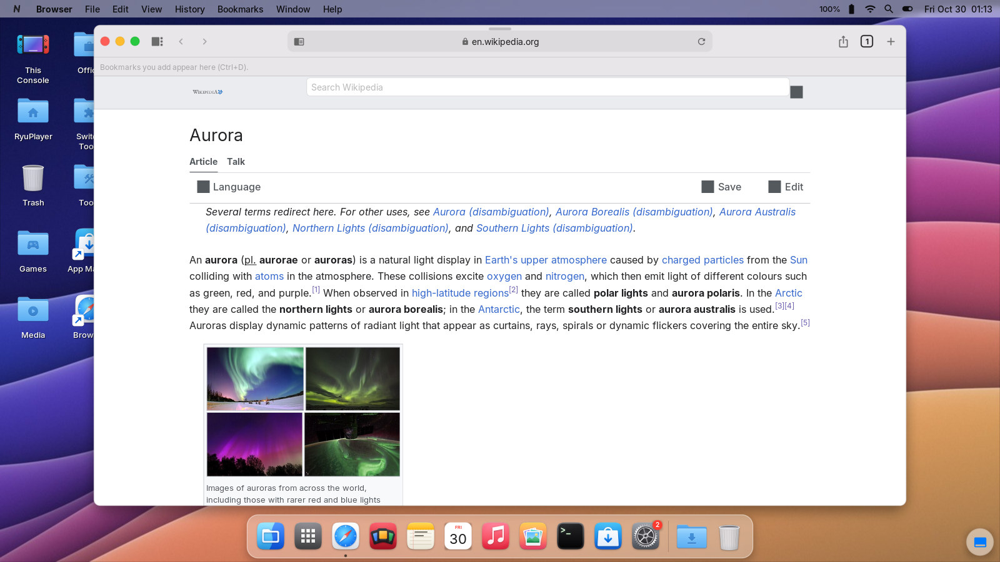 | 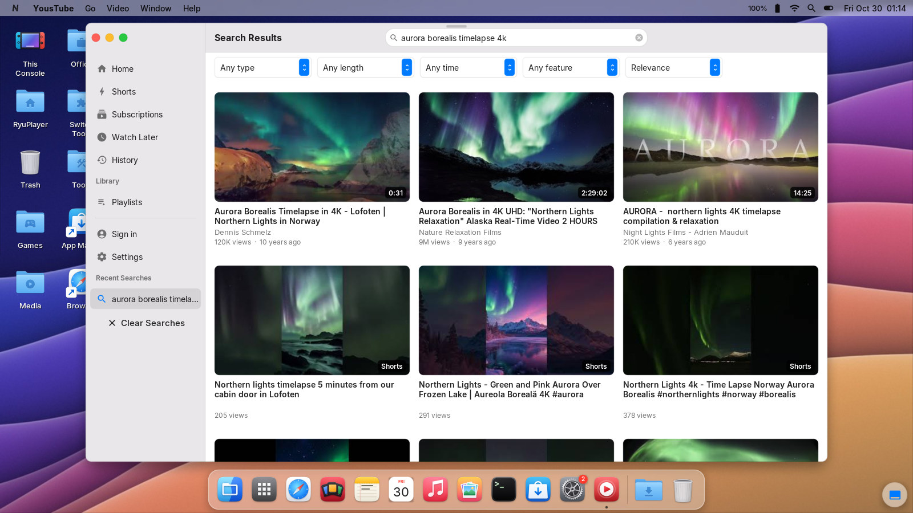 |
| Kendi HTML, CSS ve JavaScript motoruyla **Tarayıcı** | **YousTube:** video arayın ve izleyin |
| 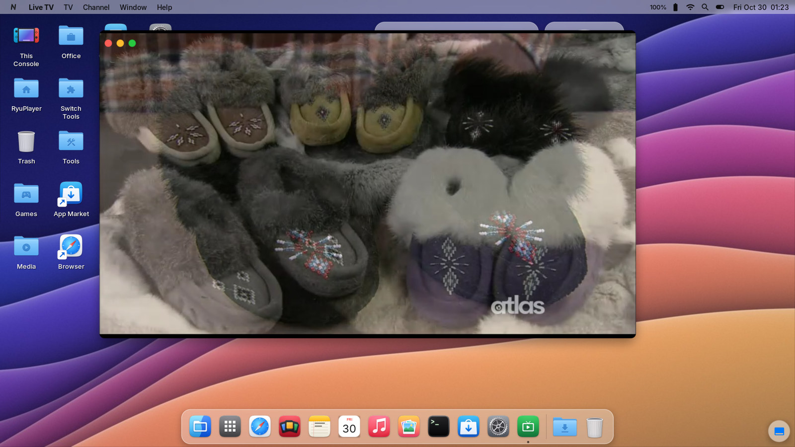 | 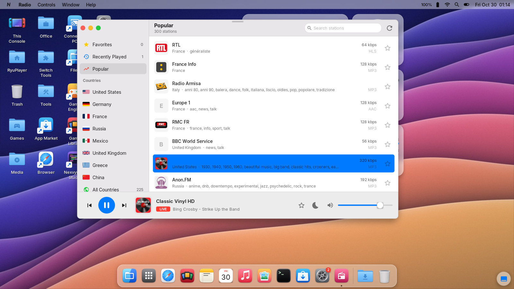 |
| **Canlı TV:** M3U listeleri ve hazır kanal listeleri | **Radyo:** dünyanın dört bir yanından istasyonlar |

- **Tarayıcı:** JavaScript'li (DOM, olaylar, fetch, localStorage) kendi düzen motoru; CSS dönüşümleri, geçişleri ve
  animasyonları, sekmeler, yer imleri, geçmiş, okuyucu modu, indirmeler ve şifreli parola deposu.
- **YousTube:** YouTube videolarını arayın ve izleyin; Shorts, yorumlar, bölümler, mini oynatıcı, oynatma hızı, altyazı
  ve akışın sunduğu yerde 1080p ya da 2160p'ye kadar kalite. Abonelikler, oynatma listeleri ve yorumlar için isteğe bağlı
  oturum açma (kendi API istemcinizle).
- **Canlı TV:** kendi M3U listeleriniz ya da ülkelere göre hazır listeler; gruplar, favoriler ve son izlenenler.
- **Radyo:** istasyonlara ülke ve türe göre göz atın, çalan şarkıyı görün, favorilerinizi saklayın, uyku zamanlayıcısı
  kurun. Pencereyi kapattıktan sonra da çalmaya devam eder.
- **Müzik, Fotoğraflar ve Video Oynatıcı:** etiketler, kapak resimleri ve çalma listeleri; resimleriniz ve konsolun Albüm
  görüntüleri; HTTPS ve HLS akışları dahil MP4, MKV, WebM ve daha fazlası.
- Ayrıca: **Kamera** (Joy-Con'un IR kamerası), **Hava Durumu**, **Haritalar**, **Haberler**, **Döviz** ve **Sözlük**.

<p align="center">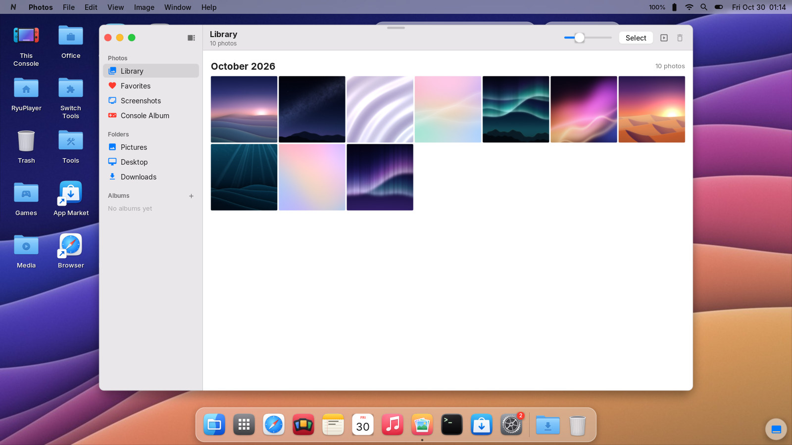</p>

### Oyun Kitaplığı

Kurulu Switch oyunlarınız kapakları, oynama süreleri ve Albüm görüntüleriyle; tek dokunuşla başlatılır (title modu).
Steam ve PC Kitaplığı ile PC oyunlarınız da burada. *(Emülatörde kurulu oyun olmadığı için burada demo modunda.)*

<p align="center">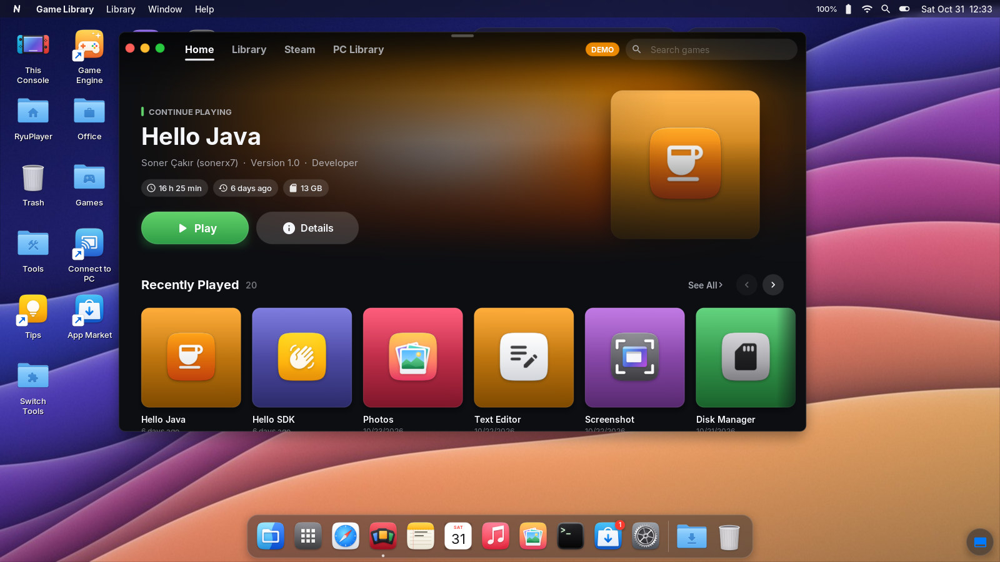</p>

## Verimlilik

| | |
|:---:|:---:|
| 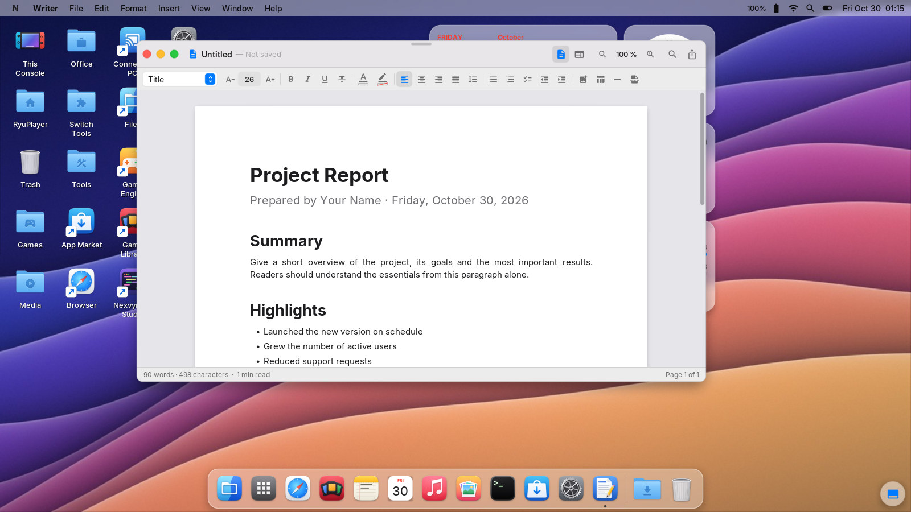 | 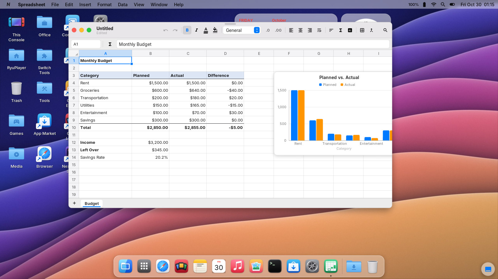 |
| **Kelime İşlemci:** şablonlar, stiller ve biçimlendirme | **Hesap Tablosu:** formüller, grafikler ve CSV |

- **Kelime İşlemci, Hesap Tablosu ve Sunum:** şablonlardan belgeler (mektup, rapor, özgeçmiş, toplantı notları),
  formüller ve grafikler, sunum temaları, geçişler ve sunum modu.
- **Dosyalar:** sürükle-bırak, kopyalama ve taşıma, sıkıştırma ve açma, Çöp Sepeti, USB bellekler (FAT ve exFAT).
- `nxvsh` kabuğuyla **Terminal**, **Kod Düzenleyici**, **Metin Düzenleyici**, **Notlar**, **Takvim**, **Anımsatıcılar**,
  **Kişiler**, **Hesap Makinesi**, **Saat** ve **Yapışkanlar**.
- **Otomasyon:** oturum açılışında, belirli bir saatte, pil seviyesinde, konsol dock'a takılınca ya da bir USB bellek
  takılınca çalışan rutinler.
- **AI Sohbet:** seçtiğiniz yapay zekâ modeliyle kendi API anahtarınızla sohbet edin; anahtar konsolda şifreli kalır.
- **Bilgisayara Bağlan:** kablosuz FTP sunucusu ve USB üzerinden dosya aktarımı (MTP); ayrıca bir FTP istemcisi.

## Üretin: konsolda uygulama, oyun ve 3D

| | |
|:---:|:---:|
| 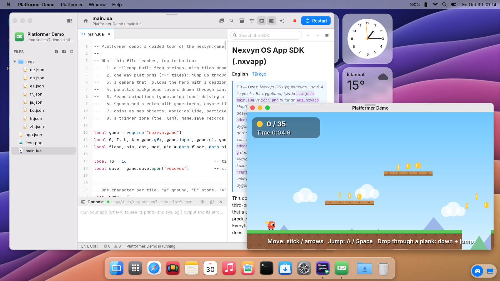 | 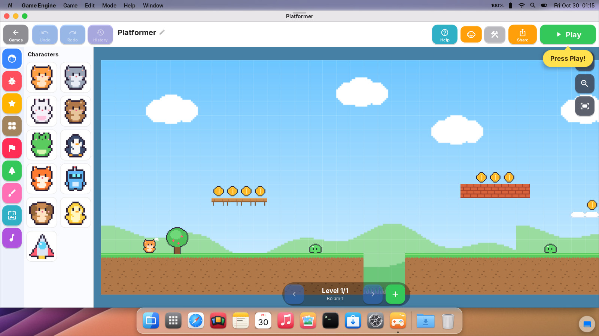 |
| **Nexvyn OS Studio:** kodu yazın, Çalıştır'a basın, uygulama hemen yanında açılır | **Oyun Motoru:** sürükleyin, bırakın, Oyna'ya basın |
| 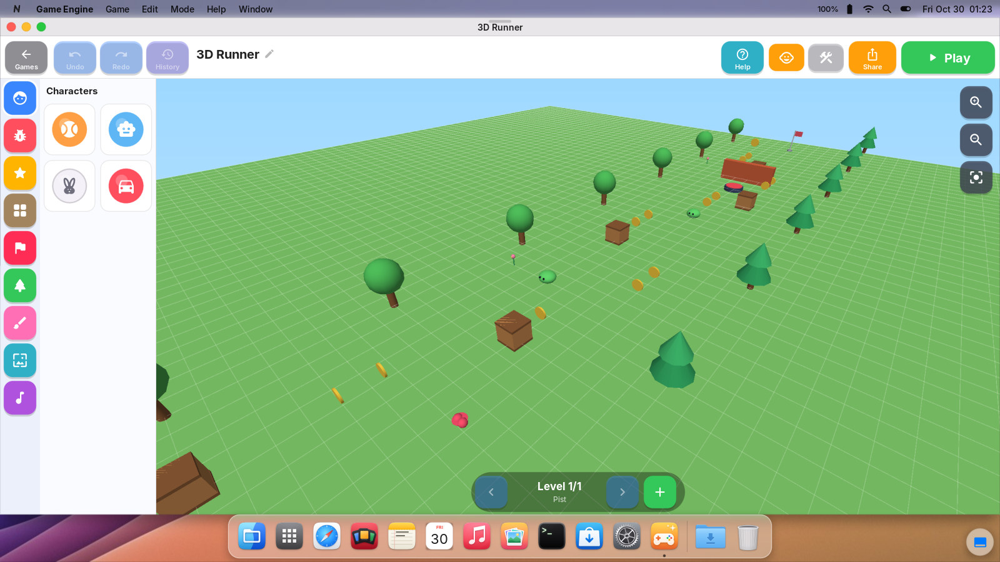 | 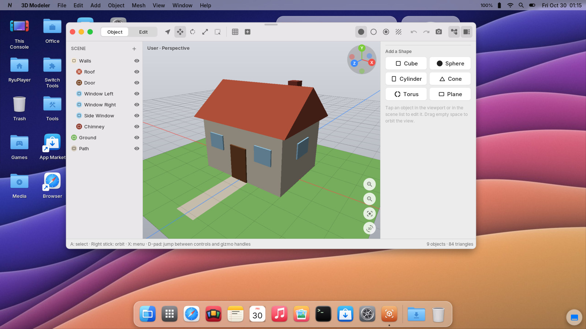 |
| 3D'de **Oyun Motoru** | **3D Modelleme:** örneklerden bir ev |

- **Nexvyn OS Studio:** altı dilde 18 şablondan projeler: **Lua 5.4**, **JavaScript**, **Python** (hafif çalışma
  ortamı ya da standart kütüphanesiyle gerçek **CPython 3.12**), **Squirrel**, **C** ve **Java**. Söz dizimi
  renklendirmesi, canlı hata denetimi, otomatik tamamlama, konsol, sprite, tilemap ve sahne düzenleyicileri, hemen
  yanında SDK başvurusu ve tek adımda `.nxvapp` paketleme.
- **Oyun Motoru:** çocukların da kullanabileceği bir 2D ve 3D oyun yapıcı. Oyun sihirbazı üç adımda oynanabilir bir oyun
  kurar (6 tür, 7 dünya). Kolay mod resim kartları ve sürükle-bırakla çalışır; Gelişmiş mod buna denetçi, katmanlar, olay
  blokları, piksel ve karo düzenleyicileri ve üretilen Lua kodunu ekler. 13 şablon ve 5 örnek oyun; sonucu uygulama olarak
  paylaşın ya da Studio'da kodla sürdürün.
- **3D Modelleme:** sahne ağacı, temel şekiller, taşıma, döndürme ve ölçekleme tutamakları, köşe, kenar ve yüz düzenleme,
  64 adım geri alma, OBJ ve STL içe ve dışa aktarma.
- **SDK 1.6:** çizim, arayüz bileşenleri, dosyalar, JSON, kalıcı veri, HTTPS, ses sentezi, bildirimler, hareket
  sensörleri, `nexvyn.game` 2D oyun motoru (sahneler, sprite'lar, tilemap'ler, kamera, fizik, tween'ler, parçacıklar) ve
  `g3d` GPU çizicisi.
- **Gösteri:** çizicinin neler yapabildiğini gösteren altı gerçek zamanlı sahne (bir ada, gece şehri, galaksi ve daha
  fazlası).

| | |
|:---:|:---:|
| 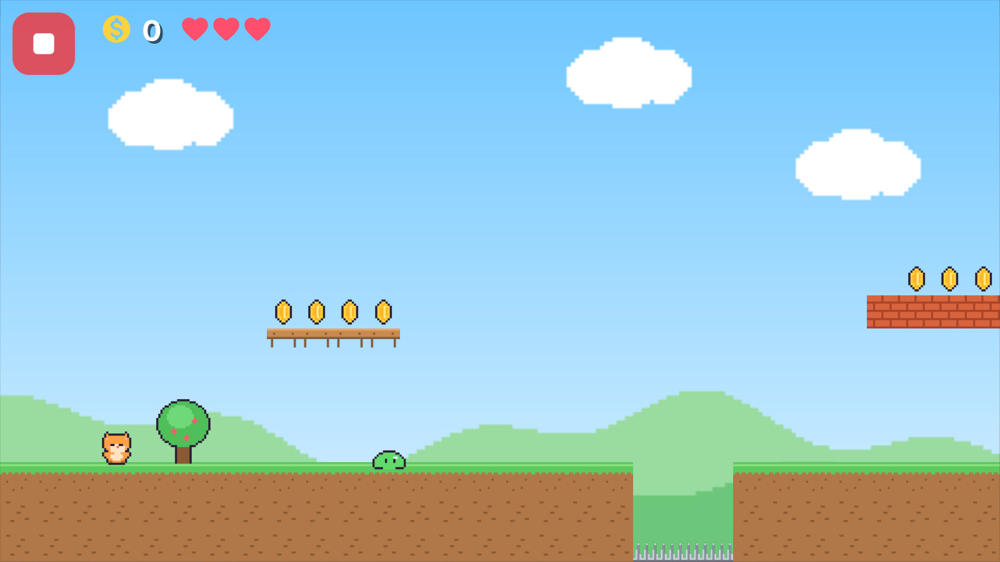 | 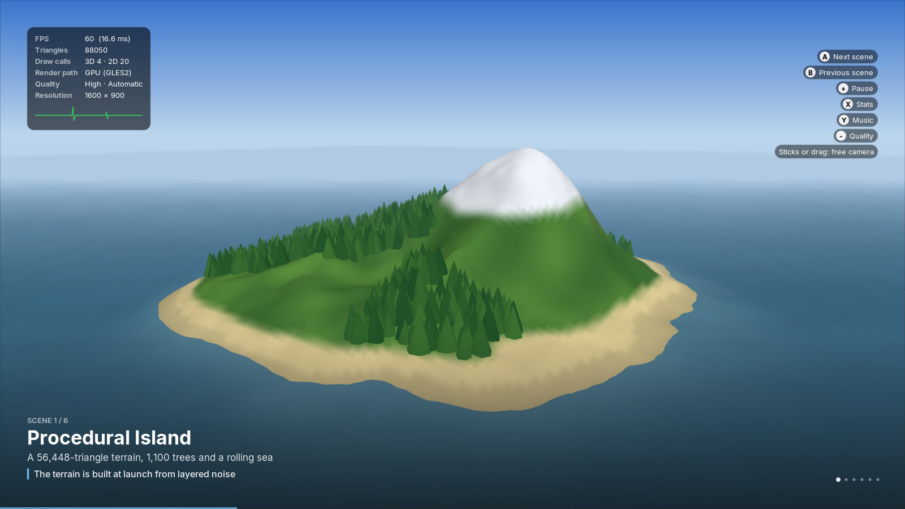 |
| Çalışan bir Oyun Motoru oyunu | **Gösteri:** GPU'da çizilen 56.000 üçgenlik bir ada |

## Uygulama Mağazası

<p align="center">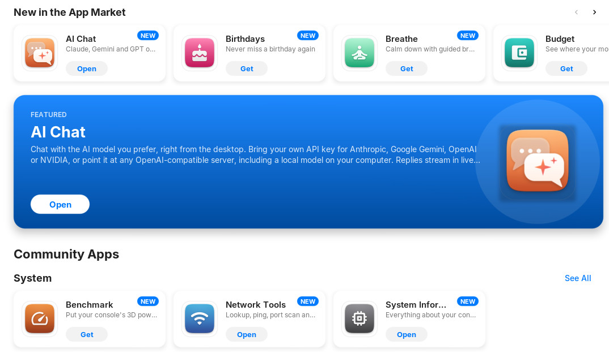</p>

Uygulamalar, oyunlar, temalar ve yazı tipi paketleri. Yeni rafı son iki haftada gelenleri, Öne Çıkan bölümü denemeniz
için bir öğeyi gösterir; her sayfa kurmadan önce izinleri listeler. Paketler SHA-256 ile denetlenir, güncellemeler tek
dokunuşla gelir, Homebrew bölümü bilinen homebrew programlarını GitHub sürümlerinden kurar. **Her öğe yayımlanmadan önce
bakımcı tarafından incelenir.** Tam liste: [Store/](Store/README.tr.md).

## Switch Araçları

<p align="center">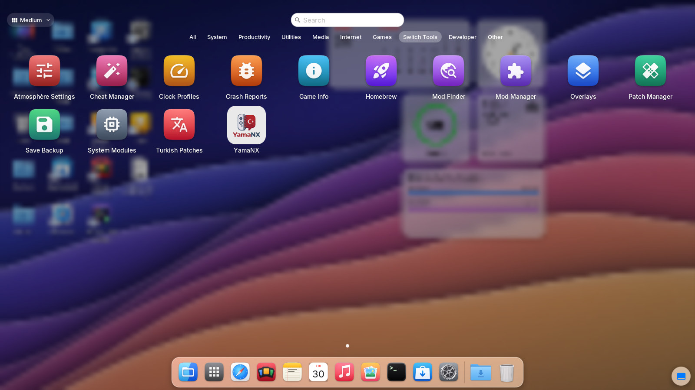</p>

Atmosphère kullanıcıları için bir araç klasörü: **Mod Yöneticisi** ve **Mod Bulucu**, **Hile Yöneticisi** (çalışan
oyunda hileleri açıp kapatma), **Katmanlar** (overlay'ler), **Saat Profilleri** (sys-clk için oyuna özel saat hızları),
**Sistem Modülleri**, **Kayıt Yedekleme**, **Oyun Bilgileri**, **Yama Yöneticisi**, **Çökme Raporları**, **Atmosphère
Ayarları** ve **Homebrew**. **Türkçe Yamalar** indirdiğiniz çeviri yamalarını kurar ve özgün dosyaları saklar, böylece
istediğiniz an geri dönebilirsiniz; **YamaNX** Switch oyunları için bir Türkçe yama yükleyicisidir. **Oyun Kitaplığı**
yüklü oyunlarınızı oynama süresi ve Albüm görüntüleriyle gösterir. Modlarla yapılan değişiklikler oyunun bir sonraki
açılışında geçerli olur.

## Erişilebilirlik ve diller

| | |
|:---:|:---:|
| 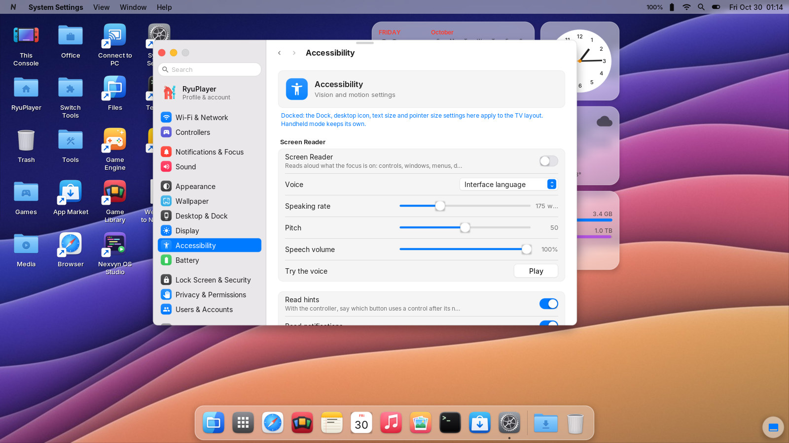 | 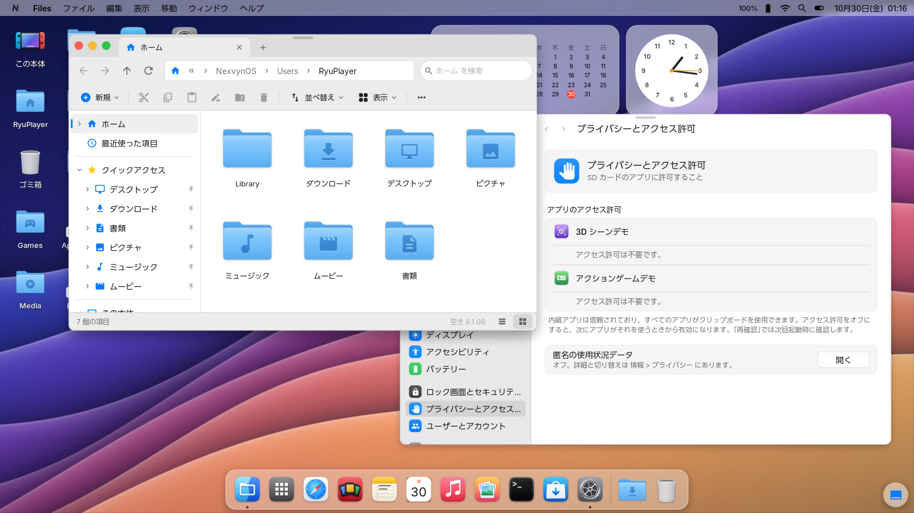 |
| **Ekran Okuyucu** ve erişilebilirlik ayarları | Sistemin tamamı **Japonca** |

- **8 dil:** English, Türkçe, Deutsch, Français, Español, 日本語, 中文 ve 한국어; Hangul ve romaji girişi.
- Odaktaki öğeyi sesli okuyan, sesi, hızı, perdesi ve ipuçları ayarlanabilen bir **Ekran Okuyucu**.
- İmleci takip eden yakınlaştırma, renkleri ters çevirme, yazı ve imleç boyutu, hareketi ve saydamlığı azaltma, büyük
  pencere düğmeleri.
- Kelime önerili ekran klavyesi (yerleşik, yüzen ya da bölünmüş) ya da konsolun kendi klavyesi.

## Size göre

| | |
|:---:|:---:|
| 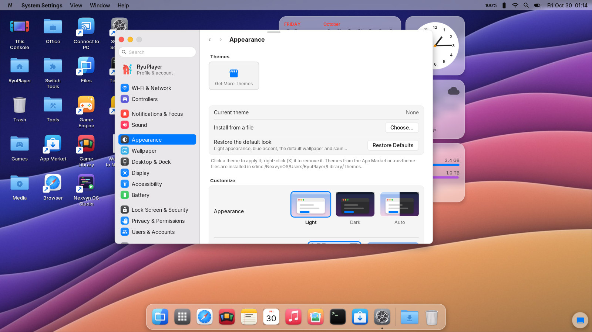 | 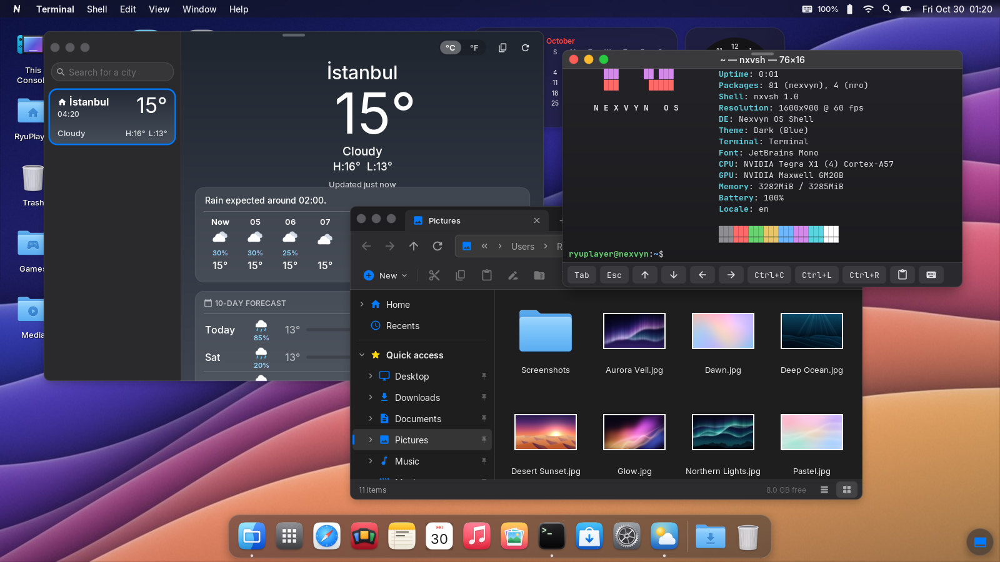 |
| **Görünüm:** açık, koyu ya da otomatik, vurgu renkleri, temalar | **Karanlık mod** |

Duvar kâğıtları, vurgu renkleri, Uygulama Mağazası'ndan temalar, zamanlanabilen Gece Modu, Dock boyutu ve konumu,
masaüstü simge boyutu, kendi avatarlarıyla birden çok kullanıcı ve kilit ekranında isteğe bağlı PIN.

## Gizlilik ve güvenlik

<p align="center">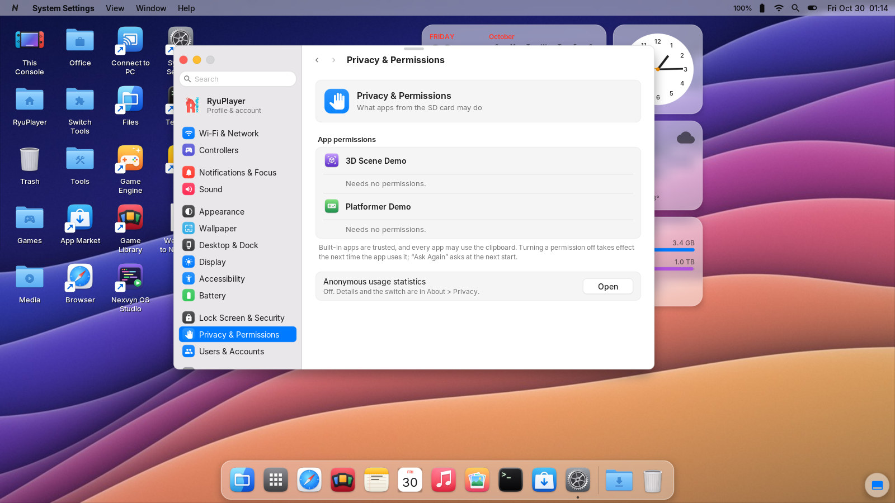</p>

- SD karttan kurulan uygulamalar ihtiyaç duydukları izinleri (ağ, dosyalar vb.) **bir kez** sorar. Bunları
  **Sistem Ayarları > Gizlilik ve İzinler** bölümünden görüp değiştirebilirsiniz. Yerel C, Java ve modül kodu ilk kez
  çalışmadan önce sorar.
- Tarayıcıdaki parolalar ve AI Sohbet'teki API anahtarları konsolda şifreli saklanır.
- **App Guard** her paketi kurulmadan önce tarar ve nedenleriyle birlikte *Sorun bulunmadı*, *İncele* ya da *Tehlikeli*
  sonucunu gösterir (özel verilerinizi dışarı gönderebilecek kod, çalışırken indirilip çalıştırılan kod, gizlenmiş kod).
  Tehlikeli uygulamalar ikinci bir onay ister. Mağaza uygulamaları dosya izni olsa bile sistem ayarlarını, başka
  uygulamaların verilerini ya da tarayıcının parolalarını okuyamaz. Sistem dosyaları görülebilir ama değiştirilemez.
  [Ayrıntılar](SDK/Guides/APP_GUARD.tr.md)
- Anonim kullanım istatistikleri Nexvyn OS ilk açıldığında bildirilir. Dosyalarınızı, parolalarınızı ya da anahtarlarınızı
  asla içermez; **Sistem Ayarları > Hakkında > Gizlilik** bölümünden istediğiniz an kapatabilirsiniz.
- Çöken uygulama tek başına kapanır, donan bir uygulama zorla kapatılabilir; belgeler otomatik kaydedilip geri yüklenir;
  çöken bir uygulama bir sonraki oturum açılışında bir kez atlanır ve bir şeyler ters giderse Güvenli Mod hazırdır.

## El modu, TV ve girdi

- **El ve TV düzenleri:** el modunda arayüz dokunmatik için daha büyüktür; TV'de kendi Dock'u, masaüstü simgeleri ve
  pencere çerçeveleriyle 1080p çizilir.
- **Dokunmatik:** dokunarak tıklama, basılı tutarak sağ tık, iki parmakla kaydırma, iki parmakla yakınlaştırma ve
  döndürme, ekran kenarlarından kaydırma ve masaüstleri arasında üç parmakla geçiş.
- **Kumanda:** sol çubuk imleci hareket ettirir, A tıklar, X sağ tıklar, D-pad düğmeler arasında atlar. Bir oyundan
  kumandayı geri almak için L+R'yi bir saniye basılı tutun.
- Yukarıdaki kısayollarla **USB klavye ve fare**.
- **Kaynaklara özenli:** boşta duran masaüstü saniyede 20 kareye iner, arka plandaki pencereler son karelerini yeniden
  kullanır, bellek azalınca resimler ve yazı tipleri boşaltılır.

---

## Kurulum

1. Atmosphère ile açılan bir Nintendo Switch gerekir.
2. [Son sürümden](https://github.com/sonerx7/Nexvyn-OS-NX/releases/latest) `NexvynOS.nro` dosyasını indirip SD kartta
   `sdmc:/switch/NexvynOS.nro` konumuna kopyalayın.
3. Homebrew menüsünden başlatın. **İpucu:** Homebrew menüsünü bir oyunu açarken **R**'yi basılı tutarak açın (başlık
   modu). Nexvyn OS böylece tam belleği kullanır; sistem tarayıcısı, Switch oyunlarını başlatma ve PC oyunları çalışır.
   HOME menüsünde kendi simgesiyle açmak için: [forwarder rehberi](SDK/Guides/FORWARDER.tr.md).
4. Kurulum yardımcısı dilinizi, klavyenizi, düzeninizi ve görünümü sorar. Sonunda adım adım öğreticilerle **İpuçları**
   uygulaması açılır.

Nexvyn OS bundan sonra kendini **Sistem Ayarları > Yazılım Güncelleme** üzerinden bu depodaki sürümlerden günceller.
Her şeyin ayrıntısı [kullanım rehberinde](SDK/Guides/USER_GUIDE.tr.md).

## Ne nerede

```
Store/            Uygulama Mağazası'nın kurduğu her şey
├── Apps/<kategori>/<kısa-ad>/      uygulamalar (ve Nexvyn OS ile gelen uygulamaların mağaza sayfaları)
├── Games/<tür>/<kısa-ad>/          oyunlar
├── Themes/<kısa-ad>/               temalar (.nxvtheme)
├── Fonts/<kısa-ad>/                yazı tipi paketleri (.nxvfont)
└── catalog.json, packages.json     konsolun okuduğu dosyalar; README.md hepsini listeler
SDK/              geliştiriciler için her şey, İngilizce ve Türkçe
├── Reference/                      SDK başvurusu, Java SDK, C başlığı
├── Languages/<dil>/                her dil için hızlı başlangıç ve şablon
├── Guides/                         kullanım ve geliştirici rehberleri
├── Samples/<dil>/<kısa-ad>/        çalışan örnekler (samples.json: Studio'nun Örnekleri)
├── AI/                             yapay zekâ asistanları için istemler
├── Publishing/                     nasıl yayımlanır, inceleme listesi
├── Fonts/                          sistem yazı tipleri
└── Tools/nxv/                      nxv komut satırı
Tools/            depo bakımı: build_store.py, CI
.github/          pull request şablonu, issue formları, CODEOWNERS, README görselleri ve tanıtım videosu
```

| Klasör | Buradan başlayın |
|---|---|
| [`Store/`](Store/README.tr.md) | Uygulamaların, oyunların, temaların ve yazı tiplerinin tam listesi |
| [`SDK/`](SDK/README.tr.md) | Dillere göre "Buradan başlayın", başvuru, rehberler, örnekler, yayımlama |
| [`Tools/`](Tools/README.tr.md) | Kataloğun nasıl üretilip denetlendiği |

## Geliştiriciler için

[SDK](SDK/README.tr.md) ile başlayın: her dil için hızlı başlangıç ve şablon,
[geliştirici rehberi](SDK/Guides/DEVELOPER_GUIDE.tr.md), [Oyun Motoru rehberi](SDK/Guides/GAME_ENGINE.tr.md),
[`.nxvapp` biçimi](SDK/Guides/NXVAPP_FORMAT.tr.md) ve [çalışan örnekler](SDK/Samples). Uygulamanın tamamını konsolda
Nexvyn OS Studio'da ya da bilgisayarınızda `nxv` komut satırıyla yazabilirsiniz.

## Uygulamanızı yayımlayın

Herkes bir uygulama, oyun, tema ya da yazı tipi gönderebilir; bakımcı her gönderiyi yayımlanmadan önce inceler.

1. [SDK](SDK/README.tr.md) ile bilgisayarınızda ya da Nexvyn OS Studio'da yapın.
2. Bu depoyu fork edin ve öğenizi `Store/Apps/<kategori>/<kısa-ad>/`, `Store/Games/<tür>/<kısa-ad>/`,
   `Store/Themes/<kısa-ad>/` ya da `Store/Fonts/<kısa-ad>/` altına ekleyin.
3. Denetimleri çalıştırın (`nxv check`, `Tools/build_store.py --check`) ve şablonla bir pull request açın.
4. Otomatik denetimlerden sonra bakımcı [inceleme listesiyle](SDK/Publishing/REVIEW.tr.md) inceler; onaylanıp
   birleştirildiğinde Uygulama Mağazası'nda Yeni olarak görünür.

Akışın tamamı, içerik kuralları, güncellemeler, bildirimler ve imzalama: [SDK/Publishing](SDK/Publishing/PUBLISHING.tr.md).
Bir öğeyi bildirmek için mağaza sayfasındaki **Bu Uygulamayı Bildir** düğmesini ya da
[bildirim formunu](https://github.com/sonerx7/Nexvyn-OS-NX/issues/new?template=report-app.yml) kullanın.

## SSS

**Konsolun sisteminin yerine mi geçiyor?**
Hayır. Nexvyn OS, Atmosphère ile konsolun kendi sisteminin üzerinde çalışan bir homebrew uygulamasıdır. Kapattığınızda
Homebrew menüsüne dönersiniz. Oyunlar, hesaplar, Albüm, pil ve Wi-Fi için konsolun kendi servislerini kullanır.

**Yeniden başlatmam ya da SD kartı bölümlemem gerekir mi?**
Hayır. Tek bir `.nro` dosyasını kopyalayıp başlatın.

**Neden başlık modu?**
Albüm'den (applet modu) açılan homebrew belleğin yalnızca küçük bir kısmını alır. Nexvyn OS orada da çalışır ve bunu bir
kez söyler, ama bazı özellikler başlık modunun tam belleğine ihtiyaç duyar.

**Dosyalarım nerede?**
`sdmc:/NexvynOS/Users/<adınız>/` içinde (Desktop, Documents, Downloads, Pictures, Music, Movies). Ayarlar ve uygulamalar
hemen yanında, `sdmc:/NexvynOS/` altında durur.

**Switch oyunlarımı başlatabilir mi?**
Evet. Oyun Kitaplığı yüklü oyunlarınızı listeler ve Nexvyn OS başlık modunda çalışırken başlatır.

**Mod ve hile kullanmak güvenli mi?**
Switch Araçları yalnızca SD karta yazar. Değiştirilmiş oyunlarla ya da hilelerle çevrimiçi oynamak hesabın
engellenmesine yol açabilir; bunları çevrimdışı kullanın.

**Emülatörde çalışır mı?**
Ekran görüntüleri ve video bir emülatörde çekildi. USB bellek, MTP ve kamera gibi gerçek donanım isteyen özellikler
yalnızca konsolda çalışır.

**Güncellemeleri nasıl alırım?**
Sistem Ayarları > Yazılım Güncelleme yeni sürümü indirir, eskisinin yedeğini alır ve kurar.

## Yol haritası

Nexvyn OS'un bundan sonra nereye gittiği, 1.1, 1.2 ve 2.0 için ölçülebilir hedeflerle: daha hızlı açılış, hiç kaybolmayan
iş, her denetimi okuyan bir Ekran Okuyucu, daha çok dil, daha iyi bir tarayıcı ve daha büyük bir Uygulama Mağazası.
[Yol haritasını](ROADMAP.tr.md) okuyun ve [nasıl yardım edebileceğinize](ROADMAP.tr.md#nasıl-yardım-edebilirsiniz) bakın:
bir uygulama yayımlayın, hata bildirin ya da çeviri yapın.

## Lisans ve emeği geçenler

Nexvyn OS **GPL-3.0-or-later** ([LICENSE](LICENSE)); üçüncü taraf bileşenler ve lisansları
[THIRD_PARTY_NOTICES.md](THIRD_PARTY_NOTICES.md) dosyasında. Mağazadaki öğeler, aksi belirtilmedikçe aynı lisansla gelir
(yazı tipi paketleri kendi lisanslarını taşır, çoğu SIL Open Font License). YamaNX, SertAy'ın YamaNX'ine dayanır.
Nintendo Switch, Nintendo'nun ticari markasıdır; bu proje Nintendo ile ilişkili değildir. Tarayıcı, YousTube, Canlı TV
ve Radyo'da görünen içerikler sahiplerine aittir.

Geliştiren: **Soner Çakır** · [github.com/sonerx7](https://github.com/sonerx7) — tasarımı ve yönetimi sahibine ait,
yapay zekâ destekli kodlama araçlarının yardımıyla geliştirildi.
