
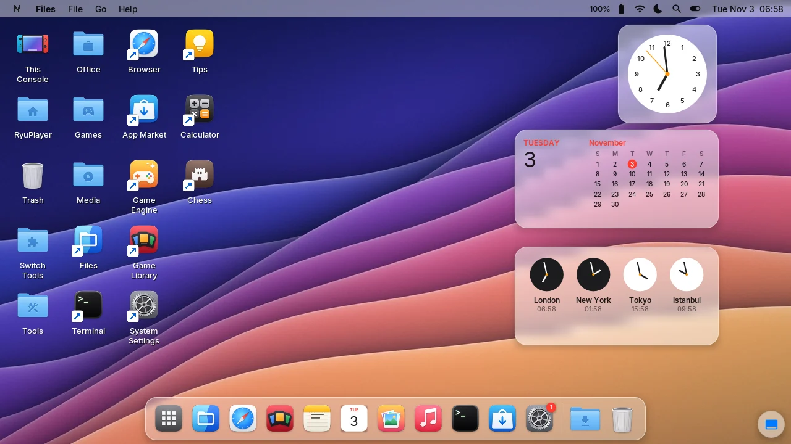

<h1 align="center">Nexvyn OS</h1>

<b>Bir Switch'te tam masaüstü, yerel 3B, gerçek bir Uygulama Mağazası ve tarayıcı.</b> 
<i>Yerel 3B 10'dan 60 fps'e. GBA oyunu tam hızda. Tarayıcıda masaüstü siteleri, WebGL ve video. Konsolda ölçüldü.</i>

<a href="https://github.com/sonerx7/Nexvyn-OS-NX/blob/main/.github/assets/video/hero_30s.mp4">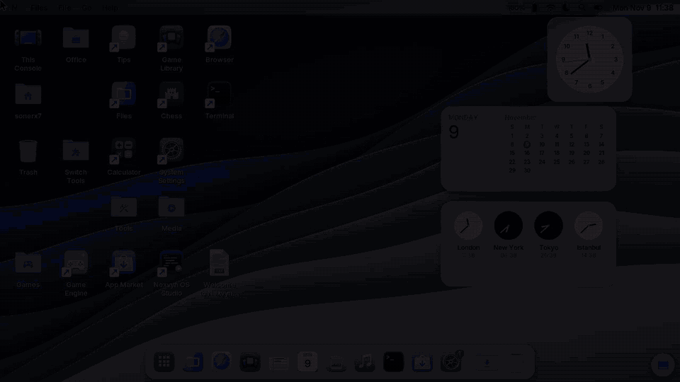</a> <a href="https://github.com/sonerx7/Nexvyn-OS-NX/blob/main/.github/assets/video/hero_30s.mp4">30 saniyelik turu izle</a> · <a href="https://github.com/sonerx7/Nexvyn-OS-NX/blob/main/.github/assets/video/overview.mp4">2 dakikalık genel bakış</a> · <a href="https://github.com/sonerx7/Nexvyn-OS-NX/blob/main/.github/assets/video/blockcraft_trailer.mp4">BlockCraft fragmanı</a>

<b>YouTube'da:</b> <a href="https://www.youtube.com/@NexvynOSNX">kanal</a> · <a href="https://www.youtube.com/watch?v=_DQouwS2TYQ">tam tanıtım</a> · <a href="https://www.youtube.com/watch?v=3aze4gmaLnI">temalar ve Doom portu</a> · <a href="https://www.youtube.com/watch?v=5R1F_wDSVAM">BlockCraft</a> · <a href="https://www.youtube.com/watch?v=Wvk8iQVjDMw">tarayıcıda WebGL</a>

- Tek bir `.nro`, Homebrew Menüsü'nden açılır. Yeniden başlatma yok, bölümleme yok.
- Pencereli bir masaüstü (Dock veya görev çubuğu düzeni), 70'ten fazla yerleşik uygulama ve her öğesi incelenmiş bir Uygulama Mağazası.
- Konsolda ya da PC'de uygulama ve oyun yapmak için, donmuş ABI v1'li yerel C/C++ SDK'sı; ayrıca Lua, JavaScript ve Python.

### 1.3.0'da yenilikler

**Tarayıcı: varsayılan olarak masaüstü siteleri.** Tarayıcı masaüstü siteleri ister, böylece çoğu sayfa masaüstü düzeninde açılır. Ayarlarda "Mobil siteleri iste" seçeneği vardır (varsayılan kapalı); her site adres çubuğu menüsünden ayrıca değiştirilebilir.

**Tarayıcı: webin daha çok parçası çalışıyor.**

- Canvas 2D: doğrusal ve radyal gradyanlar, desenler, `clip()` ile `save()` / `restore()`, birleştirme işlemleri, affine `drawImage`, `OffscreenCanvas` ve `createImageBitmap`, `setLineDash`, yaklaşık gölgeler.
- Üç boyutlu kitaplıklar için WebGL 1, ayrıca erken WebGL 2 (instancing, uniform buffer, 3B ve dizi dokuları, çoklu render hedefi, transform feedback). Bilinen WebGL 2 eksikleri: bir 2B dizi dokusunun tek katmanına çizim, 3B dokuların örneklenmesi ve vertex array veya örnek sayısı değiştikten sonra `drawArraysInstanced`. Hatalı çağrı yanlış piksel üretir; sayfa çökmez.
- ES modülleri, Web Worker'lar (aynı köken; modül worker'ları dahil), IndexedDB, Gamepad API, WebAssembly (varsayılan kapalı, Ayarlar'dan açılır) ve oyun kumandasıyla bağlantılar arasında gezinme.
- Sayfa içinde video: MP4, WebM ve HLS sistemin medya oynatıcısıyla oynar (yazılımsal çözme). MediaSource, H.264 + AAC parçalı MP4 ve WebM için çalışır. Clear Key ile şifrelenmiş video (EME ClearKey) oynar.
- Çerezler, giriş formları ve üçüncü taraf çerez engelleme (varsayılan açık). Yerel bir giriş test paketiyle sınandı; canlı sitelere giriş deneyseldir.

**Tarayıcı: henüz çalışmayanlar.**

- **Netflix ve diğer DRM'li yayınlar oynamaz.** Widevine, FairPlay ve PlayReady desteği yoktur; korumalı video reddedilir.
- **YouTube deneyseldir.** Sayfa açılır ve oynatıcı başlar, ancak her videoda oynatma henüz güvenilir değildir.
- Web yazı tipleri (`@font-face`), Service Worker ve WebSocket henüz desteklenmez.

**Tarayıcı: hız ve bellek.** Çok sekme açıkken ya da konsol bellek azaldığını bildirdiğinde arka plan sekmeleri bellekten boşaltılır; gösterildiklerinde yeniden yüklenir. Büyük script'ler derlenmiş hâlde SD kartta tutulur, böylece yeniden ziyarette açılış hızlanır. Takılan bir script bir saniyede kesilir; Tarayıcı artık bunun için "yanıt vermiyor" penceresi göstermez.

**Uygulama Mağazası'nda beş emülatör.** NES, Game Boy ve Game Boy Color, Mega Drive, SNES ve Game Boy Advance. Her biri Uygulama Mağazası'ndan ayrı bir uygulama olarak kurulur ve hepsi tek bir kütüphane arayüzünü paylaşır:

- Kapaklı, aramalı, sıralamalı ve favorili ana sayfa; son oynananlar; her oyun için ayrıntı paneli.
- Oyun içi ekran görüntüleri (kısayol veya duraklatma menüsü), istenirse kapak olarak kullanılabilir.
- Oyun ve sistem bazında ayarlar, 1 ile 9 arası durum kaydı yuvaları, çıkışta durumu kaydetme ve açılışta yükleme seçeneği.
- Kapak resmi, kutu görseli ve ekran görüntüleri için isteğe bağlı çevrim içi arşiv. İlk açılışta kabul edene kadar kapalıdır; Kütüphane ayarlarından değiştirilebilir. Yalnızca oyun adları ve konsolun adresi gönderilir.

**Yerel SDK 1.2: pencereler için sistem entegrasyonu.** `"minNative": "1.2"` ile derlenen uygulamalar şunları yapabilir:

- Pencere başlığını ve alt başlığı ayarlamak, tam ekran veya büyütülmüş moda geçmek ve OS'un "kaydedilmemiş iş" işaretini göstermek. Kaydedilmemiş işi olan bir uygulamayı kapatmadan önce Nexvyn OS sorar.
- Pil, şarj, dock ve ağ durumunu okumak; biri değiştiğinde olay almak. Durum her karede okunabilecek kadar ucuzdur.
- OS uyarı, soru ve metin istemi kutularını göstermek; böylece yerel bir uygulama sistemin geri kalanı gibi görünür.
- Güven modeli (tüm yerel uygulamalar, `minNative`'e bağlı değil): yerel uygulama kurulurken denetlenir ve bir kez güvenilir kılınır; kaydı kimliği ve özeti ile tutulur. Her açılışta yeniden sorulmaz.

Yerel kit ayrıca metin alanı odaklandığında OS ekran klavyesi isteğini (`nxn_input_text_request`) ve uygulamanın kendi menülerinin OS menü çubuğunda görünmesini (`nxn_menu_set`) içerir.

Eski yerel uygulamalar (1.0 ve 1.1) değişmeden çalışır. Bkz. [SDK/Reference](SDK/Reference/README.tr.md) ve [SDK/Guides](SDK/Guides/README.tr.md).

**Uygulama Mağazası: Çalışma Zamanları ve Kitaplıklar.** Diğer uygulamaların kullandığı çalışma zamanları ve paylaşımlı kitaplıklar için yeni kategori.

**Performans ve güvenlik.** Takılma kaydı, sistem günlüğüne yavaş adımın adını yazar; yavaş bir sayfa böylece bulunur. Tarayıcı güvenlik düzeltmeleri: siteler arası yönlendirmeler artık giriş başlıklarını taşımaz, worker'lar aynı kökende kalır, WebGL aralık taşmaları denetlenir ve bayt kodu önbelleği kaynağın özetiyle anahtarlanır.

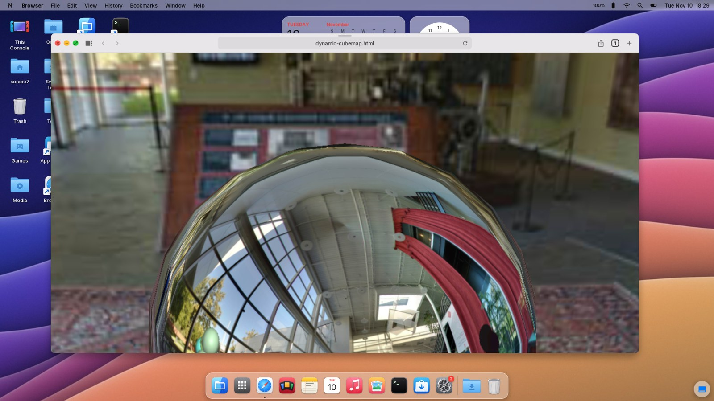

<table>
<tr>
<td>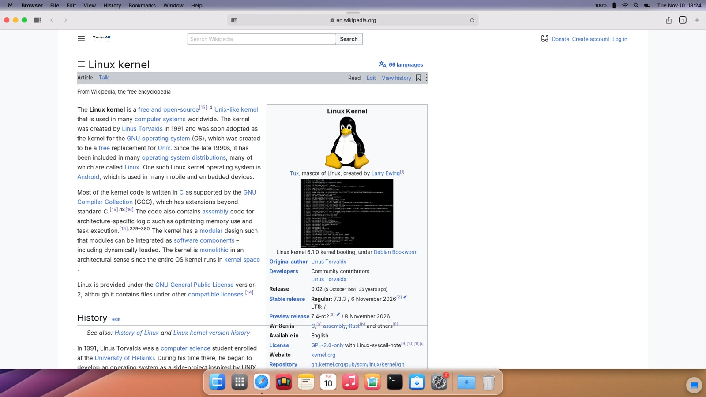 Masaüstü Wikipedia maddesi</td>
<td>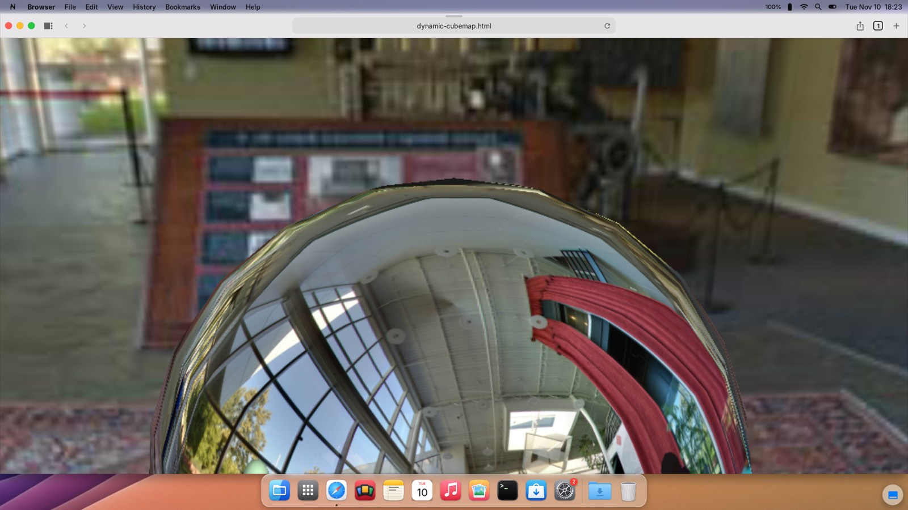 Sayfada WebGL</td>
<td>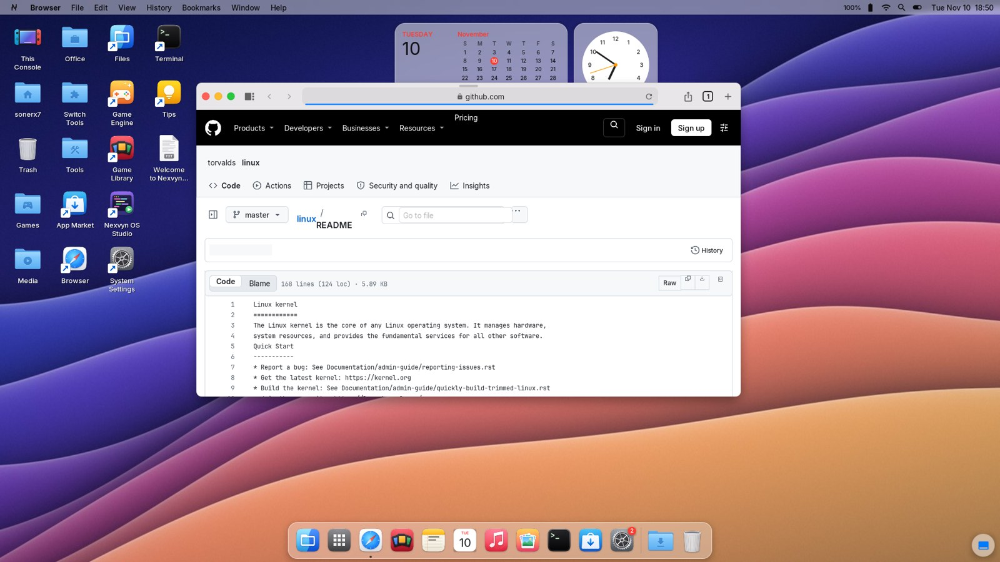 Masaüstü GitHub sayfası</td>
</tr>
<tr>
<td colspan="3" align="center">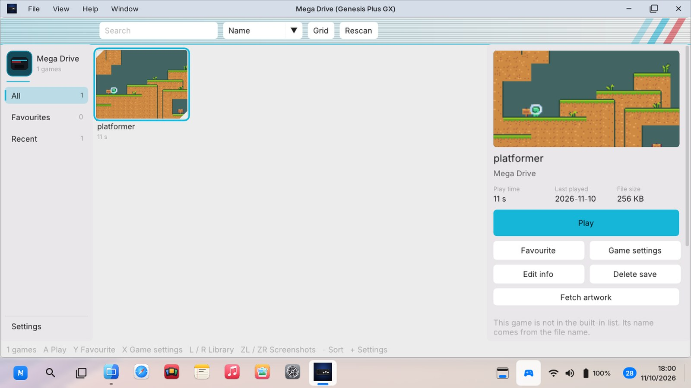 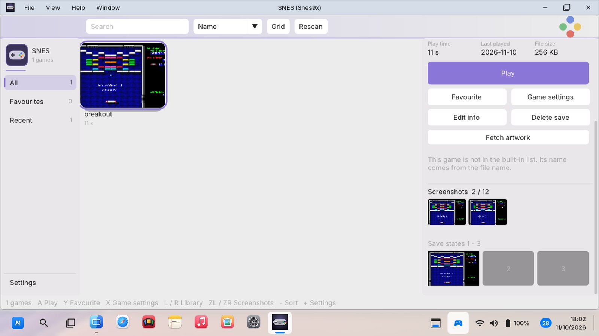</td>
</tr>
<tr>
<td colspan="3" align="center">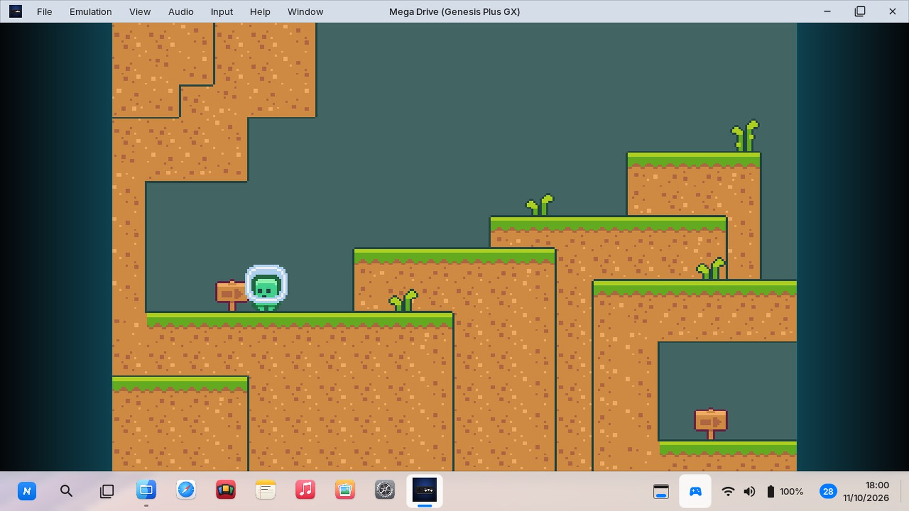 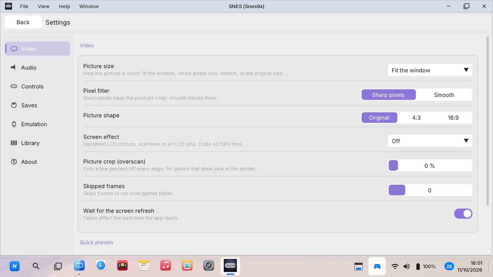</td>
</tr>
</table>

---

### Farkını yaratan 10 şey

1. **Yerel uygulamalar tam hızda.** C ve C++ uygulamaları masaüstünde kendi pencerelerinde çalışır. Konsolda ölçüldü: 3B sahneler 10'dan 59 fps'e, OpenGL vitrini 10-16'dan 60 fps'e, kare aktarımı 15-24 ms'den 0,1 ms'ye, sahne yükleme yaklaşık 30 s'den 0,6 s'ye çıktı. Klasik oyun portları (bir Doom motoru, bir Quake motoru, bir GBA emülatörü) pencerede ya da tam ekranda çalışır.

   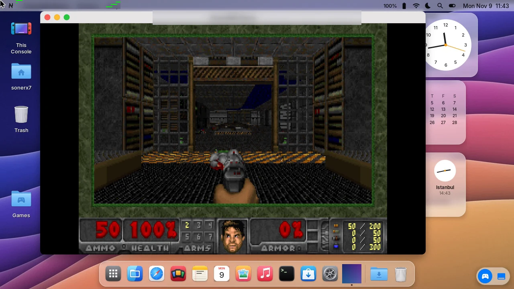 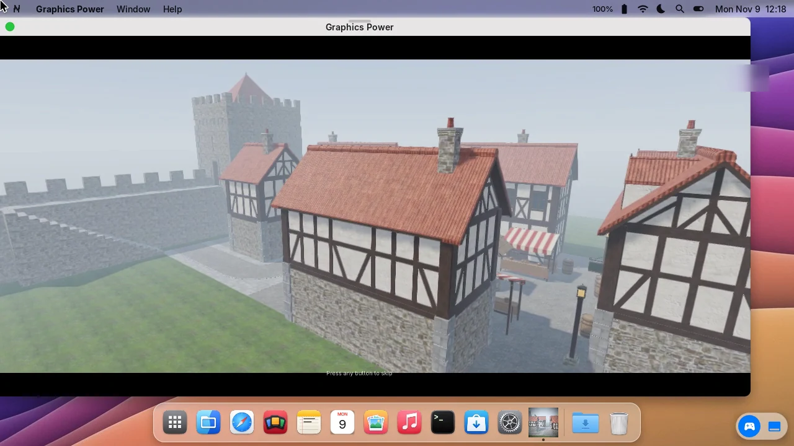

2. **Tarayıcıda masaüstü siteleri ve WebGL.** Yerleşik tarayıcı masaüstü siteleri ister ve WebGL 1 çalıştırır; popüler açık kaynak 3B web kitaplıkları çalışır: dönen bir 3B sahne konsolda yaklaşık 48 fps'te çalışır. Erken WebGL 2 sınanıyor. Varsayılan olarak açıktır.

   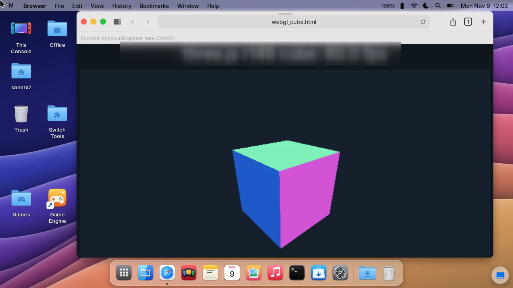

3. **Tek SDK, dört dil.** Lua, JavaScript, Python ve C aynı API'yi aynı adlarla kullanır: pencereler, arayüz, dosyalar, ağ, ses, girdi, 2B ve 3B. Her yeni özellik dördüne de gelir. Kitte yapımcılar için rehberler, örnekler, denetleyiciler ve AI istemleri vardır.
4. **Modern bir 3B motoru.** NexGFX fiziksel tabanlı bir renderer sunar: metal ve pürüzlülük malzemeleri, normal ve emisyon haritaları, gerçek zamanlı ışıklar, güneş ve spot gölgeler, HDR, tone mapping, bloom, MSAA ve instancing. Uygulamalar katılır; eski uygulamalar aynı görünür.

   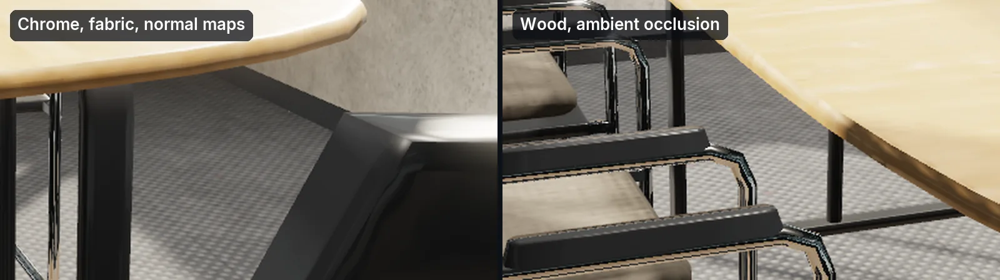

5. **Gerçek 3B modeller.** `.glb`, `.gltf`, `.fbx`, `.obj` ve `.stl` dosyaları düğüm ağaçları, malzemeler, dokular ve crossfade'li iskelet animasyonuyla yüklenir; GPU'da skinning yapılır.
6. **Voksel motoru.** Sonsuz blok dünyaları, oyuncunun etrafında arka plan iş parçacıklarında akar; güneş ve meşale ışığı, yumuşak aydınlatma, ortam kapanması, su, kaydetme, ışın seçimi ve fizik vardır. Bu yüzden blok inşa eden bir oyun birkaç yüz satırdır.
7. **Tam tema paketleri.** Tema her şeyi değiştirir: renkler, pencere çerçeveleri, Dock veya görev çubuğu, her simge (uygulamalar, klasörler, dosya türleri, diskler), sesler ve duvar kâğıtları. İlk açılışta seçin: Glass, Classic, Terminal ve daha fazlası; Uygulama Mağazası'nda daha fazla tema var. Eksik simgeler varsayılan pakete döner; bir tema kiti herkesin kendi temasını yapmasını sağlar.

   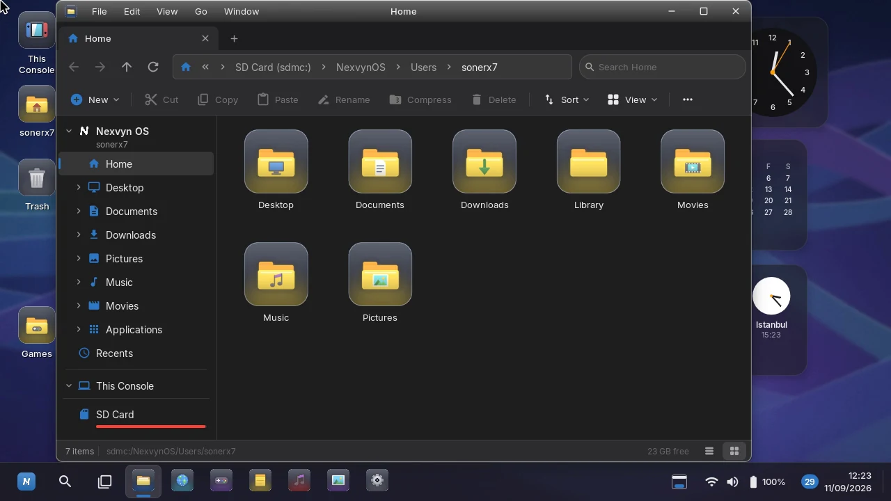 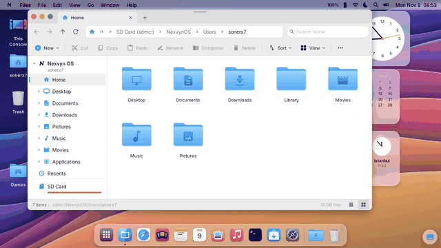

8. **Performans modu.** Resmî en yüksek saat hızları varsayılan olarak açıktır; yükleme daha hızlıdır ve isteğe bağlı bir overclock, önce uyarı verir. Kurulumlar arka planda yapılır; takılan bir uygulama masaüstünü dondurmaz: bir çıkış bekçisi vardır ve sistem bir şeyi kapatmadan önce sorar.

   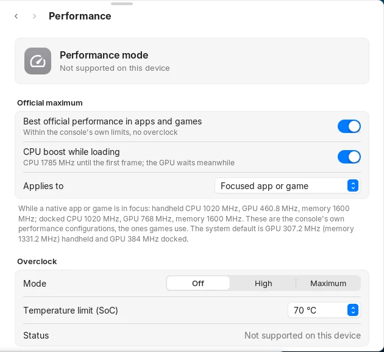

9. **Uygulama Mağazası.** Yaklaşık 170 uygulama, oyun, tema ve yazı tipi; sekmeler, kategoriler, teknik demolar vitrini, ekran görüntüleriyle tam sayfa ayrıntılar, canlı kurulum ilerlemesi (MB, hız, kalan süre) ve tek dokunuşla güncellemeler. Bazı yerleşik uygulamalar da buradan güncellenir.

   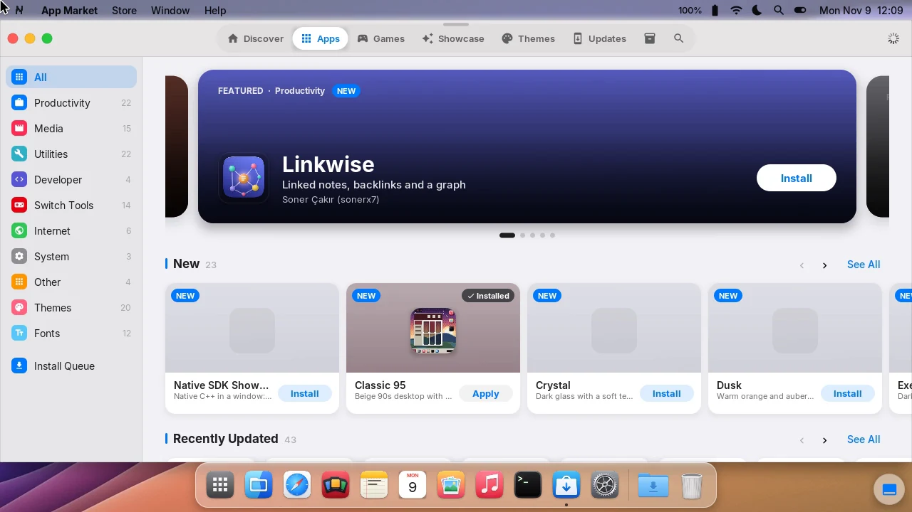 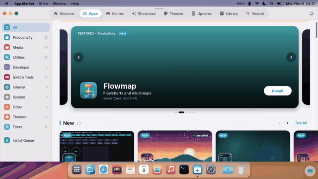

10. **Switch için gerçek bir masaüstü.** Taşınabilir pencereler, çok dokunuşlu hareketler, Joy-Con, dokunmatik, el ve dock modunda oyun, 8 dil, çevrimdışı çalışan ilk açılış sihirbazı, güvenli mod, derin sıfırlama ve birden çok sağlayıcıyla çalışan bir AI Sohbet uygulaması.

   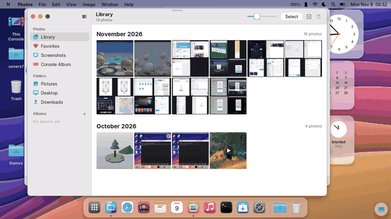

### İki masaüstü, seçim sizin

İlk kurulumda Dock veya görev çubuğu düzenini seçin; istediğiniz zaman değiştirin. Pencereler, yaslama, sanal masaüstleri, Hızlı Arama, Denetim Merkezi ve widget'lar iki düzende de aynı çalışır.

| Dock | Görev çubuğu |
|---|---|
|  | 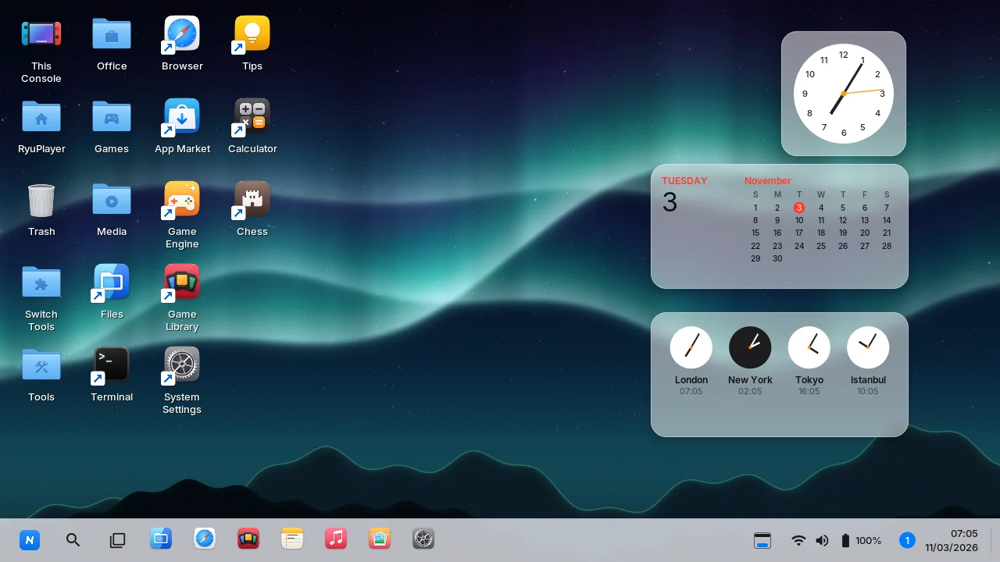 |

### Stilinizi seçin

İlk kurulum bir görünüm ister. Renkler, çubuklar, simgeler ve sesler birlikte değişir; daha fazla stil Uygulama Mağazası'nda Temalar altında bekler.

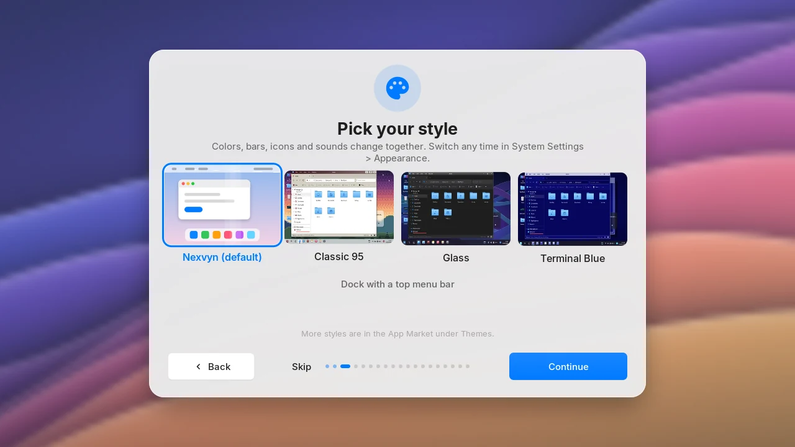

| Classic 95 | Glass | Terminal Blue |
|---|---|---|
| 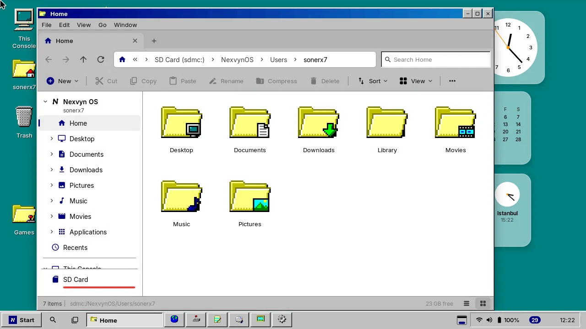 |  | 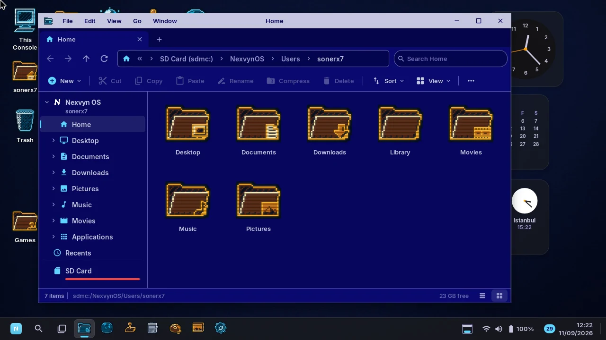 |

### Yeniden tasarlanmış Uygulama Mağazası

Keşfet, Uygulamalar, Oyunlar, Vitrin, Temalar ve Güncellemeler. Ekran görüntüsü galerisiyle tam sayfa uygulama ayrıntıları; kurulum sırasında canlı indirme hızı ve MB. Kurulumlar arka planda yapılır; yavaş bir SD kart artık masaüstünü dondurmaz.

| Keşfet | Uygulama ayrıntısı | Temalar |
|---|---|---|
|  | 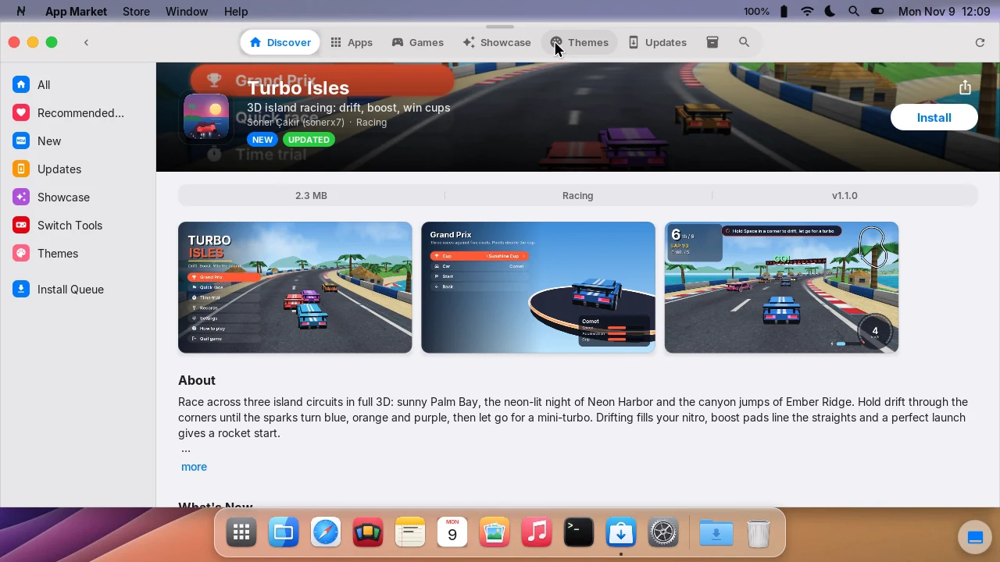 | 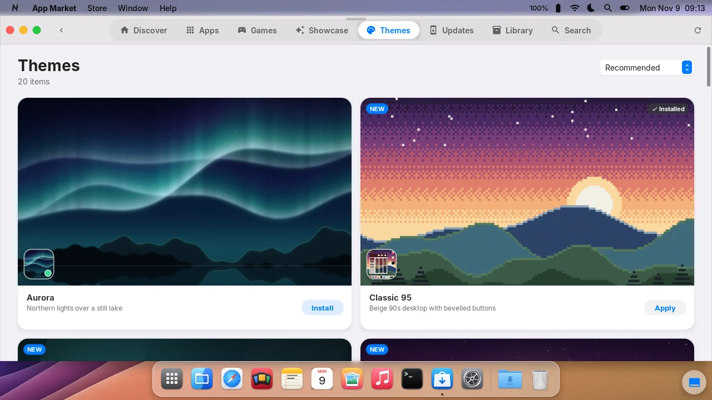 |

### Etkileyici

| | |
|---|---|
| **Native SDK Showcase** Pencerede kendi 3B görünümü, testleri ve canlı durumu olan bir C++ uygulaması.  | **Freedoom ile Doom motoru** Ücretsiz oyun verisi, temiz ses, dokunmatik ve Joy-Con.  |
| **GBA tam hızda** Ücretsiz bir homebrew GBA oyunu (MIT lisansı), ilk konsol testinde 59,2 fps; ilk derleme 4-5 veriyordu. 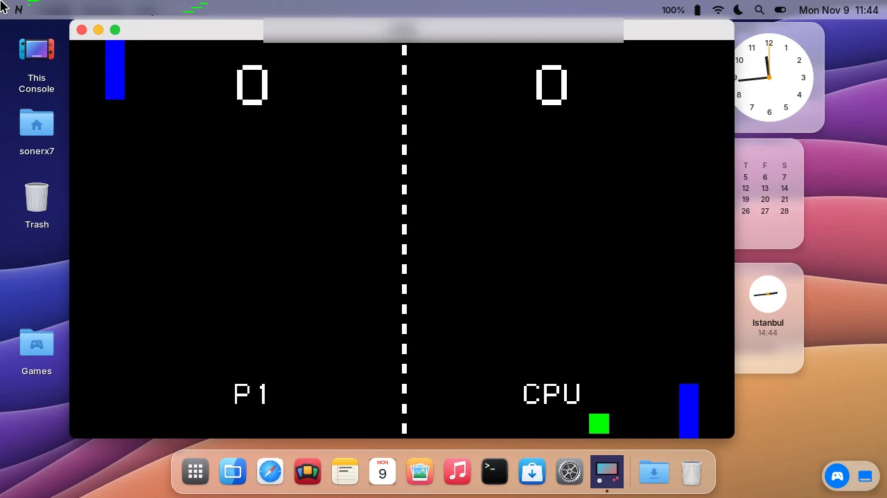 | **Tarayıcıda WebGL** Testte yaklaşık 57-58 fps bir three.js küpü (deneysel, varsayılan kapalı).  |
| **1.2.2'de yenilikler** Sürümü ilk açışınızda kısa bir turla tanıtır; Ayarlar'dan istediğiniz zaman açılır. 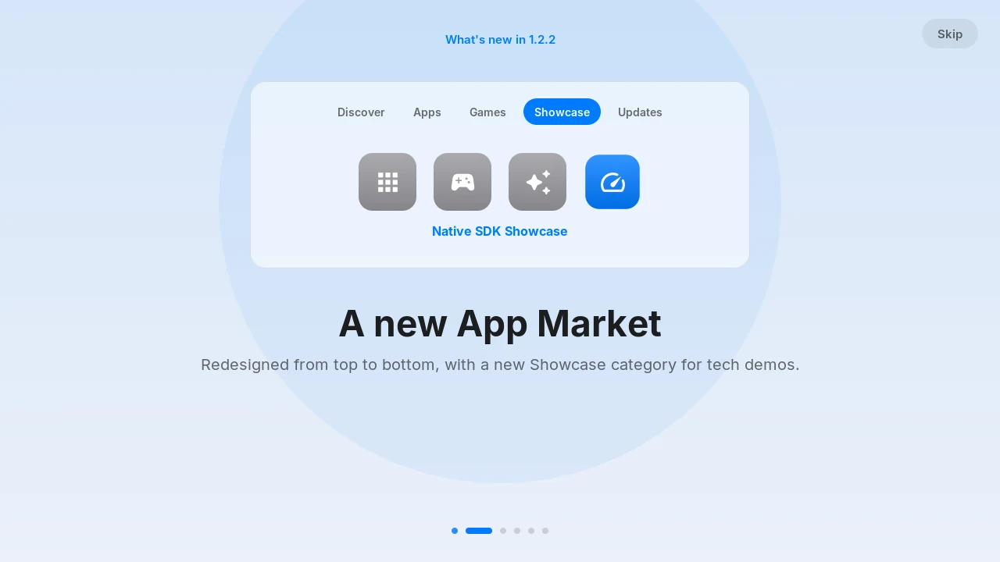 | **Resmî en yüksek saatler** Varsayılan açık; uyarıyla açılan isteğe bağlı overclock.  |

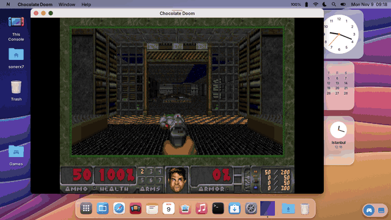

### Sayılar

Switch OLED'de ölçüldü; ilk test, son tura karşı (varsayılan ayarlar).

| Test | Önce | Şimdi |
|---|---|---|
| Yerel 3B sahne | 10 / 15 fps | 59,5 / 59,6 fps |
| OpenGL vitrini | 10-16 fps | 51,4 fps varsayılan, 59,9 fps ayarlı |
| GBA emülasyonu (gerçek oyun) | 4-5 fps | 59,2 fps, tam hız |
| Uygulama karesi ekrana | 15-24 ms | 0,10-0,22 ms |
| Sahne yükleme | ~30 sn | 0,58 sn |
| El GPU saati, resmî en yüksek | 307 MHz | 460 MHz (ölçüt 69,0'dan 84,5 fps'e) |

60 fps ekranın sınırıdır; bu yüzden bazı testler "60'ta kilitli" yazar.

### Geliştiriciler için

Donmuş ABI v1'li yerel C ve C++ (bundan sonra yalnızca ekleme): 1.0 kitiyle derlenmiş bir modül bugünkü sistemde de açılır. Her yeni API Lua, JavaScript, Python ve C'ye aynı adlarla gelir. Port kiti portları ayrı uygulamalar olarak paketler. Bkz. [SDK](SDK/README.tr.md).

Rehberler yeni sistem entegrasyonu çağrılarını anlatır: [Yerel kit](SDK/Guides/NATIVE_KIT.tr.md) ve [Tarayıcı](SDK/Guides/BROWSER.tr.md).
