<p align="center"></p>

<h1 align="center"> Nexvyn OS</h1>

<p align="center"><a href="README.md">English</a> · <b>Türkçe</b></p>

<p align="center"><b>Nintendo Switch için eksiksiz bir masaüstü işletim sistemi kabuğu; üstelik üzerinde oyun yapabileceğiniz bir yer.</b><br>
Gerçek pencereler, iki masaüstü düzeni, web tarayıcısı, video, ofis uygulamaları, oyun motoru, 3D modelleme, kod
stüdyosu ve Uygulama Mağazası; hepsi Homebrew menüsünden açılan tek bir <code>.nro</code> içinde. Yeniden başlatma yok,
SD kart bölümleme yok.</p>

<p align="center">
<a href="https://github.com/sonerx7/Nexvyn-OS-NX/releases/latest"></a>
<a href="LICENSE"></a>
<a href="SDK/README.tr.md"></a>
<a href="#erişilebilirlik-ve-diller"></a>
</p>

<p align="center">
<a href="https://github.com/sonerx7/Nexvyn-OS-NX/releases/latest"><b>⬇ NexvynOS.nro'yu indir</b></a> ·
<a href="#120da-yeni-neler">Yeni neler</a> ·
<a href="#sdk-18-konsolda-3d-oyun-yapın">SDK 1.8</a> ·
<a href="SDK/Guides/MAKE_A_GAME.tr.md">Oyun yap</a> ·
<a href="SDK/Guides/USER_GUIDE.tr.md">Kullanım rehberi</a> ·
<a href="Store/README.tr.md">Uygulama Mağazası</a> ·
<a href="CHANGELOG.md">Sürüm notları</a> ·
<a href="ROADMAP.tr.md">Yol haritası</a>
</p>

<p align="center"></p>

> Görseller ve videolar İngilizce arayüzle çekildi; Nexvyn OS'un tamamı Türkçe de kullanılabilir.

## Bir bakışta

- **Gerçek bir masaüstü.** Üst üste binen, boyutlandırılabilen pencereler, kenara yaslama, sanal masaüstleri, Pencere
  Görünümü, Başlatıcı (Launcher), Hızlı Arama, Denetim Merkezi, Bildirim Merkezi, masaüstü widget'ları ve her yerde
  sağ tık menüleri.
- **İki düzen.** **Dock düzeni** (üstte menü çubuğu, altta Dock) ya da **görev çubuğu düzeni** (Başlat menülü görev
  çubuğu, menüler her pencerenin içinde). İstediğiniz an geçebilirsiniz.
- **70'i aşkın yerleşik uygulama.** Tarayıcı, YousTube, Canlı TV, Radyo, Müzik, Fotoğraflar, Video Oynatıcı, Kelime
  İşlemci, Hesap Tablosu, Sunum, Dosyalar, Terminal, Hava Durumu, Haritalar, Takvim, Notlar ve çok daha fazlası.
- **Konsolda oyun ve uygulama yapın.** Üç dokunuşluk **Hızlı Oyun**'lu Oyun Motoru, profesyonel araçlarıyla
  **3D Modelleme** ve altı dilde kod için **Nexvyn OS Studio**. **SDK 1.8** animasyonlu `.glb`, `.gltf` ve `.fbx`
  modelleri yükler.
- **Uygulama Mağazası (App Market).** Uygulamalar, oyunlar, temalar ve yazı tipi paketleri; her biri yayımlanmadan önce
  incelenir.
- **Switch Araçları.** Modlar, hileler, overlay'ler, saat profilleri, sistem modülleri, kayıt yedekleri ve Türkçe yamalar.
- **Herkes için.** 8 dil, Ekran Okuyucu, dokunmatik, kumanda, USB klavye ve fare, el ve TV düzenleri.

---

## 1.2.0'da yeni neler

| | |
|:---:|:---:|
| 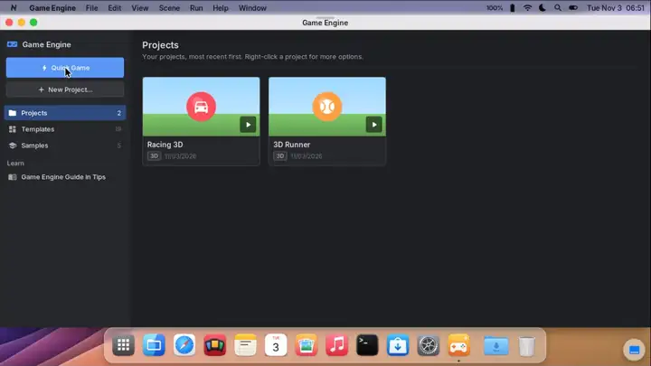 | 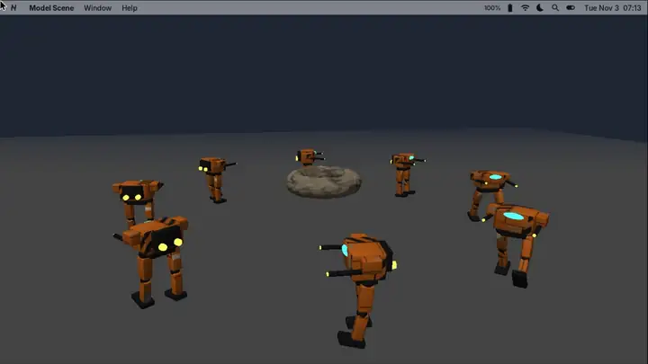 |
| **Hızlı Oyun:** tür, dünya, Hemen oyna. Birkaç saniyede 3D bir yarış | **Animasyonlu 3D modeller:** GPU'da çizilen, yürüyen iskeletli `.fbx` modeller |
| 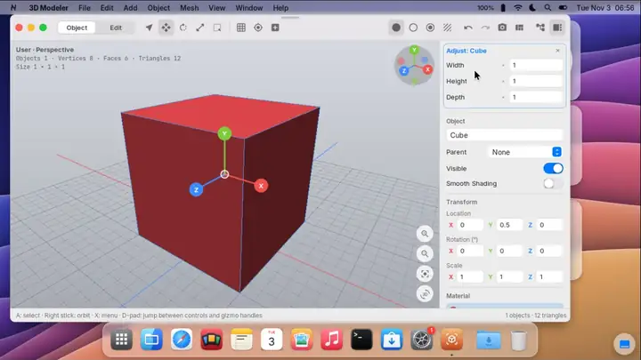 | 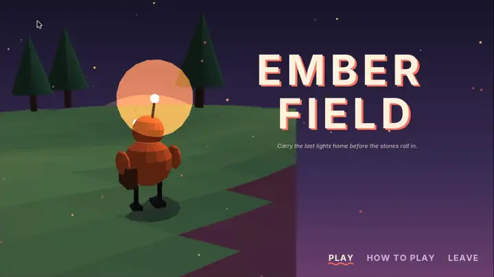 |
| **3D Modelleme:** loop cut ve segmentli bevel | **Ember Field:** animasyonlu `.glb` kahramanlı eksiksiz bir 3D oyun şablonu |

- **SDK 1.8: 3D model dosyaları.** `g3d.model` ve `g3d.loadModel`, `.glb`, `.gltf` ve `.fbx` dosyalarını (ayrıca `.obj`
  ve `.stl`) node ağacı, materyalleri, gömülü texture'ları, iskeletleri ve animasyon klipleriyle açar. Skinning GPU'da
  çalışır; klipler oynar, döngüye girer ve birbirine geçiş yapar, kemiklere nesne bağlayabilirsiniz. Modeller arka
  planda yüklenir, oyun çizmeye devam eder.
- **Oyun Motoru'nda Hızlı Oyun.** Bir tür (17, altısı yeni: Koşu 2D, Kanat Çırp, Tuğla Kırıcı, Arena, Ada
  Macerası 3D, Labirent Kaçışı 3D), bir dünya (7) ve birkaç seçenek seçin; oyun oynamaya ya da düzenleyicide açmaya hazır.
  Yeni hazır parçalar (arabalar, devriye gezen ya da kovalayan düşmanlar, anahtar ve kapı, checkpoint, dalgalar, gün ve
  gece, hareketli platformlar), Nexvyn OS için üretilmiş 40 doku ve 67 ses efekti.
- **3D Modelleme, profesyonel araçlar.** Bevel, loop cut, knife, bridge, fill, dissolve, spin ve mirror; loop, ring,
  büyütme, küçültme ve bağlı seçim; proportional editing, vertex snapping ve sayıyla tam değer. Modifier yığını
  (mirror, array, subdivision surface, solidify, bevel, smooth, decimate), UV açma, yüz başına materyal slotları,
  dörtlü görünüm ve `.glb` dışa aktarma.
- **Ember Field ve Oyun yap rehberi.** Yeni bir Studio şablonu ve örnek oyun; ayrıca
  [Oyun yap](SDK/Guides/MAKE_A_GAME.tr.md): boş projeden Uygulama Mağazası'na eksiksiz tarif.
- **Takılan app artık masaüstünü dondurmuyor.** Çok uzun süren bir Lua, JavaScript ya da Python callback'i kesilir;
  SDK 1.8 için yapılan app'ler *Yanıt vermiyor: Yeniden Yükle / Kapat* gösterir, eski app'ler sizin yerinize asla
  kapatılmaz: Nexvyn OS *Bekle / Kapat* diye sorar. Takılan bir native app'ten çıkmak için **+** ve **−**'yi 2 saniye
  basılı tutun.
- **Gerçek konsollarda daha akıcı.** Ayar, durum ve log yazmaları arka plandaki bir thread'de yapılır, masaüstü artık
  her 3 saniyede klasörleri yeniden taramaz, 3D app'ler kapanınca GPU belleğini geri verir. Yavaş frame'ler, zamanı
  alan bölümle birlikte loglanır.
- **Native modüller yeniden çalışıyor**; sistemin derlemesiyle eşleşiyor ve üç çökmeden sonra kapanıyor.

Tam liste [sürüm notlarında](CHANGELOG.md).

## SDK 1.8: konsolda 3D oyun yapın

Nexvyn OS elinizde tutabileceğiniz bir oyun stüdyosu da. Aşağıdakilerin hepsi doğrudan konsolda çalışır; bilgisayar
isteğe bağlıdır.

| | |
|:---:|:---:|
|  | 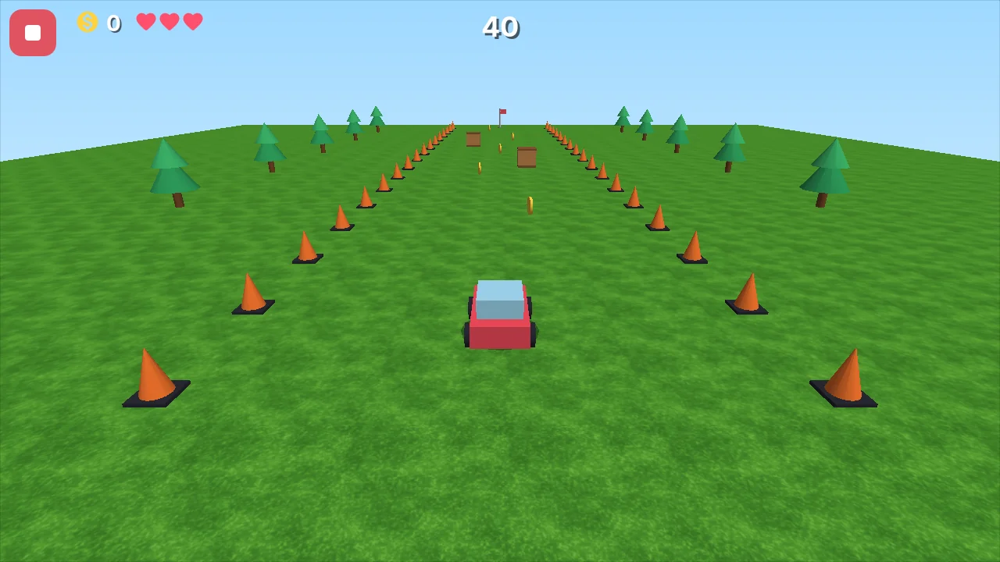 |
| **Hızlı Oyun, 1. adım:** 17 türden birini seçin | **Hemen oyna:** oyun hemen tam ekranda açılır |
|  | 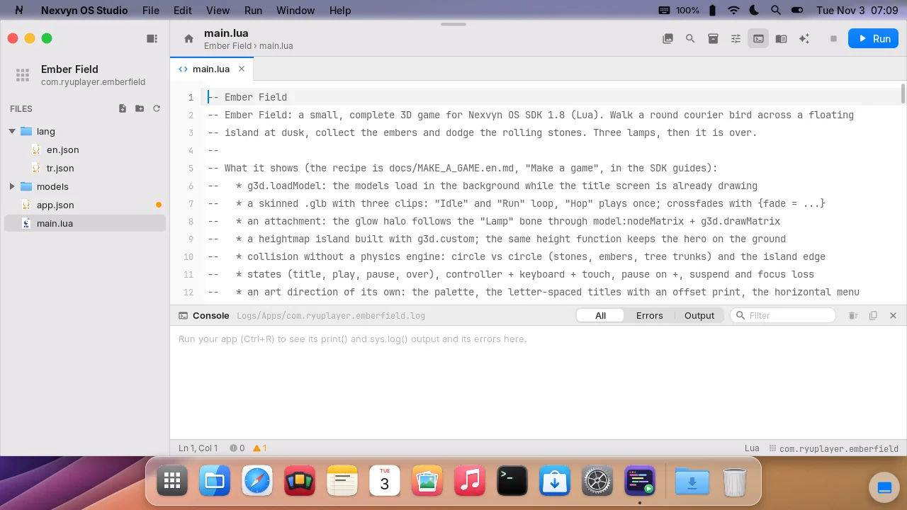 |
| **Düzenleyicide aç:** dokulu 3D bölümler, hiyerarşi, varlıklar ve denetçi | **Studio:** Ember Field şablonu, Ctrl+R ile çalışmaya hazır |
|  | 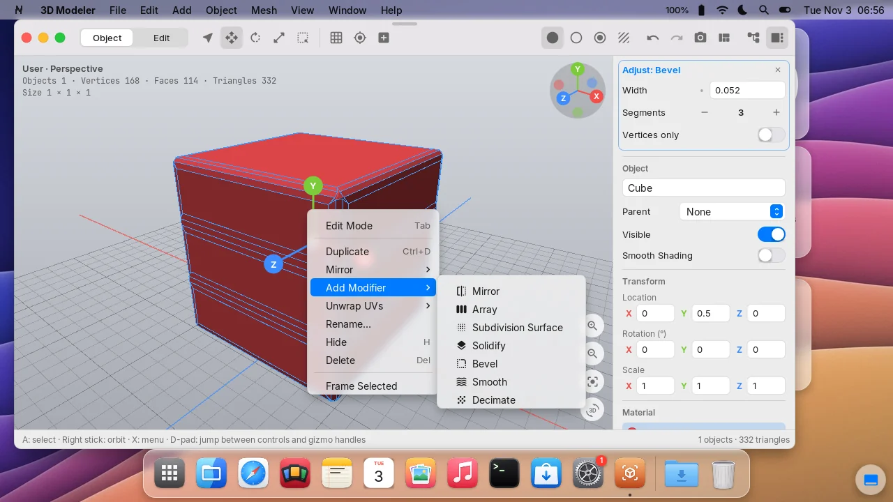 |
| **3D Modelleme, Düzenleme Modu:** her işlem bir dokunuş uzakta | **Modifier'lar:** hazır olduğunuzda uygulanan, bozmayan bir yığın |
| 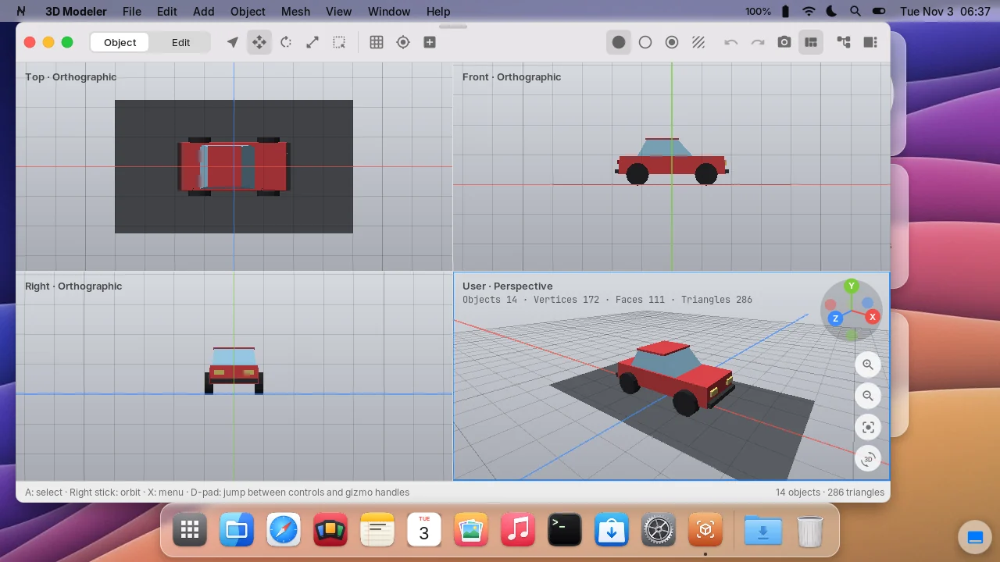 | 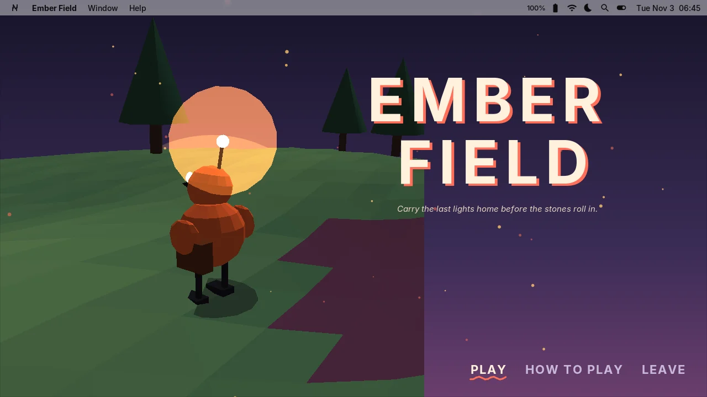 |
| **Dörtlü görünüm:** üst, ön, sağ ve perspektif | **Ember Field:** kendine ait bir sanat yönü, hazır menü şablonu değil |

**Bir modeli yükleyip oynatmak (Lua):**

```lua
local hero

function app.load()
  -- loads in the background; the title screen keeps drawing
  g3d.loadModel("bundle:/models/hero.glb", 1.6, function(m, err)
    hero = m
    if hero then hero:play("Run", {loop = true, fade = 0.2}) end
  end)
end

function app.update(dt)
  if hero then hero:update(dt) end
end

function app.draw(w, h)
  g3d.begin(0, 0, w, h, 60, 0.1, 200)
  g3d.camera(0, 3, 8, 0, 1, 0)
  if hero then g3d.draw(hero, 0, 0, 0) end
  g3d.finish()
end
```

- **Modeller:** `.glb` / `.gltf` ve `.fbx` (binary ve metin), ayrıca `.obj` ve `.stl`. Gömülü ya da yanındaki
  texture'lar, alfa modları, çift yüzlü ve ışıksız (unlit) materyaller. FBX dosyaları yüklenirken Y yukarı ve metreye
  çevrilir.
- **Animasyon:** ada ya da sıraya göre `play`, döngü, hız, geriye oynatma, şimdiki pozdan geçiş (crossfade), geçişli
  `stop`, `setTime`; aynı dosyanın iki handle'ı veriyi paylaşır ama ayrı oynar. `model:nodeMatrix` ve `g3d.drawMatrix`
  ile bir kemiğe kılıç, lamba ya da hale bağlanır.
- **Güvenli tasarım:** boyut, vertex, kemik ve anahtar sınırları, açık hata mesajları. Bozuk bir dosya yalnızca o
  `g3d.model` çağrısını başarısız yapar; app'i ya da sistemi asla.
- **Her etkin runtime'da:** aynı API Lua, JavaScript, Python ve C'de (`nexvyn.h`). SDK 1.0-1.7 için yapılan app'ler
  değişmeden çalışmaya devam eder.
- **Buradan başlayın:** [Oyun yap](SDK/Guides/MAKE_A_GAME.tr.md) (proje, modeller, yükleme, girdi, çarpışma, konsolda
  hız, sanat yönü, key art ikon, yayımlama), [SDK başvurusu](SDK/Reference/SDK.tr.md),
  [Ember Field örneği](SDK/Samples/lua/ember-field/) ve yapay zekâ asistanları için [SDK/AI](SDK/AI/README.tr.md)
  istemleri (bir bağlam paketi ve *modellerle 3D oyun yap*, *mağaza ikonu* gibi görev istemleri).

## Masaüstü

Nexvyn OS, kaplama giydirilmiş bir başlatıcı değildir. Pencereler gerçektir: sürükleyin, her kenarından boyutlandırın,
ekranın yarısına ya da çeyreğine yaslayın, büyütün, tam ekrana alın ya da birini her zaman üstte tutun. Her pencere
bıraktığınız yerde yeniden açılır. Sanal masaüstleri 3D küp geçişiyle değişir; çöken bir uygulama sistemi kendisiyle
birlikte götürmez.

<p align="center"></p>

| | |
|:---:|:---:|
|  |  |
| **Görev çubuğu düzeni:** görev çubuğu, widget'lar, masaüstü simgeleri | **Başlat menüsü:** sabitlenenler, tüm uygulamalar, arama |
|  |  |
| **Başlatıcı:** son kullanılanlar, sonra kategorilere göre tüm uygulamalar | **Pencere Görünümü:** tüm pencereler ve masaüstleri tek bakışta |
|  |  |
| **Hızlı Arama:** uygulamalar, dosyalar, ayarlar, eylemler, hesap makinesi ve web | **Denetim Merkezi:** Wi-Fi, Rahatsız Etme, Karanlık Mod, ses, Şimdi Çalıyor |
| 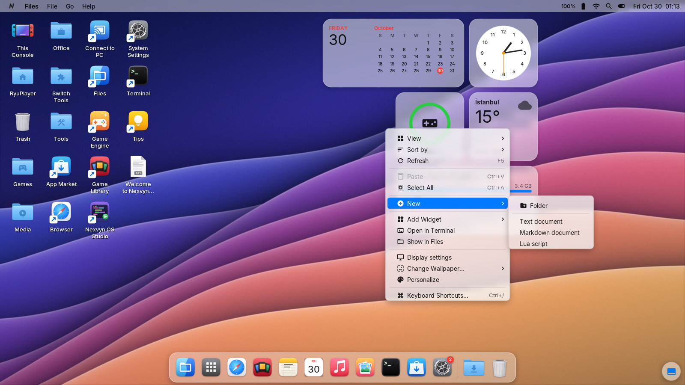 | 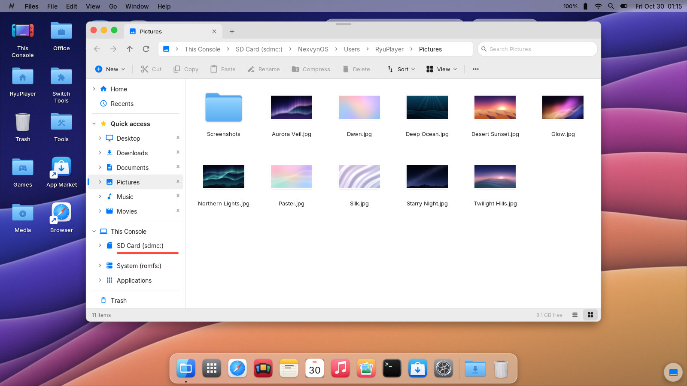 |
| Masaüstünde, simgelerde, dosyalarda ve Dock'ta **sağ tık menüleri** | **Dosyalar:** kenar çubuğu, sekmeler, liste ve ızgara görünümü, Çöp Sepeti, USB bellekler |

- **Dock düzeni:** uygulamanın menüleri, pil, Wi-Fi, saat ve arama ile bir menü çubuğu; büyütme efekti, çalışan uygulama
  noktası, sabitleme ve otomatik gizlemeyle bir Dock.
- **Görev çubuğu düzeni:** ortaya ya da sola hizalanan görev çubuğu; sabitlenen uygulamalar, kategorilere göre tüm
  uygulamalar ve önerilerle Başlat menüsü; canlı pencere küçük resimleri; her pencerede küçült, büyüt ve kapat düğmeleri.
- **Masaüstü:** simgeler, kendi simgesi olan klasörler, kısayollar, lastik bant seçimi, klavyeyle gezinme ve widget'lar
  (saat, takvim, hava durumu, pil, sistem, notlar, anımsatıcılar, dünya saati, radyo).
- **Kısayollar:** Hızlı Arama için Ctrl+Boşluk, Pencere Görünümü için F3, Başlatıcı için F4, uygulamalar arasında
  Alt+Tab, masaüstleri arasında Ctrl+Sol/Sağ. Kumandada + uygulamaları, ZR aramayı açar; L ve R pencere değiştirir.

### Tanıtım Turu

Kurulumdan hemen sonra canlı bir tur sistemi **gerçek masaüstünüzde** gösterir: yerine oturan pencereler, iki masaüstü
düzeni, Hızlı Arama, Studio'da 20 saniyede yazılıp çalıştırılan bir uygulama, üç dokunuşla yapılan bir oyun. Her adımda
*Göster* ve *Ben deneyeyim* vardır. İstediğiniz zaman **Yardım > Tanıtım Turu** ile tekrar izleyebilirsiniz.

<p align="center">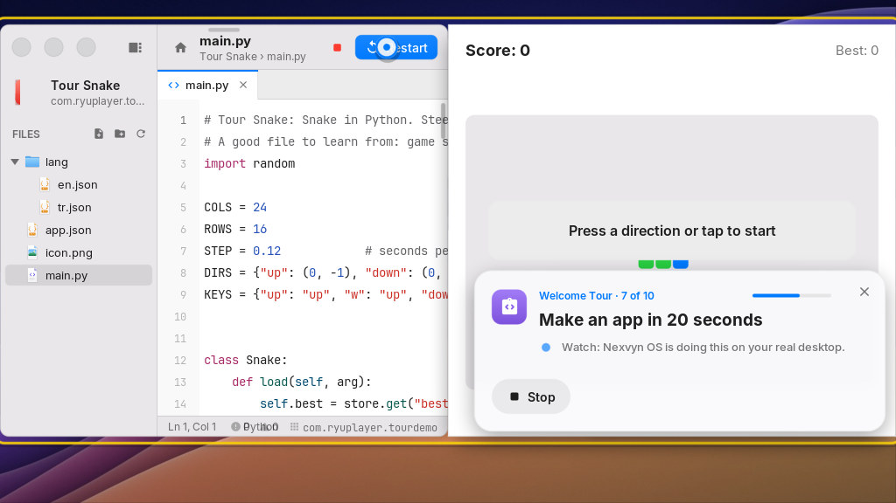</p>

## Nexvyn OS Studio: uygulamaları konsolda geliştirin

Doğrudan konsolda çalışan eksiksiz bir kod stüdyosu. Uygulamanızı yazın, **Çalıştır**'a basın; uygulama kodun hemen
yanında kendi penceresinde açılır, çıktısı anında konsola akar. Bir satırı değiştirin, **Yeniden Başlat**'a basın;
değişiklik hemen görünür. Bilgisayar yok, derleme adımı yok.

| | |
|:---:|:---:|
|  | 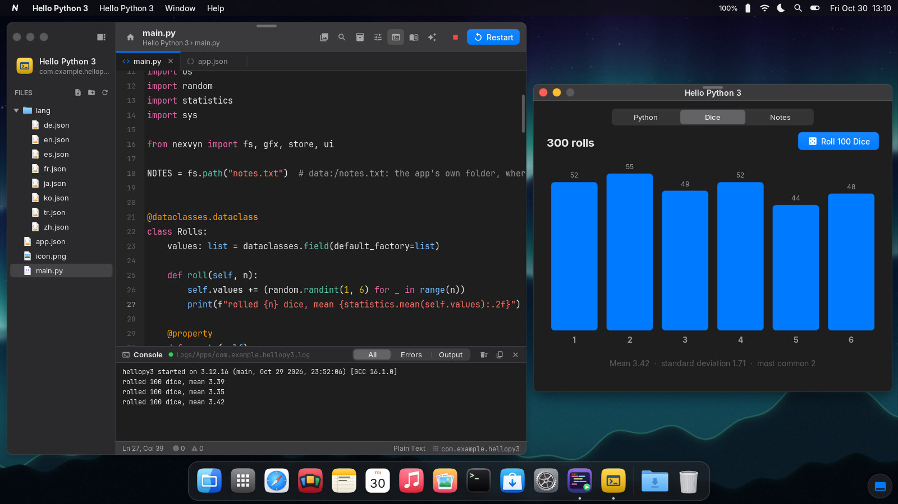 |
| **Tüm SDK için otomatik tamamlama**, başvuru o fonksiyonda açık | **Gerçek CPython 3.12:** dataclasses, statistics ve konsolda `print()` |
| 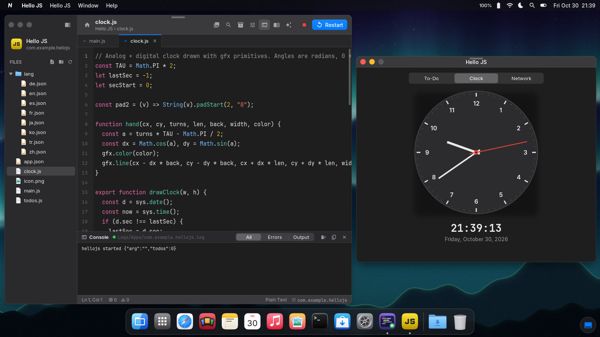 | 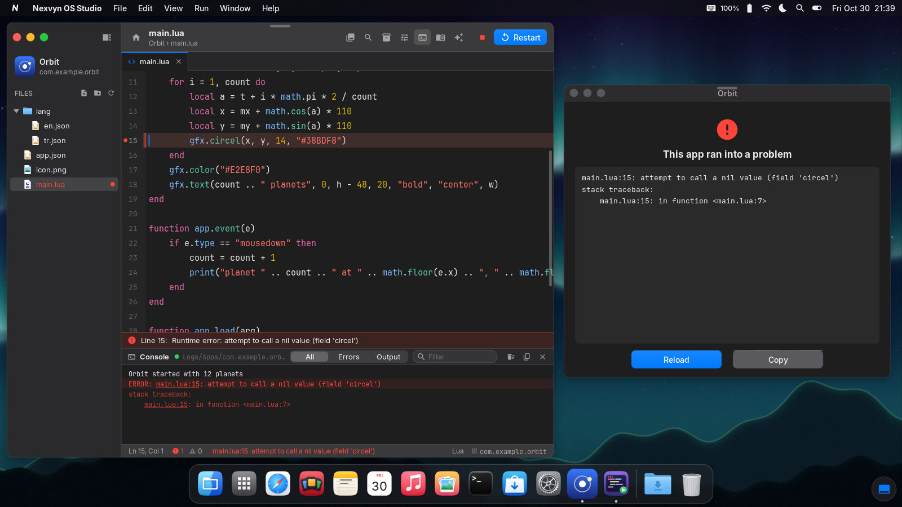 |
| **JavaScript:** Çalıştır'a basın, uygulama kodun yanında açılır | **Satır numaralı hatalar:** satıra gitmek için tıklayın ya da F8'e basın |
| 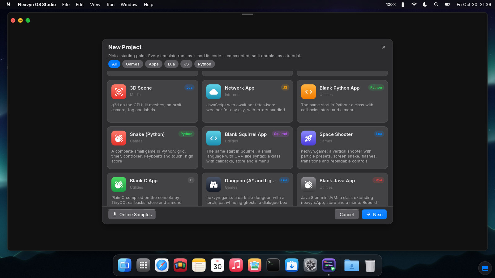 | 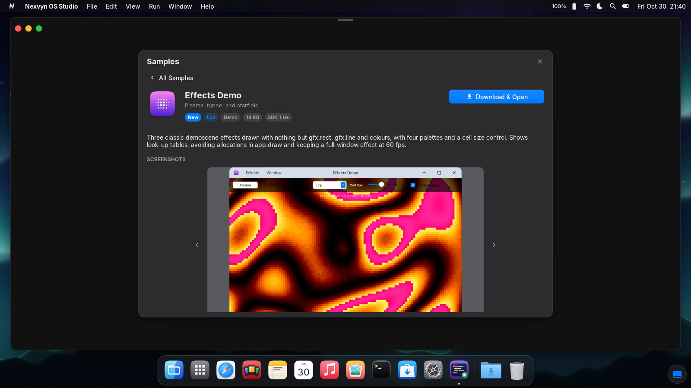 |
| Altı dilde **20 şablon**, hepsi olduğu gibi çalışır | **Örnekler:** hazır bir projeyi tek dokunuşla indirip açın |

- **Altı dil:** **Lua 5.4**, **JavaScript**, **Python** (hafif çalışma ortamı ya da standart kütüphanesiyle gerçek
  **CPython 3.12**), **Squirrel**, konsolda TinyCC ile derlenen **C** ve miniJVM üzerinde **Java 8**. Yeni SDK
  özellikleri Lua, JavaScript, Python ve C'ye gelir; Squirrel ve Java app'leri olduğu gibi çalışmaya devam eder.
- **Tüm SDK için otomatik tamamlama:** `gfx.` yazın, her fonksiyon parametreleriyle listelenir; F1, SDK başvurusunu
  tam o fonksiyonda açar. Söz dizimi hataları siz yazarken işaretlenir.
- **Canlı konsolla çalıştırma:** F5 ya da Ctrl+R uygulamayı kendi penceresinde başlatır; `print()` ve `sys.log()`
  çıktısı anında konsolda görünür. **Yeniden Başlat** değişikliklerinizi alır, isterseniz **Kaydedince Yeniden Başlat**
  bunu sizin yerinize yapar.
- **Tıklanabilir hatalar:** bir çalışma zamanı hatası dosyası ve satırıyla konsolda, düzenleyicide ve uygulamanın
  penceresinde görünür. Tıklayın ya da F8'e basın, doğrudan o satıra gidin.
- **Şablonlar ve örnekler:** 20 şablon (boş uygulamalar, platform oyunu, nişancı, bulmaca, 3D sahne, **3D modeller**,
  **Ember Field**, ağ, yapılacaklar listesi…) ya da çevrimiçi katalogdan bir örnek.
- **Kodun etrafındaki her şey:** projede bul ve değiştir, Hızlı Aç, sprite, tilemap ve sahne düzenleyicileri, anlık
  görüntüler ve AI Sohbet'te ayarladığınız sağlayıcı ve anahtarı kullanan bir **AI'ya sor** paneli.
- **Uygulama Mağazası'nda yayımlayın:** **Dışa Aktar** hemen paylaşabileceğiniz bir `.nxvapp` üretir; **Yayınla**
  sihirbazı projenizi pull request ile bu depoya eklemeniz için sizi adım adım yönlendirir. Uygulama Mağazası'nda
  görünmeden önce bakımcı tarafından incelenir.

## Oyun Motoru ve 3D Modelleme

- **Oyun Motoru:** çocukların da kullanabileceği bir 2D ve 3D oyun yapıcı. **Hızlı Oyun** üç adımda oynanabilir bir
  oyun kurar (17 tür, 7 dünya, zorluk, can, süre sınırı ve kontroller). Kolay mod resim kartları ve sürükle-bırakla
  çalışır; Gelişmiş mod buna denetçi, katmanlar, olay blokları, piksel ve karo düzenleyicileri ve üretilen Lua kodunu
  ekler. 19 şablon ve 5 örnek oyun; sonucu uygulama olarak paylaşın ya da Studio'da kodla sürdürün.
- **3D Modelleme:** sahne ağacı, temel şekiller, taşıma, döndürme ve ölçekleme tutamakları, yukarıdaki araçlarla köşe,
  kenar ve yüz düzenleme, modifier yığını, UV açma, yüz başına materyaller, 64 adım geri alma, dörtlü görünüm, OBJ ve
  STL içe ve dışa aktarma ve oyunlarınız için `.glb` dışa aktarma.
- **Gösteri:** çizicinin neler yapabildiğini gösteren gerçek zamanlı sahneler (bir ada, gece şehri, galaksi ve daha
  fazlası).

| | |
|:---:|:---:|
| 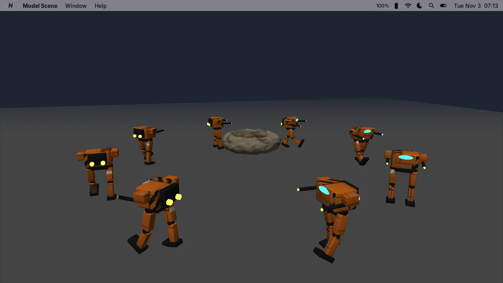 | 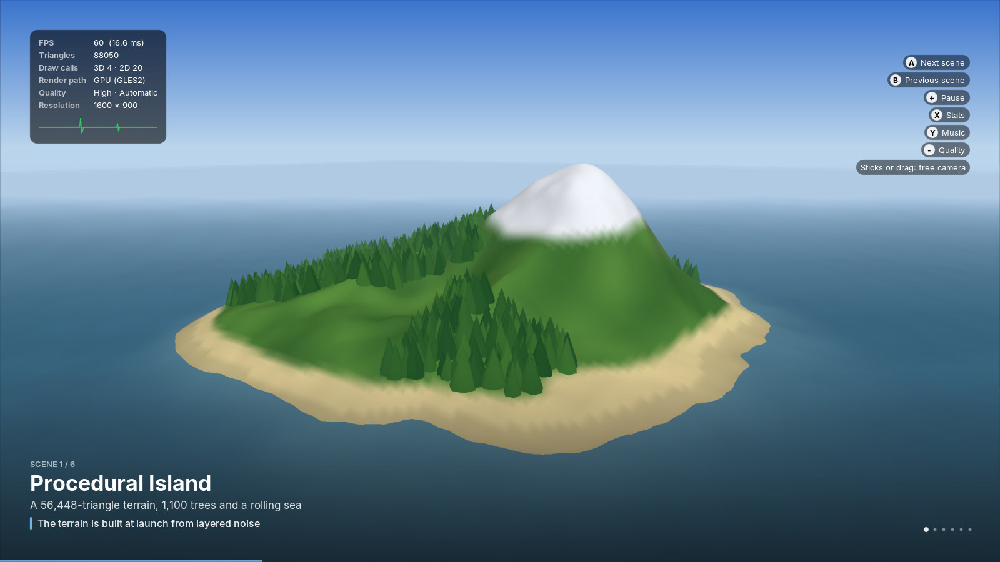 |
| **SDK 1.8 modelleri:** tek sahnede sekiz iskeletli `.fbx` robot | **Gösteri:** GPU'da çizilen 56.000 üçgenlik bir ada |

## İnternet ve medya

| | |
|:---:|:---:|
|  |  |
| Kendi HTML, CSS ve JavaScript motoruyla **Tarayıcı** | **YousTube:** video arayın ve izleyin |
| 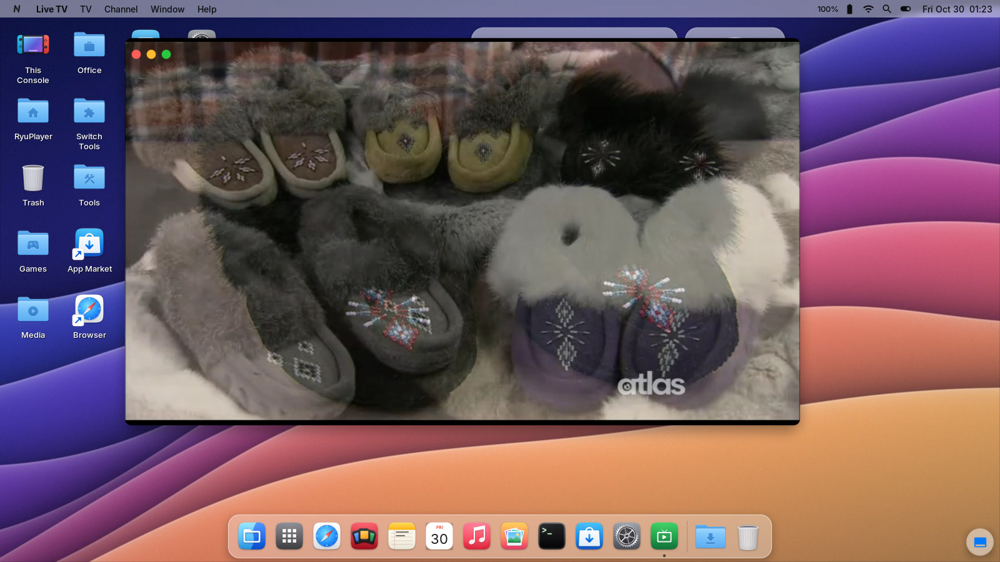 | 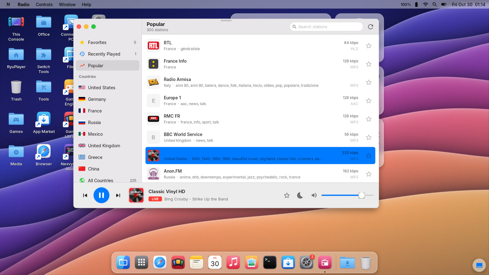 |
| **Canlı TV:** M3U listeleri ve hazır kanal listeleri | **Radyo:** dünyanın dört bir yanından istasyonlar |

- **Tarayıcı:** JavaScript'li (DOM, olaylar, fetch, localStorage) kendi düzen motoru; CSS dönüşümleri, geçişleri ve
  animasyonları, sekmeler, yer imleri, geçmiş, okuyucu modu, indirmeler ve şifreli parola deposu.
- **YousTube:** çevrimiçi videoları arayın ve izleyin; kısa videolar, yorumlar, bölümler, mini oynatıcı, oynatma hızı,
  altyazı ve akışın sunduğu yerde 1080p ya da 2160p'ye kadar kalite. Abonelikler, oynatma listeleri ve yorumlar için
  isteğe bağlı oturum açma (kendi API istemcinizle).
- **Canlı TV:** kendi M3U listeleriniz ya da ülkelere göre hazır listeler; gruplar, favoriler ve son izlenenler.
- **Radyo:** istasyonlara ülke ve türe göre göz atın, çalan şarkıyı görün, favorilerinizi saklayın, uyku zamanlayıcısı
  kurun. Pencereyi kapattıktan sonra da çalmaya devam eder.
- **Müzik, Fotoğraflar ve Video Oynatıcı:** etiketler, kapak resimleri ve çalma listeleri; resimleriniz ve konsolun Albüm
  görüntüleri; HTTPS ve HLS akışları dahil MP4, MKV, WebM ve daha fazlası.
- Ayrıca: **Kamera** (kumandanın IR kamerası), **Hava Durumu**, **Haritalar**, **Haberler**, **Döviz** ve **Sözlük**.

<p align="center">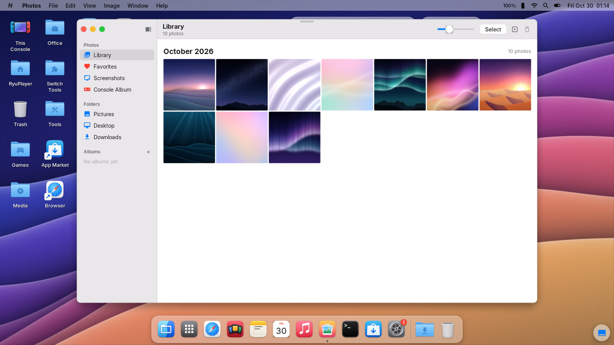</p>

### Oyun Kitaplığı

Kurulu konsol oyunlarınız kapakları, oynama süreleri ve Albüm görüntüleriyle; tek dokunuşla başlatılır (başlık modu).
PC Kitaplığı ile PC oyunlarınız da burada. *(Emülatörde kurulu oyun olmadığı için burada demo modunda.)*

<p align="center">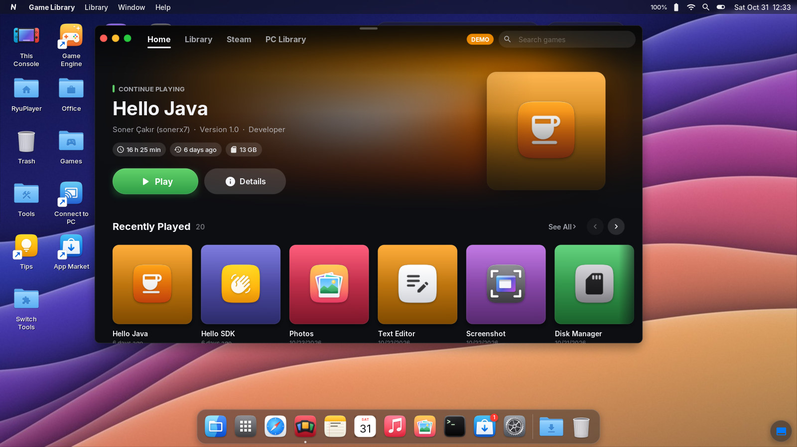</p>

## Verimlilik

| | |
|:---:|:---:|
|  |  |
| **Kelime İşlemci:** şablonlar, stiller ve biçimlendirme | **Hesap Tablosu:** formüller, grafikler ve CSV |

- **Kelime İşlemci, Hesap Tablosu ve Sunum:** şablonlardan belgeler (mektup, rapor, özgeçmiş, toplantı notları),
  formüller ve grafikler, sunum temaları, geçişler ve sunum modu.
- **Dosyalar:** sürükle-bırak, kopyalama ve taşıma, sıkıştırma ve açma, Çöp Sepeti, USB bellekler (FAT ve exFAT).
- `nxvsh` kabuğuyla **Terminal**, **Kod Düzenleyici**, **Metin Düzenleyici**, **Notlar**, **Takvim**, **Anımsatıcılar**,
  **Kişiler**, **Hesap Makinesi**, **Saat** ve **Yapışkanlar**.
- **Otomasyon:** oturum açılışında, belirli bir saatte, pil seviyesinde, konsol dock'a takılınca ya da bir USB bellek
  takılınca çalışan rutinler.
- **AI Sohbet:** seçtiğiniz yapay zekâ modeliyle kendi API anahtarınızla sohbet edin; anahtar konsolda şifreli kalır.
- **Bilgisayara Bağlan:** kablosuz FTP sunucusu ve USB üzerinden dosya aktarımı (MTP); ayrıca bir FTP istemcisi.

## Uygulama Mağazası

<p align="center"></p>

Uygulamalar, oyunlar, temalar ve yazı tipi paketleri. Oyunlar ve Uygulamalar sekmeleri öne çıkan bir öğeyle açılır,
Yeni rafı son iki haftada gelenleri gösterir, her sayfa kurmadan önce izinleri listeler. Paketler SHA-256 ile denetlenir
ve imzalıdır, güncellemeler tek dokunuşla gelir, Homebrew bölümü bilinen homebrew programlarını GitHub sürümlerinden
kurar. **Her öğe yayımlanmadan önce bakımcı tarafından incelenir.** Tam liste: [Store/](Store/README.tr.md).

## Switch Araçları

<p align="center">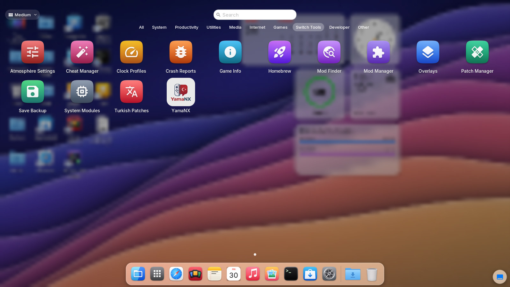</p>

Atmosphère kullanıcıları için bir araç klasörü: **Mod Yöneticisi** ve **Mod Bulucu**, **Hile Yöneticisi** (çalışan
oyunda hileleri açıp kapatma), **Katmanlar** (overlay'ler), **Saat Profilleri** (sys-clk için oyuna özel saat hızları),
**Sistem Modülleri**, **Kayıt Yedekleme**, **Oyun Bilgileri**, **Yama Yöneticisi**, **Çökme Raporları**, **Atmosphère
Ayarları** ve **Homebrew**. **Türkçe Yamalar** indirdiğiniz çeviri yamalarını kurar ve özgün dosyaları saklar, böylece
istediğiniz an geri dönebilirsiniz; **YamaNX** konsol oyunları için bir Türkçe yama yükleyicisidir. **Oyun Kitaplığı**
yüklü oyunlarınızı oynama süresi ve Albüm görüntüleriyle gösterir. Modlarla yapılan değişiklikler oyunun bir sonraki
açılışında geçerli olur.

## Erişilebilirlik ve diller

| | |
|:---:|:---:|
|  |  |
| **Ekran Okuyucu** ve erişilebilirlik ayarları | Sistemin tamamı **Japonca** |

- **8 dil:** English, Türkçe, Deutsch, Français, Español, 日本語, 中文 ve 한국어; Hangul ve romaji girişi.
- Odaktaki öğeyi sesli okuyan, sesi, hızı, perdesi ve ipuçları ayarlanabilen bir **Ekran Okuyucu**.
- İmleci takip eden yakınlaştırma, renkleri ters çevirme, yazı ve imleç boyutu, hareketi ve saydamlığı azaltma, büyük
  pencere düğmeleri.
- Kelime önerili ekran klavyesi (yerleşik, yüzen ya da bölünmüş) ya da konsolun kendi klavyesi.

## Size göre

| | |
|:---:|:---:|
| 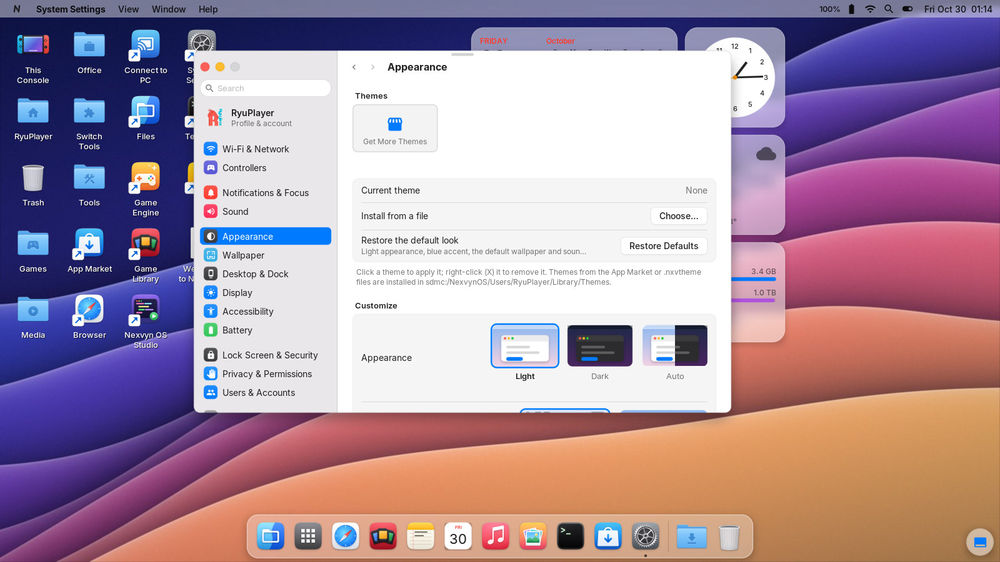 | 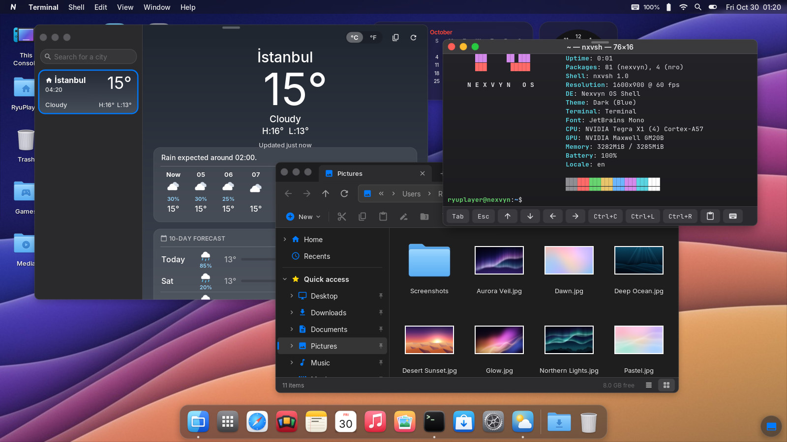 |
| **Görünüm:** açık, koyu ya da otomatik, vurgu renkleri, temalar | **Karanlık mod** |

Duvar kâğıtları, vurgu renkleri, Uygulama Mağazası'ndan temalar, zamanlanabilen Gece Modu, Dock boyutu ve konumu,
masaüstü simge boyutu, kendi avatarlarıyla birden çok kullanıcı ve kilit ekranında isteğe bağlı PIN.

## Gizlilik ve güvenlik

<p align="center">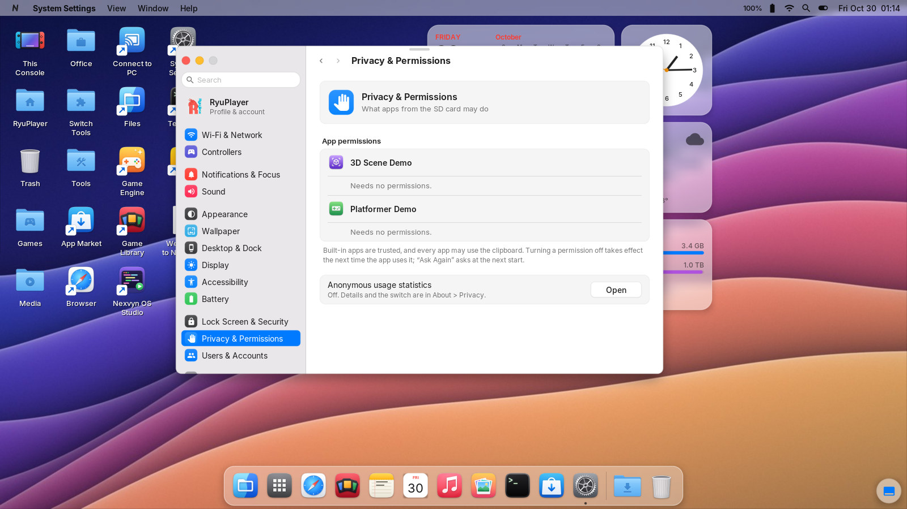</p>

- SD karttan kurulan uygulamalar ihtiyaç duydukları izinleri (ağ, dosyalar vb.) **bir kez** sorar. Bunları
  **Sistem Ayarları > Gizlilik ve İzinler** bölümünden görüp değiştirebilirsiniz. Yerel C, Java ve modül kodu ilk kez
  çalışmadan önce sorar.
- Tarayıcıdaki parolalar ve AI Sohbet'teki API anahtarları konsolda şifreli saklanır.
- **App Guard** her paketi kurulmadan önce tarar ve nedenleriyle birlikte *Sorun bulunmadı*, *İncele* ya da *Tehlikeli*
  sonucunu gösterir (özel verilerinizi dışarı gönderebilecek kod, çalışırken indirilip çalıştırılan kod, gizlenmiş kod).
  Tehlikeli uygulamalar ikinci bir onay ister. Mağaza uygulamaları dosya izni olsa bile sistem ayarlarını, başka
  uygulamaların verilerini ya da tarayıcının parolalarını okuyamaz. Sistem dosyaları görülebilir ama değiştirilemez.
  [Ayrıntılar](SDK/Guides/APP_GUARD.tr.md)
- Anonim kullanım istatistikleri Nexvyn OS ilk açıldığında bildirilir. Dosyalarınızı, parolalarınızı ya da anahtarlarınızı
  asla içermez; **Sistem Ayarları > Hakkında > Gizlilik** bölümünden istediğiniz an kapatabilirsiniz.
- Çöken uygulama tek başına kapanır; donan bir uygulama durdurulur ya da eski app'lerde beklemeyi veya kapatmayı siz
  seçersiniz. Belgeler otomatik kaydedilip geri yüklenir; çöken bir uygulama bir sonraki oturum açılışında bir kez atlanır
  ve bir şeyler ters giderse Güvenli Mod hazırdır.

## El modu, TV ve girdi

- **El ve TV düzenleri:** el modunda arayüz dokunmatik için daha büyüktür; TV'de kendi Dock'u, masaüstü simgeleri ve
  pencere çerçeveleriyle 1080p çizilir.
- **Dokunmatik:** dokunarak tıklama, basılı tutarak sağ tık, iki parmakla kaydırma, iki parmakla yakınlaştırma ve
  döndürme, ekran kenarlarından kaydırma ve masaüstleri arasında üç parmakla geçiş.
- **Kumanda:** sol çubuk imleci hareket ettirir, A tıklar, X sağ tıklar, D-pad düğmeler arasında atlar. Bir oyundan
  kumandayı geri almak için L+R'yi bir saniye basılı tutun.
- Yukarıdaki kısayollarla **USB klavye ve fare**.
- **Kaynaklara özenli:** boşta duran masaüstü saniyede 20 kareye iner, arka plandaki pencereler son karelerini yeniden
  kullanır, yavaş işler arka plan thread'lerinde çalışır; resimler, yazı tipleri ve 3D belleği gerekmeyince boşaltılır.

---

## Gereksinimler

- **Atmosphère** ile açılan, sistem sürümünüzü destekleyen Atmosphère sürümünü kullanan bir konsol (en yeni sürüm
  önerilir).
- **Sistem sürümü 22.5.0 veya üstü.** **23.0.0**'a kadar test edildi. Daha yeni bir sistem sürümünde Nexvyn OS yine
  açılır, ama bazı özellikler orada henüz test edilmedi; Nexvyn OS bunu bir kez bildirir.
- SD kartta `.nro` dosyası (yaklaşık 72 MB) için yaklaşık **80 MB** boş yer, artı kendi dosyalarınız için yer.
- SD kart bölümü (partition) ya da ek kurulum gerekmez.
- **Önerilen başlatma: başlık modu.** Bir oyunu **R** tuşuna basılı tutarak başlatın, sonra Nexvyn OS'u Homebrew
  menüsünden açın. Böylece belleğin tamamı (yaklaşık 3,2 GB) kullanılır. Albüm'den (applet modu) açılınca yalnızca
  birkaç yüz MB olur: büyük app'ler, tam tarayıcı ve oyun başlatma sınırlıdır; Nexvyn OS bunu söyler.

<p align="center"> Hakkında: sistem sürümü, Atmosphère, ortam, başlatma modu ve App SDK sürümü 1.8"></p>

**Sistem Ayarları > Hakkında**; sistem sürümünü, Atmosphère sürümünü, başlatma modunu ve App SDK sürümünü gösterir.

## Kurulum

1. Atmosphère ile açılan bir konsol gerekir.
2. [Son sürümden](https://github.com/sonerx7/Nexvyn-OS-NX/releases/latest) `NexvynOS.nro` dosyasını indirip SD kartta
   `sdmc:/switch/NexvynOS.nro` konumuna kopyalayın.
3. Homebrew menüsünden başlatın. **İpucu:** Homebrew menüsünü bir oyunu açarken **R**'yi basılı tutarak açın (başlık
   modu). Nexvyn OS böylece tam belleği kullanır; sistem tarayıcısı, konsol oyunlarını başlatma ve PC oyunları çalışır.
   HOME menüsünde kendi simgesiyle açmak için: [forwarder rehberi](SDK/Guides/FORWARDER.tr.md).
4. Kurulum yardımcısı dilinizi, klavyenizi, düzeninizi ve görünümü sorar. Sonunda adım adım öğreticilerle **İpuçları**
   uygulaması açılır.

Nexvyn OS bundan sonra kendini **Sistem Ayarları > Yazılım Güncelleme** üzerinden bu depodaki sürümlerden günceller.
Her şeyin ayrıntısı [kullanım rehberinde](SDK/Guides/USER_GUIDE.tr.md).

## Çevrimiçi ve çevrimdışı

Nexvyn OS ağ olmadan çalışır. Şu bölümler internet bağlantısı ister:

- **Tarayıcı** (web sayfaları) ve **tam tarayıcı**
- **App Market** (app kurma ve güncelleme) ve **sistem güncellemeleri**
- **AI Sohbet** (kendi API anahtarınızla)
- **Hava Durumu**, **Haberler**, **Döviz** (kurlar), **Haritalar**, **Sözlük**
- **Radyo**, **IPTV** ve **video** app'i
- **Mod Bulucu** ve Türkçe yama indirmeleri
- Anonim kullanım istatistikleri (isteğe bağlı, Ayarlar > Gizlilik'ten kapatılabilir)

Yalnızca yerel ağı kullananlar: **PC Bağlantısı** ile **FTP** sunucusu ve istemcisi.
Geri kalan her şey (dosyalar, notlar, takvim, müzik ve video oynatıcılar, oyunlar, Oyun Motoru, 3D Modelleme, Studio)
çevrimdışı çalışır.

## Bilinen sorunlar

- **Test edilmemiş sistem sürümlerinde tam tarayıcı.** Sistem sürümü test edilenlerden yeni olan bazı konsollarda tam
  tarayıcıyı açmak konsolu bir Atmosphère fatal hatasıyla durdurdu. Nexvyn OS test edilmemiş sistem sürümlerinde tam
  tarayıcıyı kapalı tutar ve sayfayı kendi tarayıcısında açar. Tarayıcı ayarlarından izin verebilirsiniz; konsol durursa
  Nexvyn OS yeniden açılışta onu tekrar kapatır. Lütfen sistem ve Atmosphère sürümünüzle ve
  `sdmc:/atmosphere/fatal_errors/` içindeki raporla bildirin.
- **Masaüstü bir an donuyor ya da oyunlardan sonra yavaşlıyor.** 1.2.0 en sık nedenleri gideriyor. Yine olursa lütfen
  `sdmc:/NexvynOS/System/Logs/system.log` dosyasını (yeniden başlattıysanız `system.prev.log`'u da) gönderin.
  `stall` ile başlayan satırlar zamanı alan bölümü söyler. Yavaşlamış ya da bozulmaya başlamış SD kart sık bir
  nedendir.
- **Büyük 3D modeller.** Çok büyük `.fbx` ya da `.glb` dosyaları birkaç saniyede yüklenir ve çok bellek kullanır. Oyun
  çizmeye devam etsin diye `g3d.loadModel` kullanın ve her modeli [SDK başvurusundaki](SDK/Reference/SDK.tr.md)
  sınırlar içinde tutun.

## Ne nerede

```
Store/            Uygulama Mağazası'nın kurduğu her şey
├── Apps/<kategori>/<kısa-ad>/      uygulamalar (ve Nexvyn OS ile gelen uygulamaların mağaza sayfaları)
├── Games/<tür>/<kısa-ad>/          oyunlar
├── Themes/<kısa-ad>/               temalar (.nxvtheme)
├── Fonts/<kısa-ad>/                yazı tipi paketleri (.nxvfont)
└── catalog.json, packages.json     konsolun okuduğu dosyalar; README.md hepsini listeler
SDK/              geliştiriciler için her şey, İngilizce ve Türkçe
├── Reference/                      SDK başvurusu, Java SDK, C başlığı
├── Languages/<dil>/                her dil için hızlı başlangıç ve şablon
├── Guides/                         kullanım ve geliştirici rehberleri, Oyun yap
├── Samples/<dil>/<kısa-ad>/        çalışan örnekler (samples.json: Studio'nun Örnekleri), Ember Field
├── AI/                             yapay zekâ asistanları için istemler
├── Publishing/                     nasıl yayımlanır, inceleme listesi
├── Fonts/                          sistem yazı tipleri
└── Tools/nxv/                      nxv komut satırı
Tools/            depo bakımı: build_store.py, CI
.github/          pull request şablonu, issue formları, CODEOWNERS ve README görselleri
```

| Klasör | Buradan başlayın |
|---|---|
| [`Store/`](Store/README.tr.md) | Uygulamaların, oyunların, temaların ve yazı tiplerinin tam listesi |
| [`SDK/`](SDK/README.tr.md) | SDK 1.8, dillere göre "Buradan başlayın", başvuru, rehberler, örnekler, yayımlama |
| [`Tools/`](Tools/README.tr.md) | Kataloğun nasıl üretilip denetlendiği |

## Geliştiriciler için

[SDK](SDK/README.tr.md) ile başlayın: her dil için hızlı başlangıç ve şablon, [Oyun yap](SDK/Guides/MAKE_A_GAME.tr.md)
tarifi, [geliştirici rehberi](SDK/Guides/DEVELOPER_GUIDE.tr.md), [Oyun Motoru rehberi](SDK/Guides/GAME_ENGINE.tr.md),
[`.nxvapp` biçimi](SDK/Guides/NXVAPP_FORMAT.tr.md), [çalışan örnekler](SDK/Samples) ve
[yapay zekâ asistanları için istemler](SDK/AI/README.tr.md). Uygulamanın tamamını konsolda Nexvyn OS Studio'da ya da
bilgisayarınızda `nxv` komut satırıyla yazabilirsiniz. App'ler İngilizce yazılır, başka diller `lang/*.json`
dosyalarıyla eklenir.

## Uygulamanızı yayımlayın

Herkes bir uygulama, oyun, tema ya da yazı tipi gönderebilir; bakımcı her gönderiyi yayımlanmadan önce inceler.

1. [SDK](SDK/README.tr.md) ile bilgisayarınızda ya da Nexvyn OS Studio'da yapın.
2. Bu depoyu fork edin ve öğenizi `Store/Apps/<kategori>/<kısa-ad>/`, `Store/Games/<tür>/<kısa-ad>/`,
   `Store/Themes/<kısa-ad>/` ya da `Store/Fonts/<kısa-ad>/` altına ekleyin.
3. Denetimleri çalıştırın (`nxv check`, `Tools/build_store.py --check`) ve şablonla bir pull request açın.
4. Otomatik denetimlerden sonra bakımcı [inceleme listesiyle](SDK/Publishing/REVIEW.tr.md) inceler; onaylanıp
   birleştirildiğinde Uygulama Mağazası'nda Yeni olarak görünür.

Akışın tamamı, içerik kuralları, güncellemeler, bildirimler ve imzalama: [SDK/Publishing](SDK/Publishing/PUBLISHING.tr.md).
Bir öğeyi bildirmek için mağaza sayfasındaki **Bu Uygulamayı Bildir** düğmesini ya da
[bildirim formunu](https://github.com/sonerx7/Nexvyn-OS-NX/issues/new?template=report-app.yml) kullanın.

## SSS

**Konsolun sisteminin yerine mi geçiyor?**
Hayır. Nexvyn OS, Atmosphère ile konsolun kendi sisteminin üzerinde çalışan bir homebrew uygulamasıdır. Kapattığınızda
Homebrew menüsüne dönersiniz. Oyunlar, hesaplar, Albüm, pil ve Wi-Fi için konsolun kendi servislerini kullanır.

**Yeniden başlatmam ya da SD kartı bölümlemem gerekir mi?**
Hayır. Tek bir `.nro` dosyasını kopyalayıp başlatın. `sdmc:/NexvynOS/` klasörü küçük başlar, dosyalarınız ve app'lerle
büyür.

**Hangi sistem sürümü gerekiyor?**
22.5.0 veya üstü; 23.0.0'a kadar test edildi. Sizinkini Sistem Ayarları > Hakkında gösterir.

**Neden başlık modu?**
Albüm'den (applet modu) açılan homebrew belleğin yalnızca küçük bir kısmını alır. Nexvyn OS orada da çalışır ve bunu bir
kez söyler, ama bazı özellikler (büyük app'ler, tam tarayıcı, oyun başlatma) başlık modunun tam belleğine (yaklaşık
3,2 GB) ihtiyaç duyar.

**Kod yazmadan oyun yapabilir miyim?**
Evet. Oyun Motoru'nu açın, **Hızlı Oyun**'a basın, bir tür ve bir dünya seçip **Hemen oyna**'ya basın. Resim kartları
ve sürükle-bırakla değiştirmek için düzenleyicide açın, uygulama olarak paylaşın.

**Kendi 3D modellerimi kullanabilir miyim?**
Evet. 3D aracınızdan ya da yerleşik 3D Modelleme'den `.glb` (veya `.fbx`) dışa aktarın, app'inizin klasörüne koyun ve
`g3d.loadModel` ile yükleyin. [Oyun yap](SDK/Guides/MAKE_A_GAME.tr.md) animasyonlar dahil yolun tamamını gösterir.

**Yapay zekâ asistanıyla app yazabilir miyim?**
Evet. Ona [SDK/AI](SDK/AI/README.tr.md) içindeki bağlam paketini ve bir görev istemini verin; Studio'nun **AI'ya sor**
paneli AI Sohbet'te ayarladığınız sağlayıcı ve anahtarı kullanır.

**Dosyalarım nerede?**
`sdmc:/NexvynOS/Users/<adınız>/` içinde (Desktop, Documents, Downloads, Pictures, Music, Movies). Ayarlar ve uygulamalar
hemen yanında, `sdmc:/NexvynOS/` altında durur.

**Konsol oyunlarımı başlatabilir mi?**
Evet. Oyun Kitaplığı yüklü oyunlarınızı listeler ve Nexvyn OS başlık modunda çalışırken başlatır.

**Tarayıcıda abonelikli video servislerini izleyebilir miyim?**
Hayır. Videolarını DRM ile koruyan servisler ne yerleşik tarayıcıda ne tam tarayıcıda oynar. DRM'siz ücretsiz video
siteleri ve canlı yayınlar genelde çalışır.

**Tarayıcı verilerimi kaydediyor mu?**
Yerleşik tarayıcı geçmişi, yer imlerini, çerezleri ve indirmeleri kullanıcı klasörünüze kaydeder
(`sdmc:/NexvynOS/Users/<ad>/Library/Application Support/browser/`). Kayıtlı şifreler şifrelenir. Gizli sekmeler geçmiş
bırakmaz. Tarayıcı ayarları > Gizlilik geçmişi, çerezleri ve site verilerini siler (kayıtlı şifreler siz silene kadar
kalır).

**Mod ve hile kullanmak güvenli mi?**
Switch Araçları yalnızca SD karta yazar. Değiştirilmiş oyunlarla ya da hilelerle çevrimiçi oynamak hesabın
engellenmesine yol açabilir; bunları çevrimdışı kullanın.

**Emülatörde çalışır mı?**
Görseller ve videolar bir emülatörde çekildi. USB bellek, MTP ve kamera gibi gerçek donanım isteyen özellikler yalnızca
konsolda çalışır.

**Güncellemeleri nasıl alırım?**
Sistem Ayarları > Yazılım Güncelleme yeni sürümü indirir, eskisinin yedeğini alır ve kurar. App'leriniz, dosyalarınız ve
ayarlarınız yerinde kalır.

## Yol haritası

Nexvyn OS'un bundan sonra nereye gittiği, ölçülebilir hedeflerle: daha hızlı açılış, hiç kaybolmayan iş, her denetimi
okuyan bir Ekran Okuyucu, daha çok dil, daha iyi bir tarayıcı ve daha büyük bir Uygulama Mağazası.
[Yol haritasını](ROADMAP.tr.md) okuyun ve [nasıl yardım edebileceğinize](ROADMAP.tr.md#nasıl-yardım-edebilirsiniz) bakın:
bir uygulama yayımlayın, hata bildirin ya da çeviri yapın.

## Lisans ve emeği geçenler

Nexvyn OS **GPL-3.0-or-later** ([LICENSE](LICENSE)); üçüncü taraf bileşenler ve lisansları
[THIRD_PARTY_NOTICES.md](THIRD_PARTY_NOTICES.md) dosyasında. Mağazadaki öğeler, aksi belirtilmedikçe aynı lisansla gelir
(yazı tipi paketleri kendi lisanslarını taşır, çoğu SIL Open Font License). YamaNX, SertAy'ın YamaNX'ine dayanır.
Nintendo Switch, Nintendo'nun ticari markasıdır; bu proje Nintendo ile ilişkili değildir. Tarayıcı, YousTube, Canlı TV
ve Radyo'da görünen içerikler sahiplerine aittir.

Geliştiren: **Soner Çakır** · [github.com/sonerx7](https://github.com/sonerx7) — tasarımı ve yönetimi sahibine ait,
yapay zekâ destekli kodlama araçlarının yardımıyla geliştirildi.
