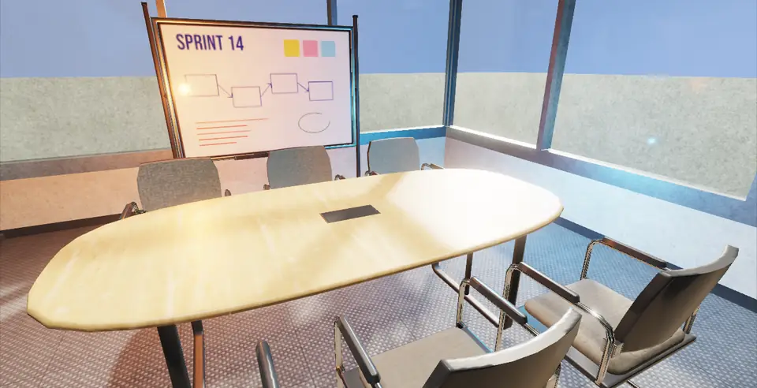
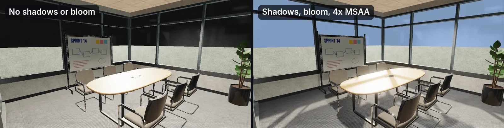
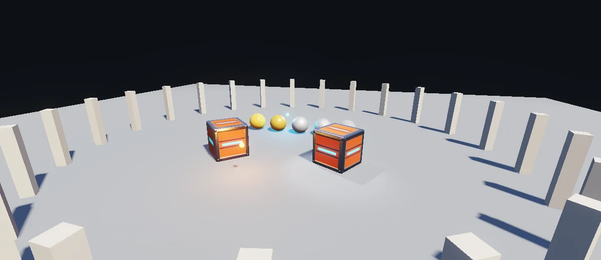
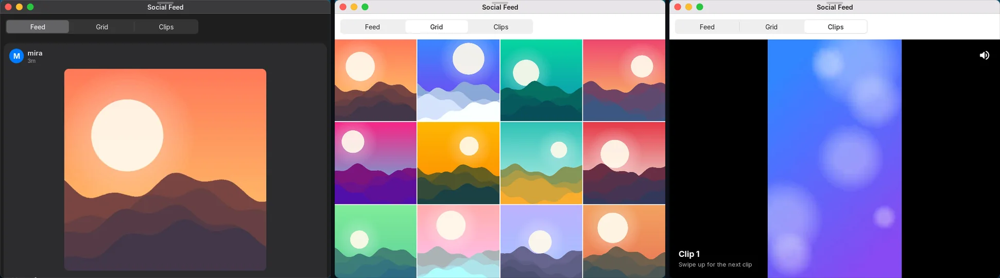
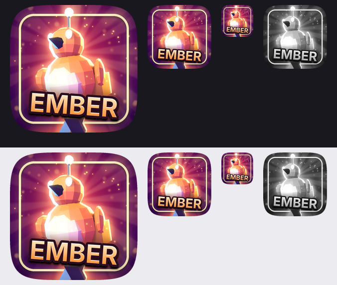
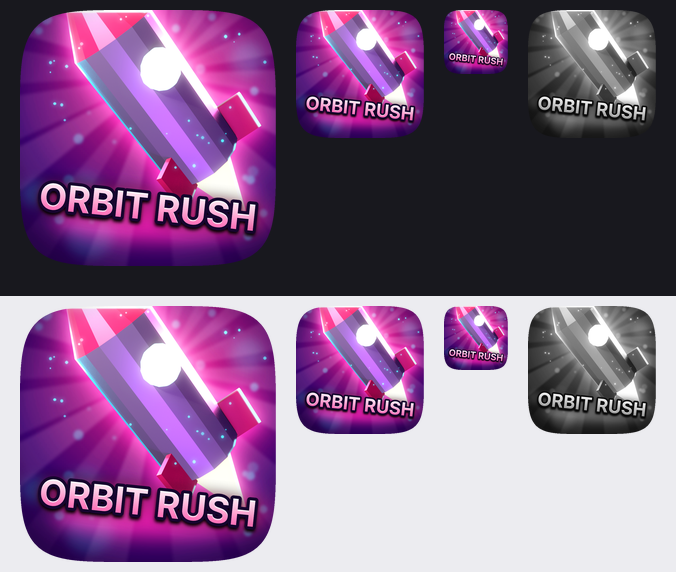
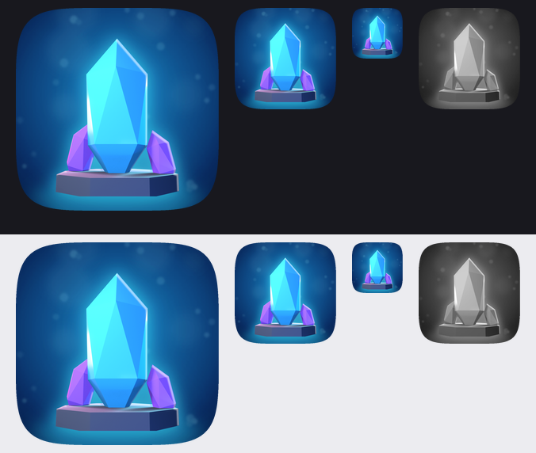

# Nexvyn OS SDK

**English** · [Türkçe](README.tr.md)

Everything for people who make apps, games, themes and fonts for Nexvyn OS: the SDK reference, a quick start and a
template for each language, guides and recipes, working samples, context packs for AI assistants, the publishing guide
and command-line tools. Every document exists in English and Turkish.

**Current version: SDK 1.12** (Nexvyn OS 1.2.2). Apps made for SDK 1.0 to 1.11 run unchanged
([SDK versions](Guides/SDK_VERSIONS.en.md)).

## SDK 1.9 at a glance

### NexGFX pbr renderer

A physically based renderer for 3D apps and games, opt-in per app with `g3d.renderer("pbr")`.

| Feature | API |
|---|---|
| Metallic-roughness materials with normal, occlusion and emissive maps; glTF ORM, FBX map sets, MetallicSmoothness | from the model file, or `g3d.material(meshOrModel, {...}[, name])` |
| Real-time lights: the sun plus up to 16 point, spot and directional lights (8 per object) | `g3d.light`, `g3d.addLight`, `g3d.updateLight`, `g3d.removeLight` |
| Shadows: the sun (fitted to the view, filtered) and one spot light | `g3d.shadows({quality, distance, bias})` |
| Glass: thin transmission with refraction, Fresnel reflection; alpha blend and cut-out with alpha to coverage | `transmission`, `ior`, glTF alpha modes |
| Reflections and ambient light from a sky hemisphere or a 6-face cube map (reflection probe) | `g3d.environment({sky, ground, cubemap})` |
| HDR, ACES or filmic tone mapping, bloom, MSAA 2x / 4x / 8x | `g3d.postfx({exposure, tonemap, bloom, msaa})` |
| GPU instancing, up to 128 copies per call | `g3d.drawInstanced(mesh, transforms)` |
| What the console offers, and what draws the frames | `g3d.caps()`, `g3d.rendererInfo()` |

When the console offers no OpenGL ES 3, `g3d.renderer("pbr")` returns `"basic"` and the same calls still draw.

| | |
|:---:|:---:|
|  |  |
| **Post effects:** shadows, bloom, MSAA | **[PBR, Lights and Shadows](Samples/lua/pbr3d/)** sample |

### Feeds, media and network

| Feature | API |
|---|---|
| HTTP with JSON, form, multipart and file bodies, upload progress, cookies, retries, offline cache | `net.request(options, callback[, progress])`, `net.cancel` |
| WebSocket client | `net.ws`, `net.wsSend`, `net.wsPoll`, `net.wsClose` |
| Sign-in through the console's browser (OAuth 2.0 with PKCE) | `net.oauth` |
| Web pictures with a disk and memory cache, thumbnails | `gfx.imageUrl(url, maxSize)` |
| Video and audio players inside the app (files, MP4, HLS) | `media.open`, `media.draw`, `media.play` ... |
| Virtualized lists and grids, pull-to-refresh, infinite scroll | `ui.beginFeed`, `ui.feedItem`, `ui.endFeed` |
| Full-screen swipe pager | `ui.pager` |
| Rich text with bold, links, mentions and hashtags; "5m" style times in 8 languages | `ui.richText`, `sys.relativeTime` |

### Also in SDK 1.10 to 1.12

- **Native SDK 1.1 (SDK 1.10):** C / C++ apps that run inside Nexvyn OS in a window or full screen, built with the [Native SDK kit](Languages/c/native-kit/README.md) (`nxv-native`, templates for apps, games, ports and SDL2) -- start with the [Native SDK guide](Guides/NATIVE_GUIDE.en.md). Since Nexvyn OS 1.2.2 native apps run much faster by default and the system has Settings > Performance (official maximum clocks, optional overclock); the frame-pacing, sound and reserved error-code notes are in the [kit reference](Guides/NATIVE_KIT.en.md) ("Performance, frame pacing and settings").
- **Kept folders and save backups (SDK 1.11):** `ui.chooseFolder` (the user picks, `remember` keeps the folder), `fs.folderGrants` / `folderGranted` / `revokeFolder`, `fs.savePath`, `fs.saveBackup` / `saveRestore` / `saveBackups` / `saveDeleteBackup`; the same names in Lua, JavaScript, Python and C, no permission needed.
- **Language parity (SDK 1.12):** `ui.tokens()` (the system look as one table), `audio.stopAll()`, and `input_action` in C; the same names as the native SDK, in Lua, JavaScript, Python and C.

### Also in SDK 1.9

- **Runtime library:** `net.request` in Lua; `TextEncoder`, `TextDecoder`, `URL`, `URLSearchParams`,
  `structuredClone` in JavaScript; more `str` methods, `urllib.parse`, `html`, `uuid` in Python.
- **The same API in Lua, JavaScript, Python and C.** Squirrel and Java keep working and are frozen at SDK 1.8.

## Kits and tools

| | |
|---|---|
| [Sound kit](Languages/lua/kits/README.md) (`sfx`) | Layered sound effects and music from recipes: variants, buses, ducking, ambience, music loops. Guide: [Sound design](Guides/SOUND_DESIGN.en.md) |
| [Feel kit](Languages/lua/kits/README.md) (`juice`) | Easing and tweens, shake, hit-stop, particles, glow, titles, panels, buttons, transitions, 2D and 3D cameras, 3D light moods. Guide: [Graphics, UI and game feel](Guides/GAME_FEEL.en.md) |
| [Icon tool](Tools/icon/README.md) | Renders the game's own model and builds its key-art store icon in every size; style `clean` (default), `bold` or `loud` |
| [Texture tool](Tools/textures/README.md) | Checks PBR texture sets, scales maps down, packs ORM, converts MetallicSmoothness and -Y (green down) normal maps |
| [Theme tool](Tools/theme/README.md) | Checks a theme pack (`theme.json`, limits, WCAG AA contrast) and packs the `.nxvtheme`; guide: [Making themes](Guides/THEMES.en.md), template: `Samples/themes/template` |
| [nxv](Tools/nxv/README.md) | New project from a template, check, build (Java), pack, sign, install, push to the console |

Kits exist for Lua and JavaScript (`Languages/lua/kits`, `Languages/javascript/kits`).

  

## Start here

| Language | 1. Quick start | 2. Template | 3. Guide | 4. Samples |
|---|---|---|---|---|
| **Lua 5.4** (recommended) | [Languages/lua](Languages/lua/README.md) | [template](Languages/lua/template/) | [Developer guide](Guides/DEVELOPER_GUIDE.en.md), [game engine](Guides/GAME_ENGINE.en.md) | [Samples/lua](Samples/lua/) |
| **JavaScript** | [Languages/javascript](Languages/javascript/README.md) | [template](Languages/javascript/template/) | [Apps in JavaScript](Guides/JS_APPS.en.md) | [Samples/javascript](Samples/javascript/) |
| **Python** | [Languages/python](Languages/python/README.md) | [template](Languages/python/template/) | [Apps in Python](Guides/PY_APPS.en.md) | [Samples/python](Samples/python/) |
| **C** | [Languages/c](Languages/c/README.md) | [template](Languages/c/template/) | [Apps in C](Guides/C_APPS.en.md) | [Samples/c](Samples/c/) |
| **C / C++ (native)** | [Languages/c/native-kit](Languages/c/native-kit/README.md) | templates in the kit | [Native SDK guide](Guides/NATIVE_GUIDE.en.md), [kit reference](Guides/NATIVE_KIT.en.md) | kit `examples/` |
| Squirrel (frozen at 1.8) | [Languages/squirrel](Languages/squirrel/README.md) | [template](Languages/squirrel/template/) | [Apps in Squirrel](Guides/SQUIRREL_APPS.en.md) | [Samples/squirrel](Samples/squirrel/) |
| Java (frozen at 1.8) | [Languages/java](Languages/java/README.md) | [template](Languages/java/template/) | [Apps in Java](Guides/JAVA_APPS.en.md) | [Samples/java](Samples/java/) |

If in doubt, start with **Lua**: it has the most samples, the kits and Studio's visual editors.

## Recipes and guides

| You want to | Read |
|---|---|
| Build a 3D game with the pbr renderer, step by step | [PBR game recipe](Guides/PBR_GAME_RECIPE.en.md) (Lua, JavaScript, Python, C) · [Make a game](Guides/MAKE_A_GAME.en.md) |
| Build a feed, photo, short-video or chat app | [Social app recipe](Guides/SOCIAL_APP_RECIPE.en.md) · [Make a social app](Guides/MAKE_A_SOCIAL_APP.en.md) |
| Use AI tools for code, models and textures | [AI-assisted workflow](Guides/AI_WORKFLOW.en.md) · [SDK/AI](AI/README.md) |
| Make it sound and feel good | [Sound design](Guides/SOUND_DESIGN.en.md) · [Graphics, UI and game feel](Guides/GAME_FEEL.en.md) |
| Know which SDK version has what | [SDK versions](Guides/SDK_VERSIONS.en.md) · [Compatibility](Guides/COMPATIBILITY.en.md) |
| Look up a function | [SDK reference](Reference/SDK.en.md) |
| Publish in the App Market | [Publishing](Publishing/README.md) · [Contributing](../CONTRIBUTING.md) |

All guides: [Guides/](Guides/README.md).

## With an AI assistant

1. Give the assistant [`AI/system-prompt.en.md`](AI/system-prompt.en.md) and the pack of your language
   ([`AI/languages/`](AI/languages/)). Chat assistants take them as project files; coding assistants in an editor or a
   terminal read them from your repository through their instruction file.
2. Ask with a task prompt from [`AI/tasks/`](AI/tasks/): a 3D game with models and the pbr renderer, a game, a social
   app, a utility, a port, a language, the store listing, the store icon.
3. Check every answer: `python SDK/Tools/nxv/nxv.py check <folder>`; send failures back with the
   [fix prompt](AI/tasks/fix-lua-check.en.md). The [checklist](AI/checklist.en.md) lists what the assistant must
   verify.
4. For generated 3D models and textures follow the [AI-assisted workflow](Guides/AI_WORKFLOW.en.md): scale, pivot,
   texture sizes, PBR map packing, glass and emission.

## Your first app in 10 minutes

**On the console (no PC needed):**

1. Open **Nexvyn OS Studio**, choose **New Project** and pick a template (for example *3D: PBR, Lights and Shadows*),
   or open **Samples**.
2. Name the app. The project is installed into `sdmc:/NexvynOS/Applications/` and opens in the editor.
3. Change the code and press **Run** (Ctrl+R). `print()` output and errors appear in Studio's console.
4. When it is ready, **Export Package** or follow **Publish to the App Market**.

**On a PC:**

1. Copy a template: `python SDK/Tools/nxv/nxv.py new lua "My App" --author yourname`.
2. Edit `id`, `name`, `description`, `minSdk` and `permissions` in `app.json`; write the code.
3. Check it: `python SDK/Tools/nxv/nxv.py check MyApp.nxvapp`.
4. Send it to the console: start the FTP server in **Connect to PC**, then
   `python SDK/Tools/nxv/nxv.py push MyApp.nxvapp --host <console-ip>`.
5. Reopen the Launcher; the app is there. Errors show in the window with line numbers and are logged to
   `sdmc:/NexvynOS/System/Logs/Apps/<id>.log`.

## Contents

| Folder | What is in it |
|---|---|
| [Reference/](Reference/README.md) | The SDK reference (`SDK.en.md`, `SDK.tr.md`), the Java SDK sources, the C header |
| [Languages/](Languages/README.md) | A quick start, a checked template and (Lua, JavaScript) the game kits for each language |
| [Guides/](Guides/README.md) | Recipes, the game and social app guides, language guides, formats, compatibility, user guides |
| [Samples/](Samples/README.md) | Working sample projects; [`samples.json`](samples.json) is what Studio's *Samples* reads |
| [AI/](AI/README.md) | Context packs, task prompts and the checklist for AI assistants |
| [Publishing/](Publishing/README.md) | Publishing in the App Market: the flow, the review checklist, reports and takedowns |
| [Fonts/](Fonts/) | The system fonts (Inter, JetBrains Mono, the icon font with `Icons.codepoints`) |
| [Tools/](Tools/README.md) | `nxv`, the icon tool and the texture tool |
