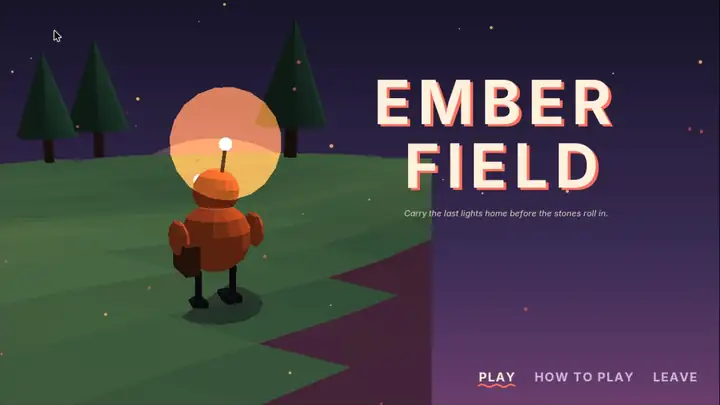
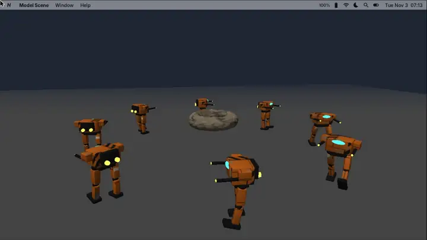

# Nexvyn OS SDK · Uygulama Geliştirme

[English](README.md) · **Türkçe**

Nexvyn OS için uygulama, oyun, tema ve yazı tipi yapanlar için her şey: SDK başvurusu, her dil için hızlı başlangıç
ve şablon, rehberler, çalışan örnekler, yapay zekâ asistanları için istemler, yayımlama rehberi ve `nxv` komut satırı.
Her belge İngilizce (`NAME.en.md`, `README.md`) ve Türkçe (`NAME.tr.md`, `README.tr.md`) olarak vardır.

## SDK 1.8'de yeni: 3B modeller, animasyon ve oyun tarifi

 

- **3B model dosyaları:** `g3d.model(path[, size])`, `.glb`, `.gltf` ve `.fbx` dosyalarını (ayrıca `.obj` ve `.stl`)
  node ağacı, materyalleri, gömülü texture'ları, iskeletleri ve animasyon klipleriyle açar.
  `g3d.loadModel(path[, size], callback)` arka planda yükler, oyun çizmeye devam eder.
- **Animasyon:** `model:play(name, {loop, speed, fade})`, geçişler (crossfade), `stop`, `setTime`, GPU skinning ve
  kemiklere nesne bağlamak için `model:nodeMatrix` ile `g3d.drawMatrix`.
- **Aynı API Lua, JavaScript, Python ve C'de.** Squirrel ve Java app'leri olduğu gibi çalışmaya devam eder. SDK 1.0-1.7
  için yapılan app'ler değişmeden çalışır; yeni davranış yalnızca `"targetSdk": "1.8"` olan app'lere uygulanır.
- **[Oyun yap](Guides/MAKE_A_GAME.tr.md):** boş projeden Uygulama Mağazası'na eksiksiz tarif: 3B modeller, yükleme,
  girdi, çarpışma, konsolda hız, size ait bir sanat yönü, key art ikon ve yayın.
- **[Kor Tarlası (Ember Field)](Samples/lua/ember-field/):** animasyonlu `.glb` kahramanlı eksiksiz küçük bir 3B oyun;
  aynı zamanda Studio şablonu. **3B modeller** iki klipli ve takılı nesneli daha küçük bir şablon.
- **SDK 1.8'e göre [AI istemleri](AI/README.tr.md)**, *modellerle 3B oyun yap* ve *mağaza ikonu* dahil. App'ler
  İngilizce yazılır, başka diller `lang/*.json` dosyalarıyla eklenir.
- Konsolda: Oyun Motoru'ndaki **Hızlı Oyun** ve **3D Modelleme**'nin yeni araçları (bevel, loop cut, modifier'lar,
  `.glb` dışa aktarma) kodunuzun yüklediği modelleri ve bölümleri üretir.

## Buradan başlayın

| Dil | 1. Hızlı başlangıç | 2. Şablon | 3. Rehber | 4. Örnekler |
|---|---|---|---|---|
| **Lua 5.4** (önerilen) | [Languages/lua](Languages/lua/README.tr.md) | [template](Languages/lua/template/) | [Geliştirici rehberi](Guides/DEVELOPER_GUIDE.tr.md), [oyun motoru](Guides/GAME_ENGINE.tr.md) | [Samples/lua](Samples/lua/) |
| **JavaScript** | [Languages/javascript](Languages/javascript/README.tr.md) | [template](Languages/javascript/template/) | [JavaScript ile uygulama](Guides/JS_APPS.tr.md) | [Samples/javascript](Samples/javascript/) |
| **Python** | [Languages/python](Languages/python/README.tr.md) | [template](Languages/python/template/) | [Python ile uygulama](Guides/PY_APPS.tr.md) | [Samples/python](Samples/python/) |
| **Squirrel** | [Languages/squirrel](Languages/squirrel/README.tr.md) | [template](Languages/squirrel/template/) | [Squirrel ile uygulama](Guides/SQUIRREL_APPS.tr.md) | [Samples/squirrel](Samples/squirrel/) |
| **C** | [Languages/c](Languages/c/README.tr.md) | [template](Languages/c/template/) | [C ile uygulama](Guides/C_APPS.tr.md) | [Samples/c](Samples/c/) |
| **Java** | [Languages/java](Languages/java/README.tr.md) | [template](Languages/java/template/) | [Java ile uygulama](Guides/JAVA_APPS.tr.md) | [Samples/java](Samples/java/) |

Sonra: her işlev için [SDK başvurusu](Reference/SDK.tr.md), `.nxvapp` / `.nxvtheme` / `.nxvfont` için
[paket biçimi](Guides/NXVAPP_FORMAT.tr.md) ve işinizi Uygulama Mağazası'na koymak için [Yayımlama](Publishing/README.tr.md).

Kararsızsanız **Lua** ile başlayın: en çok örnek, en iyi performans ve Studio'daki görsel editörler onunla gelir.

**Oyun mu yapıyorsunuz?** [Oyun yap](Guides/MAKE_A_GAME.tr.md) eksiksiz tariftir (SDK 1.8): proje, 3B modeller
(`.glb` / `.fbx`), yükleme, girdi, çarpışma, Switch'te hız, size ait bir sanat yönü, mağaza ikonu (key art) ve
yayın. Bu yolla yapılmış bir örnek: [Kor Tarlası](Samples/lua/ember-field/).
Ses, grafik, arayüz ve oyun hissi için `Languages/lua/kits` ve `Languages/javascript/kits` içindeki kitleri kullanın
([ses tasarımı](Guides/SOUND_DESIGN.tr.md), [grafik, arayüz ve oyun hissi](Guides/GAME_FEEL.tr.md)); mağaza ikonunu
[ikon aracıyla](Tools/icon/README.tr.md) yapın.

## Neler yapabilirsiniz

Bir Nexvyn OS uygulaması, içinde `app.json`, giriş dosyası ve `icon.png` bulunan bir `.nxvapp` klasörüdür (ya da bu
klasörün zip'lenmiş tek dosya hâli). Uygulamalar kendi penceresinde çalışır ve aynı SDK'yı kullanır:

- **Araç ve verimlilik uygulamaları:** `ui` bileşenleri (düğmeler, metin alanları, listeler, kaydırma, iletişim
  kutuları), `store` ile kalıcı veri, `fs` ile dosyalar, `net` ile HTTPS ve JSON, bildirimler, paylaşım, Hızlı Arama.
- **2D oyunlar:** `nexvyn.game` motoru (sahneler, sprite, tilemap, kamera, fizik, parçacıklar, tween, dokunmatik
  kontroller) ya da düz `gfx` çizimi; kumanda, klavye, dokunmatik ve hareket sensörleri.
- **3D:** GPU'da `g3d` (ışık, sis, doku) ve SDK 1.8'den beri arka planda yüklenen (`g3d.loadModel`) animasyonlu
  `.glb` / `.gltf` / `.fbx` modeller: iskelet animasyonu, geçişler ve takılan nesneler.
- **Ses:** sentezlenmiş tonlar, sistem sesleri, `.wav` / `.ogg` / `.mp3` dosyaları ve akış müziği.
- Kod gerektirmeyen **temalar** (`.nxvtheme`: renkler, duvar kâğıdı, sesler) ve **yazı tipi paketleri** (`.nxvfont`).

## 10 dakikada ilk uygulama

**Konsolda (bilgisayar gerekmez):**

1. **Nexvyn OS Studio**'yu açın, **Yeni Proje**'yi seçip bir şablon seçin (ör. *Boş Lua uygulaması*) ya da
   **Örnekler**'i açın.
2. Uygulamaya bir ad verin. Proje `sdmc:/NexvynOS/Applications/` içine kurulur ve düzenleyicide açılır.
3. `main.lua` içinde metni değiştirin, **Çalıştır** (Ctrl+R) ile açın. `print()` çıktısı ve hatalar Studio
   konsolunda görünür.
4. Hazır olunca **Paketi Dışa Aktar** (`~/Documents/<ad>.nxvapp`) ya da **Uygulama Mağazası'nda Yayımla** adımlarını
   izleyin.

**PC'de:**

1. Bir şablonu kopyalayın: `python SDK/Tools/nxv/nxv.py new lua "Benim Uygulamam" --author adiniz`.
2. `app.json` içinde `id`, `name`, `description` ve `permissions` alanlarını düzenleyin; kodu yazın.
3. Denetleyin: `python SDK/Tools/nxv/nxv.py check BenimUygulamam.nxvapp --sdk <Nexvyn OS kaynak klasörü>`.
4. Konsola gönderin: **Bilgisayara Bağlan** ile FTP sunucusunu açın, sonra
   `python SDK/Tools/nxv/nxv.py push BenimUygulamam.nxvapp --host <konsol-ip>` (Ryujinx: `nxv install BenimUygulamam.nxvapp`).
5. Launcher'ı yeniden açın; uygulama oradadır. Hatalar pencerede satır numarasıyla görünür ve
   `sdmc:/NexvynOS/System/Logs/Apps/<id>.log` dosyasına yazılır.

## İçindekiler

| Klasör | Ne var |
|---|---|
| [Reference/](Reference/README.tr.md) | SDK başvurusu (`SDK.en.md`, `SDK.tr.md`), Java SDK kaynakları, C başlığı, SDK sürüm geçmişi |
| [Languages/](Languages/README.tr.md) | Her dil için hızlı başlangıç ve denetleyiciden geçen hazır şablon |
| [Guides/](Guides/README.tr.md) | Kullanım ve geliştirici rehberleri: dil rehberleri, paket biçimi, oyun motoru, Oyun Atölyesi, yerel modüller ... |
| [Samples/](Samples/README.tr.md) | Altı dilde çalışan örnek projeler; Studio'nun *Örnekler* bölümü [`samples.json`](samples.json) dosyasını okur |
| [AI/](AI/README.tr.md) | Yapay zekâ asistanlarıyla uygulama yazmak için istemler ve bağlam paketleri |
| [Publishing/](Publishing/README.tr.md) | Uygulama Mağazası'nda yayımlama: akış, inceleme listesi, bildirim ve kaldırma |
| [Fonts/](Fonts/) | Sistem yazı tipleri (Inter, JetBrains Mono, `Icons.codepoints` ile simge yazı tipi): taslaklar ve simgeler için |
| [Tools/](Tools/README.tr.md) | `nxv` komut satırı: new, check, build, pack, icon, install, push |
