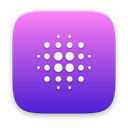
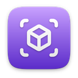
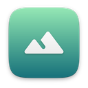
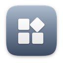
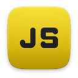
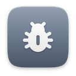
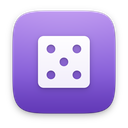

# Örnekler

[English](README.md) · **Türkçe**

**24** örnek.

Altı dilde çalışan örnek projeler. Her klasörde `source/` (eksiksiz bir `.nxvapp` paketi), `README.md` (ne öğrettiği, kontroller, çalıştırma), `icon.png`, `store.json` (beş dilde başlık ve açıklama, tür, etiketler, ekran görüntüsü betiği) ve varsa `screenshots/` vardır. `Tools/build_store.py` her örnek için `<slug>.zip` ve Nexvyn OS Studio'nun *Örnekler* bölümünün okuduğu `SDK/samples.json` dosyasını üretir.

Bir örneği denemek için `source/` klasörünü `sdmc:/NexvynOS/Applications/<ad>.nxvapp` olarak kopyalayın ya da `python SDK/Tools/nxv/nxv.py push SDK/Samples/<dil>/<ad> --host <konsol-ip>`.

## Lua

|  | Örnek | Tür | SDK | Özet |
|---|---|---|---|---|
|  | [Ritim Kutusu Demosu](lua/beatbox/) | demo | 1.0 | 16 adımlı davul makinesi |
|  | [Efekt Demosu](lua/effects/) | demo | 1.0 | Plazma, tünel ve yıldız alanı |
|  | [Hareketler Demosu](lua/gestures/) | demo | 1.0 | Yakınlaştır, döndür, kaydır, eğ ve titret |
|  | [Merhaba SDK](lua/hello/) | demo | 1.0 | Lua SDK turu |
|  | [Parçacık Demosu](lua/particles/) | demo | 1.2 | Yayıcılar, patlamalar ve çekim kuyuları |
|  | [Verlet Fizik Demosu](lua/physics/) | demo | 1.2 | Halatlar, köprü ve yırtılan kumaş |
|  | [Platform Demosu](lua/platformer/) | oyun | 1.2 | nexvyn.game ile eksiksiz bir platform bölümü |
|  | [3B Sahne Demosu](lua/scene3d/) | demo | 1.0 | Dokulu 3D modeller, güneş, sis ve parıltı |
|  | [Synth Demosu](lua/synth/) | demo | 1.0 | Piyano, dalga biçimleri ve ADSR zarfı |
|  | [Arazi Demosu](lua/terrain/) | demo | 1.0 | Üzerinde uçulan, kodla üretilmiş bir ada |
|  | [Arayüz Galerisi](lua/ui-gallery/) | demo | 1.0 | Tüm ui bileşenleri ve kodları |

## JavaScript

|  | Örnek | Tür | SDK | Özet |
|---|---|---|---|---|
|  | [Merhaba JS](javascript/hello/) | demo | 1.1 | JavaScript SDK turu |
|  | [Şekiller JS Demosu](javascript/shapes-js/) | demo | 1.1 | JavaScript ile tüm g3d temel şekilleri |

## Python

|  | Örnek | Tür | SDK | Özet |
|---|---|---|---|---|
|  | [Melodi Çalar (Python)](python/audio-py/) | demo | 1.3 | Nota nota melodi çalar |
|  | [Merhaba Python](python/hello/) | demo | 1.3 | Python SDK turu |

## Squirrel

|  | Örnek | Tür | SDK | Özet |
|---|---|---|---|---|
|  | [Merhaba Squirrel](squirrel/hello/) | demo | 1.5 | Squirrel SDK turu |
|  | [Yılan (Squirrel)](squirrel/snake/) | oyun | 1.5 | Klasik oyun: kumanda, klavye ve dokunmatik |
|  | [Kronometre](squirrel/stopwatch/) | uygulama | 1.5 | Turlar, en iyi ve en kötü; kapatınca da korunur |

## C

|  | Örnek | Tür | SDK | Özet |
|---|---|---|---|---|
|  | [Merhaba C](c/hello/) | demo | 1.5 | C SDK turu |
|  | [Hayat Oyunu (C)](c/life/) | demo | 1.5 | C ile Conway'in hücresel otomatı |
|  | [Bahşiş Bölüşücü (C)](c/tipcalc/) | uygulama | 1.5 | Hesabı ve bahşişi adilce bölüştür |

## Java

|  | Örnek | Tür | SDK | Özet |
|---|---|---|---|---|
|  | [Zar Atıcı (Java)](java/dice/) | uygulama | 1.5 | d4'ten d20'ye, zar tut, geçmişi sakla |
|  | [Merhaba Java](java/hello/) | demo | 1.5 | Java SDK turu |
|  | [Pong (Java)](java/pong/) | oyun | 1.5 | Konsola karşı, 7 sayıyı alan kazanır |
