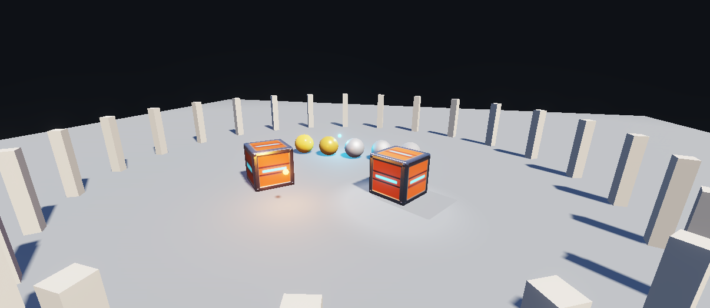

# PBR, Lights and Shadows

The NexGFX **pbr renderer** of SDK 1.9 in one small scene: a crate model with all its PBR maps, five spheres from rough
to polished metal, two moving point lights, a spot light that casts shadows, sun shadows, HDR with tone mapping and
bloom, and 24 pillars drawn with one instanced call. The same project is the Studio template
*3D: PBR, Lights and Shadows*.

<p align="center"></p>

| | |
|---|---|
| Id | `com.sonerx7.demo.pbr3d` |
| Language | Lua 5.4 |
| Min SDK | 1.9 (target 1.9) |
| Permissions | none |
| Window | 960 × 600, resizable |

## What it teaches

- `g3d.renderer("pbr")` in `app.load`, and a scene that stays correct when it returns `"basic"` (no OpenGL ES 3)
- Model materials as they are: `models/crate.glb` brings base colour, normal, metallic-roughness and emissive maps
- `g3d.material` on plain meshes: metallic 0 to 1 and roughness 0.15 to 0.87 on the five spheres; emissive bulbs
  with `emissiveStrength` above 1, so they feed the bloom
- Lights with ids: `g3d.addLight` (point and spot), moved every frame with `g3d.updateLight`
- `g3d.shadows`, `g3d.postfx` (exposure, ACES tone mapping, bloom) and `g3d.environment` (sky and ground ambient)
- `g3d.drawInstanced`: 24 pillars, one GPU call on the pbr renderer
- Buttons that switch the renderer, the shadows and the bloom, so you can compare what each part adds

**APIs used:** `g3d.renderer`, `g3d.model`, `g3d.mesh`, `g3d.material`, `g3d.addLight`, `g3d.updateLight`,
`g3d.shadows`, `g3d.postfx`, `g3d.environment`, `g3d.drawInstanced`, `g3d.begin/camera/light/fog/draw/finish`,
`ui.button`, `sys.fps`

## Code excerpt

```lua
function app.load()
  crate = g3d.model("bundle:/models/crate.glb", 1.4)       -- PBR maps come from the file
  warm = g3d.addLight({type = "point", color = "#FF9A3C", intensity = 6, range = 8})
  spot = g3d.addLight({type = "spot", x = 0, y = 6, z = 0, dx = 0, dy = -1, dz = 0,
                       intensity = 40, range = 14, inner = 12, outer = 20, shadow = true})
  active = g3d.renderer("pbr")                               -- "pbr", or "basic" without OpenGL ES 3
  g3d.shadows({enabled = true, quality = "medium", distance = 26})
  g3d.postfx({exposure = 1.0, tonemap = "aces", bloom = 0.08})
  g3d.environment({sky = "#9DB8E8", ground = "#4A4038", sun = 2.6})
end
```

## Running it

Copy the `source/` folder to `sdmc:/NexvynOS/Applications/` as `PBRLights.nxvapp`, or create it in Studio from the
template *3D: PBR, Lights and Shadows*. Files: `main.lua` (about 120 lines), `app.json`, `lang/en.json`,
`lang/tr.json`, `icon.png`, `models/crate.glb` (187 KB, CC0).

Check it on a PC: `python SDK/Tools/nxv/nxv.py check SDK/Samples/lua/pbr3d/source` (add `--sdk <source checkout>`
for the full Lua checker).

Measure on the console: the stats line shows the triangle count and fps. On a heavy scene lower `msaa`, the shadow
quality and the texture sizes first (SDK reference, section 8b, *Budget*).

## Versions

| Version | Change |
|---|---|
| 1.0 | First release (SDK 1.9, Nexvyn OS 1.2.2). |
