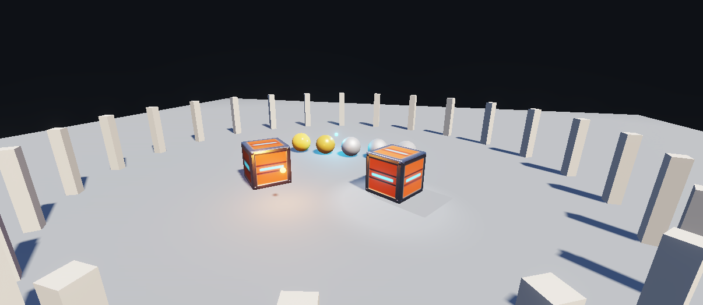

# PBR, Işıklar ve Gölgeler

[English](README.md) · **Türkçe**

SDK 1.9'un NexGFX **pbr renderer**'ı tek bir küçük sahnede: bütün PBR haritalarıyla bir kasa modeli, pürüzlüden parlak
metale beş küre, hareket eden iki nokta ışık, gölge düşüren bir spot ışık, güneş gölgeleri, ton eşlemeli HDR ve bloom,
tek instanced çağrıyla çizilen 24 sütun. Aynı proje Studio'daki *3B: PBR, ışıklar ve gölgeler* şablonudur.

<p align="center"></p>

| | |
|---|---|
| Kimlik | `com.sonerx7.demo.pbr3d` |
| Dil | Lua 5.4 |
| En düşük SDK | 1.9 (hedef 1.9) |
| İzinler | yok |
| Pencere | 960 × 600, boyutlandırılabilir |

## Ne öğretir

- `app.load` içinde `g3d.renderer("pbr")` ve `"basic"` dönünce de (OpenGL ES 3 yoksa) doğru kalan bir sahne
- Model materyalleri olduğu gibi: `models/crate.glb` base color, normal, metallic-roughness ve emissive haritalarını
  getirir
- Düz mesh'lerde `g3d.material`: beş kürede metallic 0'dan 1'e, roughness 0.15'ten 0.87'ye; `emissiveStrength` 1'in
  üstünde olan, bu yüzden bloom'a giren ampuller
- Id'li ışıklar: `g3d.addLight` (nokta ve spot), her karede `g3d.updateLight` ile hareket
- `g3d.shadows`, `g3d.postfx` (pozlama, ACES ton eşleme, bloom) ve `g3d.environment` (gök ve zemin ortam ışığı)
- `g3d.drawInstanced`: 24 sütun, pbr renderer'da tek GPU çağrısı
- Renderer'ı, gölgeleri ve bloom'u açıp kapatan düğmeler: her parçanın ne kattığını karşılaştırırsınız

**Kullanılan API'ler:** `g3d.renderer`, `g3d.model`, `g3d.mesh`, `g3d.material`, `g3d.addLight`, `g3d.updateLight`,
`g3d.shadows`, `g3d.postfx`, `g3d.environment`, `g3d.drawInstanced`, `g3d.begin/camera/light/fog/draw/finish`,
`ui.button`, `sys.fps`

## Koddan bir parça

```lua
function app.load()
  crate = g3d.model("bundle:/models/crate.glb", 1.4)       -- PBR haritaları dosyadan gelir
  warm = g3d.addLight({type = "point", color = "#FF9A3C", intensity = 6, range = 8})
  spot = g3d.addLight({type = "spot", x = 0, y = 6, z = 0, dx = 0, dy = -1, dz = 0,
                       intensity = 40, range = 14, inner = 12, outer = 20, shadow = true})
  active = g3d.renderer("pbr")                               -- "pbr", OpenGL ES 3 yoksa "basic"
  g3d.shadows({enabled = true, quality = "medium", distance = 26})
  g3d.postfx({exposure = 1.0, tonemap = "aces", bloom = 0.08})
  g3d.environment({sky = "#9DB8E8", ground = "#4A4038", sun = 2.6})
end
```

## Çalıştırma

`source/` klasörünü `sdmc:/NexvynOS/Applications/` içine `PBRLights.nxvapp` adıyla kopyalayın ya da Studio'da
*3B: PBR, ışıklar ve gölgeler* şablonundan oluşturun. Dosyalar: `main.lua` (yaklaşık 120 satır), `app.json`,
`lang/en.json`, `lang/tr.json`, `icon.png`, `models/crate.glb` (187 KB, CC0).

PC'de denetleyin: `python SDK/Tools/nxv/nxv.py check SDK/Samples/lua/pbr3d/source` (Lua checker'ının tamamı için
`--sdk <kaynak deposu>` ekleyin).

Konsolda ölçün: alt satır üçgen sayısını ve fps'i gösterir. Ağır bir sahnede önce `msaa`'yı, gölge kalitesini ve doku
boyutlarını düşürün (SDK başvurusu, bölüm 8b, *Bütçe*).

## Sürümler

| Sürüm | Değişiklik |
|---|---|
| 1.0 | İlk sürüm (SDK 1.9, Nexvyn OS 1.3.0). |
