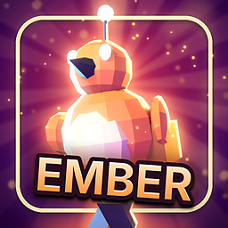
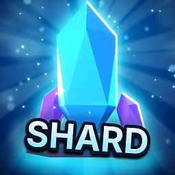
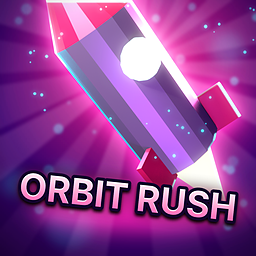

# Store icon tool (key art)

**English** · [Türkçe](README.tr.md)

The App Market icon of a game or app made with the SDK must look like real store key art: a bold hero, dramatic
light, a strong rim light, a saturated palette, depth, glow and particles, a tight crop, the name as a logo. Never a
flat symbol on a gradient. These two scripts make one from your game's own model in a few minutes.

| Step | Script | Needs | Makes |
|---|---|---|---|
| 1. Hero | [`hero_render.py`](hero_render.py) | Blender 4.4 or newer (free) | `hero.png`: your model posed and lit by a key light, two coloured rim lights and a fill, on a transparent background |
| 2. Key art | [`finish_icon.py`](finish_icon.py) | Python 3 + Pillow (`pip install pillow`) | `keyart_1024.png`, `icon_512.png`, `icon.png` (256 x 256) and `preview.png` |

`finish_icon.py` builds the background (a lit gradient, light rays, bokeh), a glow behind the hero, a rim highlight
on its edges, a ground light, sparks, bloom, a colour grade, a vignette and the title (bold, outlined, gradient fill,
bevel line, glow, slightly tilted). `preview.png` shows the icon at 256, 128 and 64 px with rounded corners, on dark
and on light, and in grey: if the hero does not stand out in the grey one, the values are too close.

## Quick start

```sh
# 1. the hero, from the model the game loads (pick an action pose: a clip and a frame)
blender -b --factory-startup -P SDK/Tools/icon/hero_render.py -- \
    --model MyGame.nxvapp/models/hero.glb --clip Run --frame 6 --look ember --out hero.png

# 2. the key art and every size
python SDK/Tools/icon/finish_icon.py hero.png --title "SKY HOP" --look ember --out art/

# 3. the icon of the bundle
copy art/icon.png MyGame.nxvapp/icon.png
```

No model (a tool or an app)? `--hero crystal`, `--hero rocket` or `--hero orb` renders a built-in object; better, make
one object in a 3D tool that stands for what your app does and render that.

## Looks

`--look` sets the colours of both scripts: `ember` (orange hero on violet dusk), `frost` (cyan ice on deep blue),
`toxic` (acid green on black), `synth` (hot pink and cyan), `gold` (gold rays and warm light), `royal` (violet and
gold), `jungle` (amber on deep green), `noir` (red on black). Pick the one closest to your game's palette, then
change the colours in the `LOOKS` tables of both scripts so the icon uses your game's real colours.

## Composition options (finish_icon.py)

| Option | Use |
|---|---|
| `--fill 1.05` | the hero larger than the square: a tight crop reads better at 64 px than a small whole figure |
| `--x 0.55 --y 0.8` | where the hero stands (centre x, bottom), shares of the square |
| `--frame` | an inner badge frame; with a large `--fill` and `--y` above 1 the head breaks out over the border |
| `--rays 0`, `--sparks 80` | calmer or busier backgrounds |
| `--tilt -6` | title angle; `--title "ORBIT RUSH"`; leave `--title` out for no text |
| `--seed 3` | another random layout of rays and sparks |

## Examples

Made with exactly these scripts (commands below), in [examples/](examples/):

| | |
|---|---|
|  | **Ember Field** (the sample in `SDK/Samples/lua/ember-field`): its own `pip.glb`, clip *Run* frame 5, `--look ember --frame --fill 1.02 --y 1.04 --title EMBER`. The antenna breaks out of the frame. |
|  | **Shard** (an app without a model): `--hero crystal --look frost --yaw -20`, then `--fill 0.9 --y 0.9 --seed 3 --title SHARD`. |
|  | **Orbit Rush**: `--hero rocket --look synth --yaw 30 --camera eye --exposure -0.4`, then `--fill 0.95 --y 0.8 --x 0.55 --tilt -6 --title "ORBIT RUSH"`. The nose leaves the square: motion. |

Each folder has `icon.png` (256), `icon_512.png` and `preview.png`.

## Rules the result must meet

- 256 x 256 PNG as `source/icon.png`, filled edge to edge (the corners may be rounded or cut where the icon is shown; use
  `--mask` only for previews).
- One hero, big, in the central 80 % (face, silhouette, logo); at most one or two words.
- Clearly this game: the same hero and colours as the screenshots. Unlike the other icons in its store category.
- Rendered from your own model, or made with a tool whose terms let you publish the result (name it in the README).

More: [Store icon task for AI assistants](../../AI/tasks/store-icon.en.md) (with a prompt for image generators) and
[Make a game, section 12](../../Guides/MAKE_A_GAME.en.md#12-store-icon-and-key-art).
