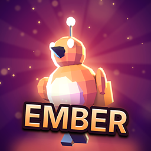

# Store icon tool (key art)

The App Market icon of a game or app made with the SDK shows the item itself: its hero, main object or world, not a
flat placeholder symbol on a gradient. How it looks is the maker's choice. These two scripts make a polished icon
from your game's own model in a few minutes, in the style you pick.

| Step | Script | Needs | Makes |
|---|---|---|---|
| 1. Hero | [`hero_render.py`](hero_render.py) | Blender 4.4 or newer (free) | `hero.png`: your model posed and lit by a key light, two coloured rim lights and a fill, on a transparent background |
| 2. Key art | [`finish_icon.py`](finish_icon.py) | Python 3 + Pillow (`pip install pillow`) | `keyart_1024.png`, `icon_512.png`, `icon.png` (256 x 256) and `preview.png` |

`finish_icon.py` builds a lit background, a soft glow behind the hero, a rim highlight on its edges and a vignette;
with the stronger styles also light rays, sparks and bloom. A title is added only when you ask for one. `preview.png`
shows the icon at 256, 128 and 64 px with rounded corners, on dark and on light, and in grey: if the hero does not
stand out in the grey one, the values are too close.

## Quick start

```sh
# 1. the hero, from the model the game loads (pick a good pose: a clip and a frame)
blender -b --factory-startup -P SDK/Tools/icon/hero_render.py -- \
    --model MyGame.nxvapp/models/hero.glb --clip Run --frame 6 --look ember --out hero.png

# 2. the key art and every size (clean style, no text)
python SDK/Tools/icon/finish_icon.py hero.png --look ember --out art/

# 3. the icon of the bundle
copy art/icon.png MyGame.nxvapp/icon.png
```

No model (a tool or an app)? `--hero crystal`, `--hero rocket` or `--hero orb` renders a built-in object; better,
make one object in a 3D tool that stands for what your app does and render that.

## Styles

`--style` (both scripts) is your choice; without it the tool uses **clean**.

| Style | Looks like | Use it for |
|---|---|---|
| `clean` (default) | the hero, a soft lit background, a gentle glow and rim, a natural colour grade; no rays, no sparks, no text | most games and apps |
| `bold` | more contrast and colour, a few light rays and sparks, a stronger rim | action and adventure games that want more punch |
| `loud` | many rays and sparks, strong bloom and glow, a punchy grade | arcade games that ask for it |

Single options override parts of a style: `--rays`, `--sparks`, `--fill`, `--y`. `--title "NAME"` adds a title logo
(off by default; a game's name is already shown under its icon), `--frame` an inner badge frame, `--tilt` the title
angle.

## Looks

`--look` sets the colours of both scripts: `ember` (orange hero on violet dusk), `frost` (cyan ice on deep blue),
`toxic` (acid green on black), `synth` (pink and cyan), `gold` (gold and warm light), `royal` (violet and gold),
`jungle` (amber on deep green), `noir` (red on black). Pick the one closest to your game's palette, then change the
colours in the `LOOKS` tables of both scripts so the icon uses your game's real colours.

## Composition options (finish_icon.py)

| Option | Use |
|---|---|
| `--fill 0.9` | hero height as a share of the square (clean 0.78, bold 0.86, loud 0.95; above 1 crops the hero) |
| `--x 0.55 --y 0.9` | where the hero stands (centre x, bottom), shares of the square |
| `--seed 3` | another random layout of the background details |

## Examples

Made with these scripts, in [examples/](examples/):

| | |
|---|---|
|  | **Ember Field** (the sample in `SDK/Samples/lua/ember-field`), default clean style: its own `pip.glb`, clip *Run* frame 5, `--look ember`. |
|  | **Shard** (an app without a model), clean: `--hero crystal --look frost --yaw -20`, then `--look frost --seed 3`. |
|  | **Orbit Rush**, clean: `--hero rocket --look synth --yaw 30 --camera eye --exposure -0.3`, then `--look synth --seed 11`. |
|  | **Ember Field, bold** (when the maker asks for it): `--style bold` in both scripts, `--title EMBER`. |

Each folder has `icon.png` (256), `icon_512.png` and `preview.png`.

## Rules the result must meet

- 256 x 256 PNG as `source/icon.png`, filled edge to edge (the corners may be rounded or cut where the icon is shown;
  use `--mask` only for previews).
- It shows the game or app itself (the same hero, object or world as the screenshots), not a flat placeholder glyph
  on a gradient (`nxv icon` makes those only while you work).
- It reads at 64 px: one main subject inside the central 80 %.
- Rendered from your own model, or made with a tool whose terms let you publish the result (name it in the README).

More: [Store icon task for AI assistants](../../AI/tasks/store-icon.md) (with a prompt for image generators) and
[Make a game, section 12](../../Guides/MAKE_A_GAME.md#12-store-icon-and-key-art).
