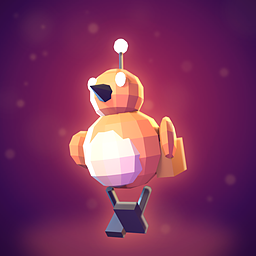
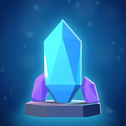
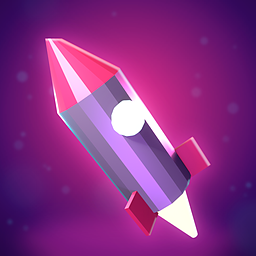
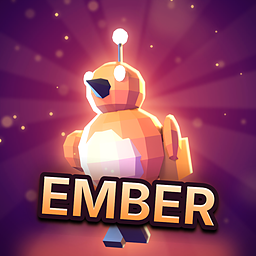

# Mağaza ikonu aracı (key art)

[English](README.md) · **Türkçe**

SDK ile yapılan bir oyunun ya da uygulamanın App Market ikonu öğenin kendisini gösterir: kahramanını, ana nesnesini
ya da dünyasını; gradyan üstünde düz, geçici bir sembolü değil. Nasıl görüneceği yapımcının seçimidir. Bu iki betik,
oyununuzun kendi modelinden seçtiğiniz stilde, birkaç dakikada özenli bir ikon yapar.

| Adım | Betik | Gereken | Ürettiği |
|---|---|---|---|
| 1. Kahraman | [`hero_render.py`](hero_render.py) | Blender 4.4 ya da daha yenisi (ücretsiz) | `hero.png`: modeliniz poz verilmiş, bir ana ışık, iki renkli rim ışığı ve bir dolgu ışığıyla aydınlatılmış, saydam arka planlı |
| 2. Key art | [`finish_icon.py`](finish_icon.py) | Python 3 + Pillow (`pip install pillow`) | `keyart_1024.png`, `icon_512.png`, `icon.png` (256 x 256) ve `preview.png` |

`finish_icon.py` ışıklı bir arka plan, kahramanın arkasında yumuşak bir parlama, kenarlarında bir rim vurgusu ve bir
vinyet kurar; daha güçlü stillerde ışık huzmeleri, kıvılcımlar ve bloom da ekler. Başlık yalnızca isterseniz eklenir.
`preview.png` ikonu 256, 128 ve 64 px'te köşeleri yuvarlatılmış olarak koyu ve açık zeminde, bir de gri tonlu
gösterir: gri olanda kahraman öne çıkmıyorsa değerler birbirine çok yakındır.

## Hızlı başlangıç

```sh
# 1. kahraman, oyunun yüklediği modelden (iyi bir poz seçin: bir klip ve bir kare)
blender -b --factory-startup -P SDK/Tools/icon/hero_render.py -- \
    --model MyGame.nxvapp/models/hero.glb --clip Run --frame 6 --look ember --out hero.png

# 2. key art ve bütün boyutlar (clean stil, yazısız)
python SDK/Tools/icon/finish_icon.py hero.png --look ember --out art/

# 3. paketin ikonu
copy art/icon.png MyGame.nxvapp/icon.png
```

Model yok mu (bir araç ya da uygulama)? `--hero crystal`, `--hero rocket` ya da `--hero orb` yerleşik bir nesne
çizer; daha iyisi, bir 3D araçta uygulamanızın işini anlatan tek bir nesne yapıp onu çizdirin.

## Stiller

`--style` (iki betikte de) sizin seçiminizdir; verilmezse araç **clean** kullanır.

| Stil | Görünüş | Ne için |
|---|---|---|
| `clean` (varsayılan) | kahraman, yumuşak ışıklı arka plan, hafif parlama ve rim, doğal renk ayarı; huzme, kıvılcım ve yazı yok | çoğu oyun ve uygulama |
| `bold` | daha fazla kontrast ve renk, birkaç ışık huzmesi ve kıvılcım, daha güçlü rim | daha vurucu olmak isteyen aksiyon ve macera oyunları |
| `loud` | çok sayıda huzme ve kıvılcım, güçlü bloom ve parlama, sert renk ayarı | bunu isteyen arcade oyunları |

Tek tek seçenekler stilin parçalarını ezer: `--rays`, `--sparks`, `--fill`, `--y`. `--title "AD"` bir başlık logosu
ekler (varsayılan kapalı; oyunun adı zaten ikonunun altında yazar), `--frame` içte bir rozet çerçevesi, `--tilt`
başlık açısı.

## Görünümler

`--look` iki betiğin renklerini birlikte seçer: `ember` (mor alacakaranlıkta turuncu kahraman), `frost` (koyu mavide
camgöbeği buz), `toxic` (siyahta asit yeşili), `synth` (pembe ve camgöbeği), `gold` (altın ve sıcak ışık), `royal`
(mor ve altın), `jungle` (koyu yeşilde kehribar), `noir` (siyahta kırmızı). Oyununuzun paletine en yakın olanı seçin,
sonra iki betikteki `LOOKS` tablolarında renkleri değiştirerek ikonun oyununuzun gerçek renklerini kullanmasını
sağlayın.

## Kompozisyon seçenekleri (finish_icon.py)

| Seçenek | Kullanım |
|---|---|
| `--fill 0.9` | kahramanın yüksekliği, karenin payı olarak (clean 0.78, bold 0.86, loud 0.95; 1'in üstü kahramanı kırpar) |
| `--x 0.55 --y 0.9` | kahramanın durduğu yer (orta x, alt kenar), karenin payı olarak |
| `--seed 3` | arka plan ayrıntılarının başka bir rastgele dizilişi |

## Örnekler

Bu betiklerle yapıldı, [examples/](examples/) içinde:

| | |
|---|---|
|  | **Ember Field** (`SDK/Samples/lua/ember-field` örneği), varsayılan clean stil: kendi `pip.glb`'si, *Run* klibinin 5. karesi, `--look ember`. |
|  | **Shard** (modeli olmayan bir uygulama), clean: `--hero crystal --look frost --yaw -20`, sonra `--look frost --seed 3`. |
|  | **Orbit Rush**, clean: `--hero rocket --look synth --yaw 30 --camera eye --exposure -0.3`, sonra `--look synth --seed 11`. |
|  | **Ember Field, bold** (yapımcı isterse): iki betikte `--style bold`, `--title EMBER`. |

Her klasörde `icon.png` (256), `icon_512.png` ve `preview.png` var.

## Sonucun uyması gereken kurallar

- `source/icon.png` olarak 256 x 256 PNG, kenardan kenara dolu (ikonun gösterildiği yerde köşeler yuvarlanabilir ya
  da kesilebilir; `--mask` yalnızca önizleme içindir).
- Oyunun ya da uygulamanın kendisini gösterir (ekran görüntüleriyle aynı kahraman, nesne ya da dünya); gradyan
  üstünde düz, geçici bir sembol değildir (`nxv icon` bunları yalnızca çalışırken üretir).
- 64 px'de okunur: ortadaki %80'lik alanda tek bir ana konu.
- Kendi modelinizden çizilmiş ya da çıktısını yayımlamanıza izin veren bir araçla yapılmış (README'de adını yazın).

Daha fazlası: [AI asistanları için mağaza ikonu görevi](../../AI/tasks/store-icon.tr.md) (görsel üreticiler için
prompt'la) ve [Oyun yap, bölüm 12](../../Guides/MAKE_A_GAME.tr.md).
