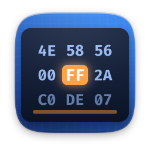
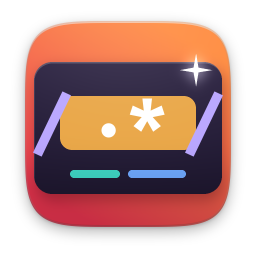

# developer

[English](README.md)

| | Öğe | Sürüm | Açıklama |
|---|---|---|---|
|  | [Base64 ve Hash](hashtool/) | 1.1.0 | Metni kodla, sağlama toplamını doğrula |
|  | [Hexpad](hexpad/) | 1.0 | Her dosya için onaltılık düzenleyici |
|  | [JSON Biçimlendirici](jsonfmt/) | 1.1.0 | JSON'u doğrula, biçimlendir, keşfet |
|  | [Regex Lab](regexlab/) | 1.0 | Düzenli ifadeleri canlı dene |
