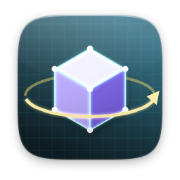
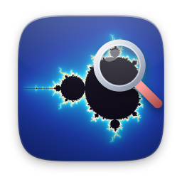
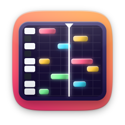
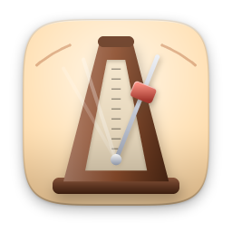

# media

[Türkçe](README.tr.md)

| | Item | Version | Description |
|---|---|---|---|
|  | [3D Modeler](modeler/) · ships with Nexvyn OS | 1.0 | Low-poly 3D modeling, OBJ and STL |
|  | [3D Viewer](viewer3d/) | 1.1.0 | Spin, zoom and inspect OBJ and STL models |
|  | [Chiptrack](chiptrack/) | 1.0 | Make chiptune music, export WAV |
|  | [Chordbook](chordbook/) | 1.0 | Chords, scales and progressions |
|  | [Drum Machine](drums/) | 1.1.0 | 16 steps, accents and nine styles |
|  | [Fractal Explorer](mandelbrot/) | 1.1.0 | Dive deep into Mandelbrot and Julia |
|  | [Live TV](iptv/) · ships with Nexvyn OS | 1.0 | Free TV channels and your M3U playlists |
|  | [Melody Studio](sequencer/) | 1.1.0 | Compose melodies on a piano roll |
|  | [Metronome](metronome/) | 1.1.0 | Keep perfect time with a swinging pendulum |
|  | [Paint](paint/) · ships with Nexvyn OS | 1.0 | Draw, sketch and edit images |
|  | [Piano](piano/) | 1.1.0 | Play, record and learn songs key by key |
|  | [Pixel Art](pixelart/) | 1.1.0 | Sprites up to 64×64, exported as PNG |
|  | [Radio](radio/) · ships with Nexvyn OS | 1.0 | Thousands of live stations worldwide |
|  | [White Noise](noise/) | 1.1.0 | Rain, waves and noise to help you sleep |
|  | [YousTube](tube/) · ships with Nexvyn OS | 1.0 | YouTube videos, Shorts and channels |
