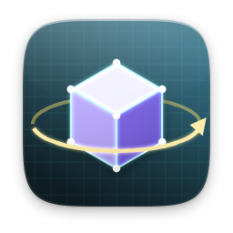
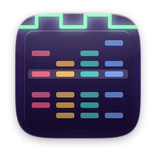
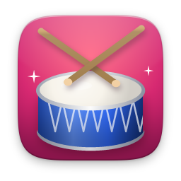
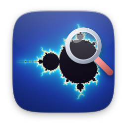
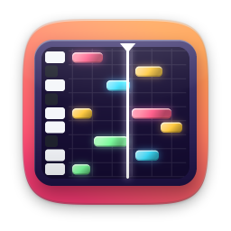
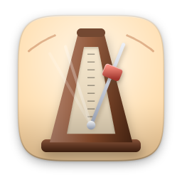
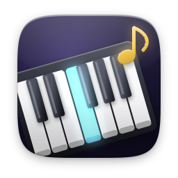
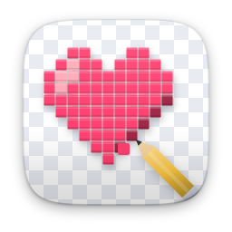
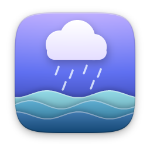

# media

[English](README.md)

| | Öğe | Sürüm | Açıklama |
|---|---|---|---|
|  | [3D Modelleme](modeler/) · Nexvyn OS ile gelir | 1.0 | Low-poly 3D modelleme, OBJ ve STL |
|  | [3D Görüntüleyici](viewer3d/) | 1.1.0 | OBJ ve STL modellerini döndür, incele |
|  | [Chiptrack](chiptrack/) | 1.0 | Chiptune müzik yap, WAV aktar |
|  | [Akor Defteri](chordbook/) | 1.0 | Akorlar, diziler ve akor dizileri |
|  | [Ritim Makinesi](drums/) | 1.1.0 | 16 adım, vurgular ve dokuz tarz |
|  | [Fraktal Gezgini](mandelbrot/) | 1.1.0 | Mandelbrot ve Julia'nın derinliklerine dal |
|  | [Canlı TV](iptv/) · Nexvyn OS ile gelir | 1.0 | Ücretsiz TV kanalları ve M3U listelerin |
|  | [Melodi Stüdyosu](sequencer/) | 1.1.0 | Piyano rulosunda melodi besteleyin |
|  | [Metronom](metronome/) | 1.1.0 | Sallanan sarkaçla tempoyu hiç kaçırma |
|  | [Çizim](paint/) · Nexvyn OS ile gelir | 1.0 | Çiz, karala, resim düzenle |
|  | [Piyano](piano/) | 1.1.0 | Çal, kaydet, şarkıları tuş tuş öğren |
|  | [Piksel Sanatı](pixelart/) | 1.1.0 | 64×64'e kadar sprite, PNG dışa aktarma |
|  | [Radyo](radio/) · Nexvyn OS ile gelir | 1.0 | Dünyadan binlerce canlı radyo istasyonu |
|  | [Beyaz Gürültü](noise/) | 1.1.0 | Uykuya dalmak için yağmur, dalga, gürültü |
|  | [YousTube](tube/) · Nexvyn OS ile gelir | 1.0 | YouTube videoları, Shorts ve kanallar |
