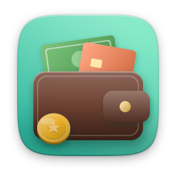
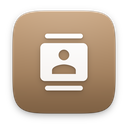
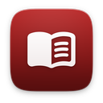
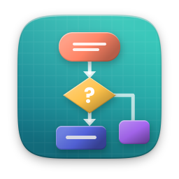
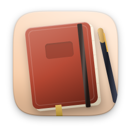
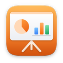
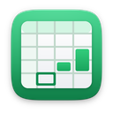
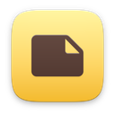
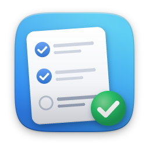
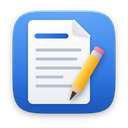

# office

| | Item | Version | Description |
|---|---|---|---|
|  | [Budget](budget/) | 1.1.0 | Budgets, repeats and monthly charts |
|  | [Contacts](contacts/) · ships with Nexvyn OS | 1.0 | Your address book, with vCard import |
|  | [Dictionary](dictionary/) · ships with Nexvyn OS | 1.0 | Turkish TDK and English definitions |
|  | [Flowmap](flowmap/) | 1.0 | Flowcharts and mind maps |
|  | [Journal](journal/) | 1.1.0 | Daily lines, moods, insights, memories |
|  | [Kanban](kanban/) | 1.1.0 | Boards, checklists and drag-and-drop |
|  | [Presenter](slides/) · ships with Nexvyn OS | 1.0 | Beautiful slide decks, ready to present |
|  | [Spreadsheet](sheets/) · ships with Nexvyn OS | 1.0 | Formulas, charts and Excel files |
|  | [Sticky Notes](stickies/) · ships with Nexvyn OS | 1.0 | Colourful notes that stay on your desktop |
|  | [To-Do](todo/) | 1.1.0 | Projects, steps, repeats and due dates |
|  | [Writer](writer/) · ships with Nexvyn OS | 1.0 | A word processor with Word file support |
