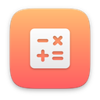

# other

[Türkçe](README.tr.md)

| | Item | Version | Description |
|---|---|---|---|
|  | [Capitals](capitals/) | 1.0 | Learn the capitals of 150 countries |
|  | [Game of Life](life/) | 1.0 | Watch cells live, die and evolve |
|  | [Math Race](mathrace/) | 1.0 | 60 seconds of mental maths, full speed |
|  | [Primes](primes/) | 1.0 | Sieve, spiral and factor prime numbers |
|  | [Times Tables](multiply/) | 1.0 | Learn the times tables and earn stars |
|  | [Turtle Graphics](turtle/) | 1.0 | Learn to code by drawing with a turtle |
