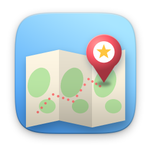
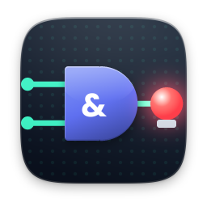
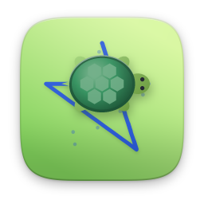

# other

[Türkçe](README.tr.md)

| | Item | Version | Description |
|---|---|---|---|
|  | [Capitals](capitals/) | 1.1.0 | Learn the capitals of 150 countries |
|  | [Logic Lab](logiclab/) | 1.0 | Build and run digital circuits |
|  | [Times Tables](multiply/) | 1.1.0 | Learn the times tables and earn stars |
|  | [Turtle Graphics](turtle/) | 1.1.0 | Learn to code by drawing with a turtle |
