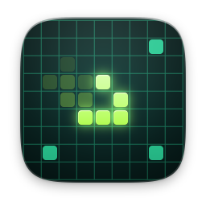
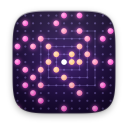
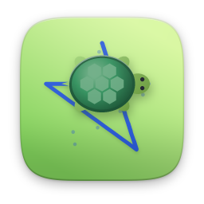

# other

[English](README.md)

| | Öğe | Sürüm | Açıklama |
|---|---|---|---|
|  | [Başkentler](capitals/) | 1.0.1 | 150 ülkenin başkentini öğren |
|  | [Hayat Oyunu](life/) | 1.0.1 | Hücrelerin doğup ölüşünü izle |
|  | [Matematik Yarışı](mathrace/) | 1.0.1 | 60 saniyede tam gaz zihinden matematik |
|  | [Asal Sayılar](primes/) | 1.0.1 | Asalları ele, sarmalda gör, çarpanla |
|  | [Çarpım Tablosu](multiply/) | 1.0.1 | Çarpım tablosunu öğren, yıldız topla |
|  | [Kaplumbağa Grafikleri](turtle/) | 1.0.1 | Kaplumbağayla çizerek kodlamayı öğren |
