# productivity

| | Item | Version | Description |
|---|---|---|---|
|  | [AI Chat](aichat/) · ships with Nexvyn OS | 1.0 | Claude, Gemini and GPT on your Switch |
| 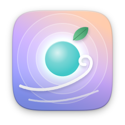 | [Breathe](breathe/) | 1.1.0 | Calm down with guided breathing |
| 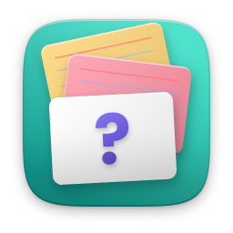 | [Flashcards](flashcards/) | 1.1.0 | Spaced repetition, quizzes and imports |
| 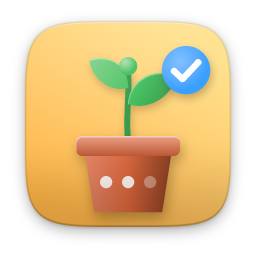 | [Habits](habits/) | 1.1.0 | Streaks, rest days and milestones |
| 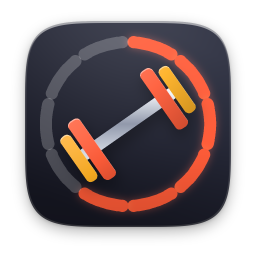 | [Interval Timer](interval/) | 1.1.0 | HIIT and Tabata timer for every workout |
| 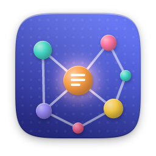 | [Linkwise](linkwise/) | 1.0 | Linked notes, backlinks and a graph |
|  | [Nex Local AI Studio](nexai-studio/) | 1.2.0 | Local GGUF LLM, AI Store & Media Studio |
| 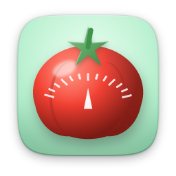 | [Pomodoro](pomodoro/) | 1.1.0 | Focus sprints, tasks and a daily goal |
| 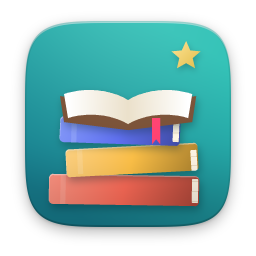 | [Reading List](reading/) | 1.1.0 | Track your books, pages and reading goal |
| 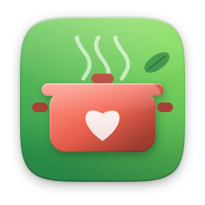 | [Recipe Box](recipebox/) | 1.0 | Recipes, cooking mode and shopping |
| 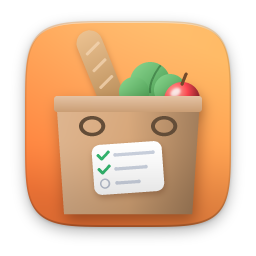 | [Shopping List](shopping/) | 1.1.0 | Lists sorted by aisle, quick to refill |
| 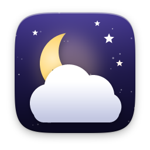 | [Sleep Tracker](sleep/) | 1.1.0 | Log your nights and reach your sleep goal |
| 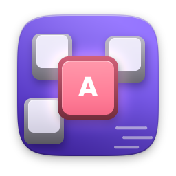 | [Typing Tutor](typing/) | 1.1.0 | Touch typing, weak keys and speed tests |
