# productivity

[English](README.md)

| | Öğe | Sürüm | Açıklama |
|---|---|---|---|
|  | [AI Sohbet](aichat/) · Nexvyn OS ile gelir | 1.0 | Claude, Gemini ve GPT artık Switch'inde |
| 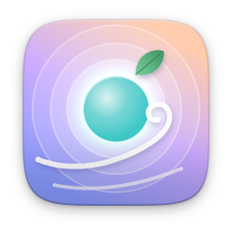 | [Nefes](breathe/) | 1.1.0 | Rehberli nefesle sakinleş |
| 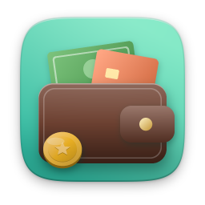 | [Bütçe](budget/) | 1.1.0 | Bütçeler, tekrarlar, aylık grafikler |
|  | [Kişiler](contacts/) · Nexvyn OS ile gelir | 1.0 | vCard destekli adres defterin |
| 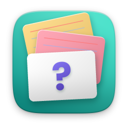 | [Kelime Kartları](flashcards/) | 1.1.0 | Aralıklı tekrar, testler, içe aktarma |
| 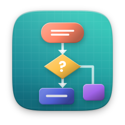 | [Flowmap](flowmap/) | 1.0 | Akış şemaları ve zihin haritaları |
| 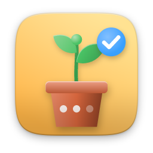 | [Alışkanlıklar](habits/) | 1.1.0 | Seriler, dinlenme günleri, hedefler |
| 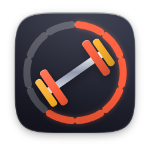 | [Aralıklı Zamanlayıcı](interval/) | 1.1.0 | Her antrenman için HIIT ve Tabata sayacı |
| 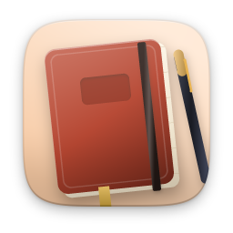 | [Günlük](journal/) | 1.1.0 | Günlük satırlar, ruh hali, anılar |
|  | [Görev Panosu](kanban/) | 1.1.0 | Panolar, kontrol listeleri, sürükle-bırak |
| 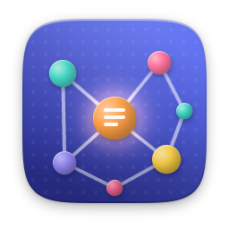 | [Linkwise](linkwise/) | 1.0 | Bağlantılı notlar, geri bağlantılar ve grafik |
| 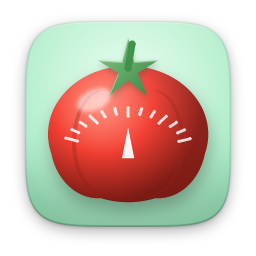 | [Pomodoro](pomodoro/) | 1.1.0 | Odak turları, görevler, günlük hedef |
| 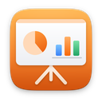 | [Sunum](slides/) · Nexvyn OS ile gelir | 1.0 | Şık sunumlar hazırla ve sun |
|  | [Okuma Listesi](reading/) | 1.1.0 | Kitaplarını, sayfalarını ve hedefini izle |
| 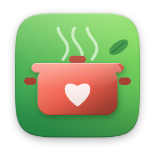 | [Tarif Kutusu](recipebox/) | 1.0 | Tarifler, pişirme kipi ve alışveriş |
| 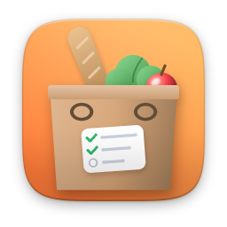 | [Alışveriş Listesi](shopping/) | 1.1.0 | Reyonlara göre sıralı, hızlı alışveriş |
| 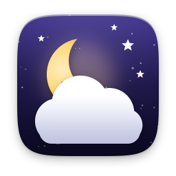 | [Uyku Takibi](sleep/) | 1.1.0 | Gecelerini kaydet, uyku hedefine ulaş |
| 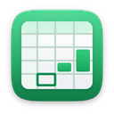 | [Hesap Tablosu](sheets/) · Nexvyn OS ile gelir | 1.0 | Formüller, grafikler ve Excel dosyaları |
|  | [Yapışkan Notlar](stickies/) · Nexvyn OS ile gelir | 1.0 | Masaüstünde kalan renkli notlar |
| 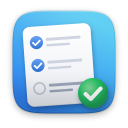 | [Yapılacaklar](todo/) | 1.1.0 | Projeler, adımlar, tekrarlar, tarihler |
| 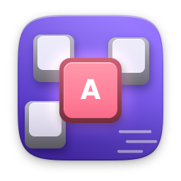 | [Klavye Ustası](typing/) | 1.1.0 | On parmak, zayıf tuşlar, hız testi |
| 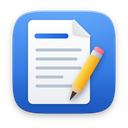 | [Kelime İşlemci](writer/) · Nexvyn OS ile gelir | 1.0 | Word uyumlu kelime işlemci |
