# productivity

[English](README.md)

| | Öğe | Sürüm | Açıklama |
|---|---|---|---|
|  | [AI Sohbet](aichat/) · Nexvyn OS ile gelir | 1.0 | Claude, Gemini ve GPT artık Switch'inde |
| 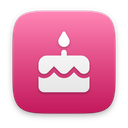 | [Doğum Günleri](birthdays/) | 1.0 | Hiçbir doğum gününü kaçırma |
| 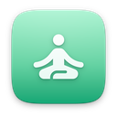 | [Nefes](breathe/) | 1.0 | Rehberli nefesle sakinleş |
| 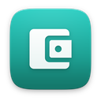 | [Bütçe](budget/) | 1.0 | Paranın nereye gittiğini her ay gör |
| 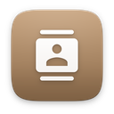 | [Kişiler](contacts/) · Nexvyn OS ile gelir | 1.0 | vCard destekli adres defterin |
|  | [Sınav Geri Sayımı](examcount/) | 1.0 | Sınavlara geri say, her gün çalış |
| 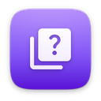 | [Kelime Kartları](flashcards/) | 1.0 | Aralıklı tekrarla daha kalıcı öğren |
| 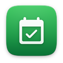 | [Alışkanlıklar](habits/) | 1.0 | İyi alışkanlıkları gün gün kazan |
| 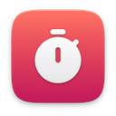 | [Aralıklı Zamanlayıcı](interval/) | 1.0 | Her antrenman için HIIT ve Tabata sayacı |
|  | [Günlük](journal/) | 1.0 | Her gün birkaç satır, bir ruh hali, bir anı |
| 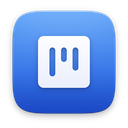 | [Görev Panosu](kanban/) | 1.0 | Görevlerini sürükle-bırak panolarda düzenle |
| 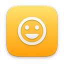 | [Ruh Hali Günlüğü](mood/) | 1.0 | Nasıl hissettiğini gün gün gör |
| 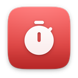 | [Pomodoro](pomodoro/) | 1.0 | Odaklanarak çalış, aralarda dinlen |
| 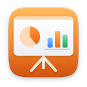 | [Sunum](slides/) · Nexvyn OS ile gelir | 1.0 | Şık sunumlar hazırla ve sun |
|  | [Okuma Listesi](reading/) | 1.0 | Kitaplarını, sayfalarını ve hedefini izle |
| 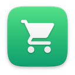 | [Alışveriş Listesi](shopping/) | 1.0 | Reyonlara göre sıralı, hızlı alışveriş |
| 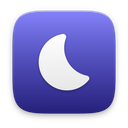 | [Uyku Takibi](sleep/) | 1.0 | Gecelerini kaydet, uyku hedefine ulaş |
| 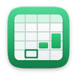 | [Hesap Tablosu](sheets/) · Nexvyn OS ile gelir | 1.0 | Formüller, grafikler ve Excel dosyaları |
| 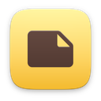 | [Yapışkan Notlar](stickies/) · Nexvyn OS ile gelir | 1.0 | Masaüstünde kalan renkli notlar |
| 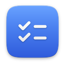 | [Yapılacaklar](todo/) | 1.0 | Görevler, projeler ve tarihler tek yerde |
| 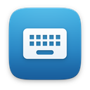 | [Klavye Ustası](typing/) | 1.0 | On parmak klavyeyi sıra sıra öğren |
| 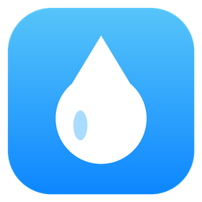 | [Su Takibi](water/) | 1.1 | Suyunu takip et, günlük hedefe ulaş |
| 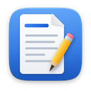 | [Kelime İşlemci](writer/) · Nexvyn OS ile gelir | 1.0 | Word uyumlu kelime işlemci |
