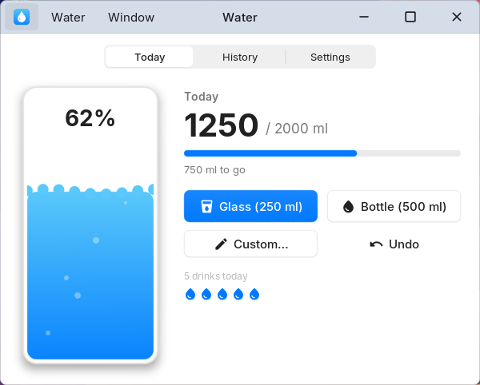
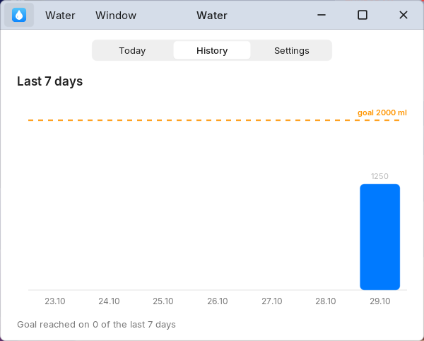
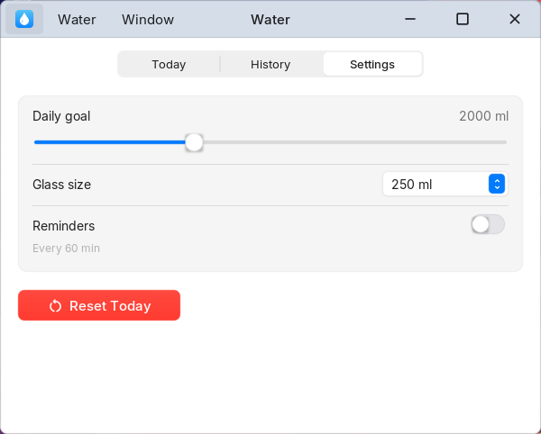
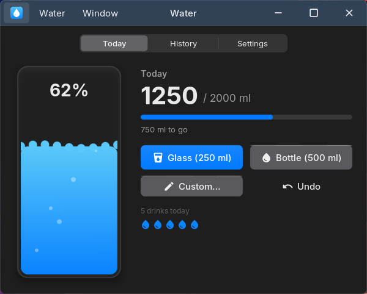

# Su Takibi / Water

Günlük su tüketimini takip eden örnek Nexvyn OS uygulaması (Lua SDK).
A sample Nexvyn OS app (Lua SDK) that tracks how much water you drink each day.

| Bugün | Geçmiş | Ayarlar | Karanlık mod |
|---|---|---|---|
|  |  |  |  |

## Özellikler

- Tek dokunuşla bardak (150–500 ml, ayarlanabilir) ya da 500 ml şişe ekleme, özel miktar, geri alma.
- Günlük hedef (1000–4000 ml) ve dolan bardak animasyonu; hedefe ulaşınca bildirim.
- Son 7 günün grafiği, hedef çizgisi ve kaç gün hedefe ulaşıldığı.
- İsteğe bağlı hatırlatıcı: 15–180 dakikada bir, hedefe kalan miktarı bildirir.
- Klavye: Boşluk/Enter bardak ekler, Backspace geri alır, sol/sağ ok sekme değiştirir.
- Türkçe ve İngilizce; açık ve karanlık mod.

## Kurulum

- **Mağaza:** Uygulama Mağazası > Verimlilik > Su Takibi > Al.
- **Elle:** `water.nxvapp` dosyasını SD karta kopyalayın ve Dosyalar'da açın; yükleyici ayrıntıları, izinleri ve dosya
  doğrulamasını (`Bütün`) gösterir.

İzinler: yalnızca `notifications` (hedef ve hatırlatıcı bildirimleri). Ağ ya da dosya erişimi istemez.
Veriler `~/Library/Application Support/com.sonerx7.water/` içinde tutulur; "Verileriyle kaldır" bunları da siler.

## Geliştirme

Kaynak `source/` klasöründe (`main.lua` ~250 satır, `app.json`, `lang/`). Paketlemek ve denetlemek için Nexvyn OS
kaynak reposundaki araçlar kullanılır:

```
python tools/lua_check.py apps/productivity/water/source --frames 600
python tools/nxvapp_pack.py apps/productivity/water/source -o apps/productivity/water/water.nxvapp --index
```

`--index` çıktısındaki `size` ve `sha256`, `store/catalog.json` kaydıyla aynı olmalıdır.

## Sürümler

| Sürüm | Değişiklik |
|---|---|
| 1.1 | Yüzde etiketi su çizgisinin üstüne binmiyor; şişe düğmesindeki ikon görünür oldu. |
| 1.0 | İlk sürüm. |
