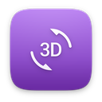
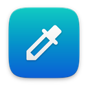
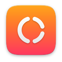
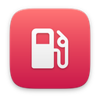
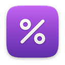
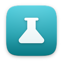
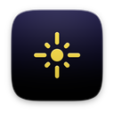
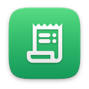
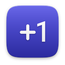
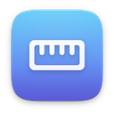

# utilities

[Türkçe](README.tr.md)

| | Item | Version | Description |
|---|---|---|---|
|  | [3D Surface](graph3d/) | 1.0 | Plot z = f(x, y) as a 3D surface |
|  | [Automation](automation/) · ships with Nexvyn OS | 1.0 | One-tap routines and smart triggers |
|  | [BMI](bmi/) | 1.0 | Your BMI, healthy range and trend |
|  | [Color Converter](colorconv/) | 1.0 | HEX, RGB, HSL, HSV and CMYK in sync |
|  | [Color Meter](colorpicker/) · ships with Nexvyn OS | 1.0 | Pick any color on screen, copy its code |
|  | [Color Palette](palette/) | 1.0 | Color harmonies from a single base color |
|  | [Controller Test](gamepad/) · ships with Nexvyn OS | 1.0 | Test buttons, sticks, motion and rumble |
|  | [Countdown](countdown/) | 1.0 | Big ticking countdowns to your big days |
|  | [Date Calculator](datecalc/) | 1.0 | Days between dates, date math and more |
|  | [Decision Wheel](wheel/) | 1.0 | Can't decide? Spin the wheel |
|  | [Dice & Coin](dice/) | 1.0 | Roll d4 to d20 dice or flip a coin |
|  | [Finance Calculator](finance/) | 1.0 | Loans, savings, percentages and VAT |
|  | [Fonts](fontbook/) · ships with Nexvyn OS | 1.0 | Preview, inspect and install fonts |
|  | [Fuel Calculator](fuel/) | 1.0 | Fuel use, trip costs and a fill-up log |
|  | [Globe](globe/) | 1.0 | A 3D Earth with live day and night |
|  | [Graph Plotter](graph/) | 1.0 | Plot functions, find roots and crossings |
|  | [Loan Calculator](loancalc/) | 1.0 | Know your payment before you borrow |
|  | [Moon Phase](moon/) | 1.0 | Tonight's moon and every phase ahead |
|  | [Morse Code](morse/) | 1.0 | Translate, play and practice Morse code |
|  | [Password Generator](passgen/) | 1.0 | Strong passwords and easy passphrases |
|  | [Percentage Calculator](percent/) | 1.0 | Five percentage calculators, one window |
|  | [Periodic Table](periodic/) | 1.0 | All 118 elements, one tap away |
|  | [QR Code](qrcode/) | 1.0 | QR codes for text, links and Wi-Fi |
|  | [Roman Numerals](roman/) | 1.0 | Convert, learn and quiz Roman numerals |
|  | [Solar System](solar/) | 1.0 | The planets in motion, starting today |
|  | [Split Bill](splitbill/) | 1.0 | Split the bill fairly, item by item |
|  | [Tally Counter](tally/) | 1.0 | Count anything with named counters |
|  | [Text Tools](texttools/) | 1.0 | Fix case, tidy and sort text, count words |
|  | [Tip Calculator](tipcalc/) | 1.0 | Tip, total and each person's share |
|  | [Unit Converter](unitconv/) | 1.0 | Length, mass, temperature, data and more |
|  | [World Clock](worldclock/) | 1.0 | Time around the world, and when to meet |
