# utilities

[English](README.md)

| | Öğe | Sürüm | Açıklama |
|---|---|---|---|
| 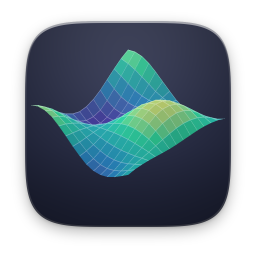 | [3D Yüzey](graph3d/) | 1.1.0 | z = f(x, y) fonksiyonlarını 3D çiz |
|  | [Otomasyon](automation/) · Nexvyn OS ile gelir | 1.0 | Tek dokunuşla rutinler, akıllı tetikler |
|  | [Turnuva](bracket/) | 1.0 | Oyun geceleri için turnuvalar |
| 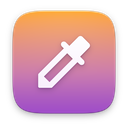 | [Renk Ölçer](colorpicker/) · Nexvyn OS ile gelir | 1.0 | Ekrandaki her rengi yakala, kodunu kopyala |
| 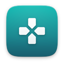 | [Kontrolcü Testi](gamepad/) · Nexvyn OS ile gelir | 1.0 | Tuşları, çubukları ve titreşimi test et |
| 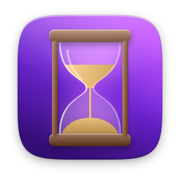 | [Geri Sayım](countdown/) | 1.1.0 | Beklediğin günlere canlı geri sayım |
|  | [Tarih Hesaplayıcı](datecalc/) | 1.1.0 | Tarih farkı, gün ekleme ve fazlası |
|  | [Zar ve Yazı Tura](dice/) | 1.1.0 | d4'ten d20'ye zar at ya da yazı tura |
| 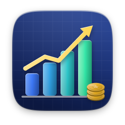 | [Finans Hesaplayıcı](finance/) | 1.1.0 | Kredi, birikim, yüzde ve KDV hesapları |
| 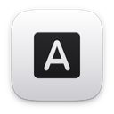 | [Yazı Tipleri](fontbook/) · Nexvyn OS ile gelir | 1.0 | Yazı tiplerini önizle, incele ve yükle |
| 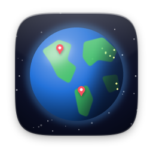 | [Dünya Küresi](globe/) | 1.1.0 | Gece ve gündüzü canlı 3D Dünya |
| 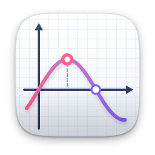 | [Grafik Çizici](graph/) | 1.1.0 | Fonksiyon çiz, kökleri ve kesişimleri bul |
| 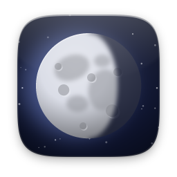 | [Ay Evresi](moon/) | 1.1.0 | Bu gecenin Ay'ı ve tüm evreleri |
| 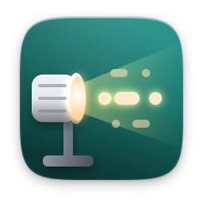 | [Mors Kodu](morse/) | 1.1.0 | Mors kodunu çevir, çal ve pratik yap |
| 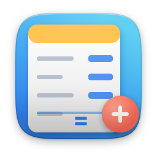 | [Hesap Defteri](numbook/) | 1.0 | Hesap yapan not defteri |
| 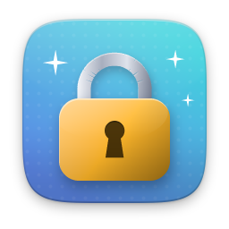 | [Şifre Üretici](passgen/) | 1.1.0 | Güçlü şifreler, akılda kalan parolalar |
| 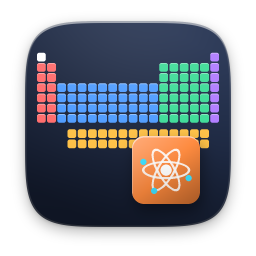 | [Periyodik Tablo](periodic/) | 1.1.0 | 118 elementin hepsi bir dokunuş uzakta |
| 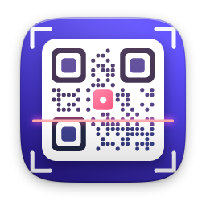 | [QR Kod](qrcode/) | 1.1.0 | Metin, bağlantı ve Wi-Fi için QR kod |
| 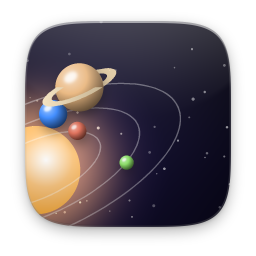 | [Güneş Sistemi](solar/) | 1.1.0 | Gezegenler bugünden itibaren hareket hâlinde |
| 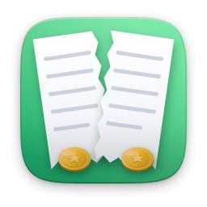 | [Hesap Bölüş](splitbill/) | 1.1.0 | Hesabı ürün ürün, hakkaniyetle böl |
| 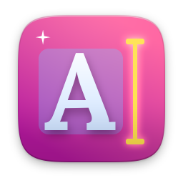 | [Metin Araçları](texttools/) | 1.1.0 | Harf düzelt, metni topla, kelime say |
| 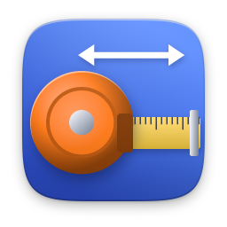 | [Birim Dönüştürücü](unitconv/) | 1.1.0 | Uzunluk, kütle, sıcaklık, veri ve fazlası |
