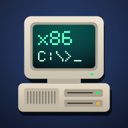
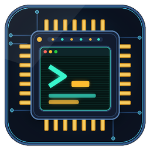

# Beta

[Türkçe](README.tr.md)

In-development apps, games and emulators tested via `Store/beta.json`. Promote one to the public store with `python Tools/build_store.py --release <slug>`.

| | Item | Version | Description |
|---|---|---|---|
|  | [Bochs x86 PC](Emulators/pc/bochs/) | 3.1.0 | Full-system x86 & x86-64 PC emulator |
|  | [RA2 Yuri Port](Ports/redalert2/) | 1.0.0 | Command & Conquer: Red Alert 2 port |
|  | [TinyEMU](Emulators/pc/tinyemu/) | 1.0.0 | RISC-V 32/64/128 system & Linux VM emulator |
