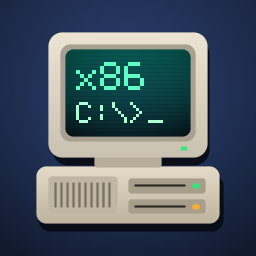
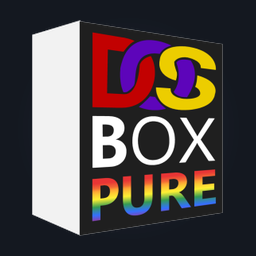
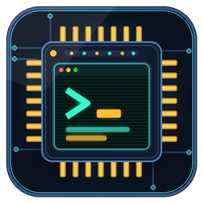

# Beta

In-development apps, games and emulators tested via `Store/beta.json`. Promote one to the public store with `python Tools/build_store.py --release <slug>`.

| | Item | Version | Description |
|---|---|---|---|
|  | [Bochs x86 PC](Emulators/pc/bochs/) | 3.3.0 | x86/x64 PC Emulator · Port by sonerx7 |
|  | [DOSBox](Emulators/pc/dosbox/) | 1.0.1 | MS-DOS PC emulator for games and software |
|  | [Port Market](Apps/utilities/port-market/) | 0.2.1 | Your Nexvyn OS port library |
|  | [RA2 Yuri Port](Ports/strategy/redalert2/) | 1.2.0 | Yuri's Revenge: native RTS beta |
|  | [TinyEMU](Emulators/pc/tinyemu/) | 1.0.0 | RISC-V 32/64/128 system & Linux VM emulator |
