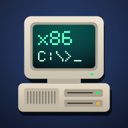
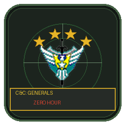
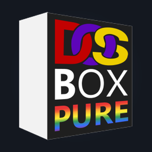
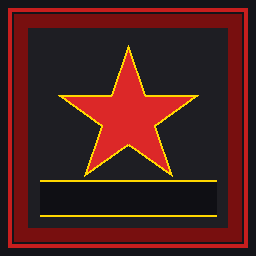
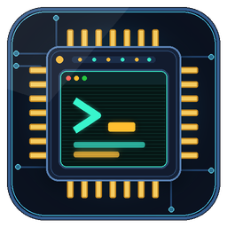

# Beta (Geliştirme Aşaması)

[English](README.md)

Geliştirme aşamasındaki uygulamalar, oyunlar ve emülatörler (`Store/beta.json`). Yayına almak için: `python Tools/build_store.py --release <slug>`.

| | Öğe | Sürüm | Açıklama |
|---|---|---|---|
|  | [Bochs x86 PC](Emulators/pc/bochs/) | 3.1.0 | Tam donanım x86 ve x86-64 PC emülatörü |
|  | [C&C Generals: Zero Hour](Ports/cncgenerals/) | 1.0.4 | Command & Conquer: Generals portu |
|  | [DOSBox](Emulators/pc/dosbox/) | 1.0.0 | Oyun ve yazılımlar için MS-DOS emülatörü |
|  | [RA2 Yuri Port](Ports/redalert2/) | 1.0.0 | Command & Conquer: Red Alert 2 portu |
|  | [TinyEMU](Emulators/pc/tinyemu/) | 1.0.0 | RISC-V 32/64/128 sistem ve Linux VM emülatörü |
