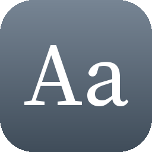

# Fonts

[English](README.md)

| | Öğe | Sürüm | Açıklama |
|---|---|---|---|
|  | [Bebas Neue](bebas-neue/) | 2.000 | Başlıklar için uzun, kalın büyük harfler |
|  | [Caveat](caveat/) | 2.000 | Notlar için canlı bir el yazısı |
|  | [Fira Code](fira-code/) | 5.002 | Kod için eş aralıklı bir yazı tipi |
|  | [Lexend](lexend/) | 1.007 | Kolay okumak için tasarlanmış bir sans serif |
|  | [Lora](lora/) | 3.008 | Kaligrafi kökenli çağdaş bir serif |
|  | [Merriweather](merriweather/) | 2.100 | Ekran için tasarlanmış sağlam bir serif |
|  | [Noto Sans JP](noto-sans-jp/) | 2.004 | Japonca yazı tipi paketi (CJK) |
|  | [Noto Sans KR](noto-sans-kr/) | 2.004 | Korece yazı tipi paketi (CJK) |
|  | [Noto Sans SC](noto-sans-sc/) | 2.004 | Basitleştirilmiş Çince yazı tipi paketi (CJK) |
|  | [Nunito](nunito/) | 3.602 | Sıcak, yuvarlak hatlı bir sans serif |
|  | [Poppins](poppins/) | 4.004 | Başlıklar için geometrik bir sans serif |
|  | [Source Serif 4](source-serif/) | 4.004 | Belgeler için klasik bir metin serifi |
