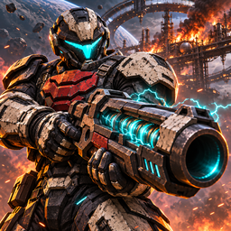
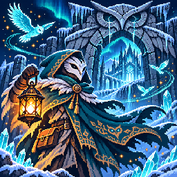
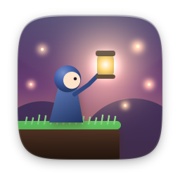
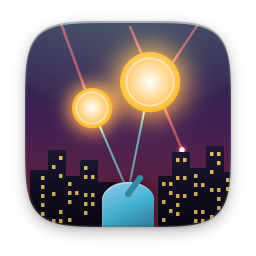
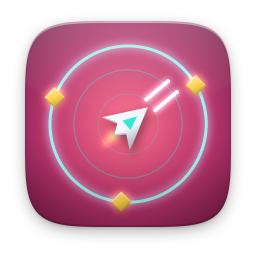
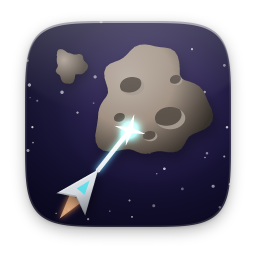
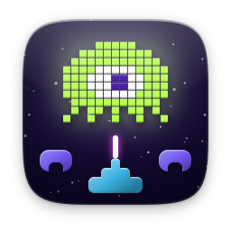
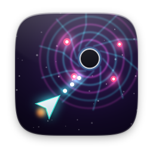

# action

[Türkçe](README.tr.md)

| | Item | Version | Description |
|---|---|---|---|
|  | [Ash Protocol](ash-protocol/) | 1.5.0 | Six chapters. Four weapons. One last order. |
|  | [Frost Lantern](frost-lantern/) | 1.4.0 | Five realms. Thirty boons. A lost dawn. |
|  | [Lanternfall](lanternfall/) | 1.0.0 | Lantern-lit platformer: 3 worlds, 3 bosses |
|  | [Luma: Starfall Islands](luma/) | 1.7.0 | Explore ten worlds. Outsmart eight enemies. |
|  | [Missile Defense](missile/) | 1.1.0 | Six cities, three batteries: hold the sky |
|  | [Orbit Arena](spacearena/) | 1.1.0 | Survive endless waves in a neon arena |
|  | [Road Crosser](froggy/) | 1.1.0 | Cross the road, ride the river, get home |
|  | [Rock Blaster](asteroids/) | 1.1.0 | Blast the rocks, watch your back |
|  | [Star Siege](invaders/) | 1.1.0 | They march. You hold the line |
|  | [Void Delve](voiddelve/) | 1.0.0 | Twin-stick roguelite with relics and bosses |
