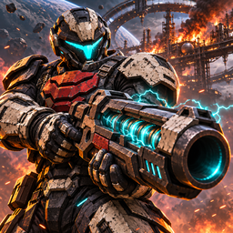
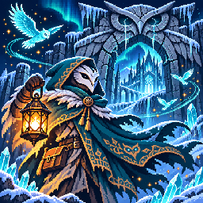
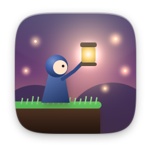
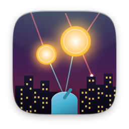
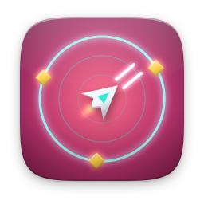
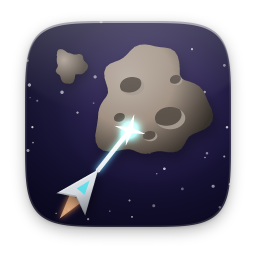
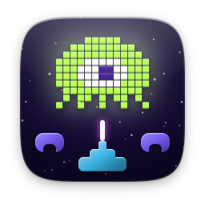
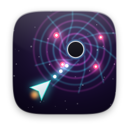

# action

[English](README.md)

| | Öğe | Sürüm | Açıklama |
|---|---|---|---|
|  | [Kül Protokolü](ash-protocol/) | 1.0.1 | Altı bölüm. Dört silah. Son bir emir. |
|  | [Ayaz Feneri](frost-lantern/) | 1.0.0 | Beş bölge. Otuz lütuf. Kayıp bir şafak. |
|  | [Fener Düşüşü](lanternfall/) | 1.0.0 | Fener ışığında platform: 3 dünya, 3 boss |
|  | [Luma: Yıldız Adaları](luma/) | 1.2.0 | On dünyayı keşfet. Sekiz düşmanla savaş. |
|  | [Füze Savunması](missile/) | 1.1.0 | Altı şehir, üç batarya: göğü savun |
|  | [Uzay Arenası](spacearena/) | 1.1.0 | Neon arenada dalga dalga düşmana dayan |
|  | [Yolu Geç](froggy/) | 1.1.0 | Yolu geç, nehri aş, yuvana ulaş |
|  | [Kaya Avcısı](asteroids/) | 1.1.0 | Kayaları patlat, arkanı kolla |
|  | [Yıldız Kuşatması](invaders/) | 1.1.0 | Onlar ilerler, sen hattı tutarsın |
|  | [Boşluk Dalışı](voiddelve/) | 1.0.0 | Kalıntılı, bosslu çift çubuklu roguelite |
