# arcade

[Türkçe](README.tr.md)

| | Item | Version | Description |
|---|---|---|---|
| 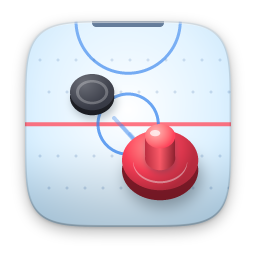 | [Air Hockey](airhockey/) | 1.1.0 | Fast table hockey, solo or with a friend |
| 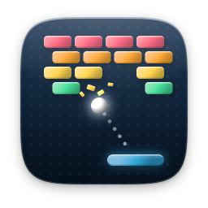 | [Brick Smash](breakout/) | 1.1.0 | 15 stages, bombs, lasers and fireballs |
| 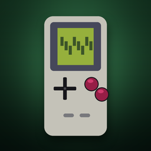 | [Game Boy (Gambatte)](gambatte/) | 1.0.0 | Game Boy emulator |
| 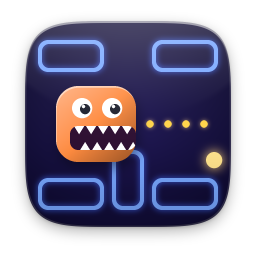 | [Maze Eater](mazeeater/) | 1.1.0 | Four mazes, three ghosts, one appetite |
| 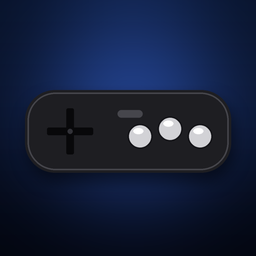 | [Mega Drive (Genesis Plus GX)](genesis-plus-gx/) | 1.0.0 | Mega Drive emulator |
| 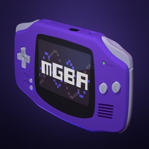 | [mGBA](mgba/) | 0.11.0 | Game Boy Advance emulator |
| 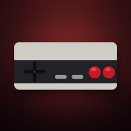 | [NES (FCEUmm)](fceumm/) | 1.0.0 | NES emulator |
| 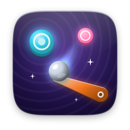 | [Pinball](pinball/) | 1.1.0 | Flippers, bumpers and a real plunger |
| 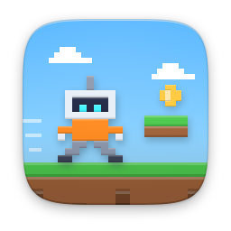 | [Pixel Run](pixelrun/) | 1.1.0 | Run, jump and stomp through three worlds |
| 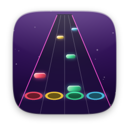 | [Rhythm](rhythm/) | 1.1.0 | Hit the notes and play the song yourself |
| 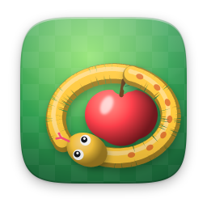 | [Snake](snake/) | 1.1.0 | Four modes, maze stages and medals |
| 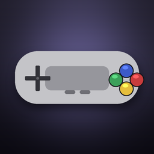 | [SNES (Snes9x)](snes9x/) | 1.0.0 | SNES emulator |
