# arcade

[English](README.md)

| | Öğe | Sürüm | Açıklama |
|---|---|---|---|
| 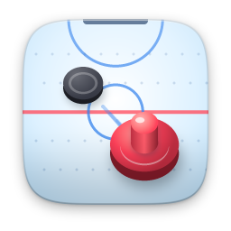 | [Hava Hokeyi](airhockey/) | 1.0.1 | Hızlı masa hokeyi, tek başına ya da ikili |
| 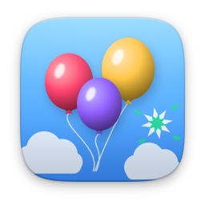 | [Balon Patlat](balloons/) | 1.0.1 | Balonları patlat, bombalara dokunma |
| 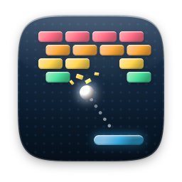 | [Tuğla Kır](breakout/) | 1.0.1 | Tuğlaları kır, güçlendirmeleri yakala |
| 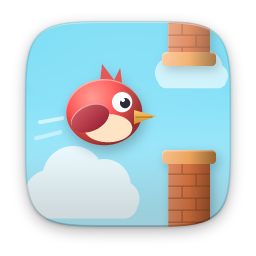 | [Kanatlı Kuş](flappy/) | 1.0.1 | Boruların arasından uç, madalya kazan |
| 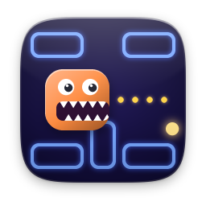 | [Labirent Yiyici](mazeeater/) | 1.0.1 | Yemleri ye, hayaletleri atlat |
| 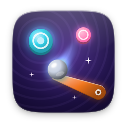 | [Langırt](pinball/) | 1.0.1 | Paletler, tamponlar ve gerçek bir fırlatıcı |
| 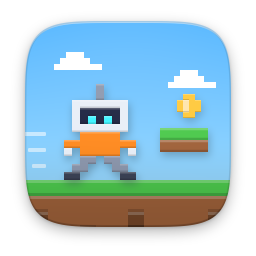 | [Pixel Koşu](pixelrun/) | 1.0.1 | Üç dünyada koş, zıpla, düşmanları ez |
| 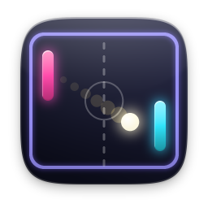 | [Pong](pong/) | 1.0.1 | Bilgisayara ya da arkadaşına karşı 7 sayı |
| 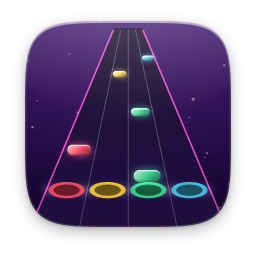 | [Ritim](rhythm/) | 1.0.1 | Notaları yakala, şarkıyı sen çal |
| 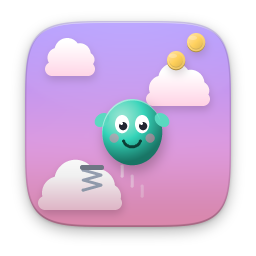 | [Zıpla Zıpla](jumper/) | 1.0.1 | Zıpla, yüksel, uzaya kadar tırman |
| 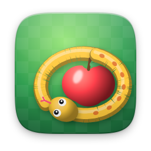 | [Yılan](snake/) | 1.0.1 | Ye, uza, sakın kendini ısırma |
| 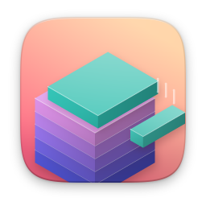 | [Kule Kur](stack/) | 1.0.1 | Bloğu tam zamanında bırak, kuleyi yükselt |
| 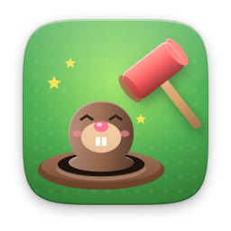 | [Köstebek Vur](whack/) | 1.0.1 | Köstebekleri vur, zamana karşı yarış |
