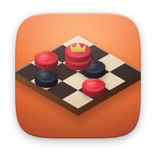
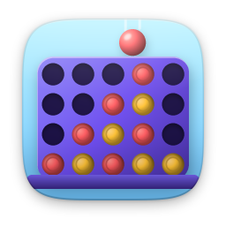
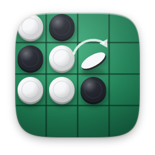

# board

[English](README.md)

| | Öğe | Sürüm | Açıklama |
|---|---|---|---|
|  | [Dama](checkers/) | 1.1.0 | Atla, taş al, damana kavuş |
|  | [Dört Bağla](connect4/) | 1.1.0 | Pulları bırak, dördünü yan yana getir |
|  | [Reversi](reversi/) | 1.1.0 | Taşları çevir, tahtayı ele geçir |
