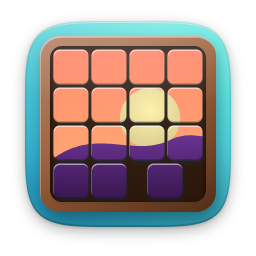
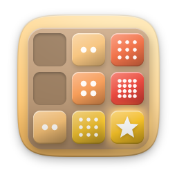
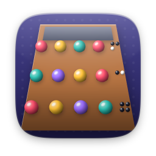
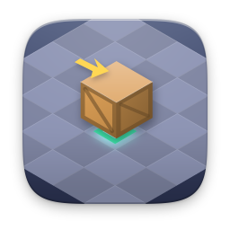
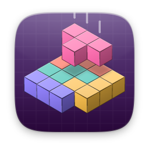
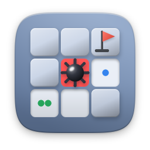
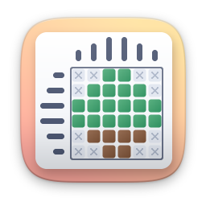
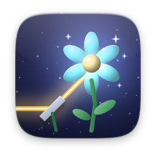
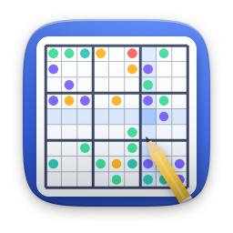

# puzzle

[Türkçe](README.tr.md)

| | Item | Version | Description |
|---|---|---|---|
|  | [15 Puzzle](fifteen/) | 1.1.0 | Slide the tiles back into order |
|  | [2048](g2048/) | 1.1.0 | Four boards, Time Attack, smart hints |
|  | [Code Breaker](mastermind/) | 1.1.0 | Crack the secret colour code in 10 tries |
|  | [Crate Pusher](sokoban/) | 1.1.0 | 40 levels of crate-pushing logic |
|  | [Falling Blocks](blocks/) | 1.1.0 | Marathon, Sprint, Ultra and Dig modes |
|  | [Lights Out](lightsout/) | 1.1.0 | Turn off every light in the fewest moves |
|  | [Memory Cards](memory/) | 1.1.0 | Flip the cards and find all the pairs |
|  | [Mine Field](minesweeper/) | 1.1.0 | Custom boards, stats and win streaks |
|  | [Nonogram](nonogram/) | 1.1.0 | Fill the grid and reveal a hidden picture |
|  | [Photon Garden](photongarden/) | 1.0.0 | 120 light-bending puzzles and a level editor |
|  | [Sudoku](sudoku/) | 1.1.0 | Four levels, a daily puzzle, streaks |
|  | [Water Sort](watersort/) | 1.1.0 | Pour until every tube holds one colour |
