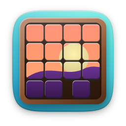
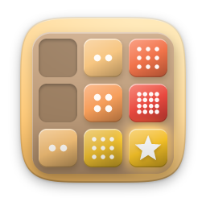
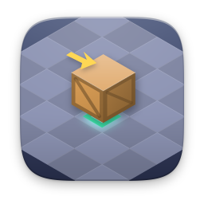
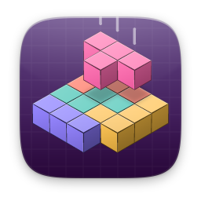
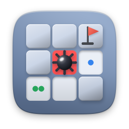
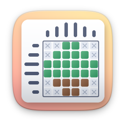
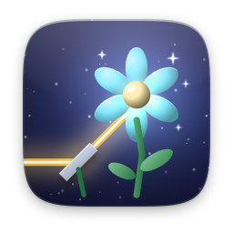
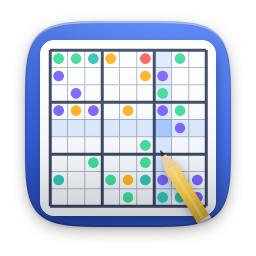

# puzzle

[English](README.md)

| | Öğe | Sürüm | Açıklama |
|---|---|---|---|
|  | [15 Bulmaca](fifteen/) | 1.1.0 | Karoları kaydır, sayıları sıraya diz |
|  | [2048](g2048/) | 1.1.0 | Dört tahta, Zamana Karşı, akıllı ipucu |
|  | [Şifre Kır](mastermind/) | 1.1.0 | Gizli renk şifresini 10 denemede kır |
|  | [Kutu İtme](sokoban/) | 1.1.0 | 40 bölümlük kutu itme bulmacası |
|  | [Blok Düşür](blocks/) | 1.1.0 | Maraton, Sprint, Ultra ve Kazı modları |
|  | [Işıkları Söndür](lightsout/) | 1.1.0 | Bütün ışıkları en az hamleyle söndür |
|  | [Hafıza Kartları](memory/) | 1.1.0 | Kartları çevir, bütün eşleri bul |
|  | [Mayın Tarlası](minesweeper/) | 1.1.0 | Özel tahtalar, istatistik ve seriler |
|  | [Resim Bulmaca](nonogram/) | 1.1.0 | Kareleri boya, gizli resmi ortaya çıkar |
|  | [Foton Bahçesi](photongarden/) | 1.0.0 | 120 ışık bükme bulmacası ve bölüm düzenleyici |
|  | [Sudoku](sudoku/) | 1.1.0 | Dört zorluk, günlük bulmaca, seriler |
|  | [Su Sıralama](watersort/) | 1.1.0 | Her tüpte tek renk kalana dek dök |
