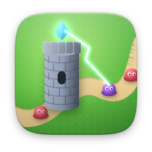

# strategy

| | Item | Version | Description |
|---|---|---|---|
|  | [Banners of Aldmoor](aldmoor/) | 1.0.0 | Turn-based tactics: an eight-battle campaign |
|  | [Tank Duel](tanks/) | 1.1.0 | Turn-based artillery on destructible land |
|  | [Tower Defense](towerdefense/) | 1.1.0 | Three maps, 15 waves, then Endless |
