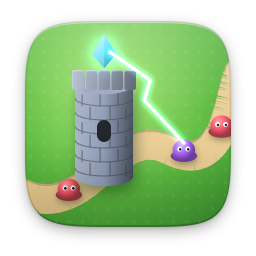

# strategy

[English](README.md)

| | Öğe | Sürüm | Açıklama |
|---|---|---|---|
|  | [Aldmoor Sancakları](aldmoor/) | 1.0.0 | Sıra tabanlı taktik: sekiz savaşlık sefer |
|  | [Tank Düellosu](tanks/) | 1.1.0 | Yıkılabilir arazide sıra tabanlı topçu |
|  | [Kule Savunması](towerdefense/) | 1.1.0 | Üç harita, 15 dalga, sonra Sonsuz |
