# Nexvyn OS App Market (Uygulama Mağazası)

[English](README.md)

Bu sayfa `Tools/build_store.py` ile üretilir. Toplam **168** öğe. Konsoldaki App Market `Store/catalog.json` dosyasını okur; buradaki her şey yayımlanmadan önce incelendi. Kendi işinizi yayımlamak için: [SDK/Publishing](../SDK/Publishing/README.tr.md).

## Verimlilik (23)

| | Ad | Açıklama |
|---|---|---|
|  | [AI Sohbet](Apps/productivity/aichat/) · Nexvyn OS ile gelir | Claude, Gemini ve GPT artık Switch'inde |
|  | [Doğum Günleri](Apps/productivity/birthdays/) | Hiçbir doğum gününü kaçırma |
|  | [Nefes](Apps/productivity/breathe/) | Rehberli nefesle sakinleş |
|  | [Bütçe](Apps/productivity/budget/) | Paranın nereye gittiğini her ay gör |
|  | [Kişiler](Apps/productivity/contacts/) · Nexvyn OS ile gelir | vCard destekli adres defterin |
|  | [Sınav Geri Sayımı](Apps/productivity/examcount/) | Sınavlara geri say, her gün çalış |
|  | [Kelime Kartları](Apps/productivity/flashcards/) | Aralıklı tekrarla daha kalıcı öğren |
|  | [Alışkanlıklar](Apps/productivity/habits/) | İyi alışkanlıkları gün gün kazan |
|  | [Aralıklı Zamanlayıcı](Apps/productivity/interval/) | Her antrenman için HIIT ve Tabata sayacı |
|  | [Günlük](Apps/productivity/journal/) | Her gün birkaç satır, bir ruh hali, bir anı |
|  | [Görev Panosu](Apps/productivity/kanban/) | Görevlerini sürükle-bırak panolarda düzenle |
|  | [Ruh Hali Günlüğü](Apps/productivity/mood/) | Nasıl hissettiğini gün gün gör |
|  | [Pomodoro](Apps/productivity/pomodoro/) | Odaklanarak çalış, aralarda dinlen |
|  | [Sunum](Apps/productivity/slides/) · Nexvyn OS ile gelir | Şık sunumlar hazırla ve sun |
|  | [Okuma Listesi](Apps/productivity/reading/) | Kitaplarını, sayfalarını ve hedefini izle |
|  | [Alışveriş Listesi](Apps/productivity/shopping/) | Reyonlara göre sıralı, hızlı alışveriş |
|  | [Uyku Takibi](Apps/productivity/sleep/) | Gecelerini kaydet, uyku hedefine ulaş |
|  | [Hesap Tablosu](Apps/productivity/sheets/) · Nexvyn OS ile gelir | Formüller, grafikler ve Excel dosyaları |
|  | [Yapışkan Notlar](Apps/productivity/stickies/) · Nexvyn OS ile gelir | Masaüstünde kalan renkli notlar |
|  | [Yapılacaklar](Apps/productivity/todo/) | Görevler, projeler ve tarihler tek yerde |
|  | [Klavye Ustası](Apps/productivity/typing/) | On parmak klavyeyi sıra sıra öğren |
|  | [Su Takibi](Apps/productivity/water/) | Suyunu takip et, günlük hedefe ulaş |
|  | [Kelime İşlemci](Apps/productivity/writer/) · Nexvyn OS ile gelir | Word uyumlu kelime işlemci |

## Araçlar (31)

| | Ad | Açıklama |
|---|---|---|
|  | [3D Yüzey](Apps/utilities/graph3d/) | z = f(x, y) fonksiyonlarını 3D çiz |
|  | [Otomasyon](Apps/utilities/automation/) · Nexvyn OS ile gelir | Tek dokunuşla rutinler, akıllı tetikler |
|  | [Vücut Kitle İndeksi](Apps/utilities/bmi/) | VKİ'n, sağlıklı aralığın ve gidişatın |
|  | [Renk Dönüştürücü](Apps/utilities/colorconv/) | HEX, RGB, HSL, HSV ve CMYK eşzamanlı |
|  | [Renk Ölçer](Apps/utilities/colorpicker/) · Nexvyn OS ile gelir | Ekrandaki her rengi yakala, kodunu kopyala |
|  | [Renk Paleti](Apps/utilities/palette/) | Tek renkten uyumlu renk paletleri |
|  | [Kontrolcü Testi](Apps/utilities/gamepad/) · Nexvyn OS ile gelir | Tuşları, çubukları ve titreşimi test et |
|  | [Geri Sayım](Apps/utilities/countdown/) | Beklediğin günlere canlı geri sayım |
|  | [Tarih Hesaplayıcı](Apps/utilities/datecalc/) | Tarih farkı, gün ekleme ve fazlası |
|  | [Karar Çarkı](Apps/utilities/wheel/) | Karar veremiyor musun? Çarkı çevir |
|  | [Zar ve Yazı Tura](Apps/utilities/dice/) | d4'ten d20'ye zar at ya da yazı tura |
|  | [Finans Hesaplayıcı](Apps/utilities/finance/) | Kredi, birikim, yüzde ve KDV hesapları |
|  | [Yazı Tipleri](Apps/utilities/fontbook/) · Nexvyn OS ile gelir | Yazı tiplerini önizle, incele ve yükle |
|  | [Yakıt Hesaplayıcı](Apps/utilities/fuel/) | Yakıt tüketimi, yol masrafı ve depo kaydı |
|  | [Dünya Küresi](Apps/utilities/globe/) | Gece ve gündüzü canlı 3D Dünya |
|  | [Grafik Çizici](Apps/utilities/graph/) | Fonksiyon çiz, kökleri ve kesişimleri bul |
|  | [Kredi Hesapla](Apps/utilities/loancalc/) | Borçlanmadan önce taksitini bil |
|  | [Ay Evresi](Apps/utilities/moon/) | Bu gecenin Ay'ı ve tüm evreleri |
|  | [Mors Kodu](Apps/utilities/morse/) | Mors kodunu çevir, çal ve pratik yap |
|  | [Şifre Üretici](Apps/utilities/passgen/) | Güçlü şifreler, akılda kalan parolalar |
|  | [Yüzde Hesaplayıcı](Apps/utilities/percent/) | Beş yüzde hesaplayıcısı tek pencerede |
|  | [Periyodik Tablo](Apps/utilities/periodic/) | 118 elementin hepsi bir dokunuş uzakta |
|  | [QR Kod](Apps/utilities/qrcode/) | Metin, bağlantı ve Wi-Fi için QR kod |
|  | [Romen Rakamları](Apps/utilities/roman/) | Romen rakamlarını çevir, öğren, sına |
|  | [Güneş Sistemi](Apps/utilities/solar/) | Gezegenler bugünden itibaren hareket hâlinde |
|  | [Hesap Bölüş](Apps/utilities/splitbill/) | Hesabı ürün ürün, hakkaniyetle böl |
|  | [Sayaç](Apps/utilities/tally/) | İsimli sayaçlarla her şeyi say |
|  | [Metin Araçları](Apps/utilities/texttools/) | Harf düzelt, metni topla, kelime say |
|  | [Bahşiş Hesapla](Apps/utilities/tipcalc/) | Bahşiş, toplam ve kişi başı pay |
|  | [Birim Dönüştürücü](Apps/utilities/unitconv/) | Uzunluk, kütle, sıcaklık, veri ve fazlası |
|  | [Dünya Saatleri](Apps/utilities/worldclock/) | Dünyada saat kaç, ne zaman buluşmalı |

## Medya (17)

| | Ad | Açıklama |
|---|---|---|
| 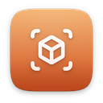 | [3D Modelleme](Apps/media/modeler/) · Nexvyn OS ile gelir | Low-poly 3D modelleme, OBJ ve STL |
| 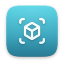 | [3D Görüntüleyici](Apps/media/viewer3d/) | OBJ ve STL modellerini döndür, incele |
| 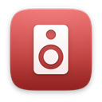 | [Ritim Makinesi](Apps/media/drums/) | 16 adımlı ızgarada ritim programla |
| 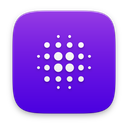 | [Fraktal Gezgini](Apps/media/mandelbrot/) | Mandelbrot ve Julia'nın derinliklerine dal |
| 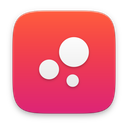 | [Lav Lambası](Apps/media/lavalamp/) | Süzülen ışıltılı damlalarla rahatla |
|  | [Canlı TV](Apps/media/iptv/) · Nexvyn OS ile gelir | Ücretsiz TV kanalları ve M3U listelerin |
|  | [Melodi Stüdyosu](Apps/media/sequencer/) | Piyano rulosunda melodi besteleyin |
| 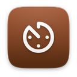 | [Metronom](Apps/media/metronome/) | Sallanan sarkaçla tempoyu hiç kaçırma |
| 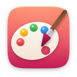 | [Çizim](Apps/media/paint/) · Nexvyn OS ile gelir | Çiz, karala, resim düzenle |
| 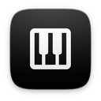 | [Piyano](Apps/media/piano/) | Çal, kaydet, örnek şarkılarla öğren |
| 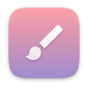 | [Piksel Sanatı](Apps/media/pixelart/) | Retro karakterler çiz, PNG olarak kaydet |
| 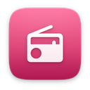 | [Radyo](Apps/media/radio/) · Nexvyn OS ile gelir | Dünyadan binlerce canlı radyo istasyonu |
| 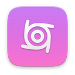 | [Spirograf](Apps/media/spirograph/) | Dönen çarklarla büyüleyici desenler çiz |
|  | [Ton Üretici](Apps/media/tonegen/) | 20 Hz'den 20 kHz'e test tonları ve taramalar |
| 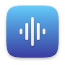 | [Beyaz Gürültü](Apps/media/noise/) | Uykuya dalmak için yağmur, dalga, gürültü |
| 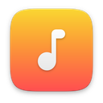 | [Ksilofon](Apps/media/xylophone/) | Renkli tuşlara vur, şarkıları öğren |
|  | [YousTube](Apps/media/tube/) · Nexvyn OS ile gelir | YouTube videoları, Shorts ve kanallar |

## İnternet (6)

| | Ad | Açıklama |
|---|---|---|
| 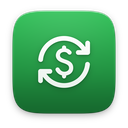 | [Döviz](Apps/internet/currency/) · Nexvyn OS ile gelir | 36 para birimi için canlı döviz kurları |
|  | [Sözlük](Apps/internet/dictionary/) · Nexvyn OS ile gelir | TDK Türkçe ve İngilizce sözlük bir arada |
| 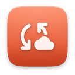 | [FTP İstemcisi](Apps/internet/ftp/) · Nexvyn OS ile gelir | FileZilla tarzı dosya aktarımı |
| 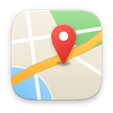 | [Haritalar](Apps/internet/maps/) · Nexvyn OS ile gelir | Aramalı ve iğneli OpenStreetMap |
|  | [Haberler](Apps/internet/news/) · Nexvyn OS ile gelir | RSS ve Atom akışların, şık bir okuyucuda |
| 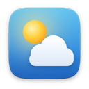 | [Hava Durumu](Apps/internet/weather/) · Nexvyn OS ile gelir | Saatlik ve 10 günlük tahmin, şık görünümle |

## Geliştirici (2)

| | Ad | Açıklama |
|---|---|---|
|  | [Base64 ve Hash](Apps/developer/hashtool/) | Metni kodla, sağlama toplamını doğrula |
|  | [JSON Biçimlendirici](Apps/developer/jsonfmt/) | JSON'u doğrula, biçimlendir, keşfet |

## Sistem (3)

| | Ad | Açıklama |
|---|---|---|
| 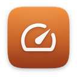 | [Performans Testi](Apps/system/benchmark/) | Konsolunun 3D gücünü sına |
| 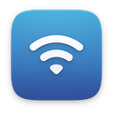 | [Ağ Araçları](Apps/system/network/) · Nexvyn OS ile gelir | DNS sorgu, ping, port tarama ve hız testi |
| 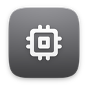 | [Sistem Bilgisi](Apps/system/sysinfo/) · Nexvyn OS ile gelir | Konsolunla ilgili her şey, canlı |

## Switch Araçları (14)

| | Ad | Açıklama |
|---|---|---|
| 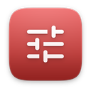 | [Atmosphère Ayarları](Apps/switch/amsconfig/) · Nexvyn OS ile gelir | Atmosphère'in gizli ayarları, açıklamalı |
| 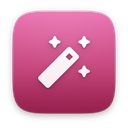 | [Hile Yöneticisi](Apps/switch/cheats/) · Nexvyn OS ile gelir | Atmosphère hilelerini oyun oyun yönet |
| 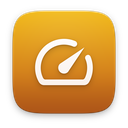 | [Saat Profilleri](Apps/switch/sysclk/) · Nexvyn OS ile gelir | Oyun başına CPU, GPU ve bellek hızları |
| 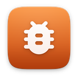 | [Çökme Raporları](Apps/switch/crashlogs/) · Nexvyn OS ile gelir | Bir şey neden çöktü, öğren |
| 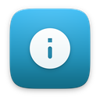 | [Oyun Bilgileri](Apps/switch/gameinfo/) · Nexvyn OS ile gelir | Oyun başına sürüm, build ID ve modlar |
|  | [Homebrew](Apps/switch/homebrew/) · Nexvyn OS ile gelir | Tüm .nro uygulamaların tek başlatıcıda |
| 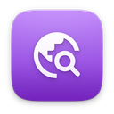 | [Mod Bulucu](Apps/switch/modfinder/) · Nexvyn OS ile gelir | Sahip olduğun oyunlar için GameBanana modları |
| 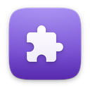 | [Mod Yöneticisi](Apps/switch/modmanager/) · Nexvyn OS ile gelir | Oyun modlarını güvenle kur, aç, kapat |
| 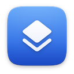 | [Katmanlar](Apps/switch/overlays/) · Nexvyn OS ile gelir | Tesla katmanlarını ve menü tuşlarını yönet |
| 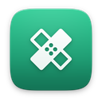 | [Yama Yöneticisi](Apps/switch/exefspatches/) · Nexvyn OS ile gelir | IPS yama setlerini aç, kapat |
| 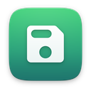 | [Kayıt Yedekleme](Apps/switch/savebackup/) · Nexvyn OS ile gelir | Oyun kayıtlarını yedekle, geri yükle |
| 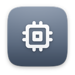 | [Sistem Modülleri](Apps/switch/sysmodules/) · Nexvyn OS ile gelir | Arka plan sistem modüllerini gör, yönet |
| 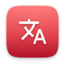 | [Türkçe Yamalar](Apps/switch/turkish-patches/) · Nexvyn OS ile gelir | Oyunlarını Türkçe oynat, yamaları kolayca kur |
| 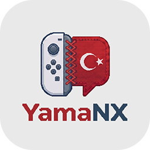 | [YamaNX](Apps/switch/yamanx/) · Nexvyn OS ile gelir | Switch oyunların için Türkçe yamalar |

## Diğer (6)

| | Ad | Açıklama |
|---|---|---|
|  | [Başkentler](Apps/other/capitals/) | 150 ülkenin başkentini öğren |
|  | [Hayat Oyunu](Apps/other/life/) | Hücrelerin doğup ölüşünü izle |
|  | [Matematik Yarışı](Apps/other/mathrace/) | 60 saniyede tam gaz zihinden matematik |
|  | [Asal Sayılar](Apps/other/primes/) | Asalları ele, sarmalda gör, çarpanla |
|  | [Çarpım Tablosu](Apps/other/multiply/) | Çarpım tablosunu öğren, yıldız topla |
|  | [Kaplumbağa Grafikleri](Apps/other/turtle/) | Kaplumbağayla çizerek kodlamayı öğren |

## Oyunlar (46)

| | Ad | Açıklama |
|---|---|---|
|  | [15 Bulmaca](Games/puzzle/fifteen/) | Karoları kaydır, sayıları sıraya diz |
|  | [2048](Games/puzzle/g2048/) | Kaydır, birleştir, 2048'e ulaş |
|  | [3D Labirent](Games/racing/maze3d/) | On labirentte parlayan çıkışı bul |
|  | [Hava Hokeyi](Games/arcade/airhockey/) | Hızlı masa hokeyi, tek başına ya da ikili |
|  | [Asteroitler](Games/action/asteroids/) | Kayaları patlat, arkanı kolla |
|  | [Balon Patlat](Games/arcade/balloons/) | Balonları patlat, bombalara dokunma |
|  | [Bowling](Games/sports/bowling/) | On pinli bowlingde on çerçeve |
|  | [Tuğla Kır](Games/arcade/breakout/) | Tuğlaları kır, güçlendirmeleri yakala |
|  | [Dama](Games/board/checkers/) | Atla, taş al, damana kavuş |
|  | [Şifre Kır](Games/puzzle/mastermind/) | Gizli renk şifresini 10 denemede kır |
|  | [Dört Bağla](Games/board/connect4/) | Pulları bırak, dördünü yan yana getir |
|  | [Blok Düşür](Games/puzzle/blocks/) | Döndür, bırak, satırları temizle |
|  | [Kanatlı Kuş](Games/arcade/flappy/) | Boruların arasından uç, madalya kazan |
|  | [Balık Tut](Games/casual/fishing/) | Oltanı at, makarayı sar, koleksiyonu doldur |
|  | [Adam Asmaca](Games/word/hangman/) | Kelimeyi harf harf tahmin et |
|  | [Işıkları Söndür](Games/puzzle/lightsout/) | Bütün ışıkları en az hamleyle söndür |
|  | [Labirent Yiyici](Games/arcade/mazeeater/) | Yemleri ye, hayaletleri atlat |
|  | [Hafıza Kartları](Games/puzzle/memory/) | Kartları çevir, bütün eşleri bul |
|  | [Meteor Yağmuru](Games/action/meteor/) | Fırtınadan kaç, yıldızları topla |
|  | [Mayın Tarlası](Games/puzzle/minesweeper/) | Tarlayı temizle, her mayına bayrak dik |
|  | [Mini Golf](Games/sports/minigolf/) | Dokuz çukurlu, kuşbakışı mini golf |
|  | [Füze Savunması](Games/action/missile/) | Altı şehir, üç batarya: göğü savun |
|  | [Resim Bulmaca](Games/puzzle/nonogram/) | Kareleri boya, gizli resmi ortaya çıkar |
|  | [Uzay Arenası](Games/action/spacearena/) | Neon arenada dalga dalga düşmana dayan |
|  | [PC Oyunları](Games/platforms/pcgames/) · Nexvyn OS ile gelir | Steam ve PC oyunların Switch'te |
|  | [Langırt](Games/arcade/pinball/) | Paletler, tamponlar ve gerçek bir fırlatıcı |
|  | [Pixel Koşu](Games/arcade/pixelrun/) | Üç dünyada koş, zıpla, düşmanları ez |
|  | [Pong](Games/arcade/pong/) | Bilgisayara ya da arkadaşına karşı 7 sayı |
|  | [Yarışçı](Games/racing/racer/) | Yapay zekâ rakiplere karşı 3 turluk 3B yarış |
| 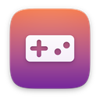 | [Retro](Games/platforms/retro/) · Nexvyn OS ile gelir | NES'ten GBA'ya klasikler, kayıt noktalarıyla |
|  | [Reversi](Games/board/reversi/) | Taşları çevir, tahtayı ele geçir |
|  | [Ritim](Games/arcade/rhythm/) | Notaları yakala, şarkıyı sen çal |
|  | [Yolu Geç](Games/action/froggy/) | Yolu geç, nehri aş, yuvana ulaş |
|  | [Gösteri](Games/showcase/techdemo/) · Nexvyn OS ile gelir | Gerçek zamanlı 3D ve müzik gösterisi |
|  | [Zıpla Zıpla](Games/arcade/jumper/) | Zıpla, yüksel, uzaya kadar tırman |
|  | [Yılan](Games/arcade/snake/) | Ye, uza, sakın kendini ısırma |
|  | [Sokoban](Games/puzzle/sokoban/) | Her kasayı hedefine it |
|  | [Uzay İstilası](Games/action/invaders/) | Onlar yürüyor, sen hattı tut |
|  | [Sudoku](Games/puzzle/sudoku/) | Üç zorlukta, her seferinde yeni bulmaca |
|  | [Tank Düellosu](Games/strategy/tanks/) | Yıkılabilir arazide sıra tabanlı topçu |
|  | [XOX](Games/board/tictactoe/) | Üçünü yan yana diz, tek ya da ikili |
| 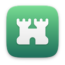 | [Kule Savunması](Games/strategy/towerdefense/) | Kule kur, geliştir, 15 dalgaya dayan |
|  | [Kule Kur](Games/arcade/stack/) | Bloğu tam zamanında bırak, kuleyi yükselt |
|  | [Su Sıralama](Games/puzzle/watersort/) | Her tüpte tek renk kalana dek dök |
|  | [Köstebek Vur](Games/arcade/whack/) | Köstebekleri vur, zamana karşı yarış |
|  | [Kelime Bul](Games/word/turkish-words/) | Beş harfli kelimeyi altı denemede bul |

## Temalar (8)

| | Ad | Açıklama |
|---|---|---|
| 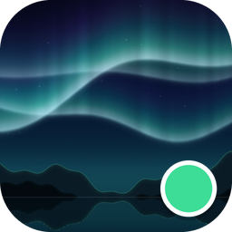 | [Kutup Işıkları](Themes/aurora/) | Durgun gölde kuzey ışıkları |
| 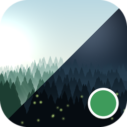 | [Orman](Themes/forest/) | Şafakta sisli çamlar, gece ateş böcekleri |
| 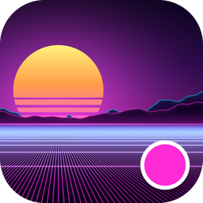 | [Gece Yarısı Neonu](Themes/midnight-neon/) | Neon ızgara üzerinde synthwave güneşi |
| 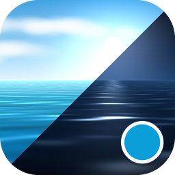 | [Okyanus](Themes/ocean/) | Gündüz güneşli, gece ay ışıklı deniz |
| 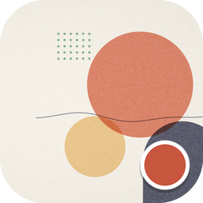 | [Kâğıt](Themes/paper/) | Baskı şekilli sade açık görünüm |
| 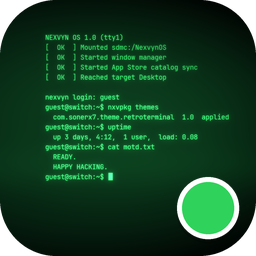 | [Retro Terminal](Themes/retro-terminal/) | 8 bit sesli yeşil fosfor CRT |
| 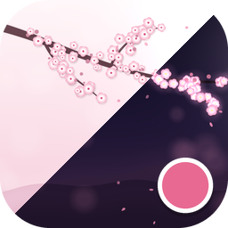 | [Sakura](Themes/sakura/) | Gündüz ve gece kiraz çiçekleri |
| 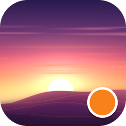 | [Gün Batımı](Themes/sunset/) | Tepelerin üzerinde altın saat |

## Yazı Tipleri (12)

| | Ad | Açıklama |
|---|---|---|
|  | [Bebas Neue](Fonts/bebas-neue/) | Başlıklar için uzun, kalın büyük harfler |
|  | [Caveat](Fonts/caveat/) | Notlar için canlı bir el yazısı |
|  | [Fira Code](Fonts/fira-code/) | Kod için eş aralıklı bir yazı tipi |
|  | [Lexend](Fonts/lexend/) | Kolay okumak için tasarlanmış bir sans serif |
|  | [Lora](Fonts/lora/) | Kaligrafi kökenli çağdaş bir serif |
|  | [Merriweather](Fonts/merriweather/) | Ekran için tasarlanmış sağlam bir serif |
|  | [Noto Sans JP](Fonts/noto-sans-jp/) | Japonca yazı tipi paketi (CJK) |
|  | [Noto Sans KR](Fonts/noto-sans-kr/) | Korece yazı tipi paketi (CJK) |
|  | [Noto Sans SC](Fonts/noto-sans-sc/) | Basitleştirilmiş Çince yazı tipi paketi (CJK) |
|  | [Nunito](Fonts/nunito/) | Sıcak, yuvarlak hatlı bir sans serif |
|  | [Poppins](Fonts/poppins/) | Başlıklar için geometrik bir sans serif |
|  | [Source Serif 4](Fonts/source-serif/) | Belgeler için klasik bir metin serifi |
