# Themes

[English](README.md)

| | Öğe | Sürüm | Açıklama |
|---|---|---|---|
| 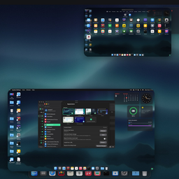 | [Kutup Işıkları](aurora/) | 1.1 | Durgun gölde kuzey ışıkları |
| 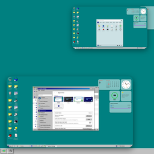 | [Classic](classic-95/) | 1.2 | Gri 90'lar masaüstü, kabartmalı pencere |
| 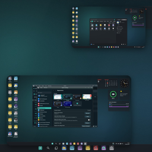 | [Crystal](crystal/) | 1.2 | Yumuşak turkuaz parıltılı koyu cam |
| 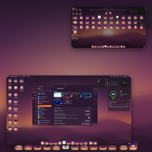 | [Dusk](dusk/) | 1.2 | Sıcak turuncu ve patlıcan moru, açık masaüstü |
| 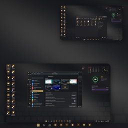 | [Executive](executive/) | 1.2 | Pirinç vurgulu koyu iş cihazı |
| 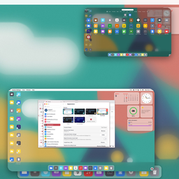 | [Flat Phone](flat-phone/) | 1.2 | Düz, parlak şekiller ve temiz renkler |
| 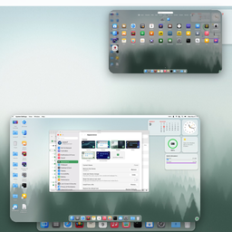 | [Orman](forest/) | 1.1 | Şafakta sisli çamlar, gece ateş böcekleri |
| 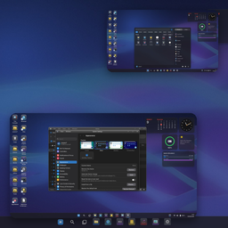 | [Glass](glass/) | 1.2 | Buzlu cam görev çubuğu, serin mavi ışık |
| 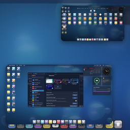 | [Gloss Phone](gloss-phone/) | 1.2 | Yeni bir telefon gibi parlak ve derin |
| 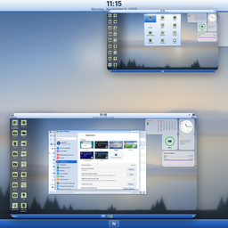 | [Keypad](keypad/) | 1.3 | 2000'lerin tuşlu telefonu |
| 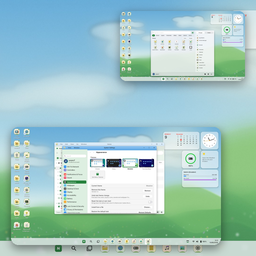 | [Meadow](meadow/) | 1.2 | Parlak mavi ve yeşil, neşeli ve güneşli |
| 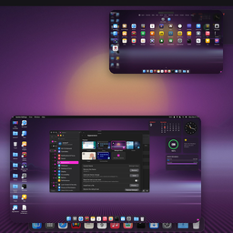 | [Gece Yarısı Neonu](midnight-neon/) | 1.1 | Neon ızgara üzerinde synthwave güneşi |
| 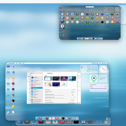 | [Okyanus](ocean/) | 1.1 | Gündüz güneşli, gece ay ışıklı deniz |
| 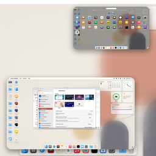 | [Kâğıt](paper/) | 1.1 | Baskı şekilli sade açık görünüm |
| 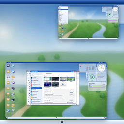 | [Pocket](pocket/) | 1.1 | Pocket PC dönemi: mavi çubuk |
| 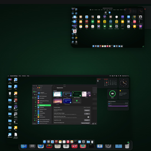 | [Retro Terminal](retro-terminal/) | 1.1 | 8 bit sesli yeşil fosfor CRT |
| 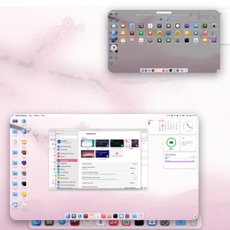 | [Sakura](sakura/) | 1.1 | Gündüz ve gece kiraz çiçekleri |
| 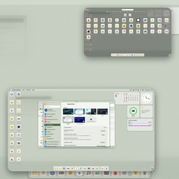 | [Stylus](stylus/) | 1.2 | Sakin gri-yeşil el cihazı, piksel simgeler |
| 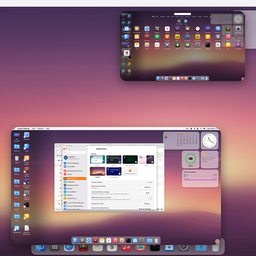 | [Gün Batımı](sunset/) | 1.1 | Tepelerin üzerinde altın saat |
| 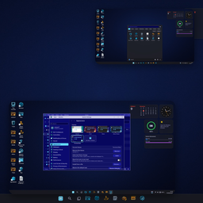 | [Terminal Blue](terminal-blue/) | 1.3 | Mavi ve gri metin modu ekranı |
| 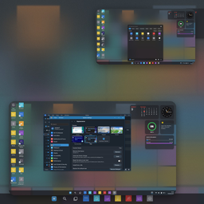 | [Tiles](tiles/) | 1.2 | Cesur düz renkli kareler, sade |
